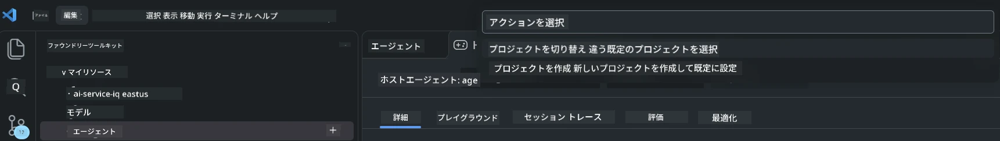

# モジュール 0 - はじめに

⏱️ 約10分

> [!WARNING]
> **プレビューと制限:** [Hosted Agents](https://learn.microsoft.com/azure/foundry/agents/concepts/hosted-agents) は現在<strong>公開プレビュー</strong>です。製品ワークロードでの使用は推奨されません。このワークショップで示される一部の機能は、サービスがGAに向かうにつれて変更される可能性があります。

## 作成するもの

このラボでは、Lab 01の単一エージェントスキルを拡張し、<strong>マルチエージェントワークフロー</strong> - Resume → Job Fit Evaluatorを構築します。

履歴書と職務記述書を貼り付けます。4つの専門エージェントが順番に入力を処理し、次を返します：
- フィットスコア (0～100とスコア内訳)
- スキルと認証のギャップ一覧
- 各ギャップに対するMicrosoft Learnのリンク付き個別学習ロードマップ

**ワークフローで使用するもの：**
- **Microsoft Agent Framework** - 順次パイプライン編成のための`WorkflowBuilder`
- **Foundry Toolkit for VS Code** - スキャフォールド、ローカルテスト、デプロイ
- **AIモデル** (例: `gpt-4.1-mini`) - 4つのエージェントすべてが使用
- **Microsoft Learn MCPサーバー** - 各スキルギャップに対して実際の学習リソースリンクを提供

---

## パスを選択する

> ⚠️ **Lab 01で使用したパスと同じパスで続行してください。**

<details open>
<summary><strong>🅰️ パスA - Azureクラウド (Azureサブスクリプションが必要)</strong></summary>

| | 詳細 |
|---|---|
| <strong>対象者</strong> | Azureサブスクリプションを使ってLab 01を完了した方 |
| <strong>モデル</strong> | Foundry経由のAzure OpenAI (例: `gpt-4.1-mini`) |
| <strong>カバーするモジュール</strong> | すべてのモジュール (00〜09) |
| **クラウドへデプロイしますか？** | ✅ はい - エンドツーエンドでの完全デプロイメント |

</details>

<details open>
<summary><strong>🅱️ パスB - Foundry Local (Azureサブスクリプション不要)</strong></summary>

| | 詳細 |
|---|---|
| <strong>対象者</strong> | Foundry Localを使用してLab 01を完了した方 |
| <strong>モデル</strong> | Foundry Local (無料、あなたのマシン上で動作) |
| <strong>カバーするモジュール</strong> | モジュール00〜05 (06〜07はスキップ - デプロイとクラウド検証) |
| **クラウドへデプロイしますか？** | ❌ いいえ - Agent Inspectorを使ったローカルテストのみ |

</details>

---

## Lab 01の確認

Lab 02はLab 01の内容を直接基にしています。ここを始める前に必ずLab 01を完了してください。

まだLab 01を完了していませんか？こちらから開始してください: [Lab 01 - Introduction](../../lab01-single-agent/docs/00-prerequisites.md)

<details open>
<summary><strong>🅰️ パスA - Azureクラウド</strong></summary>

```powershell
az account show --query "{name:name, id:id}" --output table
```

これが失敗した場合は、`az login` を実行してください。その後VS Codeで次を確認します:

1. `Ctrl+Shift+P` → **Foundry Toolkit** と入力 → コマンドが表示されることを確認。
2. **Foundry Toolkit** アイコンをクリック → プロジェクトとデプロイ済みモデルが **Succeeded** と表示される。



> **RBAC:** Lab 01で **Foundry User** を割り当て済みです。再割り当てが必要な場合は[Lab 01, Module 1](../../lab01-single-agent/docs/01-setup.md#deploy-a-model--assign-rbac)を参照してください。以前の役割名は **Azure AI User** でしたが、権限は同じです。

</details>

<details open>
<summary><strong>🅱️ パスB - Foundry Local</strong></summary>

```powershell
Invoke-WebRequest -Uri "http://localhost:5273/v1/health" -UseBasicParsing | Select-Object StatusCode
```

期待される結果: `StatusCode: 200`。そうでない場合はFoundry ToolkitサイドバーからFoundry Localを再起動してください。

> 推論はすべてあなたのマシン上で行われます。唯一のアウトバウンドコールはMCPツールから`https://learn.microsoft.com/api/mcp`への通信です。

</details>

---

## Lab 02の新要素

| | Lab 01 | Lab 02 |
|--|--------|--------|
| エージェント数 | 1 | 4 (WorkflowBuilderで連結) |
| スキャフォールドテンプレート | 基本 - エージェントフレームワーク | ワークフロー - エージェントフレームワーク |
| 新パッケージ | - | `mcp` |
| オーケストレーション | 単一の会話型エージェント | 逐次パイプライン (WorkflowBuilder) |
| 新しいツール | - | `search_microsoft_learn_for_plan` (MCP) |

---

**次へ:** [01 - アーキテクチャを理解する →](01-understand-multi-agent.md)

---

<!-- CO-OP TRANSLATOR DISCLAIMER START -->
**免責事項**：
本書類は AI 翻訳サービス [Co-op Translator](https://github.com/Azure/co-op-translator) を使用して翻訳されています。正確性を期していますが、自動翻訳には誤りや不正確な部分が含まれる可能性があることをご承知おきください。原文の原語版が正式な情報源とみなされるべきです。重要な情報については、専門の人間による翻訳を推奨します。本翻訳の利用により生じたいかなる誤解や解釈違いについても、当方は責任を負いかねます。
<!-- CO-OP TRANSLATOR DISCLAIMER END -->