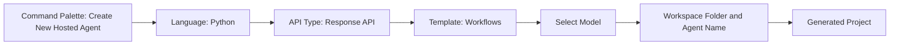
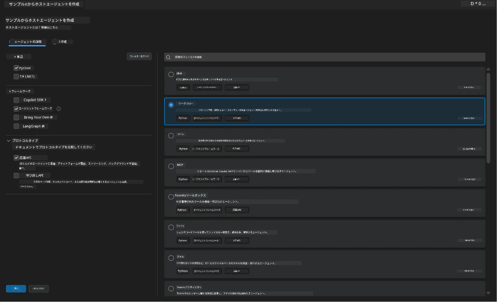
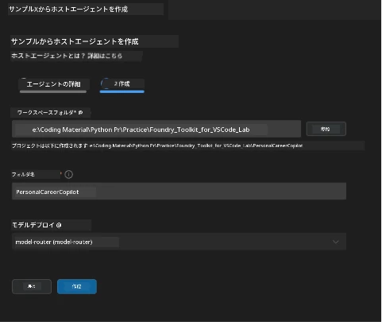

# モジュール 2 - マルチエージェント プロジェクトのスキャフォールド

⏱️ 約5分

このモジュールでは、[Foundry Toolkit for VS Code](https://aka.ms/foundrytk) を使用して **マルチエージェント プロジェクトをスキャフォールド** します。ウィザードは `agent.yaml`、`main.py`、`Dockerfile`、`requirements.txt`、`.env`、および VS Code のデバッグ構成を生成します。これにより、モジュール 3 で 4 エージェントのワークフローの配線に集中できます。

> **重要なコンセプト:** スキャフォールドは 1 つのエージェントを備えた動作するスタブです。モジュール 3 で `WorkflowBuilder` グラフを使ってプレースホルダロジックを置き換えます。ボイラープレートコードを最初から書く必要はありません。

> **リファレンス実装:** [`PersonalCareerCopilot/`](../../../../../workshop/lab02-multi-agent/PersonalCareerCopilot) は完全な動作例です。進行中の作業と比較するために使用してください。

### スキャフォールド ウィザードの流れ



---

## ステップ 1: Create Hosted Agent ウィザードを開く

1. `Ctrl+Shift+P` を押して <strong>コマンドパレット</strong> を開きます。
2. 「**Foundry Toolkit: Create new Hosted Agent**」と入力して選択します。
3. ウィザードが **Agent Details** タブで開きます。

> **代替:** アクティビティバーの **Foundry Toolkit** アイコンをクリック → **Hosted Agents** の横の **+** アイコンをクリック → **Create New Hosted Agent**。

---

## ステップ 2: 設定を選択



1. 左のナビゲーション/オプションセクションで以下を選択します：

| メニュー | 選択 | 備考 |
|--------|-----------|-------|
| **Language** | Python | C# (.NET) もサポート |
| **Framework** | Agent Framework | `Agent`、`AgentExecutor`、`WorkflowBuilder` を提供 |
| **API type** | Response API | `POST /responses` - プラットフォーム管理された履歴、ストリーミングサポート |
| **Template** | **Workflows** | 複数のエージェントを通じて要求を順次処理 |

2. 選択したら **Next** をクリック



3. 次の画面で以下を選択します：

| メニュー | 選択 | 備考 |
|--------|-----------|-------|
| **Workspace folder** | ターゲットフォルダーを参照 | 例：このリポジトリの `workshop/lab02-multi-agent/` |
| **Agent name** | `PersonalCareerCopilot` | これがプロジェクトのディレクトリ名になります |
| **Model Deployment** | デプロイ済みモデルを選択 | 例：Lab 01 の `gpt-4.1-mini` |

4. **Create** をクリックしてプロジェクトをスキャフォールド。VS Code がファイルを生成してフォルダーを開きます。

> **ヒント:** [`gpt-4.1-mini`](https://learn.microsoft.com/azure/foundry/foundry-models/concepts/models-sold-directly-by-azure#gpt-41-series) はマルチエージェント開発において速度と品質のバランスが良いです。

---

## ステップ 3: 生成されたプロジェクトを確認

スキャフォールドが完了したら、エクスプローラーで次のファイルが表示されていることを確認します (`Ctrl+Shift+E`)：

```
📂 <your-agent-name>/
├── .azdignore          ← Files excluded from Azure Developer CLI deployments
├── .dockerignore       ← Files excluded from Docker builds
├── .env                ← Environment variables (placeholders - fill in Module 3)
├── .vscode/
│   ├── launch.json     ← Debug config (F5 → run + Agent Inspector)
│   └── tasks.json      ← VS Code task definitions
├── agent.yaml          ← Agent definition (kind: hosted, protocol: responses)
├── Dockerfile          ← Container config for deployment
├── main.py             ← Stub agent entry point (replace with WorkflowBuilder in Module 3)
└── requirements.txt    ← Python dependencies
```

> **重要:** このスキャフォールドされたフォルダーを直接 VS Code で開いて、`.vscode/launch.json` と `tasks.json` が F5 デバッグに正しく適用されるようにしてください。

### 主要ファイルの説明

| ファイル | 目的 |
|------|---------|
| `agent.yaml` | `kind: hosted` を宣言、環境変数をマップ、`/responses` プロトコルを定義 |
| `main.py` | スタブ：1つの `FoundryChatClient` → `Agent` → `ResponsesHostServer`。モジュール 3 でこれを 4 エージェント + `WorkflowBuilder` に置き換えます |
| `Dockerfile` | `python:3.12-slim`、`requirements.txt` をインストール、ポート 8088 を公開、`python main.py` を実行 |
| `requirements.txt` | `agent-framework-foundry`、`agent-framework-foundry-hosting`、`mcp<2,>=1.24.0`、`debugpy` |

> **参照:** 完全な生成コンテンツについては [`PersonalCareerCopilot/agent.yaml`](../../../../../workshop/lab02-multi-agent/PersonalCareerCopilot/agent.yaml) および [`PersonalCareerCopilot/requirements.txt`](../../../../../workshop/lab02-multi-agent/PersonalCareerCopilot/requirements.txt) を参照してください。

---

### ✅ チェックポイント

- [ ] スキャフォールド ウィザード完了 - 新しいプロジェクトフォルダーがエクスプローラーに表示されている
- [ ] 予想された全ファイルが存在：`agent.yaml`、`main.py`、`Dockerfile`、`requirements.txt`、`.env`
- [ ] `agent.yaml` に `kind: hosted` と `protocol: responses` が表示されている
- [ ] `main.py` が `Agent`、`FoundryChatClient`、`ResponsesHostServer` をインポートしている
- [ ] スキャフォールドしたフォルダーが VS Code ワークスペースのルートとして開いている
- [ ] `main.py` はスタブであることを理解している - `WorkflowBuilder` はモジュール 3 で追加される

---

**前へ:** [01 - マルチエージェント アーキテクチャを理解する](01-understand-multi-agent.md) · **次へ:** [03 - エージェントと環境の設定 →](03-configure-agents.md)

---

<!-- CO-OP TRANSLATOR DISCLAIMER START -->
**免責事項**：
本書類は AI 翻訳サービス [Co-op Translator](https://github.com/Azure/co-op-translator) を使用して翻訳されています。正確性を期していますが、自動翻訳には誤りや不正確な部分が含まれる可能性があることをご承知おきください。原文の原語版が正式な情報源とみなされるべきです。重要な情報については、専門の人間による翻訳を推奨します。本翻訳の利用により生じたいかなる誤解や解釈違いについても、当方は責任を負いかねます。
<!-- CO-OP TRANSLATOR DISCLAIMER END -->