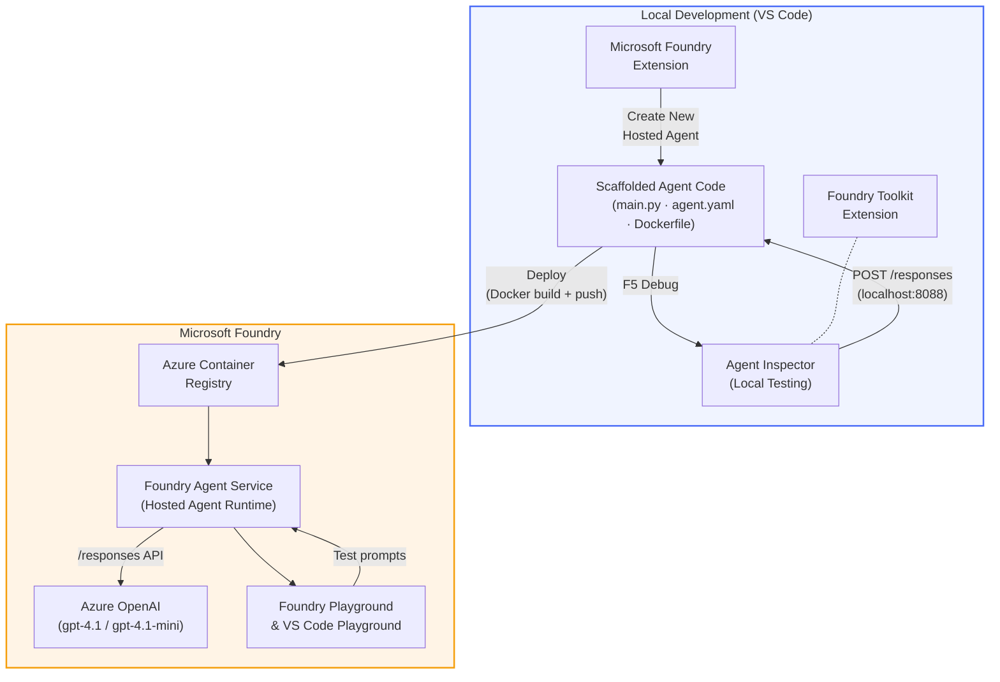

# វគ្គបណ្តុះបណ្តាល Foundry Toolkit + Foundry Hosted Agents

[](https://www.python.org/)
[](https://learn.microsoft.com/agent-framework/)
[](https://learn.microsoft.com/azure/foundry/agents/concepts/hosted-agents)
[](https://ai.azure.com/)
[](https://learn.microsoft.com/azure/ai-services/openai/)
[](https://learn.microsoft.com/cli/azure/install-azure-cli)
[](https://learn.microsoft.com/azure/developer/azure-developer-cli/install-azd)
[](https://www.docker.com/)
[](https://marketplace.visualstudio.com/items?itemName=ms-windows-ai-studio.windows-ai-studio)
[](LICENSE)

បង្កើត សាកល្បង ហើយដាក់បញ្ចូលសហការី AI ទៅកាន់ **Microsoft Foundry Agent Service** ជា **Hosted Agents** - ទាំងអស់ពី VS Code ដោយប្រើ **Microsoft Foundry extension** និង **Foundry Toolkit**។

> **Hosted Agents កំពុងនៅក្នុងការមើលជាមុន។** តំបន់ដែលគាំទ្រមានកំណត់ - សូមមើល [region availability](https://learn.microsoft.com/azure/foundry/agents/concepts/hosted-agents#region-availability)។

> ថត `agent/` ក្នុងនៃរោងចក្រ​រាល់គ្នា​ត្រូវបាន **បង្កើតដោយស្វ័យប្រវត្តិ** ដោយ Foundry extension - បន្ទាប់មកអ្នកប្ដូរកូដ សាកល្បងនៅលើម៉ាស៊ីនផ្ទាល់ខ្លួន ហើយដាក់បញ្ចូល។

### 🌐 ការគាំទ្រ ភាសាច្រើន

#### គាំទ្រដោយ GitHub Action (ស្វ័យប្រវត្តិ និងតែងតែធ្វើបច្ចុប្បន្នភាព)

<!-- CO-OP TRANSLATOR LANGUAGES TABLE START -->
[Arabic](../ar/README.md) | [Bengali](../bn/README.md) | [Bulgarian](../bg/README.md) | [Burmese (Myanmar)](../my/README.md) | [Chinese (Simplified)](../zh-CN/README.md) | [Chinese (Traditional, Hong Kong)](../zh-HK/README.md) | [Chinese (Traditional, Macau)](../zh-MO/README.md) | [Chinese (Traditional, Taiwan)](../zh-TW/README.md) | [Croatian](../hr/README.md) | [Czech](../cs/README.md) | [Danish](../da/README.md) | [Dutch](../nl/README.md) | [Estonian](../et/README.md) | [Finnish](../fi/README.md) | [French](../fr/README.md) | [German](../de/README.md) | [Greek](../el/README.md) | [Hebrew](../he/README.md) | [Hindi](../hi/README.md) | [Hungarian](../hu/README.md) | [Indonesian](../id/README.md) | [Italian](../it/README.md) | [Japanese](../ja/README.md) | [Kannada](../kn/README.md) | [Khmer](./README.md) | [Korean](../ko/README.md) | [Lithuanian](../lt/README.md) | [Malay](../ms/README.md) | [Malayalam](../ml/README.md) | [Marathi](../mr/README.md) | [Nepali](../ne/README.md) | [Nigerian Pidgin](../pcm/README.md) | [Norwegian](../no/README.md) | [Persian (Farsi)](../fa/README.md) | [Polish](../pl/README.md) | [Portuguese (Brazil)](../pt-BR/README.md) | [Portuguese (Portugal)](../pt-PT/README.md) | [Punjabi (Gurmukhi)](../pa/README.md) | [Romanian](../ro/README.md) | [Russian](../ru/README.md) | [Serbian (Cyrillic)](../sr/README.md) | [Slovak](../sk/README.md) | [Slovenian](../sl/README.md) | [Spanish](../es/README.md) | [Swahili](../sw/README.md) | [Swedish](../sv/README.md) | [Tagalog (Filipino)](../tl/README.md) | [Tamil](../ta/README.md) | [Telugu](../te/README.md) | [Thai](../th/README.md) | [Turkish](../tr/README.md) | [Ukrainian](../uk/README.md) | [Urdu](../ur/README.md) | [Vietnamese](../vi/README.md)

> **ចូលចិត្ត Clone នៅក្នុងម៉ាស៊ីនផ្ទាល់ខ្លួនទេ?**
>
> ឃ្លាំងទិន្នន័យនេះរួមបញ្ចូលការប្រែសម្រួលជាភាសា ៥០+ ដែលបង្កើនទំហំទាញយកយ៉ាងច្រើន។ ដើម្បី clone ដោយគ្មានការប្រែសម្រួល សូមប្រើ sparse checkout:
>
> **Bash / macOS / Linux:**
> ```bash
> git clone --filter=blob:none --sparse https://github.com/microsoft-foundry/Foundry_Toolkit_for_VSCode_Lab.git
> cd Foundry_Toolkit_for_VSCode_Lab
> git sparse-checkout set --no-cone '/*' '!translations' '!translated_images'
> ```
>
> **CMD (Windows):**
> ```cmd
> git clone --filter=blob:none --sparse https://github.com/microsoft-foundry/Foundry_Toolkit_for_VSCode_Lab.git
> cd Foundry_Toolkit_for_VSCode_Lab
> git sparse-checkout set --no-cone "/*" "!translations" "!translated_images"
> ```
>
> វា​ផ្តល់​អ្នក​នូវ​គ្រប់​អ្វី​ដែល​ចាំបាច់​ដើម្បី​បញ្ចប់វគ្គ​នេះដោយ​ទិន្នន័យ​ទាញយក​រហ័សជាងមុន។
<!-- CO-OP TRANSLATOR LANGUAGES TABLE END -->

---

## វិធីសាស្រ្តរចនាសម្ព័ន្ធ



**លំហូរ:** សរុប Foundry extension បង្កើតភ្នាក់ងារ → អ្នកប្ដូរកូដ និងបានពណ៌នាការណែនាំ → សាកល្បងក្នុងម៉ាស៊ីនដោយ Agent Inspector → ដាក់បញ្ចូលទៅ Foundry (រូបភាព Docker ត្រូវបាន push ទៅ ACR) → ពិនិត្យឡើងវិញនៅ Playground។

---

## អ្វីដែលអ្នកនឹងបង្កើត

| រោងចក្រ | ពណ៌នា | ស្ថានភាព |
|-----|-------------|--------|
| **រោងចក្រ 01 - ភ្នាក់ងារតែមួយ** | បង្កើត **"Explain Like I'm an Executive" Agent** សាកល្បងក្នុងម៉ាស៊ីន ហើយដាក់បញ្ចូលទៅ Foundry | ✅ មានស្រាប់ |
| **រោងចក្រ 02 - សកម្មភាពភ្នាក់ងារច្រើន** | បង្កើត **"Resume → Job Fit Evaluator"** - ភ្នាក់ងារចំនួន ៤ សហការដើម្បីផ្ទៀងផ្ទាត់ភាពសមនឹងប្រវត្តិការងារ និងបង្កើតផែនការសិក្សា | ✅ មានស្រាប់ |

---

## ជួបភ្នាក់ងារអគ្គនាយក

នៅក្នុងវគ្គបណ្តុះបណ្ដាលនេះ អ្នកនឹងបង្កើត **"Explain Like I'm an Executive" Agent** - ភ្នាក់ងារ AI ត្រូវផ្លាស់ប្តូរជាភាសាបច្ចេកទេសកិនកាត់ទៅជាសេចក្ដីសង្ខេបស្ងប់ស្ងាត់ ប្រកបដោយភាពឆ្លាតបញ្ញាដល់កន្លែងប្រជុំក្រុមប្រឹក្សាភិបាល។ ព្រោះយើងត្រូវតែស្មោះត្រង់ មិនមាននរណានៅក្នុងក្រុម C-suite ចង់ស្ដាប់អំពី "thread pool exhaustion caused by synchronous calls introduced in v3.2."

ខ្ញុំបានបង្កើតភ្នាក់ងារនេះបន្ទាប់ពីមានហេតុការណ៍មួយចំនួនដែលការរបាយការណ៍ការបរាជ័យរបស់ខ្ញុំបានទទួលការឆ្លើយតប៖ *"ហេតុដូចម្តេច... គេហទំព័រត្រូវបានបិទឬទេ?"*

### វាដំណើរការយ៉ាងដូចម្តេច

អ្នកផ្ដល់ការ​អាប់ដេត​បច្ចេកទេសមួយ។ វាចេញមកជាសេចក្ដីសង្ខេបអគ្គនាយក - ចំណុច​ប៊ុលเล็ต​ទីបី ដោយគ្មានពាក្យបច្ចេកទេស ពាក្យបញ្ជុះបញ្ជា ឬភាពបារម្ភអីទេស។ មានតែ **អ្វីដែលកើតឡើង** **ផលប៉ះពាល់អាជីវកម្ម** និង **ជំហាន​បន្ទាប់** ប៉ុណ្ណោះ។

### មើលវា​ធ្វើការ​នៅពេល​មួយ

**អ្នកនិយាយ៖**
> "The API latency increased due to thread pool exhaustion caused by synchronous calls introduced in v3.2."

**ភ្នាក់ងារឆ្លើយតប៖**

> **Executive Summary:**
> - **អ្វីដែលកើតឡើង:** ក្រោយបញ្ចេញថ្មី ប្រព័ន្ធបានយឺតចុះ។
> - **ផលប៉ះពាល់អាជីវកម្ម:** អ្នកប្រើខ្លះបានប្រឈមមុខនឹងការពន្យាពេលពេលប្រើសេវាកម្ម។
> - **ជំហាន​បន្ទាប់:** ការផ្លាស់ប្តូរត្រូវបានត្រឡប់ក្រោយ ហើយមានការរៀបចំដំណោះស្រាយមុនដាក់បញ្ចូលឡើងវិញ។

### ហេតុអ្វីបានជា​ភ្នាក់ងារនេះ?

វាជាភ្នាក់ងារសាមញ្ញម្នាក់ មុខងារតែមួយ - ល្អសម្រាប់រៀនដំណើរការសហការីដែលបានដាក់បញ្ចូលដោយពេញលេញដោយមិនចូលចិត្តស្រួលនៅក្នុងស្ថិតិបច្ចេកទេសស្មុគស្មាញៗ។ ហើយពិតណាស់? ក្រុមវិស្វកម្មមួយៗអាចប្រើបានមួយរាប់នេះ។

---

## រចនាសម្ព័ន្ធវគ្គបណ្តុះបណ្តាល

```
📂 Foundry_Toolkit_for_VSCode_Lab/
├── 📄 README.md                      ← You are here
└── 📂 workshop/
    ├── 📂 lab01-single-agent/        ← Full lab: docs + agent code
    │   ├── README.md                 ← Hands-on lab instructions
    │   ├── 📂 docs/                  ← Step-by-step tutorial modules
    │   │   ├── 00-prerequisites.md
    │   │   ├── 01-setup.md
    │   │   ├── 02-create-hosted-agent.md
    │   │   ├── 03-configure-and-code.md
    │   │   ├── 04-test-locally.md
    │   │   ├── 05-deploy-to-foundry.md
    │   │   ├── 06-verify-in-playground.md
    │   │   ├── 07-summary.md
    │   │   └── 08-troubleshooting.md
    │   └── 📂 agent/                 ← Reference solution (auto-scaffolded by Foundry extension)
    │       ├── agent.yaml
    │       ├── Dockerfile
    │       ├── main.py
    │       └── requirements.txt
    └── 📂 lab02-multi-agent/         ← Resume → Job Fit Evaluator
        ├── README.md                 ← Hands-on lab instructions (end-to-end)
        ├── 📂 docs/                  ← Step-by-step tutorial modules
        │   ├── 00-prerequisites.md
        │   ├── 01-understand-multi-agent.md
        │   ├── 02-scaffold-multi-agent.md
        │   ├── 03-configure-agents.md
        │   ├── 04-orchestration-patterns.md
        │   ├── 05-test-locally.md
        │   ├── 06-deploy-to-foundry.md
        │   ├── 07-verify-in-playground.md
        │   ├── 08-troubleshooting.md
        │   └── 09-summary.md
        └── 📂 PersonalCareerCopilot/ ← Reference solution (multi-agent workflow)
            ├── agent.yaml
            ├── Dockerfile
            ├── main.py
            └── requirements.txt
```

> **កំណត់ចំណាំ៖** ថត `agent/` ក្នុងរោងចក្រ​រាល់គ្នា​គឺជា​អ្វីដែល **Microsoft Foundry extension** បង្កើតពេលអ្នកដំណើរការ `Microsoft Foundry: Create a New Hosted Agent` ពី Command Palette។ រួចហើយឯកសារត្រូវបានប្ដូរតាមការណែនាំ ភ្នាក់ងារ ឧបករណ៍ និងកំណត់រចនាសម្ព័ន្ធ។ Lab 01 នាំអ្នកធ្វើបន្ទាត់នេះឡើងវិញពីដំបូង។

---

## ចាប់ផ្តើម

### 1. Clone រក្សាទុក

```bash
git clone https://github.com/microsoft-foundry/Foundry_Toolkit_for_VSCode_Lab.git
cd Foundry_Toolkit_for_VSCode_Lab
```

### 2. តំឡើងបរិស្ថាន Python យុទ្ធសាស្រ្តសាកល

```bash
python -m venv venv
```

ចាប់ផ្តើមវា៖

- **Windows (PowerShell):**
  ```powershell
  .\venv\Scripts\Activate.ps1
  ```
- **macOS / Linux:**
  ```bash
  source venv/bin/activate
  ```

### 3. តំឡើងអាំងធើឡាញ

```bash
pip install -r workshop/lab01-single-agent/agent/requirements.txt
```

### 4. កំណត់អថេរបរិស្ថាន

ចម្លងឯកសារ `.env` ឧទាហរណ៍នៅក្នុងថតភ្នាក់ងារ ហើយបំពេញតម្លៃរបស់អ្នក៖

```bash
cp workshop/lab01-single-agent/agent/.env.example workshop/lab01-single-agent/agent/.env
```

កែសម្រួល `workshop/lab01-single-agent/agent/.env`:

```env
FOUNDRY_PROJECT_ENDPOINT=https://<your-account>.services.ai.azure.com/api/projects/<your-project>
AZURE_AI_MODEL_DEPLOYMENT_NAME=<your-model-deployment-name>
```

### 5. អនុវត្តរោងចក្រ វគ្គបណ្តុះបណ្តាល

រោងចក្រ​រាល់គ្នាជាឯកត្តាមួយមានមូលដ្ឋានផ្ទាល់ខ្លួន។ ចាប់ផ្តើមជាមួយ **Lab 01** ដើម្បីរៀនមូលដ្ឋាន ហើយបន្តទៅ **Lab 02** សម្រាប់ដំណើរការ​ភ្នាក់ងារច្រើន។

#### Lab 01 - ភ្នាក់ងារតែមួយ ([ការណែនាំពេញលេញ](workshop/lab01-single-agent/README.md))

| # | ម៉ូឌុល | តំណភ្ជាប់ |
|---|--------|------|
| 1 | អានលក្ខខណ្ឌមុន | [00-prerequisites.md](workshop/lab01-single-agent/docs/00-prerequisites.md) |
| 2 | តំឡើង Foundry Toolkit និង Foundry extension | [01-setup.md](workshop/lab01-single-agent/docs/01-setup.md) |
| 3 | បង្កើតគម្រោង Foundry | [01-setup.md](workshop/lab01-single-agent/docs/01-setup.md) |
| 4 | បង្កើតភ្នាក់ងារអាហារូបករណ៍ | [02-create-hosted-agent.md](workshop/lab01-single-agent/docs/02-create-hosted-agent.md) |
| 5 | កំណត់ការណែនាំ និងបរិស្ថាន | [03-configure-and-code.md](workshop/lab01-single-agent/docs/03-configure-and-code.md) |
| 6 | សាកល្បងក្នុងម៉ាស៊ីន | [04-test-locally.md](workshop/lab01-single-agent/docs/04-test-locally.md) |
| 7 | ដាក់បញ្ចូលទៅ Foundry | [05-deploy-to-foundry.md](workshop/lab01-single-agent/docs/05-deploy-to-foundry.md) |
| 8 | ផ្ទៀងផ្ទាត់នៅក្នុងការលេង | [06-verify-in-playground.md](workshop/lab01-single-agent/docs/06-verify-in-playground.md) |
| 9 | សង្ខេប និងជំហានបន្ទាប់ | [07-summary.md](workshop/lab01-single-agent/docs/07-summary.md) |
| 10 | ដោះស្រាយបញ្ហា | [08-troubleshooting.md](workshop/lab01-single-agent/docs/08-troubleshooting.md) |

#### Lab 02 - ដំណើរការភ្នាក់ងារច្រើន ([ការណែនាំពេញលេញ](workshop/lab02-multi-agent/README.md))

| # | ម៉ូឌុល | តំណភ្ជាប់ |
|---|--------|------|
| 1 | លក្ខខណ្ឌមុន (Lab 02) | [00-prerequisites.md](workshop/lab02-multi-agent/docs/00-prerequisites.md) |
| 2 | យល់ដឹងអំពីរចនាសម្ព័ន្ធភ្នាក់ងារច្រើន | [01-understand-multi-agent.md](workshop/lab02-multi-agent/docs/01-understand-multi-agent.md) |
| 3 | បង្កើតគម្រោងភ្នាក់ងារច្រើន | [02-scaffold-multi-agent.md](workshop/lab02-multi-agent/docs/02-scaffold-multi-agent.md) |
| 4 | កំណត់ភ្នាក់ងារ និងបរិស្ថាន | [03-configure-agents.md](workshop/lab02-multi-agent/docs/03-configure-agents.md) |
| 5 | លំនាំអត្រានៃការដឹកនាំ | [04-orchestration-patterns.md](workshop/lab02-multi-agent/docs/04-orchestration-patterns.md) |
| 6 | សាកល្បងក្នុងម៉ាស៊ីន (ភ្នាក់ងារច្រើន) | [05-test-locally.md](workshop/lab02-multi-agent/docs/05-test-locally.md) |
| 7 | ដាក់បញ្ចូលទៅ Foundry | [06-deploy-to-foundry.md](workshop/lab02-multi-agent/docs/06-deploy-to-foundry.md) |
| 8 | ផ្ទៀងផ្ទាត់នៅក្នុងការលេង | [07-verify-in-playground.md](workshop/lab02-multi-agent/docs/07-verify-in-playground.md) |
| 9 | ដោះស្រាយបញ្ហា (ភ្នាក់ងារច្រើន) | [08-troubleshooting.md](workshop/lab02-multi-agent/docs/08-troubleshooting.md) |
| 10 | សង្ខេប និងជំហានបន្ទាប់ | [09-summary.md](workshop/lab02-multi-agent/docs/09-summary.md) |

---

## អ្នកថែទាំ

<table>
<tr>
    <td align="center"><a href="https://github.com/ShivamGoyal03">
        <br />
        <sub><b>Shivam Goyal</b></sub>
    </a><br />
    </td>
</tr>
</table>

---

## អាជ្ញាបណ្ណត្រូវការ (ជំនួយរហ័ស)

| សណ្ដាប់ធ្នាប់ | តួនាទីត្រូវការ |
|----------|---------------|
| បង្កើតគម្រោង Foundry ថ្មី | **Azure AI Owner** លើធនធាន Foundry |
| ដាក់បញ្ចូលទៅគម្រោងដែលមានហើយ (ធនធានថ្មី) | **Azure AI Owner** + **Contributor** លើការជាវ |
| ដាក់បញ្ចូលទៅគម្រោងដែលបានបំពេញរចនាសម្ព័ន្ធ | **Reader** លើគណនី + **Azure AI User** លើគម្រោង |

> **សំខាន់:** តួនាទី Azure `Owner` និង `Contributor` រួមមានតែសិទ្ធិ *គ្រប់គ្រង* ប៉ុណ្ណោះ មិនមែនសិទ្ធិ *អភិវឌ្ឍន៍* (សកម្មភាពទិន្នន័យ) ទេ។ អ្នកត្រូវការតួនាទី **Azure AI User** ឬ **Azure AI Owner** ដើម្បីបង្កើត និងចាកចេញក្រុមប្រឹក្សា។

---

## ឯកសារ​គន្លឹះ

- [ការចាប់ផ្ដើមរហ័ស៖ ចេញផ្សាយអាជីវករបុរសដំបូងរបស់អ្នក (VS Code)](https://learn.microsoft.com/azure/foundry/agents/quickstarts/quickstart-hosted-agent)
- [អ្វីទៅជាអ្នកបម្រើបុរស?](https://learn.microsoft.com/azure/foundry/agents/concepts/hosted-agents)
- [បង្កើតលំហូរកម្មវិធីអ្នកបម្រើបុរសក្នុង VS Code](https://learn.microsoft.com/azure/foundry/agents/how-to/vs-code-agents-workflow-pro-code)
- [ចេញផ្សាយអ្នកបម្រើបុរស](https://learn.microsoft.com/azure/foundry/agents/how-to/deploy-hosted-agent)
- [RBAC សម្រាប់ Microsoft Foundry](https://learn.microsoft.com/azure/foundry/concepts/rbac-foundry)
- [ឧទាហរណ៍តំណាងពិនិត្យរចនាសម្ព័ន្ធ](https://github.com/Azure-Samples/agent-architecture-review-sample) - អ្នកបម្រើបុរសពិតជាមួយឧបករណ៍ MCP, រាងតំណាងទំនាក់ទំនង Excalidraw និងការចេញផ្សាយទ្វេផ្សារ

---


## លិខិតអនុញ្ញាត

[MIT](../../LICENSE)

---

<!-- CO-OP TRANSLATOR DISCLAIMER START -->
**ការបដិសេធ**:
ឯកសារនេះត្រូវបានបម្លែងភាសា ដោយប្រើសេវាបម្លែងភាសា AI [Co-op Translator](https://github.com/Azure/co-op-translator)។ ទោះយើងខ្ញុំមានក្តីប្រាថ្នាឱ្យបានច្បាស់លាស់ តែសូមយល់ដឹងថាការបម្លែងដោយស្វ័យប្រវត្តិក៏អាចមានកំហុសឬភាពមិនត្រឹមត្រូវ។ ឯកសារដើមជាភាសាទីតាំងគួរត្រូវបានគេប្រើជាប្រភពច្បាស់លាស់។ សម្រាប់ព័ត៌មានសំខាន់ៗ សូមណែនាំឱ្យប្រើប្រាស់ការប្រែដោយមនុស្សជំនាញ។ យើងខ្ញុំមិនទទួលខុសត្រូវចំពោះការយល់ច្រឡំ ឬការបកស្រាយខុសបន្ទាប់ពីការប្រើប្រាស់ការបម្លែងនេះនោះទេ។
<!-- CO-OP TRANSLATOR DISCLAIMER END -->