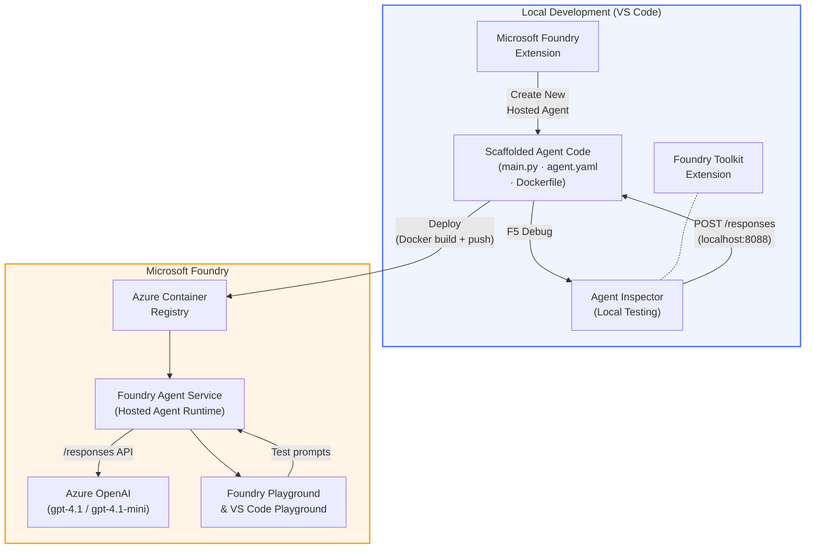

# វគ្គបណ្តុះបណ្តាល Foundry Toolkit + Foundry Hosted Agents

[](https://www.python.org/)
[](https://github.com/microsoft/agents)
[](https://learn.microsoft.com/azure/foundry/agents/concepts/hosted-agents)
[](https://ai.azure.com/)
[](https://learn.microsoft.com/azure/ai-services/openai/)
[](https://learn.microsoft.com/cli/azure/install-azure-cli)
[](https://learn.microsoft.com/azure/developer/azure-developer-cli/install-azd)
[](https://www.docker.com/)
[](https://marketplace.visualstudio.com/items?itemName=ms-windows-ai-studio.windows-ai-studio)
[](../../LICENSE)

សាងសង់, បរិក្ខារសាកល្បង និងដាក់ពាណិជ្ជកម្មភ្នាក់ងារជា **សេវាកម្មភ្នាក់ងារ Microsoft Foundry** ជា **ភ្នាក់ងារត្រូវបានផ្ទុក** - ដោយប្រើ VS Code ពេញលេញជាមួយនឹង **កម្មវិធីបន្ថែម Microsoft Foundry** និង **Foundry Toolkit**។

> **ភ្នាក់ងារត្រូវបានផ្ទុកសព្វថ្ងៃក្នុងជំហានពិនិត្យមើល។** តំបន់គាំទ្រ មានកំណត់ - សូមមើល [ភាពមានទីតាំងតំបន់](https://learn.microsoft.com/azure/foundry/agents/concepts/hosted-agents#region-availability)។

> សៀវភៅ `agent/` នៅក្នុងមួយមន្ទីរពិនិត្យជាប្រភេទ **ស្វ័យប្រវត្តិកសាង** ដោយកម្មវិធីបន្ថែម Foundry - បន្ទាប់មកអ្នកអាចកែប្រែកូដ, សាកល្បងនៅក្នុងម៉ាស៊ីន និងដាក់ពាណិជ្ជកម្ម។

### 🌐 គាំទ្រភាសាច្រើន

#### គាំទ្រដោយរបារតនះ GitHub Action (ស្វ័យប្រវត្តិ និង មានការអាប់ដេតជានិច្ច)

<!-- CO-OP TRANSLATOR LANGUAGES TABLE START -->
[Arabic](../ar/README.md) | [Bengali](../bn/README.md) | [Bulgarian](../bg/README.md) | [Burmese (Myanmar)](../my/README.md) | [Chinese (Simplified)](../zh-CN/README.md) | [Chinese (Traditional, Hong Kong)](../zh-HK/README.md) | [Chinese (Traditional, Macau)](../zh-MO/README.md) | [Chinese (Traditional, Taiwan)](../zh-TW/README.md) | [Croatian](../hr/README.md) | [Czech](../cs/README.md) | [Danish](../da/README.md) | [Dutch](../nl/README.md) | [Estonian](../et/README.md) | [Finnish](../fi/README.md) | [French](../fr/README.md) | [German](../de/README.md) | [Greek](../el/README.md) | [Hebrew](../he/README.md) | [Hindi](../hi/README.md) | [Hungarian](../hu/README.md) | [Indonesian](../id/README.md) | [Italian](../it/README.md) | [Japanese](../ja/README.md) | [Kannada](../kn/README.md) | [Khmer](./README.md) | [Korean](../ko/README.md) | [Lithuanian](../lt/README.md) | [Malay](../ms/README.md) | [Malayalam](../ml/README.md) | [Marathi](../mr/README.md) | [Nepali](../ne/README.md) | [Nigerian Pidgin](../pcm/README.md) | [Norwegian](../no/README.md) | [Persian (Farsi)](../fa/README.md) | [Polish](../pl/README.md) | [Portuguese (Brazil)](../pt-BR/README.md) | [Portuguese (Portugal)](../pt-PT/README.md) | [Punjabi (Gurmukhi)](../pa/README.md) | [Romanian](../ro/README.md) | [Russian](../ru/README.md) | [Serbian (Cyrillic)](../sr/README.md) | [Slovak](../sk/README.md) | [Slovenian](../sl/README.md) | [Spanish](../es/README.md) | [Swahili](../sw/README.md) | [Swedish](../sv/README.md) | [Tagalog (Filipino)](../tl/README.md) | [Tamil](../ta/README.md) | [Telugu](../te/README.md) | [Thai](../th/README.md) | [Turkish](../tr/README.md) | [Ukrainian](../uk/README.md) | [Urdu](../ur/README.md) | [Vietnamese](../vi/README.md)

> **ចូលចិត្តចម្លងនៅក្នុងម៉ាស៊ីនមែនទេ?**
>
> រក្សាទុកគម្រោងនេះមានការបកប្រែភាសាជាង 50 ដែលបន្ថែមទំហំនៃការទាញយកយ៉ាងខ្លាំង។ ដើម្បីចម្លងដោយគ្មានការបកប្រែ សូមប្រើ sparse checkout:
>
> **Bash / macOS / Linux:**
> ```bash
> git clone --filter=blob:none --sparse https://github.com/microsoft-foundry/Foundry_Toolkit_for_VSCode_Lab.git
> cd Foundry_Toolkit_for_VSCode_Lab
> git sparse-checkout set --no-cone '/*' '!translations' '!translated_images'
> ```
>
> **CMD (Windows):**
> ```cmd
> git clone --filter=blob:none --sparse https://github.com/microsoft-foundry/Foundry_Toolkit_for_VSCode_Lab.git
> cd Foundry_Toolkit_for_VSCode_Lab
> git sparse-checkout set --no-cone "/*" "!translations" "!translated_images"
> ```
>
> នេះផ្តល់ឱ្យអ្នកបានគ្រប់យ៉ាងដែលត្រូវការដើម្បីបញ្ចប់វគ្គបណ្តុះបណ្តាលដោយការទាញយកប្រសើរជាងមុន។
<!-- CO-OP TRANSLATOR LANGUAGES TABLE END -->

---

## ស្ថាបត្យកម្ម



**សភាព:** កម្មវិធីបន្ថែម Foundry បានសាងសង់ភ្នាក់ងារ ឲ្យអ្នកកែប្រែកូដ និងបញ្ជាក់ប្រាប់ → សាកល្បងក្នុងម៉ាស៊ីនដោយជាមួយ Agent Inspector → ដាក់ពាណិជ្ជកម្មទៅ Foundry (រូបភាព Docker ត្រូវបានបញ្ចូនទៅ ACR) → ពិនិត្យនៅក្នុង Playground។

---

## អ្វីដែលអ្នកនឹងសាងសង់

| មន្ទីរ | ពិពណ៌នា | ស្ថានភាព |
|-----|-------------|--------|
| **មន្ទីរ 01 - ភ្នាក់ងារតែមួយ** | សាងសង់ **"ពណ៌នាដូចជាខ្ញុំជាអគ្គនាយក" ភ្នាក់ងារ**, សាកល្បងក្នុងម៉ាស៊ីន និងដាក់ពាណិជ្ជកម្មទៅ Foundry | ✅ មានស្រាប់ |
| **មន្ទីរ 02 - ការងារភ្នាក់ងារច្រើន** | សាងសង់ **"Resume → Job Fit Evaluator"** - ភ្នាក់ងារចំនួន 4 រួមគ្នាធ្វើការវាយតម្លៃការសម្របសម្រួលប្រវត្តិរូប និងបង្កើតផែនការរៀន | ✅ មានស្រាប់ |

---

## ចូរជួបភ្នាក់ងារអគ្គនាយក

ក្នុងវគ្គបណ្តុះបណ្តាលនេះ អ្នកនឹងសង្កត់ចិត្តសាងសង់ **"ពណ៌នាដូចជាខ្ញុំជាអគ្គនាយក" ភ្នាក់ងារ** - ភ្នាក់ងារត្រឹមត្រូវដែលយកភាសាបច្ចេកទេសស្មុគស្មាញមកបំលែងជាសេចក្តីសង្ខេបស្ងប់ស្ងាត់សម្រាប់កៅអីប្រជុំក្រុមប្រឹក្សាភិបាល។ ពីព្រោះយើងត្រូវតែស្មោះត្រង់ មិនមាននរណានៅក្នុង C-suite ចង់ស្តាប់អំពី "ការបញ្ចប់ thread pool ដែលបណ្តាលមកពីការហៅសមកាលកម្មដែលបានបញ្ចូលនៅក្នុង v3.2" ទេ។

ខ្ញុំបានបង្កើតភ្នាក់ងារនេះបន្ទាប់ពីមានព្រឹត្តិការណ៍ជាច្រើនដែលការបង្ហោះតាមបណ្តាញដែលខ្ញុំបានរៀបចំយ៉ាងល្អមានការឆ្លើយតបថា: *"ហេតុអ្វី... គេហទំព័រមិនដំណើរការឬ?"*

### វាដំណើរការយ៉ាងដូចម្ដេច

អ្នកផ្តល់ឱ្យវាការអាប់ដេតបច្ចេកទេស។ វាចេញមកជាសេចក្តីសង្ខេបអគ្គនាយក - បីចំណុចទាញឯកសារ គ្មានផ្ទាំងបច្ចេកទេស គ្មានផ្ទាំងកូដរកកំហុស គ្មានភាពខ្លាចអវត្តមាន តែ **អ្វីដែលបានកើតឡើង**, **ឥទ្ធិពលអាជីវកម្ម**, និង **ជំហានបន្ទាប់**។

### មើលវាជាកម្មវិធី

**អ្នកប្រាប់ថា:**
> "ល្បឿន API បានបន្ថយដោយសារតែការបញ្ចប់ thread pool ដែលបណ្តាលមកពីការហៅសមកាលកម្មដែលបានបញ្ចូលនៅ v3.2។"

**ភ្នាក់ងារឆ្លើយតបថា:**

> **សេចក្តីសង្ខេបអគ្គនាយក:**
> - **អ្វីដែលបានកើតឡើង:** បន្ទាប់ពីចេញផ្សាយថ្មីៗនេះ ប្រព័ន្ធបានយឺតចុះ។
> - **ឥទ្ធិពលអាជីវកម្ម:** អ្នកប្រើប្រាស់ខ្លះបានជួបប្រទះការពន្យារពេលពេលប្រើសេវាកម្ម។
> - **ជំហានបន្ទាប់:** ការផ្លាស់ប្តូរបានត្រូវដកចេញ ហើយការជួសជុលកំពុងត្រូវរៀបចំមុនការដាក់ពាណិជ្ជកម្មឡើងវិញ។

### ហេតុអ្វីបានជាជ្រើសរើសភ្នាក់ងារនេះ?

វាជាភ្នាក់ងារងាយស្រួលជាក់លាក់និងមានគោលបំណងតែមួយ - ពេញលេញសម្រាប់ការរៀនដំណើរការភ្នាក់ងារត្រូវបានផ្ទុកពីដើមដល់ចុងដោយគ្មានការរុញរាយក្នុងខ្សែស្រឡាយឧបករណ៍ស្មុគស្មាញ។ ហើយម្នាក់ៗក្នុងក្រុមវិទ្យាសាស្ត្រអាចប្រើបានយ៉ាងល្អ។

---

## រចនាសម្ព័ន្ធវគ្គបណ្តុះបណ្តាល

```
📂 Foundry_Toolkit_for_VSCode_Lab/
├── 📄 README.md                      ← You are here
└── 📂 workshop/
    ├── 📂 lab01-single-agent/        ← Full lab: docs + agent code
    │   ├── README.md                 ← Hands-on lab instructions
    │   ├── 📂 docs/                  ← Step-by-step tutorial modules
    │   │   ├── 00-prerequisites.md
    │   │   ├── 01-setup.md
    │   │   ├── 02-create-hosted-agent.md
    │   │   ├── 03-configure-and-code.md
    │   │   ├── 04-test-locally.md
    │   │   ├── 05-deploy-to-foundry.md
    │   │   ├── 06-verify-in-playground.md
    │   │   ├── 07-summary.md
    │   │   └── 08-troubleshooting.md
    │   └── 📂 agent/                 ← Reference solution (auto-scaffolded by Foundry extension)
    │       ├── agent.yaml
    │       ├── Dockerfile
    │       ├── main.py
    │       └── requirements.txt
    └── 📂 lab02-multi-agent/         ← Resume → Job Fit Evaluator
        ├── README.md                 ← Hands-on lab instructions (end-to-end)
        ├── 📂 docs/                  ← Step-by-step tutorial modules
        │   ├── 00-prerequisites.md
        │   ├── 01-understand-multi-agent.md
        │   ├── 02-scaffold-multi-agent.md
        │   ├── 03-configure-agents.md
        │   ├── 04-orchestration-patterns.md
        │   ├── 05-test-locally.md
        │   ├── 06-deploy-to-foundry.md
        │   ├── 07-verify-in-playground.md
        │   └── 08-troubleshooting.md
        └── 📂 PersonalCareerCopilot/ ← Reference solution (multi-agent workflow)
            ├── agent.yaml
            ├── Dockerfile
            ├── main.py
            └── requirements.txt
```

> **សម្គាល់:** សៀវភៅ `agent/` ក្នុងមន្ទីរពិនិត្យគឺជាអ្វីដែល **កម្មវិធីបន្ថែម Microsoft Foundry** បង្កើតពេលអ្នកបញ្ជា `Microsoft Foundry: Create a New Hosted Agent` ពី Command Palette។ ឯកសារត្រូវបានកែប្រែជាមួយនឹងការណែនាំភ្នាក់ងារ ឧបករណ៍ និងការកំណត់រចនាសម្ព័ន្ធរបស់អ្នក។ មន្ទីរ 01 នាំអ្នកឆ្លាស់វឌ្ឍនេះពីដើម។

---

## ចាប់ផ្ដើម

### 1. ចម្លងឃ្លាំង

```bash
git clone https://github.com/microsoft-foundry/Foundry_Toolkit_for_VSCode_Lab.git
cd Foundry_Toolkit_for_VSCode_Lab
```

### 2. បង្កើតបរិយាកាស Python វិចិត្រសិល្បៈ

```bash
python -m venv venv
```

ដំណើរការ​វា៖

- **Windows (PowerShell):**
  ```powershell
  .\venv\Scripts\Activate.ps1
  ```
- **macOS / Linux:**
  ```bash
  source venv/bin/activate
  ```

### 3. ដំឡើង dependencies

```bash
pip install -r workshop/lab01-single-agent/agent/requirements.txt
```

### 4. កំណត់តម្លៃបរិយាកាស

បន្ត់ឯកសារ `.env` ក្នុងថតភ្នាក់ងារ ហើយកំណត់តម្លៃរបស់អ្នក៖

```bash
cp workshop/lab01-single-agent/agent/.env.example workshop/lab01-single-agent/agent/.env
```

កែប្រែ `workshop/lab01-single-agent/agent/.env`:

```env
AZURE_AI_PROJECT_ENDPOINT=https://<your-account>.services.ai.azure.com/api/projects/<your-project>
AZURE_AI_MODEL_DEPLOYMENT_NAME=<your-model-deployment-name>
```

### 5. តាមដានវគ្គបណ្តុះបណ្តាល

មន្ទីរ​នីមួយៗមានមុខងារស្វែងយល់ផ្ទាល់ខ្លួន។ ចាប់ផ្ដើមជាមួយ **មន្ទីរ 01** ដើម្បីរៀនមូលដ្ឋាន បន្ទាប់មកទៅ **មន្ទីរ 02** សម្រាប់ដំណើរការភ្នាក់ងារច្រើន។

#### មន្ទីរ 01 - ភ្នាក់ងារតែមួយ ([ការណែនាំពេញលេញ](workshop/lab01-single-agent/README.md))

| # | មុខងារ | តំណភ្ជាប់ |
|---|--------|------|
| 1 | អានតម្រូវការ | [00-prerequisites.md](workshop/lab01-single-agent/docs/00-prerequisites.md) |
| 2 | ដំឡើង Foundry Toolkit & កម្មវិធីបន្ថែម Foundry | [01-setup.md](workshop/lab01-single-agent/docs/01-setup.md) |
| 3 | បង្កើតគម្រោង Foundry | [01-setup.md](workshop/lab01-single-agent/docs/01-setup.md) |
| 4 | បង្កើតភ្នាក់ងារត្រូវបានផ្ទុក | [02-create-hosted-agent.md](workshop/lab01-single-agent/docs/02-create-hosted-agent.md) |
| 5 | កំណត់បញ្ជា និងបរិយាកាស | [03-configure-and-code.md](workshop/lab01-single-agent/docs/03-configure-and-code.md) |
| 6 | សាកល្បងក្នុងម៉ាស៊ីន | [04-test-locally.md](workshop/lab01-single-agent/docs/04-test-locally.md) |
| 7 | ដាក់ពាណិជ្ជកម្មទៅ Foundry | [05-deploy-to-foundry.md](workshop/lab01-single-agent/docs/05-deploy-to-foundry.md) |
| 8 | ពិនិត្យនៅក្នុងចំការក្មេង | [06-verify-in-playground.md](workshop/lab01-single-agent/docs/06-verify-in-playground.md) |
| 9 | ដោះស្រាយបញ្ហា | [08-troubleshooting.md](workshop/lab01-single-agent/docs/08-troubleshooting.md) |

#### មន្ទីរ 02 - ដំណើរការភ្នាក់ងារច្រើន ([ការណែនាំពេញលេញ](workshop/lab02-multi-agent/README.md))

| # | មុខងារ | តំណភ្ជាប់ |
|---|--------|------|
| 1 | តម្រូវការ (មន្ទីរ 02) | [00-prerequisites.md](workshop/lab02-multi-agent/docs/00-prerequisites.md) |
| 2 | យល់ដឹងស្ថាបត្យកម្មភ្នាក់ងារច្រើន | [01-understand-multi-agent.md](workshop/lab02-multi-agent/docs/01-understand-multi-agent.md) |
| 3 | សាងសង់គម្រោងភ្នាក់ងារច្រើន | [02-scaffold-multi-agent.md](workshop/lab02-multi-agent/docs/02-scaffold-multi-agent.md) |
| 4 | កំណត់ភ្នាក់ងារនិងបរិយាកាស | [03-configure-agents.md](workshop/lab02-multi-agent/docs/03-configure-agents.md) |
| 5 | គំរូផ្តាំប្រតិបត្តិការ | [04-orchestration-patterns.md](workshop/lab02-multi-agent/docs/04-orchestration-patterns.md) |
| 6 | សាកល្បងក្នុងម៉ាស៊ីន (ភ្នាក់ងារច្រើន) | [05-test-locally.md](workshop/lab02-multi-agent/docs/05-test-locally.md) |
| 7 | ដាក់ពាណិជ្ជកម្មទៅ Foundry | [06-deploy-to-foundry.md](workshop/lab02-multi-agent/docs/06-deploy-to-foundry.md) |
| 8 | ពិនិត្យនៅក្នុងចំការក្មេង | [07-verify-in-playground.md](workshop/lab02-multi-agent/docs/07-verify-in-playground.md) |
| 9 | ដោះស្រាយបញ្ហា (ភ្នាក់ងារច្រើន) | [08-troubleshooting.md](workshop/lab02-multi-agent/docs/08-troubleshooting.md) |

---

## អ្នកថែទាំ

<table>
<tr>
    <td align="center"><a href="https://github.com/ShivamGoyal03">
        <br />
        <sub><b>Shivam Goyal</b></sub>
    </a><br />
    </td>
</tr>
</table>

---

## អាជ្ញាបណ្ណចាំបាច់ (យោងសម្រួល)

| ស្ថានការណ៍ | តួនាទីចាំបាច់ |
|----------|---------------|
| បង្កើតគម្រោង Foundry ថ្មី | **Azure AI Owner** លើធនធាន Foundry |
| ដាក់ពាណិជ្ជកម្មទៅគម្រោងដែលមាន (ធនធានថ្មី) | **Azure AI Owner** + **Contributor** លើការជាវ |
| ដាក់ពាណិជ្ជកម្មទៅគម្រោងដែលបានកំណត់រចនាសម្ព័ន្ធពេញលេញ | **Reader** លើគណនី + **Azure AI User** លើគម្រោង |

> **សំខាន់៖** តួនាទី Azure `Owner` និង `Contributor` មានតែកម្មសិទ្ធិ *គ្រប់គ្រង* តែប៉ុណ្ណោះ មិនមែនសិទ្ធិ *អភិវឌ្ឍន៍* (សកម្មភាព ទិន្នន័យ) ទេ។ អ្នកត្រូវការនូវ **Azure AI User** ឬ **Azure AI Owner** ដើម្បីសាងសង់ និង ដាក់ពាណិជ្ជកម្មភ្នាក់ងារ។

---

## យោង

- [ការចាប់ផ្តើមរហ័ស៖ បញ្ចេញភ្នាក់ងារបង្ហោះដំបូងរបស់អ្នក (VS Code)](https://learn.microsoft.com/azure/foundry/agents/quickstarts/quickstart-hosted-agent)
- [ភ្នាក់ងារបង្ហោះមានអ្វីខ្លះ?](https://learn.microsoft.com/azure/foundry/agents/concepts/hosted-agents)
- [បង្កើតដំណើរការភ្នាក់ងារបង្ហោះក្នុង VS Code](https://learn.microsoft.com/azure/foundry/agents/how-to/vs-code-agents-workflow-pro-code)
- [បញ្ចេញភ្នាក់ងារបង្ហោះមួយ](https://learn.microsoft.com/azure/foundry/agents/how-to/deploy-hosted-agent)
- [RBAC សម្រាប់ Microsoft Foundry](https://learn.microsoft.com/azure/foundry/concepts/rbac-foundry)
- [ឧទាហរណ៍ភ្នាក់ងារពិនិត្យរចនាសម្ព័ន្ធ](https://github.com/Azure-Samples/agent-architecture-review-sample) - ភ្នាក់ងារបង្ហោះពិតជាជាមួយឧបករណ៍ MCP, គំនូរបង្ហាញ Excalidraw, និងការបញ្ចេញពីរដង

---


## អាជ្ញាប័ណ្ណ

[MIT](../../LICENSE)

---

<!-- CO-OP TRANSLATOR DISCLAIMER START -->
**ការបដិសេធ**:
ឯកសារនេះត្រូវបានបម្លែងភាសា ដោយប្រើសេវាបម្លែងភាសា AI [Co-op Translator](https://github.com/Azure/co-op-translator)។ ទោះយើងខ្ញុំមានក្តីប្រាថ្នាឱ្យបានច្បាស់លាស់ តែសូមយល់ដឹងថាការបម្លែងដោយស្វ័យប្រវត្តិក៏អាចមានកំហុសឬភាពមិនត្រឹមត្រូវ។ ឯកសារដើមជាភាសាទីតាំងគួរត្រូវបានគេប្រើជាប្រភពច្បាស់លាស់។ សម្រាប់ព័ត៌មានសំខាន់ៗ សូមណែនាំឱ្យប្រើប្រាស់ការប្រែដោយមនុស្សជំនាញ។ យើងខ្ញុំមិនទទួលខុសត្រូវចំពោះការយល់ច្រឡំ ឬការបកស្រាយខុសបន្ទាប់ពីការប្រើប្រាស់ការបម្លែងនេះនោះទេ។
<!-- CO-OP TRANSLATOR DISCLAIMER END -->
