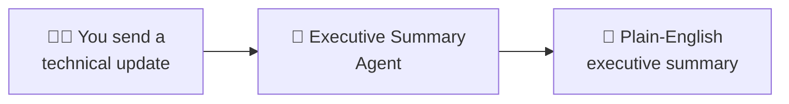

# មូឌុល 0 - ការណែនាំ

⏱️ ~10 នាទី

> [!WARNING]
> **ការមើលមុខនិងកំណត់កម្រិត៖** [ភ្នាក់ងារត្រូវដាក់ទីកន្លែង](https://learn.microsoft.com/azure/foundry/agents/concepts/hosted-agents) កំពុងនៅក្នុង **ការមើលមុខសាធារណៈ** - មិនបានណែនាំសម្រាប់បន្ទុកការប្រតិបត្តិការផ្លូវការទេ។ សូមកត់សម្គាល់ដូចខាងក្រោម៖
> - **តំបន់គាំទ្រមានកំណត់** - សូមពិនិត្យ [ចំណុចផ្តល់សេវាតំបន់](https://learn.microsoft.com/azure/foundry/agents/concepts/hosted-agents#region-availability) មុនបង្កើតធនធាន។ ប្រសិនបើអ្នកជ្រើសតំបន់មិនគាំទ្រ អនុវត្តន៍នឹងបរាជ័យ។
> - កញ្ចប់ `agent-framework-foundry-hosting` គឺជាកំណែកំណត់មុន - API ប្រហែលជាខុសគ្នារវាងកំណែ។
> - កំណត់កម្រិតកំរិត៖ ភ្នាក់ងារត្រូវដាក់ទីកន្លែងគាំទ្រព្រីកូឡា 0–5 (រួមបញ្ចូលការកំណត់ទៅសូន្យ)។
> - លក្ខណៈខ្លះៗបង្ហាញនៅក្នុងសិក្ខាសាលានេះអាចផ្លាស់ប្តូរបន្ទាប់ពីសេវាកម្មឆ្លើយទៅរក GA។

## អ្វីដែលអ្នកនឹងបង្កើត

នៅក្នុងសិក្ខាសាលានេះ អ្នកនឹងបង្កើតភ្នាក់ងារ **"ពន្យល់បែបគេខ្ញុំជាអនុប្រធាន"** - ភ្នាក់ងារដំណើរការជាសេវាកម្ម AI ដែលយកបច្ចុប្បន្នភាពបច្ចេកទេសជាច្រើនហើយសរសេរវាឡើងជាសេចក្តីសង្ខេបជាភាសាអង់គ្លេសសាមញ្ញសម្រាប់អភិបាល។

**ភ្នាក់ងារនេះប្រើ៖**
- **Microsoft Agent Framework** - សម្រាប់តុល្យភាពភ្នាក់ងារនិងរចនាសម្ព័ន្ធ
- **Foundry Toolkit សម្រាប់ VS Code** - សម្រាប់បង្កើតស៊ីស្ទឹម សាកល្បងក្នុងមូលដ្ឋាន និងបញ្ចេញ
- **ម៉ូដែល AI** (ឧ. `gpt-4.1-mini/gpt-5-mini`) - សម្រាប់បង្កើតសេចក្តីសង្ខេប

នៅចុងបញ្ចប់នៃមាតិកានេះ អ្នកនឹងបានភ្នាក់ងារដែលដំណើរការបាន ដែលអ្នកអាចសាកល្បងក្នុងមូលដ្ឋានតាមរយៈ Agent Inspector ហើយជាមិនមែនមានក៏អាចបញ្ចេញទៅពពក។

---

## ភ្នាក់ងារត្រូវដាក់ទីកន្លែង គឺអ្វី?

**ភ្នាក់ងារត្រូវដាក់ទីកន្លែង** គឺជាភ្នាក់ងារ AI ដែលដំណើរការជាសេវាកម្មគ្រប់គ្រងនៅ Microsoft Foundry។ ជំនួសការគ្រប់គ្រងផ្ទាល់ខ្លួន អ្នកបាច់បញ្ចូលកូដភ្នាក់ងាររបស់អ្នកនៅក្នុងធុងហើយ Foundry នឹងចាត់តាំងការពង្រីក ការចែកចាយ និងបង្ហាញវាតាមរយៈចំនុចចូល HTTP ស្តង់ដារ។

| គំនិត | មានន័យថា |
|---------|--------------|
| **ភ្នាក់ងារ** | កូដ Python របស់អ្នក ដែលទទួលសារ ពិនិត្យម៉ូដែល AI ហើយតបសំណើរដោយរចនាសម្ព័ន្ធ |
| **ត្រូវដាក់ទីកន្លែង** | Foundry ដំណើរការធុងរបស់អ្នក ដោយគ្មាន VM គ្មាន Kubernetes មិនចាំបាច់គ្រប់គ្រង |
| **ពិធីសាស្ត្រឆ្លើយតប** | API HTTP ស្តង់ដារ (`POST /responses`) ដែលអតិថិជនណាមួយអាចហៅដើម្បីតបស្នាមជាមួយភ្នាក់ងាររបស់អ្នក |
| **Agent Inspector** | UI សាកល្បងក្នុងមូលដ្ឋាន (បានបង្កើតក្នុង Foundry Toolkit) ដែលអនុញ្ញាតឲ្យអ្នកពិភាក្សាជាមួយភ្នាក់ងាររបស់អ្នកមុនពេលបញ្ចេញ |

នៅក្នុងសិក្ខាសាលានេះ អ្នកនឹងធ្វើពីសូន្យទៅភ្នាក់ងារត្រូវដាក់ទីកន្លែងពេញលេញ - ឬបញ្ឈប់នៅការសាកល្បងក្នុងមូលដ្ឋាន ប្រសិនបើអ្នកចូលចិត្ត។

---

## ជ្រើសរើសផ្លូវរបស់អ្នក

> ⚠️ **ជ្រើសរើសមួយផ្លូវមុនបន្ត។** ជម្រើសរបស់អ្នកកំណត់ថាឧបករណ៍ណាដែលត្រូវដំឡើង និងមូឌុលណាដែលដែលមានប្រសិទ្ធភាព។ អ្នកអាចផ្លាស់ពីផ្លូវ B → ផ្លូវ A មកក្រោយ ប្រសិនបើទទួលបានសេវាកម្ម។

<strong>🅰️ ផ្លូវ A - ពពក Azure (តម្រូវការសេវាសុពលភាព Azure)</strong>

| | ព័ត៌មានលម្អិត |
|---|---|
| **សម្រាប់នរណា?** | អ្នកមានសេវាសុពលភាព Azure ប្រតិបត្តិ និងអាចបង្កើតធនធាន Foundry |
| **ម៉ូដែល** | Azure OpenAI តាម Foundry (ឧ. `gpt-4.1-mini/gpt-5-mini`) |
| **មូឌុលដែលគ្របដណ្តប់** | មូឌុលទាំងអស់ (00–07) |
| **បញ្ចេញទៅពពក?** | ✅ ល្អ - បញ្ចេញពេញលេញពីដំណើរការចុងក្រោយ |

<strong>🅱️ ផ្លូវ B - ក្នុងមូលដ្ឋាន / ដែនឥតគិតថ្លៃ (មិនតម្រូវសេវា Azure)</strong>

| | ព័ត៌មានលម្អិត |
|---|---|
| **សម្រាប់នរណា?** | អ្នកជាវិស្វករ MVP និងសិស្ស ឬគ្រប់គ្នាដែលមិនមានទេពកោសល្យ Azure |
| **ម៉ូដែល** | **Foundry Local** (ឥតគិតថ្លៃ ដំណើរការលើម៉ាស៊ីនរបស់អ្នក) |
| **មូឌុលដែលគ្របដណ្តប់** | មូឌុល 00–04 (រំលងការបញ្ចេញនិងផ្ទៀងផ្ទាត់ពពក) |
| **បញ្ចេញទៅពពក?** | ❌ អត់ - តែសាកល្បងក្នុងមូលដ្ឋានតាមរយៈ Agent Inspector |

---

## ផ្លូវទាំងអស់៖ ឧបករណ៍តម្រូវការ

ដំឡើងឧបករណ៍ទាំងអស់ខាងក្រោម។ បន្ទាប់ពីដំឡើង ពិនិត្យវាដោយបញ្ជារបញ្ជា as សាកល្បង។

| # | ឧបករណ៍ | កំណែ | ដំឡើង | ពិនិត្យ (លទ្ធផលរំពឹង) |
|---|------|---------|---------|---------------------------|
| 1 | **Visual Studio Code** | ថ្មីបំផុត | [code.visualstudio.com](https://code.visualstudio.com/) | បើកដោយគ្មានកំហុស |
| 2 | **Python** | 3.12 ឬខ្ពស់ជាង | [python.org/downloads](https://www.python.org/downloads/) | `python --version` $\rightarrow$ `Python 3.12.x` |
| 3 | **Foundry Toolkit សម្រាប់ VS Code** | ថ្មីបំផុត | Extension ID: `ms-windows-ai-studio.windows-ai-studio` | រូបតំណាង Foundry នៅ Activity Bar |
| 4 | **ពន្យល់ Python សម្រាប់ VS Code** | ថ្មីបំផុត | Extension ID: `ms-python.python` | បានដំឡើងនៅផ្នែក Extensions |

> [!TIP]
> **គន្លឹះជំនួយសម្រាប់ដំឡើង៖**
> - **ផ្លូវ Python (Windows):** ជ 항상 சரிபார்க்க **"បញ្ចូល Python ទៅ PATH"** នៅមុខកញ្ចប់ដំឡើង Python។ ដែលខ្វះ នៅក្នុងផ្ទាំងប្រតិបត្តិការរបស់អ្នក នឹងមិនអាចរកឃើញ `python` ទេ។
> - **កំណែ Python ច្រើនៗ៖** ប្រសិនបើអ្នកមាន Python 3.10 និង 3.12 នៅក្នុងម៉ាស៊ីនរបស់អ្នក ប្រើ `python3.12 -m venv .venv` ដើម្បីធានាថាគេកំពុងប្រើកំណែត្រឹមត្រូវសម្រាប់បរិយាកាស virtual របស់អ្នក។
> - **Docker WSL 2 (Windows):** នៅពេលដំឡើង Docker Desktop សូមជ្រើសបំរើបន្ទាន់ **WSL 2 backend** ។ Docker ជាមួយ Hyper-V យឺតជាង ហើយអាចបណ្តាលបញ្ហាក្នុងការកសាងកុងតឺនឺររបស់ Foundry។
> - **Docker មិនចាប់ផ្តើម?** រង់ចាំ 30–60 វិនាទី បន្ទាប់ពីបើក Docker Desktop។ បញ្ជារបញ្ជា `docker info` - ប្រសិនបើឃើញ "មិនអាចភ្ជាប់ទៅ Docker daemon" នោះ Docker កំពុងចាប់ផ្តើម។
> - **ផ្នែកបន្ថែម VS Code មិនដំណើរការទេ?** បន្ទាប់ពីដំឡើងផ្នែកបន្ថែម សូមផ្ទាំងវីនដូឡើងវិញ៖ `Ctrl+Shift+P` → `Developer: Reload Window`។

> **អ្នកប្រើ Windows៖** សូមពិនិត្យ **"បញ្ចូល Python ទៅ PATH"** នៅពេលដំឡើង Python។

**បន្ទាប់:** [01 - ការតំឡើង →](01-setup.md)

---

<!-- CO-OP TRANSLATOR DISCLAIMER START -->
**ការបដិសេធ**:
ឯកសារនេះត្រូវបានបម្លែងភាសា ដោយប្រើសេវាបម្លែងភាសា AI [Co-op Translator](https://github.com/Azure/co-op-translator)។ ទោះយើងខ្ញុំមានក្តីប្រាថ្នាឱ្យបានច្បាស់លាស់ តែសូមយល់ដឹងថាការបម្លែងដោយស្វ័យប្រវត្តិក៏អាចមានកំហុសឬភាពមិនត្រឹមត្រូវ។ ឯកសារដើមជាភាសាទីតាំងគួរត្រូវបានគេប្រើជាប្រភពច្បាស់លាស់។ សម្រាប់ព័ត៌មានសំខាន់ៗ សូមណែនាំឱ្យប្រើប្រាស់ការប្រែដោយមនុស្សជំនាញ។ យើងខ្ញុំមិនទទួលខុសត្រូវចំពោះការយល់ច្រឡំ ឬការបកស្រាយខុសបន្ទាប់ពីការប្រើប្រាស់ការបម្លែងនេះនោះទេ។
<!-- CO-OP TRANSLATOR DISCLAIMER END -->