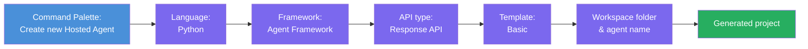
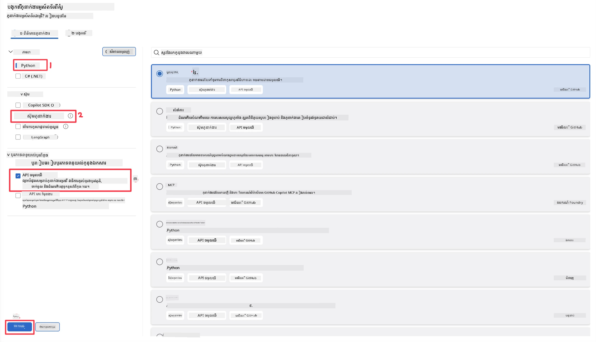
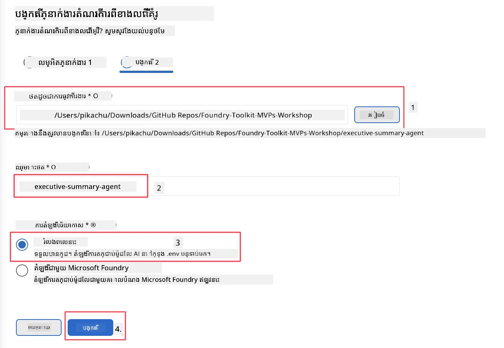

# មូឌុល 2 - បង្កើតភ្នាក់ងារចែកចាយថ្មីមួយ

⏱️ ~5 នាទី

ក្នុងមូឌុលនេះ អ្នកប្រើប្រាស់ Foundry Toolkit ដើម្បី **បង្កើតគម្រោងភ្នាក់ងារចែកចាយ**។ ការបង្កើតគំរូនេះបង្កើតរចនាសម្ព័ន្ធគម្រោងពេញលេញ - `agent.yaml`, `main.py`, `Dockerfile`, `requirements.txt`, និងការកំណត់រចនាសម្ព័ន្ធធ្វើឲ្យត្រួតពិនិត្យ VS Code - ដូច្នេះអ្នកអាចផ្តោតទៅលើការប្ដូរអាកប្បកិរិយារបស់ភ្នាក់ងារ។

> **គំនិតសំខាន់៖** ថត `agent/` ក្នុងមុខងារបណ្ដុះបណ្ដាលនេះគឺជាឧទាហរណ៍នៃអ្វីដែល Foundry Toolkit បង្កើត។ អ្នកមិនចាំបាច់សរសេរសន្លឹកឯកសារទាំងនេះពីដើមឡើយ។

### ដំណើរការបញ្ចូលជាមួយកម្មវិធីជំនួយបង្កើត



---

## ជំហាន 1: បើកកម្មវិធីជំនួយបង្កើតភ្នាក់ងារចែកចាយ

1. ចុច `Ctrl+Shift+P` ដើម្បីបើក **Command Palette**។
2. វាយថា៖ **Foundry Toolkit: Create new Hosted Agent** ហើយជ្រើសរើសវា។

> **ជម្រើសជំនួស៖ បង្កើតតាមរយៈ Foundry Portal**
> ប្រសិនបើអ្នកចូលចិត្តប្រើកម្មវិធីរុករក អ្នកអាចបង្កើតគម្រោងរបស់អ្នកនៅ [https://ai.azure.com](https://ai.azure.com)។ ពេលគម្រោងត្រូវបានរៀបចំរួច រត់ត្រឡប់ទៅ VS Code ហើយប្រើផ្នែកប្លង់ផ្សេងៗនៅខាងជានិង **Foundry Toolkit** ដើម្បីភ្ជាប់ទៅវា។

> **ជម្រើសផ្សេងទៀត៖** នៅផ្នែកជានៃ Foundry Toolkit ផ្ទុកម៉ៅស៍លើ **Agents** ក្រោមគម្រោងរបស់អ្នក ចុចរូបតំណាង **+** ហើយជ្រើស **Create in Code With Template**។

## ជំហានទី 2៖ ជ្រើសការកំណត់



1. នៅផ្នែកជាមួយផ្ទាំងរុករក/ជម្រើស បន្ទាប់មកជ្រើសដូចតទៅ៖

| ម៉ឺនុយ | ជម្រើស | កំណត់សម្គាល់ |
|--------|-----------|-------|
| **ភាសា** | Python | គាំទ្រពី C# ផងដែរ |
| **ស៊ុមវំនើប** | Agent Framework | ចំណុចចាប់ផ្តើមងាយស្រួលប្រើប្រាស់ដោយការប្រើ Agent Framework SDK |
| **ប្រភេទ API** | Response API | `POST /responses` - ផ្លាស់ប្តូរជាសន្ទនា ជាមួយប្រវត្តិគ្រប់គ្រងដោយវេទិកា |
| **ប្លង់** | Basic | ចំណុចចាប់ផ្តើមមូលដ្ឋានដោយប្រើ Agent Framework SDK |

2. បន្ទាប់ពីជ្រើសរួច ចុច **បន្ទាប់**



3. នៅក្នុងបង្អួចបន្ទាប់ ជ្រើសដូចតទៅ៖

| ម៉ឺនុយ | ជម្រើស | កំណត់សម្គាល់ |
|--------|-----------|-------|
| **ថតមូលដ្ឋានកន្លែងធ្វើការ** | ជ្រើសថតគោលដៅ | ឧ. `/workspace/Foundry_Toolkit_for_VSCode_Lab/` ឬថតយ៉ាងក្រោមក្នុង repo នេះ |
| **ឈ្មោះភ្នាក់ងារ** | បញ្ចូលឈ្មោះ | ឧ. `executive-summary-agent` |
| **ការកំណត់បរិយាកាស** | លើកលែងការកំណត់ឥឡូវនេះ |  |

ចុច **create** ដើម្បីបង្កើតភ្នាក់ងារ។ ថតថ្មីមួយនឹងត្រូវបានបង្កើតជាមួយឈ្មោះភ្នាក់ងារបង្ហាញ។

## ជំហានទី 3៖ ពិនិត្យគម្រោងដែលបានបង្កើត

បន្ទាប់ពីការបង្កើតបានបញ្ចប់ វាយតម្លៃថាអ្នកឃើញឯកសារទាំងនេះនៅក្នុង Explorer (`Ctrl+Shift+E`)៖

```
📂 executive-summary-agent/
├── .env                ← Environment variables (placeholders)
├── .vscode/
│   ├── launch.json     ← Debug config (F5 → run + Agent Inspector)
│   └── tasks.json      ← VS Code task definitions
├── agent.yaml          ← Agent definition (kind: hosted)
├── Dockerfile          ← Container config for deployment
├── main.py             ← Agent entry point (your main code)
└── requirements.txt    ← Python dependencies
```

### អ្នក់សោចាំខ្លឹមសារ

| ឯកសារ | គោលបំណង |
|------|---------|
| `agent.yaml` | សេចក្ដីប្រកាសភ្នាក់ងារជា `kind: hosted` បម្លែងអថេរបរិយាកាស បញ្ជាក់ពណ៌នា `/responses` protocol |
| `main.py` | បង្កើត `FoundryChatClient` → ដាក់វាទៅក្នុង `Agent` ជាមួយការណែនាំ → ផ្តល់សេវាកម្មតាមរយៈ `ResponsesHostServer` នៅព្រលឹង 8088 |
| `Dockerfile` | ប្រើ `python:3.12-slim` ដំឡើងការពឹងផ្អែកវា បង្ហាញព្រលឹង 8088 រត់ `main.py` |
| `requirements.txt` | `agent-framework-foundry`, `agent-framework-foundry-hosting`, `mcp`, `debugpy` |

> **សំខាន់៖** បើកថតភ្នាក់ងារដែលបានបង្កើតដោយផ្ទាល់នៅក្នុង VS Code (ថត `agent/` ផ្ទាល់) ដើម្បីឲ្យ `.vscode/launch.json` ហើយ `tasks.json` ដំណើរការបានត្រឹមត្រូវសម្រាប់ការកែសម្រួល F5។

---

### ✅ ចំណុចពិនិត្យ

- [ ] គម្រោង scaffolded ត្រូវបានបង្កើតជាមួយឯកសារពេញលេញទាំងអស់ដែលរំពឹងទុក
- [ ] `agent.yaml` បង្ហាញ `kind: hosted` និង `protocol: responses`
- [ ] `main.py` នាំចូល `Agent`, `FoundryChatClient`, `ResponsesHostServer`
- [ ] ថតភ្នាក់ងារត្រូវបើកក្នុង VS Code ជារៀងរហូតជាមូលដ្ឋានកន្លែងធ្វើការ

---

**មុនหน้า៖** [01 - Setup](01-setup.md) · **បន្ទាប់៖** [03 - Configure & Code →](03-configure-and-code.md)

---

<!-- CO-OP TRANSLATOR DISCLAIMER START -->
**ការបដិសេធ**:
ឯកសារនេះត្រូវបានបម្លែងភាសា ដោយប្រើសេវាបម្លែងភាសា AI [Co-op Translator](https://github.com/Azure/co-op-translator)។ ទោះយើងខ្ញុំមានក្តីប្រាថ្នាឱ្យបានច្បាស់លាស់ តែសូមយល់ដឹងថាការបម្លែងដោយស្វ័យប្រវត្តិក៏អាចមានកំហុសឬភាពមិនត្រឹមត្រូវ។ ឯកសារដើមជាភាសាទីតាំងគួរត្រូវបានគេប្រើជាប្រភពច្បាស់លាស់។ សម្រាប់ព័ត៌មានសំខាន់ៗ សូមណែនាំឱ្យប្រើប្រាស់ការប្រែដោយមនុស្សជំនាញ។ យើងខ្ញុំមិនទទួលខុសត្រូវចំពោះការយល់ច្រឡំ ឬការបកស្រាយខុសបន្ទាប់ពីការប្រើប្រាស់ការបម្លែងនេះនោះទេ។
<!-- CO-OP TRANSLATOR DISCLAIMER END -->