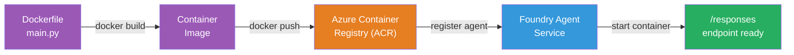
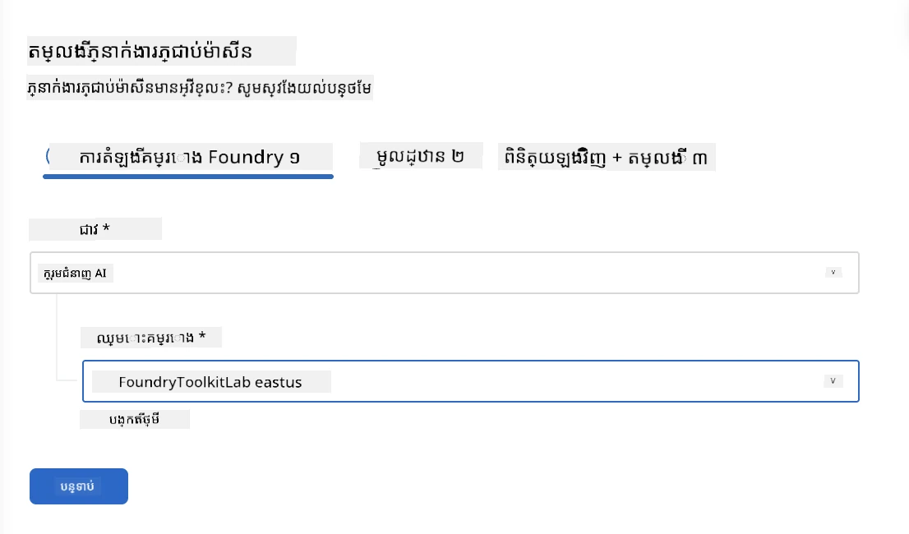
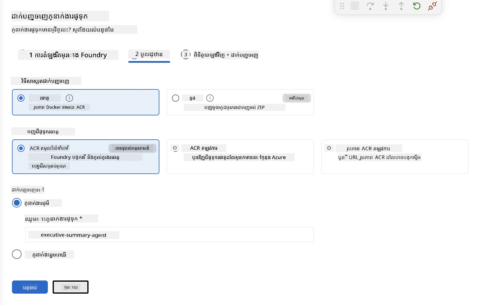
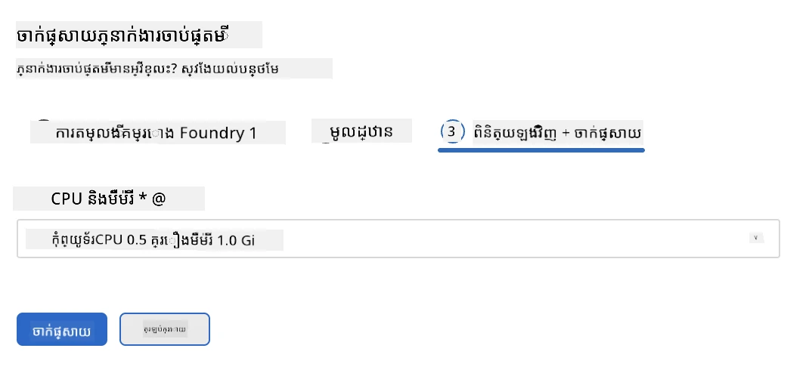
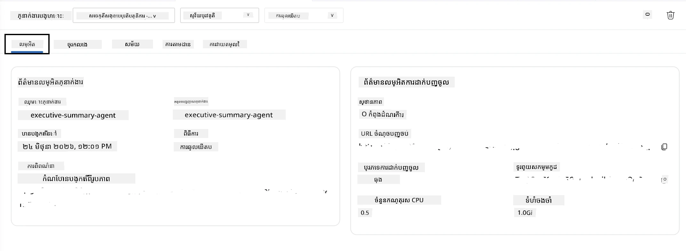

# ម៉ូឌុល 5 - ចែកចាយទៅសេវាចែកចាយ Foundry Agent

⏱️ ~10 នាទី

> ⚠️ **អ្នកប្រើផ្លូវ B:** ម៉ូឌុលនេះតម្រូវឱ្យមានការជាវ Foundry។ បើអ្នកកំពុងប្រើ Foundry Local, ជៀសវាងទៅ [ម៉ូឌុល 07 - សង្ខេប](07-summary.md)។ អ្នកបានបញ្ចប់ដំណើរការអភិវឌ្ឍន៍ក្នុងតំបន់ដោយជោគជ័យហើយ!

នៅក្នុងម៉ូឌុលនេះ អ្នកនឹងចែកចាយភ្នាក់ងារដែលបានសាកល្បងក្នុងតំបន់ទៅ Microsoft Foundry ជា **ភ្នាក់ងារតម្រុយ**។ ការចែកចាយនេះនឹង បង្កើតរូបភាព container ពិនិត្យវាទៅ Azure Container Registry ហើយចាប់ផ្តើមភ្នាក់ងារនៅក្នុងហេដ្ឋារចនាសម្ព័ន្ធដែលបានគ្រប់គ្រងដោយ Foundry។

### សន្ទស្សន៍ការចែកចាយ

---

## ការត្រួតពិនិត្យលក្ខខ័ណ្ឌជាមុន

មុននឹងចែកចាយ សូមផ្ទៀងផ្ទាត់៖

- [ ] ភ្នាក់ងារឆ្លងកាត់សេណារីយ៉ូតំបន់ទាំង 3 ពី [ម៉ូឌុល 04](04-test-locally.md)
- [ ] អ្នកមានតួនាទី **Azure AI User** នៅកម្រិតគម្រោង ([ម៉ូឌុល 01, បែងចែក RBAC](01-setup.md#deploy-a-model--assign-rbac))
- [ ] អ្នកបានចុះឈ្មោះចូល Azure នៅ VS Code (រូបតំណាងគណនីបង្ហាញឈ្មោះរបស់អ្នក)

---

## ជំហាន 1៖ ចាប់ផ្តើមការចែកចាយ

### ជម្រើស A៖ ចែកចាយពី Agent Inspector (ផ្ទះបាយណែនាំ)

ប្រសិនបើ Agent Inspector បើក (ពីការសាកល្បង)៖
1. ចុចប៊ូតុង **Deploy** នៅជ្រុងខាងលើខាងស្តាំ (រូបតំណាងពពក ↑)។

### ជម្រើស B៖ ចែកចាយពីបញ្ជីកម្មវិធី Command Palette

1. ចុច `Ctrl+Shift+P` → **Foundry Toolkit: Deploy Hosted Agent**។

---

## ជំហាន 2៖ កំណត់ការចែកចាយ

អ្នកនឹងត្រូវបានផ្តល់ជម្រើសឱ្យបញ្ចូល៖

| ប្រអប់ស្នើ | ជម្រើស |
|--------|-----------|
| **ការជាវ** | ការជាវ Azure របស់អ្នក |
| **គម្រោងគោលដៅ** | គម្រោង Foundry របស់អ្នក (ឧ. `workshop-agents`) |

ចុច **បន្ទាប់** ដើម្បីកំណត់ភ្នាក់ងារ។

| ប្រអប់ស្នើ | ជម្រើស |
|--------|-----------|
| **វិធីសាស្រ្តចែកចាយ** | Container |
| **រ៉ែសទ្រី container** | **ACR ជាមេទីយ្យល**, (Microsoft Foundry បង្កើត និងគ្រប់គ្រងសម្រាប់អ្នក) |
| **ចែកចាយទៅ** | ភ្នាក់ងារថ្មី (ឈៅ, `executive-summary-agent`) |

ចុច **បន្ទាប់** ដើម្បីពិនិត្យ និងចែកចាយភ្នាក់ងារ។

| ប្រអប់ស្នើ | ជម្រើស |
|--------|-----------|
| **CPU និងម៉ែនម៉ូរី** | **0.5 CPU cores, 1.0 Gi ម៉ែនម៉ូរី** (លំនាំដើម - គ្រប់គ្រាន់សម្រាប់សិក្ខាសាលា) |

---

## ជំហាន 3៖ ចែកចាយ និងតាមដាន

1. ចុច **Deploy**។
2. មើលផ្ទាំង **Output** (ជ្រើស **Microsoft Foundry** ពីបញ្ជីចុះបញ្ជ):
3. ការចែកចាយត្រូវបានចាប់ផ្តើមតាមជំហានខាងក្រោម៖
   - **ការសាងសង់ Docker** - សាងសង់ container ពី Dockerfile របស់អ្នក
   - **ការជញ្ចូល Docker** - បញ្ចូលរូបភាពទៅ ACR (1–3 នាទីនៅការចែកចាយដំបូង)
   - **ការចុះបញ្ជីភ្នាក់ងារ** - បង្កើតភ្នាក់ងារតម្រុយក្នុង Foundry
   - **ការចាប់ផ្តើម container** - ចាប់ផ្តើមជាមួយអត្តសញ្ញាណដែលគ្រប់គ្រងដោយប្រព័ន្ធ

4. ពេលបញ្ចប់ ព័ត៌មានជូនដំណឹងមួយបង្ហាញ៖
   > **executive-summary-agent ត្រូវបានចែកចាយដោយជោគជ័យ។** `View logs` `Run agent`

5. ចុច **Run agent** ដើម្បីបើក Agent Playground។

### តម្លៃស្ថានភាពចែកចាយ

| ស្ថានភាព | អត្ថន័យ |
|--------|---------|
| **កំពុងដំណើរការ** | Container ត្រៀមរួចរាល់, ភ្នាក់ងារឆ្លើយតប |
| **កំពុងរង់ចាំ** | Container កំពុងចាប់ផ្តើម - រង់ចាំ 30–60 វិនាទី |
| **បរាជ័យ** | ពិនិត្យកំណត់ហេតុ (មើលការដោះស្រាយបញ្ហាខាងក្រោម) |

---

## បញ្ហាចែកចាយទូទៅ

| បញ្ហា | មូលហេតុ | ដោះស្រាយ |
|-------|-----------|-----|
| `agents/write` អនុញ្ញាតបានបដិសេធ | ខ្វះតួនាទី **អ្នកប្រើ Azure AI** នៅកម្រិតគម្រោង | [មេរៀន 01, កំណត់ RBAC](01-setup.md#deploy-a-model--assign-rbac) |
| Docker មិនដំណើរការ | Docker Desktop មិនបានចាប់ផ្ដើម | ចាប់ផ្ដើម Docker Desktop → ពិនិត្យ `docker info` |
| អាជ្ញាប័ណ្ណ ACR | ភស្តុតាងដែលគ្រប់គ្រងមិនអាចទាញរូបភាព | មើល [មេរៀន 08 - ដោះស្រាយបញ្ហា](08-troubleshooting.md) |

---

### ✅ ចំណុចពិនិត្យ

- [ ] ការដាក់ពាក្យបានបញ្ចប់ដោយគ្មានកំហុស
- [ ] អេហ្សិនបង្ហាញនៅលើផ្ទាំង **Hosted Agent** នៅពេលអ្នកចុច **Agents** ក្រោមគម្រោងរបស់អ្នក នៅក្នុងបរិរស្ថាន Foundry Toolkit
- [ ] ស្ថានភាព container បង្ហាញ **កំពុងដំណើរការ**
- [ ] ផ្ទាំង Agent Playground បានបើកបង្ហាញព័ត៌មានលម្អិតអេហ្សិន និង អាសយដ្ឋានចុងបញ្ចប់(URL endpoint)

---

**មុននេះ៖** [04 - Test Locally](04-test-locally.md) · **បន្ទាប់៖** [06 - Verify in Playground →](06-verify-in-playground.md)

---

<!-- CO-OP TRANSLATOR DISCLAIMER START -->
**ការបដិសេធ**:
ឯកសារនេះត្រូវបានបម្លែងភាសា ដោយប្រើសេវាបម្លែងភាសា AI [Co-op Translator](https://github.com/Azure/co-op-translator)។ ទោះយើងខ្ញុំមានក្តីប្រាថ្នាឱ្យបានច្បាស់លាស់ តែសូមយល់ដឹងថាការបម្លែងដោយស្វ័យប្រវត្តិក៏អាចមានកំហុសឬភាពមិនត្រឹមត្រូវ។ ឯកសារដើមជាភាសាទីតាំងគួរត្រូវបានគេប្រើជាប្រភពច្បាស់លាស់។ សម្រាប់ព័ត៌មានសំខាន់ៗ សូមណែនាំឱ្យប្រើប្រាស់ការប្រែដោយមនុស្សជំនាញ។ យើងខ្ញុំមិនទទួលខុសត្រូវចំពោះការយល់ច្រឡំ ឬការបកស្រាយខុសបន្ទាប់ពីការប្រើប្រាស់ការបម្លែងនេះនោះទេ។
<!-- CO-OP TRANSLATOR DISCLAIMER END -->