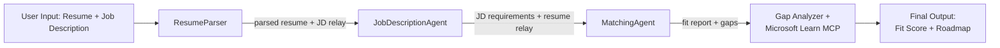

# PersonalCareerCopilot - អ្នកវាយតម្លៃការផ្គូផ្គងប្រវត្តិរូបសម្រាប់ការងារ

កម្មវិធីមួយ​ដែលផ្អែកលើចំណាត់ការកម្មវិធីពហុភ្នាក់ងារដែលវាយតម្លៃពីភាពសមរម្យរវាងប្រវត្តិរូបនិងការពិពណ៌នាការងារ បន្ទាប់មកបង្កើតផែនទីការសិក្សាផ្ទាល់ខ្លួនដើម្បីបិទចន្លោះកំហុស។

---

## ភ្នាក់ងារ

| ភ្នាក់ងារ | តួនាទី | ឧបករណ៍ |
|-------|------|-------|
| **ResumeParser** | សំរេចចេញជំនាញ ផ្លាស់ប្តូរ បទពិសោធន៍ និងវិញ្ញាបនបត្រពីអត្ថបទប្រវត្តិរូប | - |
| **JobDescriptionAgent** | សំរេចចេញជំនាញ តម្រូវ/ចូលចិត្ត បទពិសោធន៍ និងវិញ្ញាបនបត្រពីការពិពណ៌នាការងារ | - |
| **MatchingAgent** | ប្រៀបធៀបប្រវត្តិរូបនិងតម្រូវការវិភាគពិន្ទុសមរម្យ (0-100) និងជំនាញដែលបានឃើញ/ខាតបង់ | - |
| **GapAnalyzer** | បង្កើតផែនទីការសិក្សាផ្ទាល់ខ្លួនជាមួយធនធាន Microsoft Learn | `search_microsoft_learn_for_plan` (MCP) |

## ផ្ទាល់កិច្ចការ



---

## បង្ហាញឲ្យចេះលឿន

### 1. កំណត់បរិបទ

ហ្វូឡឺនេះជាការអនុវត្តយោងសម្រាប់កម្មវិធី Lab 02 ដែលផ្អែកលើចំណាត់ការកម្មវិធី។ `main.py` របស់វាប្រើប្រាស់ប្លុកប្រមូលព័ត៌មានដែលមានស្រាប់ បូកជាមួយ `WorkflowBuilder` ដើម្បីភ្ជាប់ភ្នាក់ងារបួននេះជាមួយគ្នា។

```powershell
cd workshop\lab02-multi-agent\PersonalCareerCopilot
python -m venv .venv
.\.venv\Scripts\Activate.ps1          # Windows PowerShell
# source .venv/bin/activate            # macOS / Linux
pip install -r requirements.txt
```

### 2. កំណត់គោលបំណងប្រើប្រាស់

បង្កើតឯកសារ `.env` ក្នុងហ្វូឡឺនេះ៖

```powershell
copy .env .env.bak 2>$null; echo $null > .env
```

កែសម្រួល `.env` ៖

```env
FOUNDRY_PROJECT_ENDPOINT=https://<your-account>.services.ai.azure.com/api/projects/<your-project>
AZURE_AI_MODEL_DEPLOYMENT_NAME=gpt-4.1-mini
```

| តម្លៃ | របៀបរកវា |
|-------|------------------|
| `FOUNDRY_PROJECT_ENDPOINT` | ផ្ទាំងបញ្ចាំង Foundry Toolkit → ចុចស្តាំលើគម្រោង → **ចម្លងព្រិត្តភាគគម្រោង** |
| `AZURE_AI_MODEL_DEPLOYMENT_NAME` | ផ្ទាំង Foundry → ពង្រីកគម្រោង → **ម៉ូឌែល + ព្រិត្តភាគ** → ឈ្មោះដាក់ប្រតិបត្តិការ |

### 3. រត់ក្នុងម៉ាស៊ីនមានខ្លួនឯង

```powershell
python -m debugpy --listen 127.0.0.1:5679 main.py --port 8088
```

ឬប្រើបេសកកម្ម VS Code ៖ `Ctrl+Shift+P` → **បេសកកម្ម៖ រត់បេសកកម្ម** → **រត់ម៉ាស៊ីនសេរី HTTP របស់ភ្នាក់ងារ**។

សម្រាប់បញ្ហាយោល F5 សូមប្រើ **ដ្បិតម៉ាស៊ីនសេរី HTTP របស់ភ្នាក់ងារ**។

### 4. ពិសោធជាមួយ Agent Inspector

បើក Agent Inspector ៖ `Ctrl+Shift+P` → **Foundry Toolkit៖ បើក Agent Inspector**។

បិទជូនបញ្ជាបញ្ញាបត្រ៖

```
Resume:
Jane Doe
Senior Software Engineer with 5 years of experience in Python, Django, and AWS.
Built microservices handling 10K+ requests/second. Led a team of 4 developers.
Certifications: AWS Solutions Architect Associate.
Education: B.S. Computer Science, State University.

Job Description:
Senior Cloud Engineer at Contoso Ltd.
Required: Python, Azure, Kubernetes, Terraform, CI/CD pipelines.
Preferred: Go, monitoring (Prometheus/Grafana), cost optimization.
Experience: 5+ years in cloud infrastructure.
Certifications: Azure Solutions Architect Expert preferred.
```

**គិតអ្វីដែលរង់ចាំ:** ពិន្ទុសមរម្យ (0-100), ជំនាញដែលបានឃើញ/ខាត, និងផែនទីការសិក្សាផ្ទាល់ខ្លួនជាមួយ URL Microsoft Learn។

### 5. បញ្ចេញទៅ Foundry

`Ctrl+Shift+P` → **Foundry Toolkit៖ បញ្ចេញភ្នាក់ងារតាមម៉ាស៊ីនផ្សព្វផ្សាយ** → ជ្រើសរើសគម្រោង → យល់ព្រម។

---

## រចនាសម្ព័ន្ធគម្រោង

```
PersonalCareerCopilot/
├── .env                ← Your credentials (git-ignored)
├── agent.yaml          ← Hosted agent definition (name, resources, env vars)
├── Dockerfile          ← Container image for Foundry deployment
├── main.py             ← 4-agent workflow (instructions, MCP tool, WorkflowBuilder)
└── requirements.txt    ← Python dependencies
```

## ឯកសារសំខាន់ៗ

### `agent.yaml`

កំណត់ភ្នាក់ងារតំណាងសម្រាប់សេវាភ្នាក់ងារ Foundry៖
- `kind: hosted` - រត់ជា container បានគ្រប់គ្រង
- `protocols` - ប្រើពិធីសាស្ត្រ `responses` ជាមួយ `version: 2.0.0` ដែលបង្ហាញច្រក HTTP `/responses`
- `environment_variables` - `AZURE_AI_MODEL_DEPLOYMENT_NAME` ត្រូវបានប្រកាសនៅទីនេះ; `FOUNDRY_PROJECT_ENDPOINT` ត្រូវបានបញ្ចូលដោយស្វ័យប្រវត្តិពេលដាក់ប្រើ

### `main.py`

មាន៖
- **ការណែនាំភ្នាក់ងារ** - ប្រែប្រួល `*_INSTRUCTIONS` បួន តួតែមួយសម្រាប់ភ្នាក់ងារម្នាក់
- **ឧបករណ៍ MCP** - `search_microsoft_learn_for_plan()` ហៅ `https://learn.microsoft.com/api/mcp` តាមរយៈ Streamable HTTP
- **ការបង្កើតភ្នាក់ងារ** - ឯកត្តភាព `Agent()` បួន + `AgentExecutor()` ចែករំលែក `FoundryChatClient` មួយ
- **ក្រាហ្វ workflow** - `WorkflowBuilder` ផ្ដុំភ្នាក់ងារតាមបណ្តោយ៖ ResumeParser → JD Agent → MatchingAgent → GapAnalyzer
- **ការចាប់ផ្តើមម៉ាស៊ីនបម្រើ** - `ResponsesHostServer` រត់នៅកំពង់ ៨០៨៨

### `requirements.txt`

| កញ្ចប់ | គោលបំណង |
|---------|----------|
| `agent-framework-foundry` | រតនៈរយៈពេល: `Agent`, `AgentExecutor`, `WorkflowBuilder`, `@tool`, `FoundryChatClient` |
| `agent-framework-foundry-hosting` | `ResponsesHostServer` + ការតភ្ជាប់ Foundry hosting |
| `mcp<2,>=1.24.0` | អតិថិជន MCP សម្រាប់ GapAnalyzer (`streamable_http_client`) |
| `debugpy` | ការត្រួតពិនិត្យកំហុស Python (F5 ក្នុង VS Code) |

---

## ការដោះស្រាយបញ្ហា

| បញ្ហា | ការស្វែងរកដំណោះស្រាយ |
|-------|-----|
| `KeyError: 'FOUNDRY_PROJECT_ENDPOINT'` ឬ `KeyError: 'AZURE_AI_MODEL_DEPLOYMENT_NAME'` | បង្កើត `.env` មានទាំង `FOUNDRY_PROJECT_ENDPOINT` និង `AZURE_AI_MODEL_DEPLOYMENT_NAME` បានកំណត់ |
| `ModuleNotFoundError: No module named 'agent_framework'` | បើក venv ហើយរត់ `pip install -r requirements.txt` |
| គ្មាន URL Microsoft Learn នៅលើលទ្ធផល | ពិនិត្យការតភ្ជាប់អ៊ីនធឺណិតទៅ `https://learn.microsoft.com/api/mcp` |
| មានកាត gap តែមួយ (ខ្លី) | ពិនិត្យមើល `GAP_ANALYZER_INSTRUCTIONS` រួមបញ្ចូលអ្នក `CRITICAL:` |
| កំពង់ ៨០៨៨ កំពុងប្រើ | បញ្ឈប់ម៉ាស៊ីនបម្រើផ្សេងទៀត៖ `netstat -ano \| findstr :8088` |

សម្រាប់ការដោះស្រាយបញ្ហាយ៉ាងលម្អិត សូមមើល [Module 8 - Troubleshooting](../docs/08-troubleshooting.md)។

---

**ដំណើរការពេញលេញ៖** [Lab 02 Docs](../docs/README.md) · **ត្រឡប់ទៅ៖** [Lab 02 README](../README.md) · [Workshop Home](../../../README.md)

---

<!-- CO-OP TRANSLATOR DISCLAIMER START -->
**ការបដិសេធ**:
ឯកសារនេះត្រូវបានបម្លែងភាសា ដោយប្រើសេវាបម្លែងភាសា AI [Co-op Translator](https://github.com/Azure/co-op-translator)។ ទោះយើងខ្ញុំមានក្តីប្រាថ្នាឱ្យបានច្បាស់លាស់ តែសូមយល់ដឹងថាការបម្លែងដោយស្វ័យប្រវត្តិក៏អាចមានកំហុសឬភាពមិនត្រឹមត្រូវ។ ឯកសារដើមជាភាសាទីតាំងគួរត្រូវបានគេប្រើជាប្រភពច្បាស់លាស់។ សម្រាប់ព័ត៌មានសំខាន់ៗ សូមណែនាំឱ្យប្រើប្រាស់ការប្រែដោយមនុស្សជំនាញ។ យើងខ្ញុំមិនទទួលខុសត្រូវចំពោះការយល់ច្រឡំ ឬការបកស្រាយខុសបន្ទាប់ពីការប្រើប្រាស់ការបម្លែងនេះនោះទេ។
<!-- CO-OP TRANSLATOR DISCLAIMER END -->