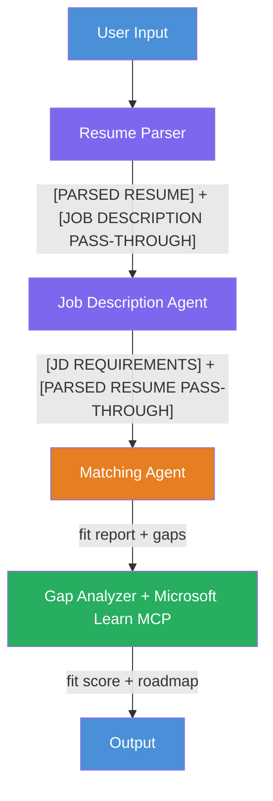

# មន្ទីរពិសោធន៍ 02 - របៀបធ្វើ Multi-Agent: Resume → Job Fit Evaluator

## ទិដ្ឋភាពទូទៅ

នៅក្នុងមន្ទីរពិសោធន៍ការប្រតิบត្តិនេះ អ្នកនឹងបង្កើតកម្មវិធី**multi-agent ប្រើរបៀប workflow ជាមុន** ដោយប្រើ Foundry Toolkit ក្នុង VS Code ហើយដាក់បញ្ចោញវាទៅ Microsoft Foundry Agent Service។

**អ្វីដែលអ្នកនឹងបង្កើត:** Resume → Job Fit Evaluator ដែលច្រកប្រមាញ resume និង job description ផ្តល់ពិន្ទុភាពសមនឹង និងបង្កើតផែនទីរៀនផ្ទាល់ខ្លួនដោយប្រើធនធាន Microsoft Learn។

---

## សំណុំរចនាសម្ព័ន្ធ

**របៀបវាដំណើរការ:**
1. អ្នកប្រើប្រាស់ភ្ជាប់ resume និង job description។
2. **ResumeParser** ច្រក resume និងចម្លង JD ដូចដើមទៅខ្នង `[JOB DESCRIPTION PASS-THROUGH]`។
3. **JD Agent** បំបែកតម្រូវការយ៉ាងរចនាសម្ព័ន្ធពី pass-through ហើយបញ្ជូន `[PARSED RESUME]` ទៅមុខជាមជ្ឈមណ្ឌល `[PARSED RESUME PASS-THROUGH]`។
4. **MatchingAgent** ប្រៀបធៀប `[PARSED RESUME PASS-THROUGH]` ជាមួយ `[JD REQUIREMENTS]` និងបង្កើតពិន្ទុភាពសមនឹង។
5. **GapAnalyzer** បម្លែងចន្លោះទៅជាផែនទីអនុវត្ត និងទាញយកតំណ Microsoft Learn ពិតៗតាមរយៈ MCP។

---

## លក្ខខណ្ឌមុន

សូមបញ្ចប់មន្ទីរពិសោធន៍ 01 ជាមុនបំផុត៖

- [មន្ទីរពិសោធន៍ 01 - Single Agent](../lab01-single-agent/README.md)

---

## ផ្នែក 1៖ អានមូឌុលៗតាមលំដាប់

មើលផ្លូវរៀនពេញលេញក្នុង៖

- [ឯកសារ Lab 2 - លក្ខខណ្ឌមុន](docs/00-prerequisites.md)
- [ឯកសារ Lab 2 - ផ្លូវរៀនពេញលេញ](docs/README.md)
- [មគ្គុទ្ទេសក៍កំណត់ PersonalCareerCopilot](PersonalCareerCopilot/README.md)

---

## ផ្នែក 2៖ បង្កើត និងសាកល្បង workflow

1. ប្រើកម្មវិធីរង Foundry Toolkit ដើម្បីបង្កើតគំរោងផ្អែកលើ workflow។
2. ចម្លងប្លុកបញ្ជា និងក្រាហ្វ workflow ពី `PersonalCareerCopilot/main.py` ទៅតំបន់ធ្វើការ។
3. ប្រតិបត្តិការព្រឺព្រួចជាកន្លែងជាមួយ Agent Inspector ហើយផ្ទៀងផ្ទាត់ភ្នាក់ងារទាំងបួននិងឧបករណ៍ MCP។
4. ផ្ញើភ្នាក់ងាររក្សាទុកទៅ Foundry នៅពេលសាកល្បងក្នុងកន្លែងជោគជ័យ។

---

## គំរូ orchestration

Lab 02 ប្រើ **pipeline តាមលំដាប់**៖ លទ្ធផលភ្នាក់ងារមួយផ្គត់ផ្គង់ទៅភ្នាក់ងារបន្ទាប់ ហើយ workflow ត្រឡប់ការឆ្លើយតបចុងក្រោយពីភ្នាក់ងារ។ គូរគំរូពីរនេះធ្វើឱ្យវាដំណើរការ៖

- **ខ្សែតាមលំដាប់** - `WorkflowBuilder` សម្ភាស ResumeParser → JD Agent → MatchingAgent → GapAnalyzer ដោយមានការហៅ `add_edge()` មួយសម្រាប់ក្នងជំហានមួយៗ
- **ការផ្ទេរគំនិត** - ព្រោះភ្នាក់ងារណាមួយមើលតែនៅលទ្ធផលភ្នាក់ងារមុនរបស់ខ្លួន ResumeParser និង JD Agent ចម្លងទិន្នន័យទៅភ្នាក់ងារដែលត្រូវការនៅខាងក្រោមក្នុង pass-through ដែលមានស្លាក។

ឯកសារបកស្រាយហេតុអ្វីមន្ទីរពិសោធន៍មិនប្រើ fan-out/fan-in និងរបៀបបន្ថែមភ្នាក់ងារថ្មីជាមួយក្រាហ្វនេះ។

មើល [docs/04-orchestration-patterns.md](docs/04-orchestration-patterns.md)។

---

**មុននេះ:** [មន្ទីរពិសោធន៍ 01 - Single Agent](../lab01-single-agent/README.md) · **ត្រឡប់ទៅ:** [ទំព័រផ្ទះសិក្ខាសាលា](../../README.md)

---

<!-- CO-OP TRANSLATOR DISCLAIMER START -->
**ការបដិសេធ**:
ឯកសារនេះត្រូវបានបម្លែងភាសា ដោយប្រើសេវាបម្លែងភាសា AI [Co-op Translator](https://github.com/Azure/co-op-translator)។ ទោះយើងខ្ញុំមានក្តីប្រាថ្នាឱ្យបានច្បាស់លាស់ តែសូមយល់ដឹងថាការបម្លែងដោយស្វ័យប្រវត្តិក៏អាចមានកំហុសឬភាពមិនត្រឹមត្រូវ។ ឯកសារដើមជាភាសាទីតាំងគួរត្រូវបានគេប្រើជាប្រភពច្បាស់លាស់។ សម្រាប់ព័ត៌មានសំខាន់ៗ សូមណែនាំឱ្យប្រើប្រាស់ការប្រែដោយមនុស្សជំនាញ។ យើងខ្ញុំមិនទទួលខុសត្រូវចំពោះការយល់ច្រឡំ ឬការបកស្រាយខុសបន្ទាប់ពីការប្រើប្រាស់ការបម្លែងនេះនោះទេ។
<!-- CO-OP TRANSLATOR DISCLAIMER END -->