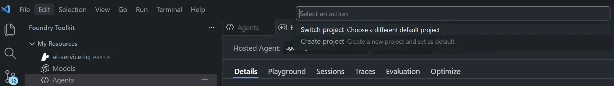

# មូឌុល 0 - ការណែនាំ

⏱️ ~10 នាទី

> [!WARNING]
> **ការមើលជាមុន និងកម្រិត៖** [ភ្នាក់ងារផ្គត់ផ្គង់](https://learn.microsoft.com/azure/foundry/agents/concepts/hosted-agents) កំពុងនៅក្នុង **ការមើលជាមុនសាធារណៈ** - មិនបានផ្ដល់អនុសាសន៍សម្រាប់បេសកកម្មផលិតកម្មទេ។ មុខងាររៀងៗខ្លះដែលបង្ហាញក្នុងសិក្ខាសាលានេះអាចផ្លាស់ប្តូរប្រសិនបើសេវាកម្មជិតទៅសម្រាប់ GA។

## អ្វីដែលអ្នកនឹងសាងសង់

នៅក្នុងមន្ទីរពិសោធន៍នេះ អ្នកពង្រីកជំនាញភ្នាក់ងារតែមួយពី មន្ទីរពិសោធន៍ 01 ដើម្បីបង្កើត **សន្ទស្សន៍ភ្នាក់ងារច្រើន** - កម្មវិធី Resume → Job Fit Evaluator។

អ្នកលើកអត្ថបទ **ប្រវត្តិរូប** និង **ការពិពណ៌នាអំពីការងារ**។ ភ្នាក់ងាររៀងៗគ្នា ៤ នាក់ដំណើរការចូលប្រព័ន្ធតាមលំដាប់ បន្ទាប់មកផ្ដល់តម្លៃ៖
- ពិន្ទុសមរម្យ (0–100 ជាមួយការបែងចែកពិន្ទុ)
- បញ្ជីចន្លោះជំនាញ និងវិញ្ញាបនបត្រ
- ផ្លូវរៀនផ្ទាល់ខ្លួនជាមួយតំណភ្ជាប់បណ្តុះបណ្តាល Microsoft Learn ពិតប្រាកដសម្រាប់ចន្លោះនីមួយៗ

**សន្ទស្សន៍នេះប្រើប្រាស់៖**
- **ស៊ុមភ្នាក់ងាររបស់ Microsoft** - `WorkflowBuilder` សម្រាប់ការរៀបចំបណ្តោយបង្គោលតាមលំដាប់
- **Foundry Toolkit សម្រាប់ VS Code** - ជារចនាសម្ព័ន្ធ ការសាកល្បងនៅក្នុងស្រុក និងការចេញផ្សាយ
- **គំរូ AI** (ឧ. `gpt-4.1-mini`) - ប្រើសម្រាប់ភ្នាក់ងាររាល់សិបនាក់
- **ម៉ាស៊ីនមេ Microsoft Learn MCP** - ផ្ដល់តំណភ្ជាប់ធនធានសិក្សាពិតប្រាកដសម្រាប់ចន្លោះជំនាញ

---

## ជ្រើសរើសផ្លូវរបស់អ្នក

> ⚠️ **បន្តជាមួយផ្លូវដដែលដែលអ្នកបានប្រើនៅក្នុង មន្ទីរពិសោធន៍ 01។**

<details open>
<summary><strong>🅰️ ផ្លូវ A - មេឃ Azure (ត្រូវការជាវសេវា Azure)</strong></summary>

| | ព័ត៌មានលំអិត |
|---|---|
| **សម្រាប់នរណា?** | អ្នកបានបញ្ចប់ មន្ទីរពិសោធន៍ 01 ដោយប្រើជាវសេវា Azure |
| **គំរូ** | Azure OpenAI តាមរយៈ Foundry (ឧ. `gpt-4.1-mini`) |
| **មូឌុលដែលគ្របដណ្តប** | មូឌុលទាំងអស់ (00–09) |
| **ចេញផ្សាយទៅមេឃទេ?** | ✅ បាទ - ចេញផ្សាយពេញលេញពីដើមដល់ចុង |

</details>

<details open>
<summary><strong>🅱️ ផ្លូវ B - Foundry Local (មិនត្រូវការជាវសេវា Azure)</strong></summary>

| | ព័ត៌មានលំអិត |
|---|---|
| **សម្រាប់នរណា?** | អ្នកបានបញ្ចប់ មន្ទីរពិសោធន៍ 01 ដោយប្រើ Foundry Local |
| **គំរូ** | Foundry Local (ឥតគិតថ្លៃ រត់លើម៉ាស៊ីនរបស់អ្នក) |
| **មូឌុលដែលគ្របដណ្តប** | មូឌុល 00–05 (រំលង 06–07 - ចេញផ្សាយ និងផ្ទៀងផ្ទាត់មេឃ) |
| **ចេញផ្សាយទៅមេឃទេ?** | ❌ ទេ - សាកល្បងក្នុងស្រុកតែតាមរយៈ Agent Inspector |

</details>

---

## បញ្ជាក់ពី មន្ទីរពិសោធន៍ 01

មន្ទីរពិសោធន៍ 02 កសាងផ្ទាល់លើមន្ទីរពិសោធន៍ 01។ សូមបញ្ចប់ មន្ទីរពិសោធន៍ 01 ជាមុនសិនមុនពេលចាប់ផ្តើមនៅទីនេះ។

មិនបានធ្វើ មន្ទីរពិសោធន៍ 01 ទេមែនទេ? ចាប់ផ្តើមនៅទីនេះ៖ [មន្ទីរពិសោធន៍ 01 - ការណែនាំ](../../lab01-single-agent/docs/00-prerequisites.md)

<details open>
<summary><strong>🅰️ ផ្លូវ A - មេឃ Azure</strong></summary>

```powershell
az account show --query "{name:name, id:id}" --output table
```

ប្រសិនបើមានបញ្ហា ដំណើរការ `az login`។ បន្ទាប់មកផ្ទៀងផ្ទាត់នៅក្នុង VS Code:

1. `Ctrl+Shift+P` → វាយ **Foundry Toolkit** → បញ្ជាក់ែាច់បញ្ជាការបង្ហាញ។
2. ចុចរូបតំណាង **Foundry Toolkit** → គម្រោងរបស់អ្នក និងគំរូការចេញផ្សាយបង្ហាញ **ជោគជ័យ**។



> **RBAC:** អ្នកបានចាត់តាំង **Foundry User** ក្នុង មន្ទីរពិសោធន៍ 01។ ប្រសិនបើចង់បំលែង សូមមើល [មន្ទីរពិសោធន៍ 01, មូឌុល 1](../../lab01-single-agent/docs/01-setup.md#deploy-a-model--assign-rbac)។ តួនាទីនេះមានឈ្មោះមុនថា **Azure AI User** - មានការអនុញ្ញាតដូចគ្នា។

</details>

<details open>
<summary><strong>🅱️ ផ្លូវ B - Foundry Local</strong></summary>

```powershell
Invoke-WebRequest -Uri "http://localhost:5273/v1/health" -UseBasicParsing | Select-Object StatusCode
```

គេរំពឹងថា: `StatusCode: 200`។ ប្រសិនបើមិនបង្ហាញឡើយ សូមចាប់ផ្តើមឡើងវិញ Foundry Local ពីផ្នែក Foundry Toolkit sidebar។

> ការវិភាគទិន្នន័យទាំងអស់បើកនៅលើម៉ាស៊ីនរបស់អ្នក។ ការហៅទៅខាងក្រៅតែម្ដងគឺឧបករណ៍ MCP ទៅកាន់ `https://learn.microsoft.com/api/mcp`។

</details>

---

## អ្វីដែលថ្មីនៅក្នុង មន្ទីរពិសោធន៍ 02

| | មន្ទីរពិសោធន៍ 01 | មន្ទីរពិសោធន៍ 02 |
|--|--------|--------|
| ភ្នាក់ងារ | ១ | ៤ (ភ្ជាប់ជាមួយ WorkflowBuilder) |
| គំរូគោល | មូលដ្ឋាន - ស៊ុមភ្នាក់ងារ | សន្ទស្សន៍ការងារ - ស៊ុមភ្នាក់ងារ |
| កញ្ចប់ថ្មី | - | `mcp` |
| កម្មវិធីរៀបចំ | ភ្នាក់ងារសន្ទស្សន៍តែមួយ | បណ្តោយបង្គោលតាមលំដាប់ (WorkflowBuilder) |
| ឧបករណ៍ថ្មី | - | `search_microsoft_learn_for_plan` (MCP) |

---

**បន្ទាប់:** [01 - យល់ដឹងអំពីស្ថាបត្យកម្ម →](01-understand-multi-agent.md)

---

<!-- CO-OP TRANSLATOR DISCLAIMER START -->
**ការបដិសេធ**:
ឯកសារនេះត្រូវបានបម្លែងភាសា ដោយប្រើសេវាបម្លែងភាសា AI [Co-op Translator](https://github.com/Azure/co-op-translator)។ ទោះយើងខ្ញុំមានក្តីប្រាថ្នាឱ្យបានច្បាស់លាស់ តែសូមយល់ដឹងថាការបម្លែងដោយស្វ័យប្រវត្តិក៏អាចមានកំហុសឬភាពមិនត្រឹមត្រូវ។ ឯកសារដើមជាភាសាទីតាំងគួរត្រូវបានគេប្រើជាប្រភពច្បាស់លាស់។ សម្រាប់ព័ត៌មានសំខាន់ៗ សូមណែនាំឱ្យប្រើប្រាស់ការប្រែដោយមនុស្សជំនាញ។ យើងខ្ញុំមិនទទួលខុសត្រូវចំពោះការយល់ច្រឡំ ឬការបកស្រាយខុសបន្ទាប់ពីការប្រើប្រាស់ការបម្លែងនេះនោះទេ។
<!-- CO-OP TRANSLATOR DISCLAIMER END -->