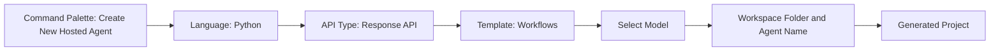
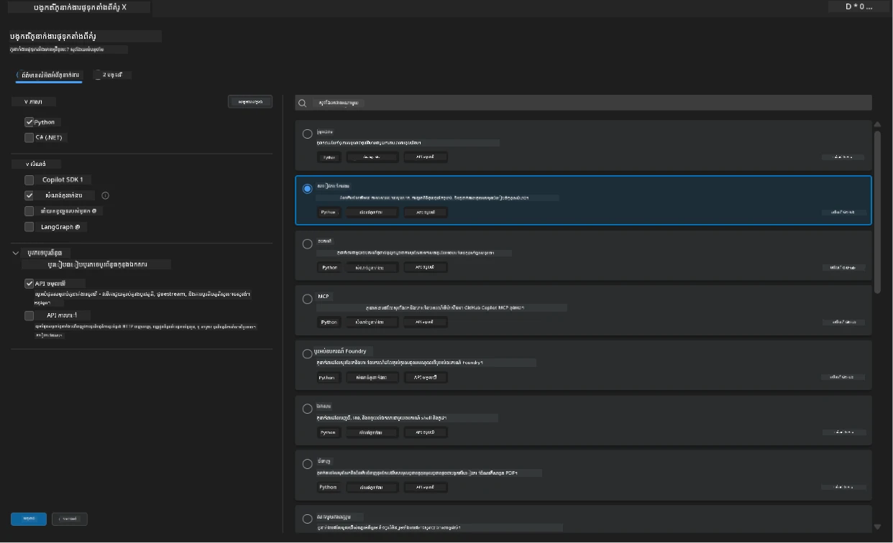
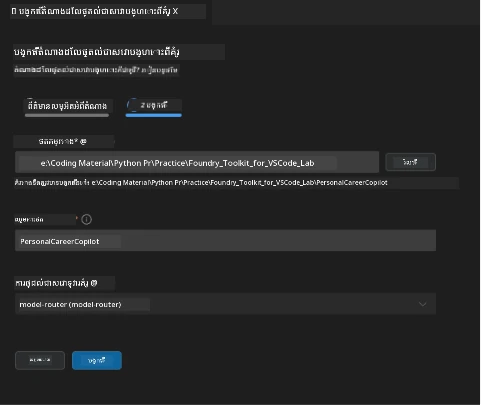

# មូឌ្យុល 2 - បង្កើតគម្រោង Multi-Agent

⏱️ ~5 នាទី

នៅក្នុងមូឌ្យុលនេះ អ្នកប្រើ [Foundry Toolkit for VS Code](https://aka.ms/foundrytk) ដើម្បី **បង្កើតគម្រោង multi-agent**។ វីហ្វស៊ីដបង្កើត `agent.yaml`, `main.py`, `Dockerfile`, `requirements.txt`, `.env`, និងការប្រើប្រាស់លំនាំសម្រាប់ VS Code ដោយសម្រាប់ debug - ដូច្នេះអ្នកអាចផ្តោតលើការតភ្ជាប់ហ្វ្លូវការងារ 4-agent នៅមូឌ្យុល 3។

> **គំនិតសំខាន់៖** ការបង្កើត scaffold គឺជាគំរូធ្វើការដែលមានអ្នកប្រតិបត្តិម្នាក់។ អ្នកដាក់ចន្លោះគំនិតជំនួសជាមួយក្រាហ្វិក `WorkflowBuilder` នៅមូឌ្យុល 3។ អ្នកមិនចាំបាច់សរសេរបទបញ្ជារៀងពីដើមទេ។

> **កំណត់ត្រាទើបតែសរសេរ៖** [`PersonalCareerCopilot/`](../../../../../workshop/lab02-multi-agent/PersonalCareerCopilot) គឺជាឧទាហរណ៍ដែលបំពេញការងារ។ ប្រើវាដើម្បីប្រៀបធៀបជាមួយការងាររបស់អ្នកលើដំណាក់កាល។

### ជំហានអ្នកគ្រូបង្រៀន scaffold



---

## ជំហាន 1: បើកវិហ្វស៊ីដ Create Hosted Agent

1. ចុច `Ctrl+Shift+P` ដើម្បីបើក **Command Palette**។
2. វាយ: **Foundry Toolkit: Create new Hosted Agent** ហើយជ្រើសរើសវា។
3. វីហ្វស៊ីដនឹងបើកនៅផ្ទាំង **Agent Details**។

> **ជម្រើសផ្សេងទៀត៖** ចុចរូបតំណាង **Foundry Toolkit** នៅក្នុងរបារសកម្មភាព → ចុចរូបតំណាង **+** នៅខាងក្បាល **Hosted Agents** → **Create New Hosted Agent**។

---

## ជំហាន 2: ជ្រើសរើសកំណត់រចនាសម្ព័ន្ធ



1. នៅផ្នែករុករក/ជម្រើសខាងឆ្វេង ជ្រើសរើសដូចខាងក្រោម៖

| មឺនុយ | ជម្រើស | កំណត់សម្គាល់ |
|--------|-----------|-------|
| **ភាសា** | Python | ផលិតកម្ម C# (.NET) ក៏គាំទ្រផងដែរ |
| **ស៊ុមរចនា** | Agent Framework | ផ្ដល់ `Agent`, `AgentExecutor`, `WorkflowBuilder` |
| **ប្រភេទ API** | Response API | `POST /responses` - ប្រព័ន្ធគ្រប់គ្រងប្រវត្តិ, គាំទ្រការផ្សាយតាមបណ្តាញ |
| **គំរូ** | **Workflows** | ដំណើរការសំណើទៅតាមជំនួសបន្តបន្ទាប់នៅក្នុងអ្នកប្រតិបត្តិជាច្រើន |

2. បន្ទាប់ពីជ្រើសរើសរួចចុច **Next**



3. នៅបង្អួចបន្ទាប់ ជ្រើសរើសដូចខាងក្រោម៖

| មឺនុយ | ជម្រើស | កំណត់សម្គាល់ |
|--------|-----------|-------|
| **ថតការងារ** | រុករកទៅថតគោលដៅ | ឧទាហរណ៍ `workshop/lab02-multi-agent/` ក្នុង repo នេះ |
| **ឈ្មោះអេហ្សង់** | `PersonalCareerCopilot` | នេះក្លាយជាឈ្មោះថតគំរោង |
| **ការចេញផ្សាយម៉ូដែល** | ជ្រើសម៉ូដែលដែលបានចេញផ្សាយរបស់អ្នក | ឧទាហរណ៍ `gpt-4.1-mini` ពីលាប 01 |

4. ចុច **Create** ដើម្បីបង្កើត scaffold គម្រោង។ VS Code នឹងបង្កើតឯកសារនិងបើកថតគម្រោង។

> **គន្លឹះ:** [`gpt-4.1-mini`](https://learn.microsoft.com/azure/foundry/foundry-models/concepts/models-sold-directly-by-azure#gpt-41-series) សម្រួលល្បឿននិងគុណភាពល្អសម្រាប់ការអភិវឌ្ឍ multi-agent។

---

## ជំហាន 3: ពិនិត្យគម្រោងដែលបានបង្កើត

បន្ទាប់ពីបញ្ចប់ការបង្កើត scaffold ផ្ទៀងផ្ទាត់មើលឃើញឯកសារទាំងនេះនៅក្នុង Explorer (`Ctrl+Shift+E`):

```
📂 <your-agent-name>/
├── .azdignore          ← Files excluded from Azure Developer CLI deployments
├── .dockerignore       ← Files excluded from Docker builds
├── .env                ← Environment variables (placeholders - fill in Module 3)
├── .vscode/
│   ├── launch.json     ← Debug config (F5 → run + Agent Inspector)
│   └── tasks.json      ← VS Code task definitions
├── agent.yaml          ← Agent definition (kind: hosted, protocol: responses)
├── Dockerfile          ← Container config for deployment
├── main.py             ← Stub agent entry point (replace with WorkflowBuilder in Module 3)
└── requirements.txt    ← Python dependencies
```

> **សំខាន់៖** បើកថត scaffold នេះដោយផ្ទាល់ក្នុង VS Code ដើម្បីឲ្យ `.vscode/launch.json` និង `tasks.json` អនុវត្តបានត្រឹមត្រូវសម្រាប់ F5 debugging។

### និយមន័យឯកសារសំខាន់ៗ

| ឯកសារ | មានប្រយោជន៍ដើម្បី |
|------|---------|
| `agent.yaml` | ចេញផ្សាយ `kind: hosted`, ផ្សារ env vars, កំណត់ប្រតិបត្តិការប្រព័ន្ធ `/responses` protocol |
| `main.py` | គំរូ: អ្នកប្រតិបត្តិម្នាក់ `FoundryChatClient` → `Agent` → `ResponsesHostServer`។ អ្នកប្រែប្រួលវាជាមួយអ្នកប្រតិបត្តិ 4 នាក់ + `WorkflowBuilder` នៅមូឌ្យុល 3 |
| `Dockerfile` | `python:3.12-slim`, ដំឡើង `requirements.txt`, បើកច្រក 8088, ប្រតិបត្ដិ `python main.py` |
| `requirements.txt` | `agent-framework-foundry`, `agent-framework-foundry-hosting`, `mcp<2,>=1.24.0`, `debugpy` |

> **យោង៖** មើល [`PersonalCareerCopilot/agent.yaml`](../../../../../workshop/lab02-multi-agent/PersonalCareerCopilot/agent.yaml) និង [`PersonalCareerCopilot/requirements.txt`](../../../../../workshop/lab02-multi-agent/PersonalCareerCopilot/requirements.txt) សម្រាប់មាតិកាទាំងស្រុងដែលបានបង្កើត។

---

### ✅ ចំណុចត្រួតពិនិត្យ

- [ ] បានបញ្ចប់វិហ្វស៊ីដ scaffold - ថតគម្រោងថ្មីបង្ហាញក្នុង Explorer
- [ ] ឯកសារដែលរំពឹងទុកទាំងអស់មាន: `agent.yaml`, `main.py`, `Dockerfile`, `requirements.txt`, `.env`
- [ ] `agent.yaml` បង្ហាញ `kind: hosted` ហើយ `protocol: responses`
- [ ] `main.py` នាំចូល `Agent`, `FoundryChatClient`, `ResponsesHostServer`
- [ ] បានបើកថត scaffold ជាមូលដ្ឋានកន្លែងការងារ VS Code
- [ ] អ្នកយល់ថា `main.py` គឺជាគំរូ stub - `WorkflowBuilder` នឹងត្រូវបញ្ចូលនៅមូឌ្យុល 3

---

**មុននេះ:** [01 - យល់ដឹងអំពីស្ថាបត្យកម្មអនុគណៈកម្មការជាច្រើន](01-understand-multi-agent.md) · **បន្ទាប់:** [03 - កំណត់រចនាសម្ព័ន្ធភ្នាក់ងារ និងបរិយាកាស →](03-configure-agents.md)

---

<!-- CO-OP TRANSLATOR DISCLAIMER START -->
**ការបដិសេធ**:
ឯកសារនេះត្រូវបានបម្លែងភាសា ដោយប្រើសេវាបម្លែងភាសា AI [Co-op Translator](https://github.com/Azure/co-op-translator)។ ទោះយើងខ្ញុំមានក្តីប្រាថ្នាឱ្យបានច្បាស់លាស់ តែសូមយល់ដឹងថាការបម្លែងដោយស្វ័យប្រវត្តិក៏អាចមានកំហុសឬភាពមិនត្រឹមត្រូវ។ ឯកសារដើមជាភាសាទីតាំងគួរត្រូវបានគេប្រើជាប្រភពច្បាស់លាស់។ សម្រាប់ព័ត៌មានសំខាន់ៗ សូមណែនាំឱ្យប្រើប្រាស់ការប្រែដោយមនុស្សជំនាញ។ យើងខ្ញុំមិនទទួលខុសត្រូវចំពោះការយល់ច្រឡំ ឬការបកស្រាយខុសបន្ទាប់ពីការប្រើប្រាស់ការបម្លែងនេះនោះទេ។
<!-- CO-OP TRANSLATOR DISCLAIMER END -->