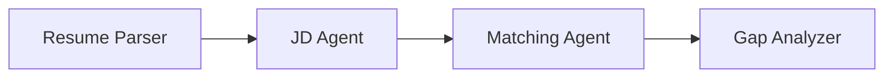
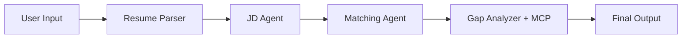

# មេរៀន 4 - លំនាំការត្រួតពិនិត្យ

⏱️ ~10 នាទី

ក្នុងមេរៀននេះ អ្នកស្វែងយល់អំពីលំនាំការត្រួតពិនិត្យដែលប្រើក្នុងកម្មវិធី Resume Job Fit Evaluator និងរៀនពីរបៀបអាន កែប្រែ និងពង្រីកក្រាហ្វវិធីការងារ។ ការយល់ដឹងពីលំនាំទាំងនេះគឺមានសារៈសំខាន់សម្រាប់ដោះស្រាយបញ្ហាស្ត្រីមុខចរន្តទិន្នន័យ និងសាងសង់ [workflows បុគ្គលិកជាច្រើន](https://learn.microsoft.com/agent-framework/workflows/) របស់អ្នកឯង។

---

## លំនាំ 1: ខ្សែស្រឡាយជាក្រឡា

លំនាំមូលដ្ឋាននៅក្នុងវិធីការងារគឺជា **ខ្សែស្រឡាយជាក្រឡា** - ចេញផ្សាយរបស់ភ្នាក់ងារក្នុងមួយបញ្ចូលទៅភ្នាក់ងារបន្ទាប់ដោយផ្ទាល់។



ក្នុងកូដ ការហៅ​​ `add_edge()` មួយគូរជំហានមួយនៅក្នុងខ្សែស្រឡាយ៖

```python
.add_edge(resume_executor, jd_executor)       # ResumeParser output → JD Agent
.add_edge(jd_executor, matching_executor)     # JD Agent output → MatchingAgent
.add_edge(matching_executor, gap_executor)    # MatchingAgent output → GapAnalyzer
```

> **ហេតុអ្វីបានជាជាក្រឡា មិនមែន fan-out/fan-in?** `WorkflowBuilder` ប្រើ **OR-semantics** សំរាប់កោងទេចូល៖ អ្នកអនុវត្តន៍បន្ទាប់ ហ៊ុំពេលដែល **ម្ដងណាមួយ**ភ្នាក់ងារពីមុនបញ្ចប់។ ប្រសិនបើ `matching_executor` មានពីរកោងចូល (ពីទាំង `resume_executor` និង `jd_executor`) វានឹងធ្វើមុខងារពីរដង - ដងមួយពេល ResumeParser បញ្ចប់ ហើយដងមួយពេល JD Agent បញ្ចប់ - នាំឲ្យ GapAnalyzer រត់ពីរដង និងចេញផលិតផលពីរដង។ ខ្សែស្រឡាយជាក្រឡាបង្ការទាំងនេះបានលើកលែង។

## លំនាំ 2: ការផ្ទេរមាតិការណ៍

ពីព្រោះ `context_mode="last_agent"` មានន័យថាអ្នកអនុវត្តន៍មើលឃើញតែ **លទ្ធផលភ្នាក់ងារមុនទីផ្ទាល់** តែប៉ុណ្ណោះ ភ្នាក់ងារនៅក្នុងខ្សែស្រឡាយជាក្រឡាត្រូវតែផ្ទេរទិន្នន័យណាមួយដែលភ្នាក់ងារខាងក្រោមត្រូវការយ៉ាងច្បាស់។

ក្នុងវិធីការងារនេះ៖
- **ResumeParser** ចម្លង JD ដោយដូចដើមទៅ `[JOB DESCRIPTION PASS-THROUGH]` (ដើម្បីឲ្យ JD Agent អាចស្វែងរកវា)។
- **JD Agent** ចម្លង `[PARSED RESUME]` ដូចដើមទៅ `[PARSED RESUME PASS-THROUGH]` (ដើម្បីឲ្យ MatchingAgent អាចប្រៀបធៀបប្រវត្តិរូបទាំងពីរ)។

```
ResumeParser output
└─ [PARSED RESUME]               ← extracted by JD Agent
└─ [JOB DESCRIPTION PASS-THROUGH] ← extracted by JD Agent

JD Agent output
└─ [JD REQUIREMENTS]             ← extracted by MatchingAgent
└─ [PARSED RESUME PASS-THROUGH]  ← extracted by MatchingAgent
```

ផ្នែកផ្ទេរសារារៀងរាល់កន្លែងត្រូវតែលេចធ្លោក្នុង **របៀបដូចដើម** - ការសង្ខេប ឬការលើកឡើងផ្សេងទៀតនឹងបំផ្លាញភ្នាក់ងារខាងក្រោមដែលពឹងផ្អែកលើវា។

---

## ក្រាហ្វពេញលេញ

ការរួមបញ្ចូលលំនាំខ្សែស្រឡាយជាក្រឡា និងការផ្ទេរមាតិការណ៍ បង្កើតវិធីការងារពេញលេញ៖



Agent Inspector បង្ហាញរូបរាងក្រាហ្វដូចគ្នានេះ ពេលភ្នាក់ងាររត់ក្នុងម៉ាស៊ីនក្នុងមូលដ្ឋាន។ សូមយោងទៅ [មេរៀន 5 - សាកល្បងក្នុងម៉ាស៊ីនក្នុងមូលដ្ឋាន](05-test-locally.md) សម្រាប់រូបថតចាក់។

---

## អានកូដ WorkflowBuilder

ក្រាហ្វវិធីការងារត្រូវបានកសាងនៅក្នុងមុខងារ `main()` ក្នុង [`PersonalCareerCopilot/main.py`](../../../../../workshop/lab02-multi-agent/PersonalCareerCopilot/main.py)។ ការហៅ `add_edge()` បីដងកសាងខ្សែស្រឡាយជាក្រឡា៖

| # | កោង | ផលប៉ះពាល់ |
|---|------|----------|
| 1 | `resume_executor → jd_executor` | ភ្នាក់ងារ JD ទទួលបាន `[PARSED RESUME]` + `[JOB DESCRIPTION PASS-THROUGH]` |
| 2 | `jd_executor → matching_executor` | MatchingAgent ទទួលបាន `[JD REQUIREMENTS]` + `[PARSED RESUME PASS-THROUGH]` |
| 3 | `matching_executor → gap_executor` | GapAnalyzer ទទួលបានរបាយការណ៍សាកសម + បញ្ជីបន្ទាត់ខ្វះ |

---

## កែប្រែក្រាហ្វ

### បន្ថែមភ្នាក់ងារថ្មីមួយ

ដើម្បីបន្ថែមភ្នាក់ងារចំនួនប្រាំ (ឧ. **InterviewPrepAgent** បន្ទាប់ពី GapAnalyzer)៖

1. កំណត់ថេរ `INTERVIEW_PREP_INSTRUCTIONS`។
2. បង្កើតវត្ថុ `Agent` + `AgentExecutor` (លំនាំដូចគ្នានឹងបួនស្ថិតមាន)។
3. បន្ថែម `.add_edge(gap_executor, interview_exec)` នៅក្នុង `WorkflowBuilder`។
4. បន្ទាន់សម័យ `output_executors=[interview_exec]`។

> **សំខាន់៖** `start_executor` ជាភ្នាក់ងារតែមួយគត់ដែលទទួលបានបញ្ចូលអ្នកប្រើប្រាស់ដើម។ ភ្នាក់ងារផ្សេងទៀតទទួលលទ្ធផលពីកោងឆ្វេងខាងលើ។

---

## កំហុសគ្រាហ្វទូទៅ

| កំហុស | រាងរិះរាល | ដំណោះស្រាយ |
|---------|----------|-------|
| ខាតកោងដល់ `output_executors` | ភ្នាក់ងាររត់ប៉ុន្តលទ្ធផលទទេ | ជ្រាបច្រកពី `start_executor` ទៅភ្នាក់ងារទាំងអស់ក្នុង `output_executors` |
| គ្នាស្របគ្នាផ្ទង | ឈប់នឹងវិលជុំទាំងអស់ ឬពន្យារពេល | ពិនិត្យមើលថាភ្នាក់ងារមិនផ្ដល់ខ្សែត្រឡប់ទៅភ្នាក់ងារខាងលើ |
| ភ្នាក់ងារនៅក្នុង `output_executors` គ្មានកោងចូល | លទ្ធផលទទេ | បន្ថែមយ៉ាងហោចណាស់១ `add_edge(source, that_agent)` |
| ភ្នាក់ងារច្រើន `output_executors` លែងមាន fan-in | លទ្ធផលមានតែចម្លើយភ្នាក់ងារតែមួយ | ប្រើភ្នាក់ងារចេញតែមួយដែលបញ្ចូល, ឬទទួលច្រើនលទ្ធផល |
| ខាត `start_executor` | `ValueError` ពេលកសាង | ជាប្រចាំបញ្ជាក់ `start_executor` ក្នុង `WorkflowBuilder()` |

---

## ការដោះស្រាយបញ្ហាគ្រាហ្វ

### ប្រើAgent Inspector

1. ចាប់ផ្តើមភ្នាក់ងារជាលក្ខណៈក្នុងម៉ាស៊ីនមូលដ្ឋានជាមួយ F5។
2. បើក Agent Inspector (`Ctrl+Shift+P` → **Foundry Toolkit: Open Agent Inspector**)។
3. ផ្ញើសារសាកល្បងមួយ។
4. នៅផ្នែកចម្លើយរបស់ Inspector ស្វែងរក **លទ្ធផលបង្ហោះផ្សាយ** - វាបង្ហាញការចូលរួមរបស់ភ្នាក់ងារនីមួយៗតាមលំដាប់។


### ប្រើកំណត់ហេតុ

បន្ថែមកំណត់ហេតុទៅ `main.py` ដើម្បីតាមដានចរន្តទិន្នន័យ៖

```python
import logging
logger = logging.getLogger("resume-job-fit")

# In main(), after building the workflow:
logger.info("Workflow graph built with edges: RP→JD, JD→MA, MA→GA")
```

កំណត់ហេតុម៉ាស៊ីនបម្រើបង្ហាញលំដាប់អនុវត្តភ្នាក់ងារ និងការហៅឧបករណ៍ MCP៖

```
INFO:agent_framework:Executing agent: ResumeParser
INFO:agent_framework:Executing agent: JobDescriptionAgent
INFO:agent_framework:Executing agent: MatchingAgent
INFO:agent_framework:Executing agent: GapAnalyzer
INFO:agent_framework:Tool call: search_microsoft_learn_for_plan(skill="Kubernetes")
POST https://learn.microsoft.com/api/mcp → 200
INFO:agent_framework:Tool call: search_microsoft_learn_for_plan(skill="Terraform")
POST https://learn.microsoft.com/api/mcp → 200
```

---

### ពិនិត្យជំហាន

- [ ] អ្នកអាចស្គាល់លំនាំការត្រួតពិនិត្យពីរគឺខ្សែស្រឡាយជាក្រឡា និងការផ្ទេរមាតិការណ៍
- [ ] អ្នកយល់ថាហេតុអ្វី `context_mode="last_agent"` ត្រូវការការផ្ទេរទិន្នន័យជាក់លាក់ពីភ្នាក់ងារមួយទៅមួយទៀត
- [ ] អ្នកអាចអានកូដ `WorkflowBuilder` និងផ្គូផ្គងការហៅ `add_edge()` ទៅនឹងក្រាហ្វនៃមើលឃើញ
- [ ] អ្នកចេះបន្ថែមភ្នាក់ងារថ្មីចុងបង្អស់ខ្សែស្រឡាយ
- [ ] អ្នកអាចសម្គាល់កំហុសក្រាហ្វទូទៅ និងរាងរិះរាលរបស់វា

---

**មុននេះ:** [03 - កំណត់រចនាសម្ព័ន្ធភ្នាក់ងារ & បរិស្ថាន](03-configure-agents.md) · **បន្ទាប់:** [05 - សាកល្បងក្នុងម៉ាស៊ីនក្នុងមូលដ្ឋាន →](05-test-locally.md)

---

<!-- CO-OP TRANSLATOR DISCLAIMER START -->
**ការបដិសេធ**:
ឯកសារនេះត្រូវបានបម្លែងភាសា ដោយប្រើសេវាបម្លែងភាសា AI [Co-op Translator](https://github.com/Azure/co-op-translator)។ ទោះយើងខ្ញុំមានក្តីប្រាថ្នាឱ្យបានច្បាស់លាស់ តែសូមយល់ដឹងថាការបម្លែងដោយស្វ័យប្រវត្តិក៏អាចមានកំហុសឬភាពមិនត្រឹមត្រូវ។ ឯកសារដើមជាភាសាទីតាំងគួរត្រូវបានគេប្រើជាប្រភពច្បាស់លាស់។ សម្រាប់ព័ត៌មានសំខាន់ៗ សូមណែនាំឱ្យប្រើប្រាស់ការប្រែដោយមនុស្សជំនាញ។ យើងខ្ញុំមិនទទួលខុសត្រូវចំពោះការយល់ច្រឡំ ឬការបកស្រាយខុសបន្ទាប់ពីការប្រើប្រាស់ការបម្លែងនេះនោះទេ។
<!-- CO-OP TRANSLATOR DISCLAIMER END -->