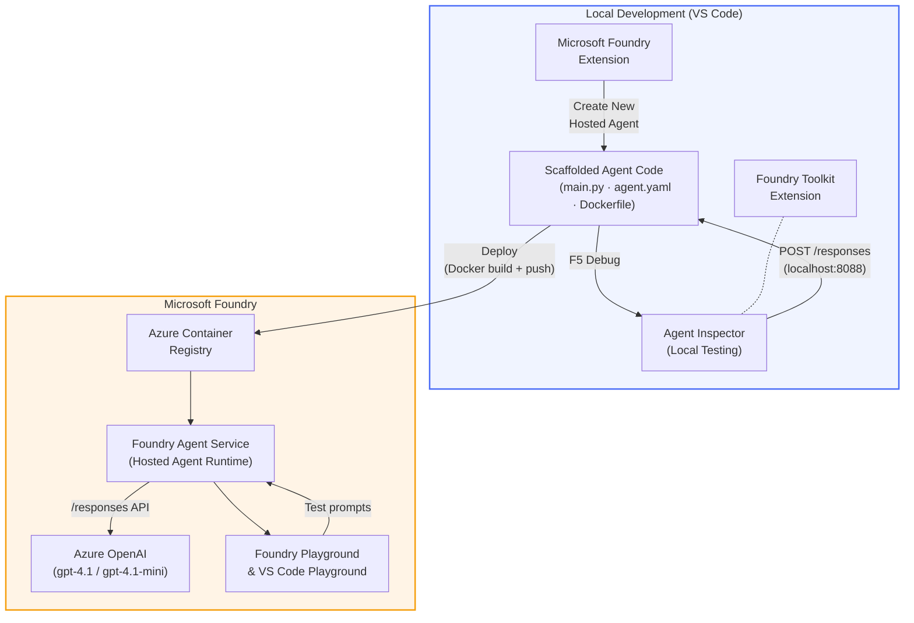

# ಫೌಂಡ್ರಿ ಟೂಲ್‌ಕಿಟ್ + ಫೌಂಡ್ರಿ ಹೋಸ್ಟಡ್ ಏಜೆಂಟ್‌ಗಳು ಕಾರ್ಯಾಗಾರ

[](https://www.python.org/)
[](https://learn.microsoft.com/agent-framework/)
[](https://learn.microsoft.com/azure/foundry/agents/concepts/hosted-agents)
[](https://ai.azure.com/)
[](https://learn.microsoft.com/azure/ai-services/openai/)
[](https://learn.microsoft.com/cli/azure/install-azure-cli)
[](https://learn.microsoft.com/azure/developer/azure-developer-cli/install-azd)
[](https://www.docker.com/)
[](https://marketplace.visualstudio.com/items?itemName=ms-windows-ai-studio.windows-ai-studio)
[](LICENSE)

**Microsoft Foundry Agent Service** ಗೆ **ಹೋಸ್ಟ್ ಮಾಡಿದ ಏಜೆಂಟ್‌ಗಳು** ಆಗಿ AI ಏಜೆಂಟ್‌ಗಳನ್ನು ನಿರ್ಮಿಸಿ, ಪರೀಕ್ಷಿಸಿ ಮತ್ತು ಜಾರಿಗೊಳಿಸಿ - ಸಂಪೂರ್ಣವಾಗಿ VS ಕೋಡ್ ಬಳಸಿ **Microsoft Foundry ವಿಸ್ತರಣೆ** ಮತ್ತು **Foundry Toolkit** ಉಪಯೋಗಿಸಿ.

> **ಹೊಸ್ಟ್ ಮಾಡಿದ ಏಜೆಂಟ್‌ಗಳು ಈಗಾಗಲೇ ಪೂರ್ವದರ್ಶಿಯಲ್ಲಿವೆ.** ಬೆಂಬಲಿತ ಪ್ರಾಂತ್ಯಗಳು ಸೀಮಿತವಾಗಿವೆ - ನೋಡಿ [ಪ್ರಾಂತ್ಯ ಲಭ್ಯತೆ](https://learn.microsoft.com/azure/foundry/agents/concepts/hosted-agents#region-availability).

> ಪ್ರತಿಯೊಂದು ಪ್ರಯೋಗಾಲಯದ ಒಳಗಿನ `agent/` ಕಡತವು Foundry ವಿಸ್ತರಣೆ ಮೂಲಕ **ಸ್ವಯಂಚಾಲಿತವಾಗಿ ರೂಢಿಮಾಡಲ್ಪಡುತ್ತದೆ** - ನಂತರ ನೀವು ಕೋಡ್ ಅನ್ನು ಕಸ್ಟಮೈಸ್ ಮಾಡಿ, ಸ್ಥಳೀಯವಾಗಿ ಪರೀಕ್ಷಿಸಿ ಮತ್ತು ಜಾರಿಗೊಳಿಸಿ.

### 🌐 ಬಹುಭಾಷಾ ಬೆಂಬಲ

#### GitHub ಕೃತ್ಯ ಮೂಲಕ ಬೆಂಬಲಿಸಲಾಗಿದೆ (ಸ್ವಯಂಚಾಲಿತ ಮತ್ತು ಸದಾ ನವೀಕೃತ)

<!-- CO-OP TRANSLATOR LANGUAGES TABLE START -->
[Arabic](../ar/README.md) | [Bengali](../bn/README.md) | [Bulgarian](../bg/README.md) | [Burmese (Myanmar)](../my/README.md) | [Chinese (Simplified)](../zh-CN/README.md) | [Chinese (Traditional, Hong Kong)](../zh-HK/README.md) | [Chinese (Traditional, Macau)](../zh-MO/README.md) | [Chinese (Traditional, Taiwan)](../zh-TW/README.md) | [Croatian](../hr/README.md) | [Czech](../cs/README.md) | [Danish](../da/README.md) | [Dutch](../nl/README.md) | [Estonian](../et/README.md) | [Finnish](../fi/README.md) | [French](../fr/README.md) | [German](../de/README.md) | [Greek](../el/README.md) | [Hebrew](../he/README.md) | [Hindi](../hi/README.md) | [Hungarian](../hu/README.md) | [Indonesian](../id/README.md) | [Italian](../it/README.md) | [Japanese](../ja/README.md) | [Kannada](./README.md) | [Khmer](../km/README.md) | [Korean](../ko/README.md) | [Lithuanian](../lt/README.md) | [Malay](../ms/README.md) | [Malayalam](../ml/README.md) | [Marathi](../mr/README.md) | [Nepali](../ne/README.md) | [Nigerian Pidgin](../pcm/README.md) | [Norwegian](../no/README.md) | [Persian (Farsi)](../fa/README.md) | [Polish](../pl/README.md) | [Portuguese (Brazil)](../pt-BR/README.md) | [Portuguese (Portugal)](../pt-PT/README.md) | [Punjabi (Gurmukhi)](../pa/README.md) | [Romanian](../ro/README.md) | [Russian](../ru/README.md) | [Serbian (Cyrillic)](../sr/README.md) | [Slovak](../sk/README.md) | [Slovenian](../sl/README.md) | [Spanish](../es/README.md) | [Swahili](../sw/README.md) | [Swedish](../sv/README.md) | [Tagalog (Filipino)](../tl/README.md) | [Tamil](../ta/README.md) | [Telugu](../te/README.md) | [Thai](../th/README.md) | [Turkish](../tr/README.md) | [Ukrainian](../uk/README.md) | [Urdu](../ur/README.md) | [Vietnamese](../vi/README.md)

> **ಸ್ಥಳೀಯವಾಗಿ ಸಹಾಯಮಾಡಬೇಕೆ?**
>
> ಈ ಸಂಗ್ರಹಣೆಯಲ್ಲಿ 50+ ಭಾಷಾ ಅನುವಾದಗಳನ್ನು ಒಳಗೊಂಡಿದೆ, ಇದು ಡೌನ್‌ಲೋಡ್ ಗಾತ್ರವನ್ನು ಸಾಕಷ್ಟು ಹೆಚ್ಚಿಸುತ್ತದೆ. ಅನುವಾದವಿಲ್ಲದೆ ಕ್ಲೋನ್ ಮಾಡಲು, ಸ್ಪಾರ್ಸ್ ಚೆಕೌಟ್ ಅನ್ನು ಬಳಸಿ:
>
> **Bash / macOS / ಲೀನಕ್ಸ್:**
> ```bash
> git clone --filter=blob:none --sparse https://github.com/microsoft-foundry/Foundry_Toolkit_for_VSCode_Lab.git
> cd Foundry_Toolkit_for_VSCode_Lab
> git sparse-checkout set --no-cone '/*' '!translations' '!translated_images'
> ```
>
> **CMD (Windows):**
> ```cmd
> git clone --filter=blob:none --sparse https://github.com/microsoft-foundry/Foundry_Toolkit_for_VSCode_Lab.git
> cd Foundry_Toolkit_for_VSCode_Lab
> git sparse-checkout set --no-cone "/*" "!translations" "!translated_images"
> ```
>
> ಇದು ನಿಮಗೆ ಕೋರ್ಸ್ ಮುಗಿಸಲು ಬೇಕಾದ ಎಲ್ಲವನ್ನೂ ಒದಗಿಸುತ್ತದೆ ಮತ್ತು ಡೌನ್‌ಲೋಡ್ ವೇಗವನ್ನು ಹೆಚ್ಚಿಸುತ್ತದೆ.
<!-- CO-OP TRANSLATOR LANGUAGES TABLE END -->

---

## ವಾಸ್ತುಶಿಲ್ಪ



**ಪ್ರವಾಹ:** ಫೌಂಡ್ರಿ ವಿಸ್ತರಣೆ ಏಜೆಂಟ್ ಅನ್ನು ರೂಢಿಮಾಡುತ್ತದೆ → ನೀವು ಕೋಡ್ ಮತ್ತು ಸೂಚನೆಗಳನ್ನು ಕಸ್ಟಮೈಸ್ ಮಾಡುತ್ತೀರಿ → ಏಜೆಂಟ್ ಇನ್ಸ್‌ಪೆಕ್ಟರ್ ಮೂಲಕ ಸ್ಥಳೀಯವಾಗಿ ಪರೀಕ್ಷಿಸುತ್ತೀರಿ → ಫೌಂಡ್ರಿಗೆ (ಡೋಕರ್ ಚಿತ್ರವನ್ನು ACR ಗೆ ಪುಶ್ ಮಾಡಿ) ಜಾರಿಗೊಳಿಸುತ್ತೀರಿ → ಪ್ಲೇಗ್ರೌಂಡ್‌ನಲ್ಲಿ ಪರಿಶೀಲನೆ.

---

## ನೀವು ನಿರ್ಮಿಸುವುದು ಏನು

| ಪ್ರಯೋಗಾಲಯ | ವಿವರಣೆ | ಸ್ಥಿತಿ |
|-----|-------------|--------|
| **ಪ್ರಯೋಗಾಲಯ 01 - ಏಕ ಏಜೆಂಟ್** | **"ನಾನು ಎಕ್ಸಿಕ್ಯೂಟಿವ್ ಆಗಿದ್ದರೆ ಹೇಗೆ ವಿವರಿಸಬೇಕು" ಏಜೆಂಟ್** ನಿರ್ಮಿಸಿ, ಸ್ಥಳೀಯವಾಗಿ ಪರೀಕ್ಷಿಸಿ ಮತ್ತು ಫೌಂಡ್ರಿಗೆ ಜಾರಿಗೊಳಿಸಿ | ✅ ಲಭ್ಯವಿದೆ |
| **ಪ್ರಯೋಗಾಲಯ 02 - ಬಹು ಏಜೆಂಟ್ ಕೆಲಸದ ಹರಿವಿನ ಪ್ರಕ್ರಿಯೆ** | **"ರಿಜ್ಯೂಮ್ → ಉದ್ಯೋಗ ಹೊಂದಿಕೆಯಾಗಿಸುವ ಮೌಲ್ಯಮಾಪಕ"** - 4 ಏಜೆಂಟ್‌ಗಳು ಸಹಕರಿಸಿ ರಿಜ್ಯೂಮ್ ಹೊಂದಿಕೆಯನ್ನು ಅಂಕಸಿ ಮತ್ತು ಕಲಿಕೆ ಮಾರ್ಗಚಿತ್ರವನ್ನು ಸೃಷ್ಟಿಸುತ್ತವೆ | ✅ ಲಭ್ಯವಿದೆ |

---

## ಎಕ್ಸಿಕ್ಯೂಟಿವ್ ಏಜೆಂಟ್ ಅನ್ನು ಪರಿಚಯಿಸಿ

ಈ ಕಾರ್ಯಾಗಾರದಲ್ಲಿ ನೀವು **"ನಾನು ಎಕ್ಸಿಕ್ಯೂಟಿವ್ ಆಗಿದ್ದರೆ ಹೇಗೆ ವಿವರಿಸಬೇಕು" ಏಜೆಂಟ್** ಅನ್ನು ನಿರ್ಮಿಸುವಿರಿ - ಇದು ತಾಂತ್ರಿಕ ಜಾರ್ಗನ್ ಅನ್ನು ಚೆಂದದ, ಬೋರ್ಡ್ ರೂಮ್-ಸಿದ್ಧ ಸಾರಾಂಶಗಳಾಗಿ ಅನುವಾದಿಸುವ AI ಏಜೆಂಟ್. ನಮ್ಮನ್ನು ನಿಜವಾಗಿಸಿಕೊಂಡರೆ, C-ಸುಟ್ ಯಾರಿಗೂ "v3.2ರಲ್ಲಿ ಪರಿಚಯಿಸಿದ ಸಮಕಾಲೀನ ಕರೆಗಳಿಂದ ಉಂಟಾದ ತಂತು ಪೂಲ್ ದ್ವಂದ್ವ" ಬಗ್ಗೆ ಕೇಳುವ ಇಚ್ಛೆ ಇಲ್ಲ.

ನಾನು ಈ ಏಜೆಂಟ್ ಅನ್ನು ನಿರ್ಮಿಸಿದಾಗ ನನ್ನ ಸೂಕ್ಷ್ಮವಾಗಿ ರಚಿಸಲಾದ ಪೋಷ್ಟ್-ಮಾರ್ಟಮ್ ಗೆ ಉತ್ತರವಾಗಿ *"ಆದ್ದರಿಂದ... ವೆಬ್ಸೈಟ್ ಗೆಡುತಿದೆಯೆ ಇಲ್ಲವೆ?"* ಅನ್ನುವುದು ಕೇಳುವುದು ಸಾಮಾನ್ಯವಾಗಿತ್ತು.

### ಇದು ಹೇಗೆ ಕಾರ್ಯನಿರ್ವಹಿಸುತ್ತದೆ

ನೀವು ತಾಂತ್ರಿಕ ನವೀಕರಣ ನೀಡುತ್ತೀರಿ. ಅದು ಮೂರು ಬಿಂದುಗಳಾದ ನಿರ್ವಿವಾದ ಸಾರಾಂಶವನ್ನು ನೀಡುತ್ತದೆ - ಜಾರ್ಗನ್ ಇಲ್ಲ, ಸ್ಟ್ಯಾಕ್ ಟ್ರೇಸ್ ಇಲ್ಲ, ಬಿಗಿ ಭಯ ಇಲ್ಲ. ಕೇವಲ **ಏನು ಆಗಿದೆ**, **ವಹಿವಟಿ ಪ್ರಭಾವ**, ಮತ್ತು **ಮುಂದಿನ ಹಂತ**.

### ಇದು ಕಾರ್ಯನಿರ್ವಹಿಸುವುದನ್ನು ನೋಡಿ

**ನೀವು ಹೇಳಿರಿ:**
> "API ವಿಳಂಬವು v3.2ನಲ್ಲಿ ಪರಿಚಯಿಸಲ್ಪಟ್ಟ ಸಮಕಾಲೀನ ಕರೆಗಳಿಂದ ತಂತು ಪೂಲ್ ದ್ವಂದ್ವದ ಕಾರಣದಿಂದ ಹೆಚ್ಚಿದೆ."

**ಏಜೆಂಟ್ ಉತ್ತರಿಸುತ್ತದೆ:**

> **ಎಕ್ಸಿಕ್ಯೂಟಿವ್ ಸಾರಾಂಶ:**
> - **ಏನು ಆಗಿದೆ:** ಇತ್ತೀಚಿನ ಬಿಡುಗಡೆಯ ನಂತರ ವ್ಯವಸ್ಥೆ ನಿಧಾನಗೊಂಡಿದೆ.
> - **ವಹಿವಟಿ ಪ್ರಭಾವ:** ಕೆಲವು ಬಳಕೆದಾರರಿಗೆ ಸೇವೆ ಬಳಸುವಾಗ ವಿಳಂಬ ಅನುಭವವಾಯಿತು.
> - **ಮುಂದಿನ ಹಂತ:** ಬದಲಾವಣೆ ಹಿಂಪಡೆಯಲ್ಪಟ್ಟಿದ್ದು, ಪುನರ್ ಜಾರಿಗೆ ಮುಂಚೆ ಸರಿಪಡಿಸಲು ಸಿದ್ಧತೆ ನಡೆಯುತ್ತಿದೆ.

### ಈ ಏಜೆಂಟ್ ಯಾಕೆ?

ಇದು ಸರಳವಾಗಿರುವ, ಏಕ ಉದ್ದೇಶ ಹೊಂದಿರುವ ಏಜೆಂಟ್ - ಹೋಸ್ಟ್ ಮಾಡಿದ ಏಜೆಂಟ್ ಕೆಲಸದ ಹರಿವನ್ನು अंतದಿಂದ अंतವರೆಗೂ ಕಲಿಯಲು ಪರಿಪೂರ್ಣ. ಮತ್ತು ನಿಜವಾಗಿಯೂ? ಪ್ರತಿ ಎಂಜಿನಿಯರಿಂಗ್ ತಂಡಕ್ಕೊಂದು ಹುಡುಕಿಕೊಳ್ಳುವ ಬಗೆ ಇದ್ದದ್ದು ಅಗತ್ಯ.

---

## ಕಾರ್ಯಾಗಾರ ರಚನೆ

```
📂 Foundry_Toolkit_for_VSCode_Lab/
├── 📄 README.md                      ← You are here
└── 📂 workshop/
    ├── 📂 lab01-single-agent/        ← Full lab: docs + agent code
    │   ├── README.md                 ← Hands-on lab instructions
    │   ├── 📂 docs/                  ← Step-by-step tutorial modules
    │   │   ├── 00-prerequisites.md
    │   │   ├── 01-setup.md
    │   │   ├── 02-create-hosted-agent.md
    │   │   ├── 03-configure-and-code.md
    │   │   ├── 04-test-locally.md
    │   │   ├── 05-deploy-to-foundry.md
    │   │   ├── 06-verify-in-playground.md
    │   │   ├── 07-summary.md
    │   │   └── 08-troubleshooting.md
    │   └── 📂 agent/                 ← Reference solution (auto-scaffolded by Foundry extension)
    │       ├── agent.yaml
    │       ├── Dockerfile
    │       ├── main.py
    │       └── requirements.txt
    └── 📂 lab02-multi-agent/         ← Resume → Job Fit Evaluator
        ├── README.md                 ← Hands-on lab instructions (end-to-end)
        ├── 📂 docs/                  ← Step-by-step tutorial modules
        │   ├── 00-prerequisites.md
        │   ├── 01-understand-multi-agent.md
        │   ├── 02-scaffold-multi-agent.md
        │   ├── 03-configure-agents.md
        │   ├── 04-orchestration-patterns.md
        │   ├── 05-test-locally.md
        │   ├── 06-deploy-to-foundry.md
        │   ├── 07-verify-in-playground.md
        │   ├── 08-troubleshooting.md
        │   └── 09-summary.md
        └── 📂 PersonalCareerCopilot/ ← Reference solution (multi-agent workflow)
            ├── agent.yaml
            ├── Dockerfile
            ├── main.py
            └── requirements.txt
```

> **ಗಮನಿಸಿ:** ಪ್ರತಿಯೊಂದು ಪ್ರಯೋಗಾಲಯದ ಒಳಗಿನ `agent/` ಫೋಲ್ಡರ್ **Microsoft Foundry ವಿಸ್ತರಣೆ** ಅನ್ನು Command Palette ನಿಂದ `Microsoft Foundry: Create a New Hosted Agent` ಚಲಾಯಿಸಿದಾಗ ರಚಿಸಲಾಗುತ್ತದೆ. ನಂತರ ಅವು ನಿಮ್ಮ ಏಜೆಂಟ್ ಸೂಚನೆಗಳು, ಸಾಧನಗಳು ಮತ್ತು ಸಂರಚನೆಯೊಂದಿಗೆ ಕಸ್ಟಮೈಸ್ ಮಾಡಲ್ಪಡುತ್ತವೆ. ಪ್ರಯೋಗಾಲಯ 01 ನಿಮಗೆ ಈ ಪ್ರಕ್ರಿಯೆಯನ್ನು ಮೂಲದಿಂದ ಮರುರಚಿಸುವುದನ್ನು ತಿಳಿಸುತ್ತದೆ.

---

## ಪ್ರಾರಂಭಿಸುವುದು

### 1. ಸಂಗ್ರಹಣೆಯನ್ನು ಕ್ಲೋನ್ ಮಾಡಿರಿ

```bash
git clone https://github.com/microsoft-foundry/Foundry_Toolkit_for_VSCode_Lab.git
cd Foundry_Toolkit_for_VSCode_Lab
```

### 2. ಪೈಥಾನ್ ವರ್ಚುವಲ್ ಇನ್ವಿರೋನ್ಮೆಂಟ್ ಸ್ಥಾಪಿಸಿ

```bash
python -m venv venv
```

ಅದನ್ನು ಸಕ್ರಿಯಗೊಳಿಸಿ:

- **ವಿಂಡೋಸ್ (ಪವರ್‌ಶೆಲ್):**
  ```powershell
  .\venv\Scripts\Activate.ps1
  ```
- **ಮ್ಯಾಕ್‌OS / ಲಿನಕ್ಸ್:**
  ```bash
  source venv/bin/activate
  ```

### 3. ಅವಲಂಬನೆಗಳನ್ನು ಸ್ಥಾಪಿಸಿ

```bash
pip install -r workshop/lab01-single-agent/agent/requirements.txt
```

### 4. ಪರಿಸರ ಚರಗಳು ಸಂರಚಿಸಿ

ಏಜೆಂಟ್ ಫೋಲ್ಡರಿನೊಳಗಿನ ಉದಾಹರಣೆ `.env` ಕಡತವನ್ನು ನಕಲಿಸಿ ಮತ್ತು ನಿಮ್ಮ ಮೌಲ್ಯಗಳನ್ನು ತುಂಬಿ:

```bash
cp workshop/lab01-single-agent/agent/.env.example workshop/lab01-single-agent/agent/.env
```

`workshop/lab01-single-agent/agent/.env` ಅನ್ನು ಸಂಪಾದಿಸಿ:

```env
FOUNDRY_PROJECT_ENDPOINT=https://<your-account>.services.ai.azure.com/api/projects/<your-project>
AZURE_AI_MODEL_DEPLOYMENT_NAME=<your-model-deployment-name>
```

### 5. ಕಾರ್ಯಾಗಾರ ಪ್ರಯೋಗಾಲಯಗಳನ್ನು ಅನುಸರಿಸಿ

ಪ್ರತಿಯೊಂದು ಪ್ರಯೋಗಾಲಯವು ತನ್ನ ಸ್ವಂತ ಮಡ್ಯೂಳ್ಗಳೊಂದಿಗೆ ಸ್ವಯಂ ಸಂಪೂರ್ಣವಾಗಿದೆ. ಮೂಲಭೂತಗಳನ್ನು ಕಲಿಯಲು **ಪ್ರಯೋಗಾಲಯ 01** ಎಂಬಿಂದ ಪ್ರಾರಂಭಿಸಿ, ನಂತರ ಬಹು ಏಜೆಂಟ್ ಕೆಲಸದ ಹರಿವಿಗಾಗಿ **ಪ್ರಯೋಗಾಲಯ 02** ಗೆ ಸಾಗಿರಿ.

#### ಪ್ರಯೋಗಾಲಯ 01 - ಏಕ ಏಜೆಂಟ್ ([ಸಂಪೂರ್ಣ ಸೂಚನೆಗಳು](workshop/lab01-single-agent/README.md))

| # | ಮಡ್ಯೂಲ್ | ಲಿಂಕ್ |
|---|--------|------|
| 1 | ಪೂರ್ವಾಪೇಕ್ಷಿತಗಳನ್ನು ಓದಿ | [00-prerequisites.md](workshop/lab01-single-agent/docs/00-prerequisites.md) |
| 2 | Foundry Toolkit & Foundry ವಿಸ್ತರಣೆ ಸ್ಥಾಪಿಸಿ | [01-setup.md](workshop/lab01-single-agent/docs/01-setup.md) |
| 3 | Foundry ಯೋಜನೆ ಸೃಜಿಸಿ | [01-setup.md](workshop/lab01-single-agent/docs/01-setup.md) |
| 4 | ಹೋಸ್ಟ್ ಮಾಡಿದ ಏಜೆಂಟ್ ಸೃಷ್ಟಿಸಿ | [02-create-hosted-agent.md](workshop/lab01-single-agent/docs/02-create-hosted-agent.md) |
| 5 | ಸೂಚನೆಗಳು ಮತ್ತು ಪರಿಸರವನ್ನು ಕಾನ್ಫಿಗರ್ ಮಾಡಿ | [03-configure-and-code.md](workshop/lab01-single-agent/docs/03-configure-and-code.md) |
| 6 | ಸ್ಥಳೀಯವಾಗಿ ಪರೀಕ್ಷಿಸಿ | [04-test-locally.md](workshop/lab01-single-agent/docs/04-test-locally.md) |
| 7 | Foundry ಗೆ ಜಾರಿಗೊಳಿಸಿ | [05-deploy-to-foundry.md](workshop/lab01-single-agent/docs/05-deploy-to-foundry.md) |
| 8 | ಪ್ಲೇಗ್ರೌಂಡ್‌ನಲ್ಲಿ ಪರಿಶೀಲಿಸಿ | [06-verify-in-playground.md](workshop/lab01-single-agent/docs/06-verify-in-playground.md) |
| 9 | ಸಾರಾಂಶ ಮತ್ತು ಮುಂದಿನ ಹಂತಗಳು | [07-summary.md](workshop/lab01-single-agent/docs/07-summary.md) |
| 10 | ಸಮಸ್ಯೆ ಪರಿಹಾರ | [08-troubleshooting.md](workshop/lab01-single-agent/docs/08-troubleshooting.md) |

#### ಪ್ರಯೋಗಾಲಯ 02 - ಬಹು ಏಜೆಂಟ್ ಕೆಲಸದ ಹರಿವು ([ಸಂಪೂರ್ಣ ಸೂಚನೆಗಳು](workshop/lab02-multi-agent/README.md))

| # | ಮಡ್ಯೂಲ್ | ಲಿಂಕ್ |
|---|--------|------|
| 1 | ಪೂರ್ವಾಪೇಕ್ಷಿತಗಳು (ಪ್ರಯೋಗಾಲಯ 02) | [00-prerequisites.md](workshop/lab02-multi-agent/docs/00-prerequisites.md) |
| 2 | ಬಹು ಏಜೆಂಟ್ ವಾಸ್ತುಶಿಲ್ಪವನ್ನು ಅರ್ಥಮಾಡಿಕೊಳ್ಳಿ | [01-understand-multi-agent.md](workshop/lab02-multi-agent/docs/01-understand-multi-agent.md) |
| 3 | ಬಹು ಏಜೆಂಟ್ ಯೋಜನೆಯನ್ನು ರೂಢಿಮಾಡಿ | [02-scaffold-multi-agent.md](workshop/lab02-multi-agent/docs/02-scaffold-multi-agent.md) |
| 4 | ಏಜೆಂಟ್‌ಗಳು ಮತ್ತು ಪರಿಸರವನ್ನು ಕಾನ್ಫಿಗರ್ ಮಾಡಿ | [03-configure-agents.md](workshop/lab02-multi-agent/docs/03-configure-agents.md) |
| 5 | ಸಂಯೋಜನಾ ಮಾದರಿಗಳನ್ನು ಬಳಸಿ | [04-orchestration-patterns.md](workshop/lab02-multi-agent/docs/04-orchestration-patterns.md) |
| 6 | ಸ್ಥಳೀಯವಾಗಿ ಪರೀಕ್ಷಿಸಿ (ಬಹು ಏಜೆಂಟ್) | [05-test-locally.md](workshop/lab02-multi-agent/docs/05-test-locally.md) |
| 7 | Foundry ಗೆ ಜಾರಿಗೊಳಿಸಿ | [06-deploy-to-foundry.md](workshop/lab02-multi-agent/docs/06-deploy-to-foundry.md) |
| 8 | ಪ್ಲೇಗ್ರೌಂಡ್‌ನಲ್ಲಿ ಪರಿಶೀಲಿಸಿ | [07-verify-in-playground.md](workshop/lab02-multi-agent/docs/07-verify-in-playground.md) |
| 9 | ಸಮಸ್ಯೆ ಪರಿಹಾರ (ಬಹು ಏಜೆಂಟ್) | [08-troubleshooting.md](workshop/lab02-multi-agent/docs/08-troubleshooting.md) |
| 10 | ಸಾರಾಂಶ ಮತ್ತು ಮುಂದಿನ ಹಂತಗಳು | [09-summary.md](workshop/lab02-multi-agent/docs/09-summary.md) |

---

## ನಿರ್ವಾಹಕ

<table>
<tr>
    <td align="center"><a href="https://github.com/ShivamGoyal03">
        <br />
        <sub><b>ಶಿವಂ ಗೌಯಲ್</b></sub>
    </a><br />
    </td>
</tr>
</table>

---

## ಅಗತ್ಯ ಅನುಮತಿಗಳು (ತ್ವರಿತ ಸೂಚನೆ)

| ಸಂದರ್ಭ | ಅಗತ್ಯ ಪಾತ್ರಗಳು |
|----------|---------------|
| ಹೊಸ Foundry ಯೋಜನೆ ಸೃಷ್ಟಿ | ಫೌಂಡ್ರಿ ಸಂಪನ್ಮೂಲದ ಮೇಲೆ **ಆಜುರ್ AI ಮಾಲೀಕರು** |
| ಇಳಗಿನ ಯೋಜನೆಗೆ ಜಾರಿ (ಹೊಸ ಸಂಪನ್ಮೂಲಗಳು) | ಚಂದಾದಾರಿಕೆಯಲ್ಲಿ **ಆಜುರ್ AI ಮಾಲೀಕರು** + **ಕೊಡುಗೆದಾರರು** |
| ಸಂಪೂರ್ಣ ಸಂರಚಿಸಲಾದ ಯೋಜನೆಗೆ ಜಾರಿ | ಖಾತೆಯಲ್ಲಿ **ವಾಚಕ** + ಯೋಜನೆಯಲ್ಲಿ **ಆಜುರ್ AI ಬಳಕೆದಾರ** |

> **ಮುಖ್ಯ:** Azure `Owner` ಮತ್ತು `Contributor` ಪಾತ್ರಗಳು *ಮ್ಯಾನೇಜ್‌ಮೆಂಟ್* ಅನುಮತಿಗಳನ್ನು ಮಾತ್ರ ಒಳಗೊಂಡಿದ್ದು, *ಡೆವಲಪ್‌ಮೆಂಟ್* (ಡೇಟಾ ಕ್ರಿಯೆ) ಅನುಮತಿಗಳನ್ನು ಒಳಗೊಂಡಿಲ್ಲ. ಏಜೆಂಟ್‌ಗಳನ್ನು ನಿರ್ಮಿಸಲು ಮತ್ತು ಜಾರಿ ಮಾಡಲು ನಿಮಗೆ **Azure AI ಉಪಯೋಗಿಸುವವರು** ಅಥವಾ **Azure AI ಮಾಲೀಕರು** ಅಗತ್ಯವಿದೆ.

---

## ಉಲ್ಲೇಖಗಳು

- [ಕ್ವಿಕ್‌ಸ್ಟಾರ್ಟ್: ನಿಮ್ಮ ಪ್ರಥಮ ಹೋಸ್ಟ್ ಮಾಡಿದ ಏಜೆಂಟ್ ಅನ್ನು ನಿಯೋಜಿಸಿ (VS ಕೋಡ್)](https://learn.microsoft.com/azure/foundry/agents/quickstarts/quickstart-hosted-agent)
- [ಹೋಸ್ಟ್ ಮಾಡಿದ ಏಜೆಂಟ್‌ಗಳು ಎಂದರೆ ಏನು?](https://learn.microsoft.com/azure/foundry/agents/concepts/hosted-agents)
- [VS ಕೋಡ್‌ನಲ್ಲಿ ಹೋಸ್ಟ್ ಮಾಡಿದ ಏಜೆಂಟ್ ಕೆಲಸದ ಹರಿವುಗಳನ್ನು ಸೃಷ್ಟಿಸಿ](https://learn.microsoft.com/azure/foundry/agents/how-to/vs-code-agents-workflow-pro-code)
- [ಹೋಸ್ಟ್ ಮಾಡಿದ ಏಜೆಂಟ್ ಅನ್ನು ನಿಯೋಜಿಸಿ](https://learn.microsoft.com/azure/foundry/agents/how-to/deploy-hosted-agent)
- [Microsoft Foundry ಒಕ್ಕೂಟ ನಿಯಂತ್ರಣ](https://learn.microsoft.com/azure/foundry/concepts/rbac-foundry)
- [ವಾಸ್ತವಿಕ ಪರಿಕಲ್ಪನೆ ವಿಮರ್ಶೆ ಏಜೆಂಟ್ ಉದಾಹರಣೆ](https://github.com/Azure-Samples/agent-architecture-review-sample) - MCP ಉಪಕರಣಗಳು, Excalidraw ಚಿತ್ತಾರಗಳು ಮತ್ತು ಡ್ಯುಯಲ್ ನಿಯೋಜನೆಯೊಂದಿಗೆ ನೈಜ ಹೋಸ್ಟ್ ಮಾಡಿದ ಏಜೆಂಟ್

---


## ಪರವಾನಗಿ

[MIT](../../LICENSE)

---

<!-- CO-OP TRANSLATOR DISCLAIMER START -->
**ಅಸ್ವೀಕಾರ**:
ಈ ದಸ್ತಾವೇಜು AI ಅನುವಾದ ಸೇವೆ [Co-op Translator](https://github.com/Azure/co-op-translator) ಬಳಸಿ ಅನುವಾದಿಸಲಾಗಿದೆ. ನಾವು ನಿಖರತೆಯನ್ನು ಸಾಧಿಸಲು ಪ್ರಯತ್ನಿಸುತ್ತಿದ್ದರೂ, ದಯವಿಟ್ಟು ಗಮನಿಸಿ, ಸ್ವಯಂಚಾಲಿತ ಅನುವಾದಗಳಲ್ಲಿ ದೋಷಗಳು ಅಥವಾ ಅಸಡ್ಡೆಗಳು ಇರಬಹುದು. ಮೂಲ ಭಾಷೆಯಲ್ಲಿರುವ ಮೂಲ ದಸ್ತಾವೇಜು ಪ್ರಾಮಾಣಿಕ ಮೂಲವೆಂದು ಪರಿಗಣಿಸಬೇಕು. ಪ್ರಮುಖ ಮಾಹಿತಿಗಾಗಿ, ವೃತ್ತಿಪರ ಮಾನವ ಅನುವಾದವನ್ನು ಶಿಫಾರಸು ಮಾಡಲಾಗುತ್ತದೆ. ಈ ಅನುವಾದವನ್ನು ಬಳಸುವ ಮೂಲಕ ಉಂಟಾಗುವ ಯಾವುದೇ ತಪ್ಪು ಅರ್ಥಗಳ ಅಥವಾ ತಪ್ಪು ವ್ಯಾಖ್ಯಾನಗಳ ಬಗ್ಗೆ ನಾವು ಹೊಣೆಗಾರರಲ್ಲ.
<!-- CO-OP TRANSLATOR DISCLAIMER END -->