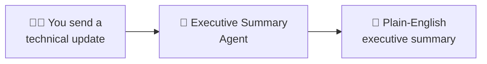

# ಅಧ್ಯಾಯ 0 - ಪರಿಚಯ

⏱️ ~10 ನಿಮಿಷಗಳು

> [!WARNING]
> **ಪೂರ್ವದರ್ಶನ ಮತ್ತು ಮಿತಿ:** [ಆಿತ್ಥೆ نجدದ ಕಾಯಿಕರಣ](https://learn.microsoft.com/azure/foundry/agents/concepts/hosted-agents) ಪ್ರಸ್ತುತ **ಸಾರ್ವಜನಿಕ ಪೂರ್ವದರ್ಶನ** ಸ್ಥಿತಿಯಲ್ಲಿ ಇವೆ - ಉತ್ಪಾದನಾ ಕಾರ್ಯಭಾರಗಳಿಗೆ ಶಿಫಾರಸು ಮಾಡಲಾಗುವುದಿಲ್ಲ. ಕೆಳಗಿನ ವಿಚಾರಗಳನ್ನು ಗಮನಿಸಿ:
> - **ಬೆಂಬಲಿತ ಪ್ರಾಂತ್ಯಗಳು ಸೀಮಿತವಾಗಿವೆ** - ಸಂಪನ್ಮೂಲಗಳನ್ನು ರಚಿಸುವ ಮೊದಲು [ಪ್ರಾಂತ್ಯ ಲಭ್ಯತೆ](https://learn.microsoft.com/azure/foundry/agents/concepts/hosted-agents#region-availability) ಪರಿಶೀಲಿಸಿ. ನೀವು ಬೆಂಬಲಿಸಲಾಗದ ಪ್ರಾಂತ್ಯವನ್ನು ಆಯ್ಕೆ ಮಾಡಿದ್ದರೆ, ನಿಯೋಜನೆ ವಿಫಲವಾಗಬಹುದು.
> - `agent-framework-foundry-hosting` ಪ್ಯಾಕೇಜ್ ಪೂರ್ವ-рಿಲೀಸ್ ಆಗಿದೆ - ಆಪಿಐಗಳು ಆವೃತ್ತಿಗಳ ನಡುವಲ್ಲಿ ಬದಲಾಗಬಹುದು.
> - ಪ್ರಮಾಣ ಮಿತಿಗಳು: ಆತಿಥೇಯ ಏಜೆಂಟ್ಗಳು 0–5 ಪ್ರತಿಲಿಪಿಗಳನ್ನು ಬೆಂಬಲಿಸುತ್ತವೆ (ಶೂನ್ಯಕ್ಕೆ ಪ್ರಮಾಣವರ್ಧನೆ ಸಹಿತ).
> - ಈ ಕಾರ್ಯಾಗಾರದಲ್ಲಿ ತೋರಿಸಲಾದ ಕೆಲವು ವೈಶಿಷ್ಟ್ಯಗಳು ಸೇವೆ GA (ಜನರಲ್ ಅಂಟೌಮೆಂಟ್ನಿ) ಕಡೆಗೆ ಸಾಗುತ್ತಿರಲು ಬದಲಾಗಬಹುದು.

## ನೀವು ನಿರ್ಮಿಸುವುದು ಏನು

ಈ ಕಾರ್ಯಾಗಾರದಲ್ಲಿ, ನೀವು **"ನಾನು ಕಾರ್ಯನಿರ್ವಹಣಾಧಿಕಾರಿಯಾಗಿ ವಿವರಿಸುವಂತೆ"** ಎಂಬ ಏಜೆಂಟ್ ಅನ್ನು ನಿರ್ಮಿಸುವಿರಿ - ಒಂದು ಆತಿಥೇಯ AI ಏಜೆಂಟ್ ಅದು ಕಷ್ಟಸಾಧ್ಯ ತಾಂತ್ರಿಕ ನವೀಕರಣಗಳನ್ನು ಸರಳ ಇಂಗ್ಲಿಷ್ ಕಾರ್ಯನಿರ್ವಹಣಾಧಿಕಾರಿ ಸಂಕ್ಷಿಪ್ತಗಳಾಗಿ ಪುನರ್ಲೇಖಿಸುತ್ತದೆ.

** ಏಜೆಂಟ್ ಬಳಸುತ್ತದೆ:**
- **Microsoft Agent Framework** - ಏಜೆಂಟ್ ತರ್ಕ ಮತ್ತು ರಚನೆಗಾಗಿ
- **Foundry Toolkit for VS Code** - ಕೈಕಟ್ಟು, ಸ್ಥಳೀಯವಾಗಿ ಪರೀಕ್ಷೆ, ಮತ್ತು ನಿಯೋಜಿಸಲು
- **AI ಮಾದರಿ** (ಉದಾ., `gpt-4.1-mini/gpt-5-mini`) - ಸಂಕ್ಷಿಪ್ತಗಳನ್ನು ರಚಿಸಲು

ಈ ಪ್ರಯೋಗಾಲಯದ ಕೊನೆಯಲ್ಲಿ, ನೀವು ಎಜೆಂಟ್ ಪರಿಶೀಲಕ ಮೂಲಕ ಸ್ಥಳೀಯವಾಗಿ ಪರೀಕ್ಷಿಸುವ ಅಥವಾ ಐಚ್ಛಿಕವಾಗಿ ಕ್ಲೌಡ್‌ಗೆ ನಿಯೋಜಿಸುವ ಕಾರ್ಯ ನಿಂವಿದ ಏಜೆಂಟ್ ಅನ್ನು ಹೊಂದಿರುತ್ತೀರಿ.

---

## ಆತಿಥೇಯ ಏಜೆಂಟ್‌ಗಳೆಂದರೆ ಏನು?

**ಆತಿಥೇಯ ಏಜೆಂಟ್** ಎಂದರೆ Microsoft Foundry ದಲ್ಲಿ ನಿರ್ವಹಿಸಲಾದ ಸೇವೆಯಾಗಿ ಕಾರ್ಯನಿರ್ವಹಿಸುವ AI ಏಜೆಂಟ್. ನಿಮ್ಮ ಸ್ವಂತ ಮೂಲಸೌಕರ್ಯವನ್ನು ನಿರ್ವಹಿಸುವ ಬದಲಾಗಿ, ನೀವು ನಿಮ್ಮ ಏಜೆಂಟ್ ಕೋಡ್ ಅನ್ನು ಕಂಟೈನರ್‌ನಲ್ಲಿ ಪ್ಯಾಕೇಜ್ ಮಾಡಿ ಮತ್ತು Foundry ಪ್ರಮಾಣ ವೃದ್ಧಿ, ಆತಿಥೇಯ, ಹಾಗೂ ಮಾನಕ HTTP ಎಂಡ್ಪಾಯಿಂಟ್ ಮೂಲಕ ಅದನ್ನು ಬಹಿರಂಗಪಡಿಸುವ ಕಾರ್ಯಗಳನ್ನು ನಿಭಾಯಿಸುತ್ತದೆ.

| ಸಂकल्पನೆ | ಅದರಿಂದ ಅರ್ಥವಾಗುವುದು |
|---------|--------------|
| **ಏಜೆಂಟ್** | ಬಳಕೆದಾರ ಸಂದೇಶವನ್ನು ಸ್ವೀಕರಿಸುವ, AI ಮಾದರಿಯನ್ನು ಕರೆಸುವ, ಮತ್ತು ರಚನೆಯುಳ್ಳ ಪ್ರತಿಕ್ರಿಯೆಯನ್ನು ನೀಡುವ ನಿಮ್ಮ Python ಕೋಡ್ |
| **ಆತಿಥೇಯ** | Foundry ನಿಮ್ಮ ಕಂಟೈನರ್ ಅನ್ನು ನಡಿಸುತ್ತದೆ - VMಗಳು ಇಲ್ಲ, Kubernetes ಇಲ್ಲ, ಮೂಲಸೌಕರ್ಯ ನಿರ್ವಹಣೆ ಇಲ್ಲ |
| **ಪ್ರತಿಕ್ರಿಯೆಗಳ ಪ್ರೋಟೋಕಾಲ್** | ಯಾವುದೇ ಕ್ಲೈಂಟ್ ಸಂಪರ್ಕಿಸಬಹುದಾದ ಮಾನಕ HTTP API (`POST /responses`) ಮೂಲಕ ನಿಮ್ಮ ಏಜೆಂಟ್ ಜೊತೆ ಸಂವಹನ ಮಾಡಲು |
| **ಏಜೆಂಟ್ ಪರಿಶೀಲಕ** | ನಿಯೋಜನೆಯ ಮುನ್ನ ನಿಮ್ಮ ಏಜೆಂಟ್ ಜೊತೆಗೆ ಚಾಟ್ ಮಾಡಲು Foundry Toolkit ನಲ್ಲಿ ನಿರ್ಮಿಸಿದ ಸ್ಥಳೀಯ ತಪಾಸಣಾ UI |

ಈ ಕಾರ್ಯಾಗಾರದಲ್ಲಿ, ನೀವು ಶೂನ್ಯದಿಂದ ಪೂರ್ಣ ಆತಿಥೇಯ ಏಜೆಂಟ್‌ಗೆ ಹೋಗುತ್ತೀರಿ - ಅಥವಾ ಸ್ಥಳೀಯ ಪರೀಕ್ಷೆಯಲ್ಲಿ ನಿಲ್ಲಿಸಬಹುದಾಗಿದೆ.

---

## ನಿಮ್ಮ ಮಾರ್ಗವನ್ನು ಆಯ್ಕೆಮಾಡಿ

> ⚠️ **ಮುಂದುವರೆಯುವ ಮೊದಲು ಒಂದು ಮಾರ್ಗವನ್ನು ಆರಿಸಿ.** ನಿಮ್ಮ ಆಯ್ಕೆ ಯಾವ ಸಾಧನಗಳನ್ನು ಸ್ಥಾಪಿಸುವುದು ಮತ್ತು ಯಾವ ಅಧ್ಯಾಯಗಳು ಅನ್ವಯಿಸುವುದೆಂದು ನಿರ್ಧರಿಸುತ್ತದೆ. ನೀವು ಬ ನಂತರ → ಅ ಮಾರ್ಗಕ್ಕೆ ಈ ಮಾರ್ಗವನ್ನು ಬದಲಾಯಿಸಬಹುದು, ಅರ್ಹ подписчик ಇದ್ದರೆ.

<strong>🅰️ ಮಾರ್ಗ ಅ - ಅಜ್ಯೂರ್ ಕ್ಲೌಡ್ (ಅಜ್ಯೂರ್ ಸಬ್ಸ್ಕ್ರಿಪ್ಶನ್ ಅಗತ್ಯವಿದೆ)</strong>

| | ವಿವರಗಳು |
|---|---|
| **ಯಾರಿಗೆ ಇದು?** | ನೀವು ಸಕ್ರಿಯ ಅಜ್ಯೂರ್ ಸಬ್ಸ್ಕ್ರಿಪ್ಶನ್ ಹೊಂದಿದ್ದೀರಿ ಮತ್ತು Foundry ಸಂಪನ್ಮೂಲಗಳನ್ನು ನಿರ್ಮಿಸಬಹುದು |
| **ಮಾದರಿ** | Foundry ಮೂಲಕ ಅಜ್ಯೂರ್ OpenAI (ಉದಾ., `gpt-4.1-mini/gpt-5-mini`) |
| **ಅಧ್ಯಾಯಗಳು ವ್ಯಾಪಿಸಿದೆ** | ಎಲ್ಲಾ ಅಧ್ಯಾಯಗಳು (00–07) |
| **ಕ್ಲೌಡ್‌ಗೆ ನಿಯೋಜಿಸುವುದೇ?** | ✅ ಹೌದು - ಸಂಪೂರ್ಣ ಅಂತಿಮ ನಿಯೋಜನೆ |

<strong>🅱️ ಮಾರ್ಗ ಬ - ಸ್ಥಳೀಯ / ಉಚಿತ-ಮಟ್ಟ (ಅಜ್ಯೂರ್ ಸಬ್ಸ್ಕ್ರಿಪ್ಶನ್ ಅವಶ್ಯಕತೆ ಇಲ್ಲ)</strong>

| | ವಿವರಗಳು |
|---|---|
| **ಯಾರಿಗೆ ಇದು?** | MVP ಗಳು, ವಿದ್ಯಾರ್ಥಿಗಳು, ಅಥವಾ ಅಜ್ಯೂರ್ ಪ್ರವೇಶವಿಲ್ಲದವರು |
| **ಮಾದರಿ** | **Foundry ಸ್ಥಳೀಯ** (ಉಚಿತ, ನಿಮ್ಮ ಯಂತ್ರದಲ್ಲಿ ಕಾರ್ಯನಿರ್ವಹಿಸುತ್ತದೆ) |
| **ಅಧ್ಯಾಯಗಳು ವ್ಯಾಪಿಸಿದೆ** | ಅಧ್ಯಾಯಗಳು 00–04 (ನಿಯೋಜನೆ ಮತ್ತು ಕ್ಲೌಡ್ ಪರಿಶೀಲನೆ ಮೀರಿಸುವುದು) |
| **ಕ್ಲೌಡ್‌ಗೆ ನಿಯೋಜಿಸುವುದೇ?** | ❌ ಇಲ್ಲ - ಏಜೆಂಟ್ ಪರಿಶೀಲಕ ಮೂಲಕ ಮಾತ್ರ ಸ್ಥಳೀಯ ಪರೀಕ್ಷೆ |

---

## ಎಲ್ಲ ಮಾರ್ಗಗಳು: ಅಗತ್ಯ ಸಾಧನಗಳು

ಕೆಳಗಿನ ಪ್ರತಿಯೊಂದು ಸಾಧನವನ್ನು ಸ್ಥಾಪಿಸಿ. ಸ್ಥಾಪನೆಯ ನಂತರ, ಅದು ಕೆಲಸ ಮಾಡುತ್ತದೆಯೇ ಎಂದು ಚಾಕ್ ಕಮಾಂಡ್ ಮೂಲಕ ಪರಿಶೀಲಿಸಿ.

| # | ಸಾಧನ | ಆವೃತ್ತಿ | ಸ್ಥಾಪನೆ | ಪರಿಶೀಲನೆ (ನಿರೀಕ್ಷಿತ ಔಟ್‌ಪುಟ್) |
|---|------|---------|---------|---------------------------|
| 1 | **ವಿಸ್ವಲ್ ಸ್ಟುಡಿಯೋ ಕೋಡ್** | ಇತ್ತೀಚಿನದು | [code.visualstudio.com](https://code.visualstudio.com/) | ದೋಷರಹಿತವಾಗಿ ತೆರೆಯುತ್ತದೆ |
| 2 | **Python** | 3.12 ಅಥವಾ ಮೇಲಿನದು| [python.org/downloads](https://www.python.org/downloads/) | `python --version` $\rightarrow$ `Python 3.12.x` |
| 3 | **Foundry Toolkit for VS Code** | ಇತ್ತೀಚಿನದು | ಎಕ್ಸ್ಟೆನ್ಷನ್ ID: `ms-windows-ai-studio.windows-ai-studio` | Foundry ಐಕಾನ್ ಕ್ರಿಯಾತ್ಮಕತಾ ಬಾರದಲ್ಲಿ |
| 4 | **Python ವಿಸ್ತರಣೆ VS Codeಗೆ** | ಇತ್ತೀಚಿನದು | ಎಕ್ಸ್ಟೆನ್ಷನ್ ID: `ms-python.python` | ವಿಸ್ತರಣೆ ಪ್ಯಾನಲ್‌ನಲ್ಲಿ ಸ್ಥಾಪಿಸಲಾಗಿದೆ |

> [!TIP]
> **ಸ್ಥಾಪನೆಗಾಗಿ ಪ್ರೋ-ಟಿಪ್ಸ್:**
> - **Python PATH (Windows):** Python ಸ್ಥಾಪನಕಾರಿಯ ಮೊದಲ экраныನಲ್ಲಿ ಯಾವಾಗಲೂ **"Python to PATH ಸೇರಿಸಿ"** ಪರಿಶೀಲಿಸಿ. ಇದಿಲ್ಲದೆ, `python` ನಿಮ್ಮ ಟರ್ಮಿನಲ್ನಲ್ಲಿ ಗುರುತಿಸಲ್ಪಡುವುದಿಲ್ಲ.
> - **ಬಹು Python ಆವೃತ್ತಿಗಳು:** Python 3.10 ಮತ್ತು 3.12 ಎರಡೂ ಇರಿದ್ದರೆ, ನಿಮ್ಮ ವರ್ಚುವಲ್ ಪರಿಸರಕ್ಕೆ ಸರಿಯಾದ ಆವೃತ್ತಿಯನ್ನು ಬಳಸಲು `python3.12 -m venv .venv` ಬಳಸಿ.
> - **Docker WSL 2 (Windows):** Docker Desktop ಸ್ಥಾಪನೆಯಾಗುವಾಗ, **WSL 2 ಬ್ಯಾಕೆಂಡ್** ಆಯ್ಕೆಮಾಡುವಂತೆ ಖಚಿತಪಡಿಸಿಕೊಳ್ಳಿ. Hyper-V ಜೊತೆಯಲ್ಲಿನ Docker ನಿಧಾನ ಮತ್ತು Foundry ಕಂಟೈನರ್ ನಿರ್ಮಾಣಗಳಲ್ಲಿ ಸಮಸ್ಯೆಕಾರಿಯಾಗಿದೆ.
> - **Docker ಆರಂಭಾಗುತ್ತಿಲ್ಲವೆ?** Docker Desktop ಚಾಲನೆ ನಂತರ 30–60 ಸೆಕೆಂಡುಗಳು ಕಾಯಿರಿ. `docker info` ಚಾಲಿಸಲು ಪ್ರಯತ್ನಿಸಿ - "Cannot connect to the Docker daemon" ಸಂದೇಶ ಕಾಣಿಸಿದರೆ, Docker ಇನ್ನೂ ಪ್ರಾರಂಭವಾಗುತ್ತಿದೆ.
> - **VS Code ವಿಸ್ತರಣೆಗಳು ಲೋಡ್ ಆಗುತ್ತಿಲ್ಲವೆ?** ವಿಸ್ತರಣೆಗಳನ್ನು ಸ್ಥಾಪಿಸಿದ ನಂತರ ವಿಂಡೋವನ್ನು ಮರುಲೋಡ್ ಮಾಡಿ: `Ctrl+Shift+P` → `Developer: Reload Window`.

> **Windows ಬಳಕೆದಾರರು:** Python ಸ್ಥಾಪನೆಯಾಗುವಾಗ **"Python to PATH ಸೇರಿಸಿ"** ಪರಿಶೀಲಿಸಿ.

**ಮುಂದೆ:** [01 - ವ್ಯವಸ್ಥಾಪನೆ →](01-setup.md)

---

<!-- CO-OP TRANSLATOR DISCLAIMER START -->
**ಅಸ್ವೀಕಾರ**:
ಈ ದಸ್ತಾವೇಜು AI ಅನುವಾದ ಸೇವೆ [Co-op Translator](https://github.com/Azure/co-op-translator) ಬಳಸಿ ಅನುವಾದಿಸಲಾಗಿದೆ. ನಾವು ನಿಖರತೆಯನ್ನು ಸಾಧಿಸಲು ಪ್ರಯತ್ನಿಸುತ್ತಿದ್ದರೂ, ದಯವಿಟ್ಟು ಗಮನಿಸಿ, ಸ್ವಯಂಚಾಲಿತ ಅನುವಾದಗಳಲ್ಲಿ ದೋಷಗಳು ಅಥವಾ ಅಸಡ್ಡೆಗಳು ಇರಬಹುದು. ಮೂಲ ಭಾಷೆಯಲ್ಲಿರುವ ಮೂಲ ದಸ್ತಾವೇಜು ಪ್ರಾಮಾಣಿಕ ಮೂಲವೆಂದು ಪರಿಗಣಿಸಬೇಕು. ಪ್ರಮುಖ ಮಾಹಿತಿಗಾಗಿ, ವೃತ್ತಿಪರ ಮಾನವ ಅನುವಾದವನ್ನು ಶಿಫಾರಸು ಮಾಡಲಾಗುತ್ತದೆ. ಈ ಅನುವಾದವನ್ನು ಬಳಸುವ ಮೂಲಕ ಉಂಟಾಗುವ ಯಾವುದೇ ತಪ್ಪು ಅರ್ಥಗಳ ಅಥವಾ ತಪ್ಪು ವ್ಯಾಖ್ಯಾನಗಳ ಬಗ್ಗೆ ನಾವು ಹೊಣೆಗಾರರಲ್ಲ.
<!-- CO-OP TRANSLATOR DISCLAIMER END -->