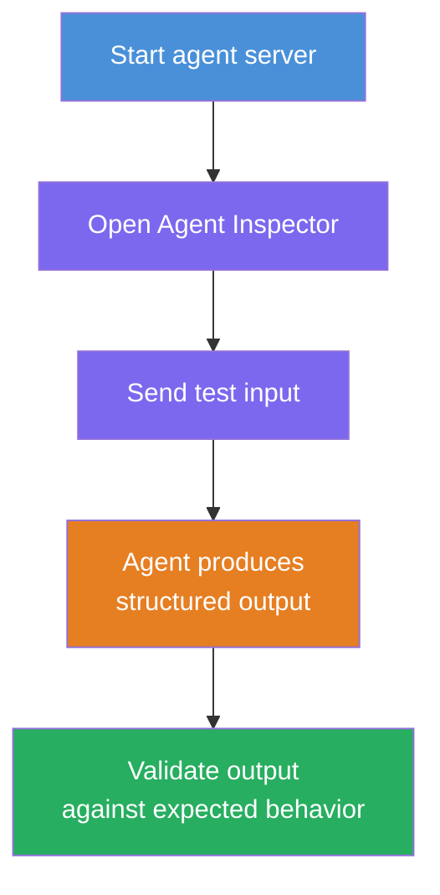
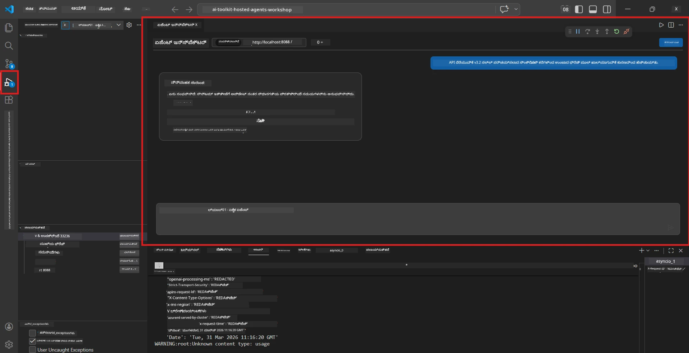
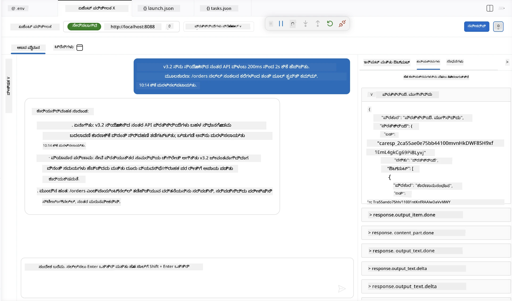

# ಮಾಡ್ಯೂಲ್ 4 - ಸ್ಥಳೀಯವಾಗಿ ಪರೀಕ್ಷೆಮಾಡಿ

⏱️ ~10 ನಿಮಿಷಗಳು

ಈ ಮಾಡ್ಯೂಲ್‌ನಲ್ಲಿ, ನೀವು ನಿಮ್ಮ ಏಜೆಂಟ್ ಅನ್ನು ಸ್ಥಳೀಯವಾಗಿ ಓಡಿಸಿ, ಅದು ಸರಿಯಾದ ರೀತಿಯಲ್ಲಿ ಕಾರ್ಯನಿರ್ವಹಿಸುತ್ತಿದೆಯೇಂದು **ಹ್ಯಾಪಿ-ಪಾತ್ ಕಾರ್ಯಾತ್ಮಕ ಪರೀಕ್ಷೆಗಳ** ಮೂಲಕ ಪರಿಶೀಲಿಸುತ್ತೀರಿ. ನೀವು ಏಜೆಂಟ್ ಇನ್ಸ್‌ಪೆಕ್ಟರ್ (ದೃಶ್ಯ UI) ಅಥವಾ ನೇರ HTTP ಕಾಲ್‌ಗಳನ್ನು ಉಪಯೋಗಿಸಿ ಏಜೆಂಟ್ ಸರಿಯಾದ, ರಚನಾತ್ಮಕ ಪ್ರತಿಕ್ರಿಯೆಗಳನ್ನು ನೀಡುತ್ತಿದೆಯೋ ಎಂಬುದನ್ನು ದೃಢೀಕರಿಸುತ್ತೀರಿ.

### ಸ್ಥಳೀಯಪರೀಕ್ಷೆಯ ಪ್ರಕ್ರಿಯೆ



---

## ಆಯ್ಕೆಯು 1: F5 ಒತ್ತಿ - ಏಜೆಂಟ್ ಇನ್ಸ್‌ಪೆಕ್ಟರ್ೊಂದಿಗೆ ಡಿಬಗ್ ಮಾಡಿ (ಶಿಫಾರಸು ಮಾಡಲಾಗಿದೆ)

### ಡಿಬಗರ್ ಪ್ರಾರಂಭಿಸಿ

1. **executive-summary-agent/** ಫೋಲ್ಡರ್ ಅನ್ನು ನೇರವಾಗಿ VS ಕೋಡ್‌ನಲ್ಲಿ ತೆರೆಯಿರಿ (`File → Open Folder`).
2. **ರನ್ ಮತ್ತು ಡಿಬಗ್** ಪ್ಯಾನೆಲ್ ತೆರೆಯಿರಿ (`Ctrl+Shift+D`).
3. ಡ್ರಾಪ್‌ಡೌನ್‌ನಿಂದ **ಡಿಬಗ್ ಲೋಕಲ್ ಏಜೆಂಟ್ HTTP ಸರ್ವರ್** ಆಯ್ಕೆಮಾಡಿ.
4. **F5** ಒತ್ತಿ (ಅಥವಾ ▶ ಸ್ಟಾರ್ಟ್ ಡಿಬಗಿಂಗ್ ಕ್ಲಿಕ್ ಮಾಡಿ).

> ⚠️ **ಮಹತ್ವದ: ನಿಮ್ಮ ಪೈತಾನ್ ಇಂಟರ್ಪ್ರೀಟರ್ ಆಯ್ಕೆಮಾಡಿ**
> ನೀವು "ModuleNotFoundError" ಅನ್ನು ಕಂಡಿದ್ದರೆ ಅಥವಾ ಡಿಬಗರ್ ಪ್ರಾರಂಭವಾಗದೆ ಇದ್ದರೆ, ನೀವು VS ಕೋಡ್‌ಗೆ ನಿಮ್ಮ ವರ್ಚುವಲ್ ಪರಿಸರವನ್ನು ಬಳಸಲು ಹೇಳಬೇಕು:
  > 1. ಒತ್ತಿರಿ `Ctrl+Shift+P` $\rightarrow$ ಟೈಪ್ ಮಾಡಿ **Python: Select Interpreter**.
  > 2. ನಿಮ್ಮ ಪ್ರಾಜೆಕ್ಟ್‌ನ `.venv` ಫೋಲ್ಡರ್‌ನಲ್ಲಿ ಇರುವ інтэрಪ್ರಿಟರ್ ಆಯ್ಕೆಮಾಡಿ (ಉದಾಹರಣೆಗೆ, Windows ನಲ್ಲಿ `.\.venv\Scripts\python.exe`).
  > 3. ಡಿಬಗ್ ಸೆಷನ್ ಅನ್ನು ಮರುಪ್ರಾರಂಭಿಸಿ.
> ನೀವು ಇನ್ನೂ ದೋಷಗಳನ್ನು ಸಂದ ಮಾಡುತ್ತಿದ್ದರೆ, ನಿಮ್ಮ `tasks.json` ಫೈಲ್ ಅನ್ನು ಕೆಳಗಿನಂತೆ ಕೈಯಾರೆ‌ ನವೀಕರಿಸಿ:
  > 1. `.vscode/tasks.json` ಫೈಲ್‌ಗೆ ತೆರಳಿರಿ
  > 2. ಟಾಸ್ಕ್‌ ಹೆಸರು: `Run Agent HTTP Server` ಗೆ ಹೋಗಿ
  > 3. ಆದೇಶದ ಮೌಲ್ಯವನ್ನು ಕೆಳಗಿನಂತೆ ನವೀಕರಿಸಿ:
  >    - **Windows:** `"value": "${workspaceFolder}/.venv/Scripts/python.exe",`
  >    - **macOS/Linux:** `"value": "${workspaceFolder}/.venv/bin/python",`

### ಏನಾಗುತ್ತದೆ

1. HTTP ಸರ್ವರ್ `http://localhost:8088/responses` ನಲ್ಲಿ ಆರಂಭವಾಗುತ್ತದೆ.
2. **Agent Inspector** ಫಲಕವು ಸ್ವಯಂಚಾಲಿತವಾಗಿ ತೆರೆಯುತ್ತದೆ - ಪರೀಕ್ಷೆಗೆ ದೃಶ್ಯ ಸಂವಾದ ಇಂಟರ್ಫೇಸ್.
3. ಬ್ರೇಕ್‌ಪಾಯಿಂಟ್‌ಗಳು `main.py` ನಲ್ಲಿ ಸಕ್ರಿಯಗೊಳ್ಳುತ್ತವೆ.

ಟರ್ಮಿನಲ್ ನೋಡಿರಿ:
```
Starting executive summary hosted agent
Executive agent server running on http://localhost:8088
```

> **Agent Inspector ತೆರೆಯದಿದ್ದರೆ:** ಒತ್ತಿರಿ `Ctrl+Shift+P` → **Foundry Toolkit: Open Agent Inspector**.



> *ಸ್ಕ್ರೀನ್‌ಶಾಟ್ ಹಳೆಯ 'AI TOOLKIT' ಬ್ರ್ಯಾಂಡಿಂಗ್ ಹಿಂದಿನ ವಿಸ್ತರಣೆ ಆವೃತ್ತಿಯಿಂದ ತೋರಿಸಬಹುದು.*

---

## ಆಯ್ಕೆಯ 2: ಟರ್ಮಿನಲ್ ಮೂಲಕ ಪರೀಕ್ಷೆ (ಪರ್ಯಾಯ)

ಒಬ್ಬ ಟರ್ಮಿನಲ್‌ನಲ್ಲಿ ಏಜೆಂಟ್ ಪ್ರಾರಂಭಿಸಿ, ಮತ್ತೊಂದು ಟರ್ಮಿನಲ್‌ನಿಂದ ವಿನಂತಿಗಳನ್ನು ಕಳುಹಿಸಿ:

```bash
# Terminal 1: Start agent
cd executive-summary-agent/
source .venv/bin/activate
python main.py
```

```bash
# Terminal 2: Send test (curl)
curl -sS -X POST http://localhost:8088/responses \
  -H "Content-Type: application/json" \
  -d '{"input": "The API latency increased due to thread pool exhaustion caused by sync calls in v3.2.", "stream": false}'
```

---

## ದೃಶ್ಯರೂಪ ಪರೀಕ್ಷೆಗಳು: ಸಂತೃಪ್ತಿಪರ ಮಾರ್ಗ ಕಾರ್ಯಗತೀಕರಣ ಪರಿಶೀಲನೆ

ಕೆಳಗಿನ **ಮೂರೂ** ದೃಶ್ಯರೂಪಗಳನ್ನು ಓಡಿಸಿ. ಇವು ನಿಮ್ಮ ಏಜೆಂಟ್ ಸತ್ಯವಾದ, ರಚನಾತ್ಮಕ ಫಲಿತಾಂಶಗಳನ್ನು ಯಥಾರ್ಥ ಇನ್‌ಪುಟ್‌ಗಾಗಿ ಉತ್ಪಾದಿಸುತ್ತಿದೆಯೇ ಎಂದು ಪರಿಶೀಲಿಸುತ್ತವೆ.



### ದೃಶ್ಯರೂಪ 1: ಐಟಿ ಘಟನೆ - API ವಿಳಂಬ ಶಿಖರ

**ಇನ್‌ಪುಟ್:**
```
The API latency increased from 200ms to 2s after deploying v3.2.
Root cause: thread pool starvation from synchronous calls in /orders.
Rolled back at 10:14.
```

** ನಿರೀಕ್ಷಿತ ವರ್ತನೆ:**
- ✅ "Executive Summary" ರಚನೆ ಅನುಸರಿಸುತ್ತದೆ (ಏನು ಸಂಭವಿಸಿತು / ವ್ಯವಹಾರ ಪ್ರಭಾವ / ಮುಂದಿನ ಹಂತ)
- ✅ ತಾಂತ್ರಿಕ ಜಾಗೃತಿ ಇಲ್ಲ (ಇದರಿಂದ "thread pool", "/orders", "v3.2" ಗಳಿಲ್ಲ)
- ✅ ವ್ಯವಹಾರ ಪ್ರಭಾವ ಸ್ಪಷ್ಟವಾಗಿ ಹೇಳುತ್ತದೆ (ಉದಾಹರಣೆಗೆ, ಬಳಕೆದಾರರು ವಿಳಂಬಕ್ಕೆ ಒಳಪಟ್ಟರು)
- ✅ ಮುಂದಿನ ಹಂತ ಇದೆ (ಉದಾಹರಣೆಗೆ, ಪರಿಹಾರ ಹೇರಿಕೆ, ನಿಗಾವಣೆ ಸ್ಥಾಪನೆ)

---

### ದೃಶ್ಯರೂಪ 2: ಡೇಟಾ ಪೈಪ್‌ಲೈನ್ - ETL ವಿಫಲತೆ

**ಇನ್‌ಪುಟ್:**
```
The nightly ETL job failed because the upstream schema changed. APAC dashboards show missing data.
```

** ನಿರೀಕ್ಷಿತ ವರ್ತನೆ:**
- ✅ ಡೇಟಾ ರಿಫ್ರೆಶ್ ವಿಫಲತೆಯನ್ನು ಸರಳ ಭಾಷೆಯಲ್ಲಿ ಸಾರಾಂಶ ಮಾಡಿದೆ
- ✅ APAC ಡ್ಯಾಂಶ್‌ಬೋರ್ಡ್ ಪ್ರಭಾವವನ್ನು ಉಲ್ಲೇಖಿಸುತ್ತದೆ
- ✅ ಪರಿಹಾರ ಮುಂದಿನ ಹಂತವನ್ನು ಒಳಗೊಂಡಿದೆ
- ✅ "ETL", "ಸ್ಕೀಮಾ" ಅಥವಾ ಇತರೆ ತಾಂತ್ರಿಕ ಶಬ್ದಗಳನ್ನು ಉಲ್ಲೇಖಿಸುವುದಿಲ್ಲ

---

### ದೃಶ್ಯರೂಪ 3: ಭದ್ರತೆ - ಹೊರಹೊಮ್ಮಲಾದ ಪ್ರಮಾಣಪತ್ರ

**ಇನ್‌ಪುಟ್:**
```
Static analysis flagged a hardcoded secret in the repository.
The secret may have been exposed in commit history.
```

** ನಿರೀಕ್ಷಿತ ವರ್ತನೆ:**
- ✅ ಪ್ರಮಾಣಪತ್ರ/ಭದ್ರತೆ ಸಮಸ್ಯೆಯನ್ನು ಆಡಳಿತಾತ್ಮಕ ಭಾಷೆಯಲ್ಲಿ ವಿವರಿಸುತ್ತದೆ
- ✅ ಸಾಧ್ಯವಾಗುವ ಅಪಾಯವನ್ನು ಸೂಚಿಸುತ್ತದೆ (ಅಧಿಕೃತ ಅಲ್ಲದ ಪ್ರವೇಶ)
- ✅ ಪರಿಹಾರ ಕ್ರಮ ತಿಳಿಸುತ್ತದೆ (ಪ್ರಮಾಣಪತ್ರ ಬದಲಾವಣೆ, ಆಡಿಟ್)
- ✅ "ಸ್ಥಿರ ವಿಶ್ಲೇಷಣೆ", "ಕಮಿಟ್ ಇತಿಹಾಸ" ಅಥವಾ "ಹರ್ಡ್‌ಕೋಡ್" ಪದಗಳನ್ನು ಒಳಗೊಂಡಿಲ್ಲ

---

## ಪರಿಶೀಲನೆ ನಿಯಮಗಳು

ಪ್ರತಿ ದೃಶ್ಯರೂಪಕ್ಕಾಗಿಯೂ ಪರಿಶೀಲಿಸಿ:

| # | ಮಾನದಂಡ | ಮಾರ್ಗ ಆದೇಶ |
|---|----------|---------------|
| 1 | **ರಚನೆ** | ಪ್ರತಿಕ್ರಿಯೆ "Executive Summary" ಮೆಾನಾಕರೂಪ ಬಳಕೆ ಮಾಡಿದೆ ಮತ್ತು ಮೂರು ಗುಂಡಿಗಳಿವೆ |
| 2 | **ಸರಳ ಭಾಷೆ** | ಎಕ್ಸಿಕ್ಯೂಟಿವ್ ತಿಳಿಯದ ತಾಂತ್ರಿಕ ಜಾರ್ಗಾನ್ ಇರಬಾರದು |
| 3 | **ನಿಖರತೆ** | ಸಾರಾಂಶವು ಇನ್‌ಪುಟ್‌ ಅನ್ನು ಪ್ರತಿಬಿಂಬಿಸುತ್ತದೆ - ಸುಳ್ಳು ವಿವರ ಇಲ್ಲ |
| 4 | **ಸಂಕ್ಷಿಪ್ತತೆ** | ಪ್ರತಿಕ್ರಿಯೆ 100 ಪದಗಳೊಳಗೆ ಇದೆ |
| 5 | **ಮುಂದಿನ ಹಂತ** | ಸ್ಪಷ್ಟ ಕ್ರಮ ಅಥವಾ ಪರಿಹಾರವು ತಿಳಿಸಬೇಕಾಗಿದೆ |

---

## ಡಿಬಗ್ ಸಲಹೆಗಳು

| ಸಮಸ್ಯೆ | ಪರಿಹಾರ |
|-------|-----|
| ಏಜೆಂಟ್ ಪ್ರಾರಂಭವಾಗುವುದಿಲ್ಲ | `.env` ಮೌಲ್ಯಗಳನ್ನು ಪರಿಶೀಲಿಸಿ, ವ್ಚಾರಿಸಿದ್ದರು ವೆನ್ ಸಕ್ರಿಯವಾಗಿದೆ ಎಂದು ಖಚಿತಪಡಿಸಿ, `pip install -r requirements.txt` ಓಡಿಸಿ |
| ಖಾಲಿ ಅಥವಾ ಸಾಮಾನ್ಯ ಪ್ರತಿಕ್ರಿಯೆ | `main.py` ಸೂಚನೆಗಳನ್ನು ಪರಿಶೀಲಿಸಿ - ಔಟ್‌ಪುಟ್ ಫಾರ್ಮ್ಯಾಟ್ ಖಚಿತಪಡಿಸಿ |
| ಪ್ರತಿಕ್ರಿಯೆಯಲ್ಲಿ ಜಾಗೃತಿ ಇದೆ | "ತಾಂತ್ರಿಕ ಪದಗಳನ್ನು ತೆಗೆದುಹಾಕುವ" ನಿಯಮಗಳನ್ನು ಬಲಪಡಿಸಿ ಸೂಚನೆಗಳಲ್ಲಿ |
| Agent Inspector ತೆರೆಯುವುದಿಲ್ಲ | `Ctrl+Shift+P` → **Foundry Toolkit: Open Agent Inspector** |
| ಟರ್ಮಿನಲ್ ನಲ್ಲಿ ಮಾದರಿ ದೋಷಗಳು | `AZURE_AI_MODEL_DEPLOYMENT_NAME` ನೊಂದಿಗೆ ಸರಿಯಾಗಿ ಹೊಂದಿಸಿರುವುದೂ ಪರಿಶೀಲಿಸಿ (ಕೆಸ್ ಸೆಂಸಿಟಿವ್) |

---

### ✅ ಪರಿಶೀಲನೆ ಬಿಂದು

- [ ] ಏಜೆಂಟ್ ಸ್ಥಳೀಯವಾಗಿ ತೊಂದರೆ ಇಲ್ಲದೆ ಪ್ರಾರಂಭವಾಗಿದೆ
- [ ] Agent Inspector ತೆರೆಯುತ್ತದೆ ಮತ್ತು ಸಂವಾದ ಇಂಟರ್ಫೇಸ್ ತೋರಿಸುತ್ತದೆ (F5 ಬಳಕೆ ಮಾಡಿಕೊಂಡರೆ)
- [ ] **ದೃಶ್ಯರೂಪ 1** (ಐಟಿ ಘಟನೆ) - ರಚನಾತ್ಮಕ Executive Summary, ಜಾಗೃತಿ ಇಲ್ಲ
- [ ] **ದೃಶ್ಯರೂਪ 2** (ಡೇಟಾ ಪೈಪ್‌ಲೈನ್) - ಸಂಬಂಧಿಸಿದ ಸಾರಾಂಶ ಮತ್ತು ವ್ಯವಹಾರ ಪ್ರಭಾವ
- [ ] **ದೃಶ್ಯರೂಪ 3** (ಭದ್ರತೆ ಎಚ್ಚರಿಕೆ) - ಸೂಕ್ತ ಅಪಾಯ ಸಂವಹನ
- [ ] ಎಲ್ಲಾ ಪ್ರತಿಕ್ರಿಯೆಗಳು ನಿಗದಿತ ಔಟ್ಪುಟ್ ರಚನೆಯನ್ನು ಅನುಸರಿಸುತ್ತವೆ

> **ನಿಮ್ಮ ಪ್ರತಿಕ್ರಿಯೆಗಳನ್ನು ಉಳಿಸಿ** (ನಕಲಿಸಿ ಅಥವಾ ಸ್ಕ್ರೀನ್‌ಶಾಟ್ ತೆಗೆದುಕೊಳ್ಳಿ) - ನೀವು ಅವುಗಳನ್ನು ಮಾಡ್ಯೂಲ್ 06 ನಲ್ಲಿ ಕ್ಲೌಡ್ ಫಲಿತಾಂಶದೊಂದಿಗೆ ಹೋಲಿಸುವಿರಿ.

---

**ಹಿಂದಿನದು:** [03 - ವಿಶ್ಲೇಷಣೆ & ಕೋಡ್](03-configure-and-code.md) · **அடுத்து:** [05 - ಫೌಂಡ್ರಿ ಗೆ ನಿಯೋಜಿಸಿ →](05-deploy-to-foundry.md)

---

<!-- CO-OP TRANSLATOR DISCLAIMER START -->
**ಅಸ್ವೀಕಾರ**:
ಈ ದಸ್ತಾವೇಜು AI ಅನುವಾದ ಸೇವೆ [Co-op Translator](https://github.com/Azure/co-op-translator) ಬಳಸಿ ಅನುವಾದಿಸಲಾಗಿದೆ. ನಾವು ನಿಖರತೆಯನ್ನು ಸಾಧಿಸಲು ಪ್ರಯತ್ನಿಸುತ್ತಿದ್ದರೂ, ದಯವಿಟ್ಟು ಗಮನಿಸಿ, ಸ್ವಯಂಚಾಲಿತ ಅನುವಾದಗಳಲ್ಲಿ ದೋಷಗಳು ಅಥವಾ ಅಸಡ್ಡೆಗಳು ಇರಬಹುದು. ಮೂಲ ಭಾಷೆಯಲ್ಲಿರುವ ಮೂಲ ದಸ್ತಾವೇಜು ಪ್ರಾಮಾಣಿಕ ಮೂಲವೆಂದು ಪರಿಗಣಿಸಬೇಕು. ಪ್ರಮುಖ ಮಾಹಿತಿಗಾಗಿ, ವೃತ್ತಿಪರ ಮಾನವ ಅನುವಾದವನ್ನು ಶಿಫಾರಸು ಮಾಡಲಾಗುತ್ತದೆ. ಈ ಅನುವಾದವನ್ನು ಬಳಸುವ ಮೂಲಕ ಉಂಟಾಗುವ ಯಾವುದೇ ತಪ್ಪು ಅರ್ಥಗಳ ಅಥವಾ ತಪ್ಪು ವ್ಯಾಖ್ಯಾನಗಳ ಬಗ್ಗೆ ನಾವು ಹೊಣೆಗಾರರಲ್ಲ.
<!-- CO-OP TRANSLATOR DISCLAIMER END -->