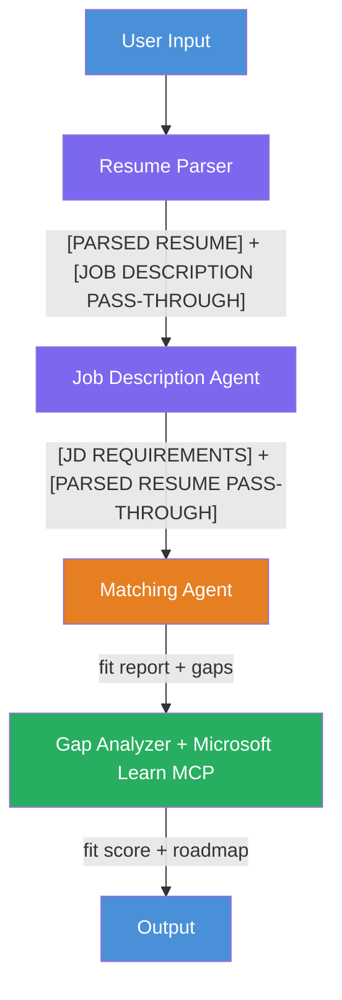

# ಪ್ರಯೋಗಶಾಲೆ 02 - ಬಹು-ಏಜೆಂಟ್ ಕಾರ್ಯಪ್ರವಾಹ: ರೆಸ್ಯೂಮ್ → ಕಾರ್ಯ ಹೊಂದಾಣಿಕೆ ಮೌಲ್ಯಮಾಪಕ

## ಅವಲೋಕನ

ಈ ಕೈಗಾರಿಕಾ ಪ್ರಯೋಗಶಾಲೆಯಲ್ಲಿ, ನೀವು VS ಕೋಡ್‌ನ Foundry Toolkit ಬಳಸಿ **ಕಾರ್ಯಪ್ರವಾಹ-ಮೊದಲು ಬಹು-ಏಜೆಂಟ್ ಅಪ್ಲಿಕೇಶನ್** ಅನ್ನು ನಿರ್ಮಿಸಿ ಅದನ್ನು Microsoft Foundry Agent Service ಗೆ ನಿಯೋಜಿಸುವಿರಿ.

**ನೀವು ನಿರ್ಮಿಸುವುದು:** ರೆಸ್ಯೂಮ್ → ಕಾರ್ಯ ಹೊಂದಾಣಿಕೆ ಮೌಲ್ಯಮಾಪಕರು, ಅದು ರೆಸ್ಯೂಮೆ ಮತ್ತು ಕೆಲಸದ ವಿವರಣೆಯನ್ನು ಪಾರ್ಸ್ ಮಾಡುತ್ತದೆ, ಹೊಂದಾಣಿಕೆಯನ್ನು ಅಂಕಗಳನ್ನು ನೀಡುತ್ತದೆ, ಮತ್ತು Microsoft Learn ಸಂಪನ್ಮೂಲಗಳನ್ನು ಬಳಸಿ ವೈಯಕ್ತಿಕೃತ ಕಲಿಕೆ ಯೋಜನೆಯನ್ನೂ ಉತ್ಪಾದಿಸುತ್ತದೆ.

---

## ವಾಸ್ತುಕಲೆ

**ಇದು ಹೇಗೆ ಕಾರ್ಯನಿರ್ವಹಿಸುತ್ತದೆ:**
1. ಬಳಕೆದಾರರು ರೆಸ್ಯೂಮ್ ಮತ್ತು ಕೆಲಸದ ವಿವರಣೆಯನ್ನು ಅಂಟಿಸೋದು.
2. **ResumeParser** ರೆಸ್ಯೂಮೆಯನ್ನು ಪಾರ್ಸ್ ಮಾಡಿ ಮತ್ತು JD ಅನ್ನು ನಿಖರವಾಗಿ `[JOB DESCRIPTION PASS-THROUGH]` ವಿಭಾಗಕ್ಕೆ ನಕಲಿಸೋದು.
3. **JD Agent** ಸಾಗಿಸಿರುವ ಡೇಟಾದಿಂದ ರಚನೆಗೊಳಿಸಿದ ಅವಶ್ಯಕತೆಗಳನ್ನು ತೆಗೆದು, ನಂತರ `[PARSED RESUME]` ಅನ್ನು `[PARSED RESUME PASS-THROUGH]` ಆಗಿ ಮುಂದಕ್ಕೆ ಕಳುಹಿಸೋದು.
4. **MatchingAgent** `[PARSED RESUME PASS-THROUGH]` ಮತ್ತು `[JD REQUIREMENTS]` ಯನ್ನು ಹೋಲಿಸಿ ಹೊಂದಾಣಿಕೆ ಅಂಕವನ್ನು ನೀಡೋದು.
5. **GapAnalyzer** ಇರುವ ಗ್ಯಾಪ್‌ಗಳನ್ನು ವ್ಯವಹಾರಪೂರ್ಣ ಯೋಜನೆಗೆ ಪರಿವರ್ತಿಸಿ ಮತ್ತು MCP ಮೂಲಕ ನಿಜವಾದ Microsoft Learn ಲಿಂಕ್‌ಗಳನ್ನು ಪಡೆಯೋದು.

---

## ಪೂರ್ವಾಪೇಕ್ಷೆಗಳು

ಮೊದಲು ಪ್ರಯೋಗಶಾಲೆ 01 ಅನ್ನು ಪೂರ್ಣಗೊಳಿಸಿ:

- [ಪ್ರಯೋಗಶಾಲೆ 01 - ಏಕ ಏಜೆಂಟ್](../lab01-single-agent/README.md)

---

## ಭಾಗ 1: ಕ್ರಮವಾಗಿ ಘಟಕಗಳನ್ನು ಓದಿಕೊಳ್ಳಿ

ಸಂಪೂರ್ಣ ಕಲಿಕೆ ಮಾರ್ಗವನ್ನು ನೋಡಿ:

- [ಪ್ರಯೋಗಶಾಲೆ 2 ಡಾಕ್ಸ್ - ಪೂರ್ವಾಪೇಕ್ಷೆಗಳು](docs/00-prerequisites.md)
- [ಪ್ರಯೋಗಶಾಲೆ 2 ಡಾಕ್ಸ್ - ಸಂಪೂರ್ಣ ಕಲಿಕೆ ಮಾರ್ಗ](docs/README.md)
- [PersonalCareerCopilot ಕಾರ್ಯಾಚರಣೆ ಮಾರ್ಗದರ್ಶಿ](PersonalCareerCopilot/README.md)

---

## ಭಾಗ 2: ಕಾರ್ಯಪ್ರವಾಹವನ್ನು ನಿರ್ಮಿಸಿ ಮತ್ತು ಪರೀಕ್ಷಿಸಿ

1. Foundry Toolkit ವಿಜಾರ್ಡ್ನಲ್ಲಿ ಕಾರ್ಯಪ್ರವಾಹ ಆಧಾರಿತ ಯೋಜನೆಯನ್ನು ಮೆರೆಯಿರಿ.
2. ಪ್ರಾಂಪ್ಟ್ ಬ್ಲಾಕ್‌ಗಳು ಮತ್ತು ಕಾರ್ಯಪ್ರವಾಹ ಗ್ರಾಫ್ ಅನ್ನು `PersonalCareerCopilot/main.py` ನಿಂದ ನಿಮ್ಮ ವರ್ಕ್‌ಸ್ಪೇಸ್‌ಗೆ ನಕಲಿಸಿ.
3. ಪ್ರಧಾನವಾಗಿ Agent Inspector ಬಳಸಿ ಸರ್ವ ಏಜೆಂಟ್‌ಗಳನ್ನು ಮತ್ತು MCP ಉಪಕರಣವನ್ನು ಖಚಿತಪಡಿಸಿ.
4. ಸ್ಥಳೀಯ ಪರೀಕ್ಷೆಯು ಯಶಸ್ವಿಯಾದಲ್ಲಿ, ಆಝೋಜಮಾದ ಏಜೆಂಟ್ ಅನ್ನು Foundry ಗೆ ನಿಯೋಜಿಸಿ.

---

## ಸಂಯೋಜನೆ ಮಾದರಿಗಳು

ಪ್ರಯೋಗಶಾಲೆ 02 ** ಕ್ರಮವಾರ ತನ್ನ ಬಳಕೆ ** ಮಾಡುತ್ತದೆ: ಪ್ರತಿಯೊಂದು ಏಜೆಂಟ್‌ನ ಔಟ್‌ಪುಟ್ ಮುಂದಿನದಕ್ಕೆ ಸೇರಿದೆಯೂ, ಅಂತಿಮ ಏಜೆಂಟ್ ಪ್ರತಿಕ್ರಿಯೆಗೆ ಕಾರ್ಯಪ್ರವಾಹ ತಲುಪಿಸುತ್ತದೆ. ಎರಡು ಮಾದರಿಗಳು ಇದನ್ನು ಕಾರ್ಯಗತಗೊಳಿಸುತ್ತವೆ:

- **ಕ್ರಮವಾರ ಸರಪಳಿ** - `WorkflowBuilder` ResumeParser → JD Agent → MatchingAgent → GapAnalyzer ಒಂದೊಂದನೇ ಹಂತಕ್ಕೆ ಒಂದು `add_edge()` ಕರೆಗಳೊಂದಿಗೆ ಸಂಪರ್ಕಿಸುತ್ತದೆ
- **ಸಾಮಗ್ರಿ ರಿಲೇ** - ಏಕೆಂದರೆ ಪ್ರತಿಯೊಂದು ಏಜೆಂಟ್ ಅದರ ನೇರ ಪೂರ್ವ ಸಂಸ್ಥೆಯ ಔಟ್‌ಪುಟ್ ಮಾತ್ರ ನೋಡುತ್ತದೆ, ResumeParser ಮತ್ತು JD Agent ಇತರ ಏಜೆಂಟ್‌ಗಳಿಗೆ ಅಗತ್ಯ ಡೇಟಾವನ್ನು ಲೇಬಲ್ ಮಾಡಲಾದ ಪಾಸ್-ತ್ರೂ ವಿಭಾಗಗಳಲ್ಲಿ ನಕಲಿಸುತ್ತವೆ

ಡಾಕ್ಸ್ ಕೆಲವೊಮ್ಮೆ ಲ್ಯಾಬ್ ಫ್ಯಾನ್-ಔಟ್ / ಫ್ಯಾನ್-ಇನ್ ಬಳಸದ ಕಾರಣ ಮತ್ತು ಮತ್ತೊಂದು ಏಜೆಂಟ್ ಸೇರಿಸುವ ವಿಧಾನ ತಿಳಿಸುತ್ತವೆ.

ನೋಡಿ [docs/04-orchestration-patterns.md](docs/04-orchestration-patterns.md).

---

**ಹಿಂದಿನ:** [ಪ್ರಯೋಗಶಾಲೆ 01 - ಏಕ ಏಜೆಂಟ್](../lab01-single-agent/README.md) · **ಹಿಂಬಾಲಿಸಿ:** [ಕಾರಾಗೃಹ ಹೋಂ](../../README.md)

---

<!-- CO-OP TRANSLATOR DISCLAIMER START -->
**ಅಸ್ವೀಕಾರ**:
ಈ ದಸ್ತಾವೇಜು AI ಅನುವಾದ ಸೇವೆ [Co-op Translator](https://github.com/Azure/co-op-translator) ಬಳಸಿ ಅನುವಾದಿಸಲಾಗಿದೆ. ನಾವು ನಿಖರತೆಯನ್ನು ಸಾಧಿಸಲು ಪ್ರಯತ್ನಿಸುತ್ತಿದ್ದರೂ, ದಯವಿಟ್ಟು ಗಮನಿಸಿ, ಸ್ವಯಂಚಾಲಿತ ಅನುವಾದಗಳಲ್ಲಿ ದೋಷಗಳು ಅಥವಾ ಅಸಡ್ಡೆಗಳು ಇರಬಹುದು. ಮೂಲ ಭಾಷೆಯಲ್ಲಿರುವ ಮೂಲ ದಸ್ತಾವೇಜು ಪ್ರಾಮಾಣಿಕ ಮೂಲವೆಂದು ಪರಿಗಣಿಸಬೇಕು. ಪ್ರಮುಖ ಮಾಹಿತಿಗಾಗಿ, ವೃತ್ತಿಪರ ಮಾನವ ಅನುವಾದವನ್ನು ಶಿಫಾರಸು ಮಾಡಲಾಗುತ್ತದೆ. ಈ ಅನುವಾದವನ್ನು ಬಳಸುವ ಮೂಲಕ ಉಂಟಾಗುವ ಯಾವುದೇ ತಪ್ಪು ಅರ್ಥಗಳ ಅಥವಾ ತಪ್ಪು ವ್ಯಾಖ್ಯಾನಗಳ ಬಗ್ಗೆ ನಾವು ಹೊಣೆಗಾರರಲ್ಲ.
<!-- CO-OP TRANSLATOR DISCLAIMER END -->