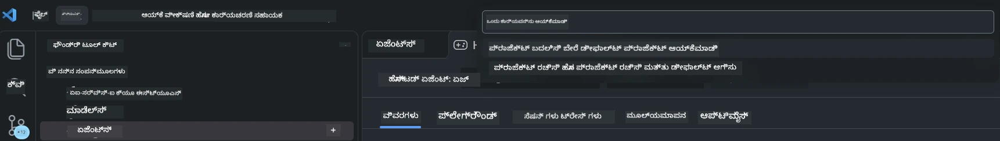

# ಮೋ듭ಲ್ 0 - ಪರಿಚಯ

⏱️ ~10 ನಿಮಿಷಗಳು

> [!WARNING]
> **ಪೂರ್ವವೀಕ್ಷಣೆ ಮತ್ತು ಸೀಮಿತತೆಗಳು:** [ಹೋಸ್ಟೆಡ್ ಏಜೆಂಟ್‌ಗಳು](https://learn.microsoft.com/azure/foundry/agents/concepts/hosted-agents) ಪ್ರಸ್ತುತ **ಸಾರ್ವಜನಿಕ ಪೂರ್ವವೀಕ್ಷಣೆಯಲ್ಲಿವೆ** - ಉತ್ಪಾದನಾ ಕಾರ್ಯಭಾರಗಳಿಗೆ ಶಿಫಾರಸು ಮಾಡಲಾಗುವುದಿಲ್ಲ. ಈ ಕಾರ್ಯಾಗಾರದಲ್ಲಿ ತೋರಿಸಲಾದ ಕೆಲವು ವೈಶಿಷ್ಟ್ಯಗಳು ಸೇವೆ GA ಕಡೆಗೆ ಸಾಗುತ್ತಿದ್ದಂತೆ ಬದಲಾಗಬಹುದು.

## ನೀವು ನಿರ್ಮಿಸುವುದು ಏನು

ಈ ಲ್ಯಾಬ್‌ನಲ್ಲಿ, ನೀವು ಲ್ಯಾಬ್ 01 ನಿಂದ ಏಕ ಏಜೆಂಟ್ ಕೌಶಲ್ಯಗಳನ್ನು ವಿಸ್ತರಿಸಿ **ಬಹು ಏಜೆಂಟ್ ಕಾರ್ಯಪ್ರವಾಹ** - ರೆಸ್ಯೂಮ್ → ಉದ್ಯೋಗ ಹೊಂದಾಣಿಕೆಯ ಮೌಲ್ಯಮಾಪಕವನ್ನು ನಿರ್ಮಿಸುತ್ತೀರಿ.

ನೀವು **ರೆಸ್ಯೂಮ್** ಮತ್ತು **ಉದ್ಯೋಗ ವಿವರಣೆ**ಗಳನ್ನು ಪೇಸ್ಟ್ ಮಾಡುತ್ತೀರಿ. ನಾನಾ ವಿಶೇಷತೆಯ ಇರುವ ನಾಲ್ಕು ಏಜೆಂಟ್‌ಗಳು ಇನ್ಪುಟ್ ಅನ್ನು ಕ್ರಮಬದ್ಧವಾಗಿ ಪ್ರಕ್ರಿಯೆಗೊಳಿಸಿ ನಂತರ ಹಿಂತಿರುಗಿಸುತ್ತವೆ:
- ಹೊಂದಾಣಿಕೆಯ ಅಂಕೆ (0–100 ಮತ್ತು ಅಂಕಾಚಾರಣೆಗೆ ಪ್ರತ್ಯೇಕನೆ)
- ಕೌಶಲ್ಯ ಮತ್ತು ಪ್ರಮಾಣಪತ್ರದ ಕೊರತೆಗಳ ಪಟ್ಟಿ
- ಪ್ರತಿಯೊಂದು ಕೊರತೆಯಿಗೂ ನಿಜವಾದ ಮೈಕ್ರೋಸಾಫ್ಟ್ ಲರ್ನ್ ಲಿಂಕ್‌ಗಳನ್ನು ನೀಡುವ ವೈಯಕ್ತಿಕ ಕಲಿಕಾ ರಸ್ತೆನಕ್ಷೆ

**ಕಾರ್ಯಪ್ರವಾಹ ಬಳಸುವವು:**
- **ಮೈಕ್ರೋಸಾಫ್ಟ್ ಏಜೆಂಟ್ ಫ್ರೇಮ್ವರ್ಕ್** - ಕ್ರಮಬದ್ಧ ಪೈಪ್ಲೈನ್ ಸಂಯೋಜನೆಗೆ `WorkflowBuilder`
- **ಫೌಂಡ್ರಿ ಟೂಲ್‌ಕಿಟ್ ಫಾರ್ VS ಕೋಡ್** - ಸ್ಕಾಫೋಲ್ಡ್, ಸ್ಥಳೀಯವಾಗಿ ಪರೀಕ್ಷೆ ಮಾಡಿ, ನಿಯೋಜಿಸಿ
- **ಏಐ ಮಾದರಿ** (ಉದಾಹರಣೆ, `gpt-4.1-mini`) - ಎಲ್ಲಾ ನಾಲ್ಕು ಏಜೆಂಟ್‌ಗಳು ಬಳಸುವವು
- **ಮೈಕ್ರೋಸಾಫ್ಟ್ ಲರ್ನ್ MCP ಸರ್ವರ್** - ಪ್ರತಿ ಕೌಶಲ್ಯ ಕೊರತೆಗೆ ನಿಜವಾದ ಕಲಿಕಾ ಸಂಪನ್ಮೂಲ ಲಿಂಕ್‌ಗಳನ್ನು ಒದಗಿಸುವುದು

---

## ನಿಮ್ಮ ಮಾರ್ಗ ಆಯ್ಕೆಮಾಡಿ

> ⚠️ **ಲ್ಯಾಬ್ 01 ನಲ್ಲಿ ನೀವು ಬಳಸಿ ಬಂದ ಅದೇ ಮಾರ್ಗವನ್ನು ಮುಂದುವರಿಸಿ.**

<details open>
<summary><strong>🅰️ ಮಾರ್ಗ A - ಅಜೂರ್ ಕ್ಲೌಡ್ (ಅಜೂರ್ ಸಬ್ಸ್ಕ್ರಿಪ್ಶನ್ ಬೇಕು)</strong></summary>

| | ವಿವರಗಳು |
|---|---|
| **ಇದನ್ನು ಯಾರು ಬಳಸಬೇಕು?** | ನೀವು ಅಜೂರ್ ಸಬ್ಸ್ಕ್ರಿಪ್ಶನ್ ಬಳಸಿ ಲ್ಯಾಬ್ 01 ಸಂಪಾದಿಸಲಾಗಿದೆ |
| **ಮಾದರಿ** | Foundry ಮೂಲಕ ಅಜೂರ್ OpenAI (ಉದಾಹರಣೆ, `gpt-4.1-mini`) |
| **ಕುನಿತುಕೊಂಡ ಮಾಗಳಾ** | ಎಲ್ಲಾ ಮಾಡ್ಯೂಲ್‌ಗಳು (00–09) |
| **ಕ್ಲೌಡ್ಗೆ ನಿಯೋಜಿಸುವವೇ?** | ✅ ಹೌದು - ಸಂಪೂರ್ಣ ಅಂತಿಮ ನಿಯೋಜನೆ |

</details>

<details open>
<summary><strong>🅱️ ಮಾರ್ಗ B - ಫೌಂಡ್ರಿ ಲೋಕಲ್ (ಅಜೂರ್ ಸಬ್ಸ್ಕ್ರಿಪ್ಶನ್ ಅಗತ್ಯವಿಲ್ಲ)</strong></summary>

| | ವಿವರಗಳು |
|---|---|
| **ಇದನ್ನು ಯಾರು ಬಳಸಬೇಕು?** | ನೀವು ಲ್ಯಾಬ್ 01 foundry local ಬಳಸಿ ಪೂರ್ಣಗೊಳನೆ ಮಾಡಿದ್ದೀರಿ |
| **ಮಾದರಿ** | ಫೌಂಡ್ರಿ ಲೋಕಲ್ (ಬಾಲ, ನಿಮ್ಮ ಯಂತ್ರದಲ್ಲಿ ಚಾಲನೆ) |
| **ಮಾಡ್ಯೂಲ್‌ಗಳು ಸವಾಲಾಗಿವೆ** | ಮಾಡ್ಯೂಲ್ 00-05 (06–07 ದಾಟಿ - ನಿಯೋಜನೆ ಮತ್ತು ಕ್ಲೌಡ್ ಪರಿಶೀಲನೆ) |
| **ಕ್ಲೌಡ್ಗೆ ನಿಯೋಜಿಸುವವೇ?** | ❌ ಇಲ್ಲ - ಏಜೆಂಟ್ ಇನ್‌ಸ್ಪೆಕ್ಟರ್ ಮೂಲಕ ಸ್ಥಳೀಯ ಪರೀಕ್ಷೆ ಮಾತ್ರ |

</details>

---

## ಲ್ಯಾಬ್ 01 ಪರಿಶೀಲನೆ

ಲ್ಯಾಬ್ 02 ನೇರವಾಗಿ ಲ್ಯಾಬ್ 01ನ ಮೇಲೆ ನಿರ್ಮಿತವಾಗಿದೆ. ಇಲ್ಲಿಗೆ ಪ್ರಾರಂಭಿಸುವ ಮೊದಲು ಲ್ಯಾಬ್ 01 ಅನ್ನು ಪೂರ್ಣಗೊಳಿಸಿ.

ಇನ್ನೂ ಲ್ಯಾಬ್ 01 ಮಾಡಿರಲಿಲ್ಲವೇ? ಇಲ್ಲಿ ಆರಂಭಿಸಿ: [ಲ್ಯಾಬ್ 01 - ಪರಿಚಯ](../../lab01-single-agent/docs/00-prerequisites.md)

<details open>
<summary><strong>🅰️ ಮಾರ್ಗ A - ಅಜೂರ್ ಕ್ಲೌಡ್</strong></summary>

```powershell
az account show --query "{name:name, id:id}" --output table
```

ವಿಫಲವಾದರೆ, `az login` ನಡೆಸಿರಿ. ನಂತರ VS ಕೋಡಿನಲ್ಲಿ ಪರಿಶೀಲನೆ ಮಾಡಿರಿ:

1. `Ctrl+Shift+P` —  **Foundry Toolkit** টাইಪ್ ಮಾಡಿ — ಆದೇಶಗಳು ತೋರಿದೆಯೇ ಎಂದು ಖಚಿತಪಡಿಸಿಕೊಳ್ಳಿ.
2. **Foundry Toolkit** ಐಕಾನ್ ಕ್ಲಿಕ್ ಮಾಡಿ — ನಿಮ್ಮ ಪ್ರಾಜೆಕ್ಟ್ ಮತ್ತು ನಿಯೋಜಿತ ಮಾದರಿ **ಸಫಲ** ಎಂದು ತೋರಿಸುತ್ತದೆ.



> **RBAC:** ನೀವು ಲ್ಯಾಬ್ 01 ರಲ್ಲಿ **Foundry User** ನ್ನು ನಿಯೋಜಿಸಿದ್ದೀರಿ. ಮರುನಿಯೋಜನೆಯನ್ನು ಕಲ್ಪಿಸುವ ಅಗತ್ಯ ಇದ್ದರೆ, [ಲ್ಯಾಬ್ 01, ಮೋ듭ಲ್ 1](../../lab01-single-agent/docs/01-setup.md#deploy-a-model--assign-rbac) ನೋಡಿ. ಈ ಪಾತ್ರದ ಹಿಂದಿನ ಹೆಸರು **Azure AI User** ಆಗಿತ್ತು - ಅನುಮತಿಗಳು ಇದೇ.

</details>

<details open>
<summary><strong>🅱️ ಮಾರ್ಗ B - ಫೌಂಡ್ರಿ ಲೋಕಲ್</strong></summary>

```powershell
Invoke-WebRequest -Uri "http://localhost:5273/v1/health" -UseBasicParsing | Select-Object StatusCode
```

ನಿರೀಕ್ಷೆ: `StatusCode: 200`. ಇಲ್ಲದಿದ್ದರೆ, ಫೌಂಡ್ರಿ ಟೂಲ್‌ಕಿಟ್ ಸೈಡ್ಬಾರ್‌ನಿಂದ ಫೌಂಡ್ರಿ ಲೋಕಲ್ ಅನ್ನು ಮರುಪ್ರಾರಂಭಿಸಿ.

> ಎಲ್ಲಾ ಅಂತರ್ನಿರ್ಣಯ ನಿಮ್ಮ ಯಂತ್ರದಲ್ಲಿ ನಡೆಯುತ್ತದೆ. ಹೊರಗಿನ ಕಾಲ್ MCP ಉಪಕರಣಕ್ಕೆ ಮಾತ್ರ `https://learn.microsoft.com/api/mcp`.

</details>

---

## ಲ್ಯಾಬ್ 02 ನಲ್ಲಿ ಏನು ಹೊಸದು

| | ಲ್ಯಾಬ್ 01 | ಲ್ಯಾಬ್ 02 |
|--|--------|--------|
| ಏಜೆಂಟ್‌ಗಳು | 1 | 4 (WorkflowBuilder ಜೊತೆಗೆ ಸರಣಿಬದ್ಧ) |
| ಸ್ಕಾಫೋಲ್ಡ್ ಟೆಂಪ್ಲೇಟ್ | അടിസ്ഥാന - ಏಜೆಂಟ್ ಫ್ರೇಮ್ವರ್ಕ್ | ಕಾರ್ಯಪ್ರವಾಹಗಳು - ಏಜೆಂಟ್ ಫ್ರೇಮ್ವರ್ಕ್ |
| ಹೊಸ ಪ್ಯಾಕೇಜ್ | - | `mcp` |
| ಸಂಯೋಜನೆ | ಏಕ ಸಂವಾದಾತ್ಮಕ ಏಜೆಂಟ್ | ಕ್ರಮಬದ್ಧ ಪೈಪ್ಲೈನ್ (WorkflowBuilder) |
| ಹೊಸ ಉಪಕರಣ | - | `search_microsoft_learn_for_plan` (MCP) |

---

**ಮುಂದೆ:** [01 - ವಾಸ್ತುಶಿಲ್ಪವನ್ನು ಅರ್ಥಮಾಡಿಕೊಳ್ಳಿ →](01-understand-multi-agent.md)

---

<!-- CO-OP TRANSLATOR DISCLAIMER START -->
**ಅಸ್ವೀಕಾರ**:
ಈ ದಸ್ತಾವೇಜು AI ಅನುವಾದ ಸೇವೆ [Co-op Translator](https://github.com/Azure/co-op-translator) ಬಳಸಿ ಅನುವಾದಿಸಲಾಗಿದೆ. ನಾವು ನಿಖರತೆಯನ್ನು ಸಾಧಿಸಲು ಪ್ರಯತ್ನಿಸುತ್ತಿದ್ದರೂ, ದಯವಿಟ್ಟು ಗಮನಿಸಿ, ಸ್ವಯಂಚಾಲಿತ ಅನುವಾದಗಳಲ್ಲಿ ದೋಷಗಳು ಅಥವಾ ಅಸಡ್ಡೆಗಳು ಇರಬಹುದು. ಮೂಲ ಭಾಷೆಯಲ್ಲಿರುವ ಮೂಲ ದಸ್ತಾವೇಜು ಪ್ರಾಮಾಣಿಕ ಮೂಲವೆಂದು ಪರಿಗಣಿಸಬೇಕು. ಪ್ರಮುಖ ಮಾಹಿತಿಗಾಗಿ, ವೃತ್ತಿಪರ ಮಾನವ ಅನುವಾದವನ್ನು ಶಿಫಾರಸು ಮಾಡಲಾಗುತ್ತದೆ. ಈ ಅನುವಾದವನ್ನು ಬಳಸುವ ಮೂಲಕ ಉಂಟಾಗುವ ಯಾವುದೇ ತಪ್ಪು ಅರ್ಥಗಳ ಅಥವಾ ತಪ್ಪು ವ್ಯಾಖ್ಯಾನಗಳ ಬಗ್ಗೆ ನಾವು ಹೊಣೆಗಾರರಲ್ಲ.
<!-- CO-OP TRANSLATOR DISCLAIMER END -->