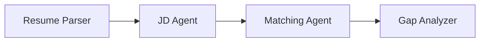
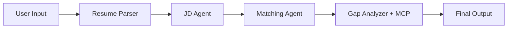

# ಅಧ್ಯಾಯ 4 - ಸಂಯೋಜನೆ ಮಾದರಿಗಳು

⏱️ ~10 ನಿಮಿಷಗಳು

ಈ ಅಧ್ಯಾಯದಲ್ಲಿ, ನೀವು ರೆಜ್ಯೂಮ್ ಜಾಬ್ ಫಿಟ್ ಎವಾಲುಯೇಟರ್‌ನಲ್ಲಿ ಬಳಸಲಾಗಿರುವ ಸಂಯೋಜನೆ ಮಾದರಿಗಳನ್ನು ಕಂಡುಹಿಡಿದು, ವರ್ಕ್‌ಫ್ಲೋ ಗ್ರಾಫ್ ಅನ್ನು ಓದುವುದು, ಬದಲಿಸುವುದು ಮತ್ತು ವಿಸ್ತರಿಸುವುದನ್ನು ಕಲಿಯುತ್ತೀರಿ. ಈ ಮಾದರಿಗಳನ್ನು ಅರ್ಥಮಾಡಿಕೊಳ್ಳುವುದು ಡೇಟಾ ಫ್ಲೋ ಸಮಸ್ಯೆಗಳನ್ನು ಡೀಬಗ್ ಮಾಡಲು ಮತ್ತು ನಿಮ್ಮದೇ [ಬಹು-ಏಜೆಂಟ್ ವರ್ಕ್‌ಫ್ಲೋಗಳ](https://learn.microsoft.com/agent-framework/workflows/) ನಿರ್ಮಿಸಲು ಅತ್ಯಾವಶ್ಯಕವಾಗಿದೆ.

---

## ಮಾದರಿ 1: ಕ್ರಮಬದ್ಧ ಸರಪಳಿ

ವರ್ಕ್‌ಫ್ಲೋದಲ್ಲಿ ಮೂಲಭೂತ ಮಾದರಿ **ಕ್ರಮಬದ್ಧ ಸರಪಳಿ** - ಪ್ರತಿಯೊಂದು ಏಜೆಂಟ್‌ನ	output ನೇರವಾಗಿ ಮುಂದಿನ ಕಡೆಗೆ ಆಹಾರವಾಗುತ್ತದೆ.



ಕೋಡ್‌ನಲ್ಲಿ, ಪ್ರತಿಯೊಂದು `add_edge()` ಕರೆ ಸರಪಳಿಯಲ್ಲಿ ಒಂದು ಹಂತವನ್ನು ಸೃಷ್ಟಿಸುತ್ತದೆ:

```python
.add_edge(resume_executor, jd_executor)       # ResumeParser output → JD Agent
.add_edge(jd_executor, matching_executor)     # JD Agent output → MatchingAgent
.add_edge(matching_executor, gap_executor)    # MatchingAgent output → GapAnalyzer
```

> **ಕ್ರಮಬದ್ಧ, ಫ್ಯಾನ್-ಔಟ್/ಫ್ಯಾನ್-ಇನ್ ಅಲ್ಲದೆ ಯಾಕೆ?** `WorkflowBuilder` ಇನ್‌ಕಮಿಂಗ್ ಎಡ್ಜ್‌ಗಳಿಗೆ **OR-ಅರ್ಥಗಳು** ಬಳಸುತ್ತದೆ: ಡೌನ್‌ಸ್ಟ್ರೀಂ ಕಾರ್ಯನಿರ್ವಹಣೆ ಯಾವಾಗಲಾದರೂ **ಯಾವುದೇ** ಪೂರ್ವಸಂಸ್ಕರಣೆಯು ಸಂಪೂರ್ಣವಾದರೆ ಪ್ರಾರಂಭವಾಗುತ್ತದೆ. `matching_executor` ಗೆ ಎರಡು ಇನ್‌ಕಮಿಂಗ್ ಎಡ್ಜ್‌ಗಳು ಇದ್ದರೆ (ಇரಡೂ `resume_executor` ಮತ್ತು `jd_executor` ಇಂದ), ಅದು ಎರಡು ಬಾರಿ ಉತ್ಸಾಹಗೊಳ್ಳುತ್ತದೆ - ಒಂದು ಸಲ ResumeParser ಮುಗಿದಾಗ ಮತ್ತು ಮತ್ತೊಂದು ಸಲ JD Agent ಮುಗಿದಾಗ - ಇದು GapAnalyzer ಕೂಡ ಎರಡು ಬಾರಿ ಕಾರ್ಯನಿರ್ವಹಿಸುವಂತೆ ಮಾಡುತ್ತದೆ ಮತ್ತು ಔಟ್ಪುಟ್ ಎರಡು ಬಾರಿ ಕಾಣಿಸುತ್ತದೆ. ಕ್ರಮಬದ್ಧ ಪೈಪ್‌ಲೈನ್ ಇದನ್ನು ಸಂಪೂರ್ಣವಾಗಿ ತಡೆಯುತ್ತದೆ.

## ಮಾದರಿ 2: ವಿಷಯ ರಿಲೇ

ಏಕೆಂದರೆ `context_mode="last_agent"` ಎಂದರೆ ಪ್ರತಿ ಕಾರ್ಯನಿರ್ವಹಣೆಗಾಗಿ ತನ್ನ **ನೇರ ಪೂರ್ವಸಂಸ್ಕರಣೆಯ ಔಟ್ಪುಟ್** ಮಾತ್ರ ಕಾಣುತ್ತದೆ, ಆದ್ದರಿಂದ ಕ್ರಮಬದ್ಧ ಸರಣಿಯಲ್ಲಿರುವ ಏಜೆಂಟ್‌ಗಳು ಡೌನ್‌ಸ್ಟ್ರೀಂ ಏಜೆಂಟ್‌ಗಳಿಗೆ ಬೇಕಾಗುವ ಯಾವುದೇ ಡೇಟಾವನ್ನು ಸ್ಪಷ್ಟವಾಗಿ ಮುಂದುವರಿಸಲು ಅಗತ್ಯವಿದೆ.

ಈ ಕಾರ್ಯಪ್ರवाहದಲ್ಲಿ:
- **ResumeParser** JD ಯನ್ನು ನಿಖರವಾಗಿ `[JOB DESCRIPTION PASS-THROUGH]` ಗೆ ನಕಲಿಸುತ್ತದೆ (ಹೀಗಾಗಿ JD Agent ಅದನ್ನು ಕಂಡುಹಿಡಿಯಬಹುದು).
- **JD Agent** `[PARSED RESUME]` ಅನ್ನು ನಿಖರವಾಗಿ `[PARSED RESUME PASS-THROUGH]` ಗೆ ನಕಲಿಸುತ್ತದೆ (ಹೀಗಾಗಿ MatchingAgent ಎರಡೂ ಪ್ರೊಫೈಲ್‌ಗಳನ್ನು ಹೋಲಿಸಬಹುದು).

```
ResumeParser output
└─ [PARSED RESUME]               ← extracted by JD Agent
└─ [JOB DESCRIPTION PASS-THROUGH] ← extracted by JD Agent

JD Agent output
└─ [JD REQUIREMENTS]             ← extracted by MatchingAgent
└─ [PARSED RESUME PASS-THROUGH]  ← extracted by MatchingAgent
```

ಪ್ರತಿಯೊಂದು ರಿಲೇ ವಿಭಾಗವೂ **ನಿಖರವಾಗಿ** ನಕಲಿಸಬೇಕಾಗಿದೆ - ಅದನ್ನು ಸಾರಾಂಶಗೊಳಿಸುವುದು ಅಥವಾ ಪರಿಷ್ಕರಿಸುವುದು ಅದರ ಮೇಲೆ ಅವಲಂಬಿತ downstream ಏಜೆಂಟ್‌ನ್ನು ಭಂಗಮಾಡುತ್ತದೆ.

---

## ಸಂಪೂರ್ಣ ಗ್ರಾಫ್

ಸರಣಿಹೊಂದಿದ ಚೈನ್ ಮತ್ತು ವಿಷಯ ರಿಲೇ ಪ್ಯಾಟರ್ನ್‌ಗಳನ್ನು ಸಂಯೋಜಿಸುವ ಮೂಲಕ ಪೂರ್ಣ ವರ್ಕ್‌ಫ್ಲೋ ಉಂಟುಮಾಡುತ್ತದೆ:



ಎಜೆಂಟ್ ಇನ್ಸ್ಪೆಕ್ಟರ್ ಅದೇ ಗ್ರಾಫ್ ರಚನೆಯನ್ನು ತೋರಿಸುತ್ತದೆ ಎಜೆಂಟ್ ಸ್ಥಳೀಯವಾಗಿ ದೌರಾಯಿಸುತ್ತದೆ. ಸ್ಕ್ರೀನ್‌ಶಾಟ್‌ಗಳಿಗೆ [Module 5 - Test Locally](05-test-locally.md) ನೋಡಿ.

---

## WorkflowBuilder ಕೋಡ್ ಓದುವುದು

ಕಾರ್ಯಪ್ರವಾಹ ಗ್ರಾಫ್ `main()` ಫังก್ಶನ್‌ನಲ್ಲಿ [`PersonalCareerCopilot/main.py`](../../../../../workshop/lab02-multi-agent/PersonalCareerCopilot/main.py) ನಲ್ಲಿ ನಿರ್ಮಿಸಲಾಗುತ್ತದೆ. ಮೂರು `add_edge()` ಕರೆಗಳು ಕ್ರಮಬದ್ಧ ಪೈಪ್‌ಲೈನ್ ಅನ್ನು ನಿರ್ಮಿಸುತ್ತವೆ:

| # | ಎಡ್ಜ್ | ಪರಿಣಾಮ |
|---|------|--------|
| 1 | `resume_executor → jd_executor` | JD ಎಜೆಂಟ್ `[PARSED RESUME]` + `[JOB DESCRIPTION PASS-THROUGH]` ಅನ್ನು ಸ್ವೀಕರಿಸುತ್ತದೆ |
| 2 | `jd_executor → matching_executor` | ಮ್ಯಾಚಿಂಗ್ ಎಜೆಂಟ್ `[JD REQUIREMENTS]` + `[PARSED RESUME PASS-THROUGH]` ಅನ್ನು ಸ್ವೀಕರಿಸುತ್ತದೆ |
| 3 | `matching_executor → gap_executor` | ಗ್ಯಾಪ್ ಅನಾಲೈಸರ್ ಫಿಟ್ ವರದಿ + ಗ್ಯಾಪ್ ಪಟ್ಟಿಯನ್ನು ಸ್ವೀಕರಿಸುತ್ತದೆ |

---

## ಗ್ರಾಫ್ ಅನ್ನು ಸಂಪಾದಿಸುವುದು

### ಹೊಸ ಏಜೆಂಟ್ ಅನ್ನು ಸೇರಿಸುವುದು

ಐದನೇ ಏಜೆಂಟ್ (ಉದಾಹರಣೆಗೆ, GapAnalyzer ನಂತರ **InterviewPrepAgent**) ಸೇರಿಸಲು:

1. `INTERVIEW_PREP_INSTRUCTIONS` ಸ್ಥಿರಾಂಕವನ್ನು ವ್ಯಾಖ್ಯಾನಿಸಿ.
2. `Agent` + `AgentExecutor` ವಸ್ತುಗಳನ್ನು ರಚಿಸಿ (ಇದೀಗ ಇರುವ ನಾಲ್ಕು ಅದೇ ಮಾದರಿಯಲ್ಲಿ).
3. `.add_edge(gap_executor, interview_exec)` ಅನ್ನು `WorkflowBuilder` ನಲ್ಲಿ ಸೇರಿಸಿ.
4. `output_executors=[interview_exec]` ಅನ್ನು ನವೀಕರಿಸಿ.

> **ಮುಖ್ಯ:** `start_executor` ಒಂದೇ ಏಜೆಂಟ್ ಆಗಿದ್ದು ಅದು ಕಚ್ಚಾ ಬಳಕೆದಾರ ಇನ್‌ಪುಟ್ ಅನ್ನು ಪಡೆಯುತ್ತದೆ. ಇತರ ಎಲ್ಲಾ ಏಜೆಂಟ್‌ಗಳು ಅವರ ಮೇಲಿನ ಎಡ್ಜ್‌ನಿಂದ ಔಟ್‌ಪುಟ್ ಅನ್ನು ಪಡೆಯುತ್ತವೆ.

---

## ಸಾಮಾನ್ಯ ಗ್ರಾಫ್ ತಪ್ಪುಗಳು

| ತಪ್ಪು | ಲಕ್ಷಣ | ಸರಿಪಡಿಸು |
|---------|---------|-----|
| `output_executors` ಗೆ ಎಡ್ಜ್ ತಪ್ಪಿದೆ | ಏಜೆಂಟ್ ಚಲಿಸುತ್ತದೆ ಆದರೆ ಔಟ್‌ಪುಟ್ ಶೂನ್ಯ | `start_executor` ನಿಂದ `output_executors` ರಲ್ಲಿನ ಪ್ರತಿಯೊಬ್ಬ ಏಜೆಂಟ್‌ಗೆ ಮಾರ್ಗವಿದೆ ಎಂದು ಖಚಿತಪಡಿಸಿ |
| ವೃತಾಕಾರ್ ಅವಲಂಬನೆ | ಅನಂತ ಲೂಪ್ ಅಥವಾ ಟೈಮೌಟ್ | ಯಾವುದೇ ಏಜೆಂಟ್ ಮೇಲಿನ ಏಜೆಂಟ್‌ಗೆ ಪ್ರತ್ಯುತ್ತರ ನೀಡುವುದಿಲ್ಲ ಎಂದು ಪರಿಶೀಲಿಸಿ |
| ಬರತರಾಗದ ಮೂಲೆಗಳಿಲ್ಲದ `output_executors` ರಲ್ಲಿ ಏಜೆಂಟ್ | ಖಾಲಿ output | ಕನಿಷ್ಠ ಒಂದು `add_edge(source, that_agent)` ಸೇರಿಸಿ |
| ಫ್ಯಾನ್-ಇನ್ ಇಲ್ಲದೆ ಬಹಳಷ್ಟು `output_executors` | ಔಟ್ಪುಟ್‌ನಲ್ಲಿ ಒಂದೇ ಏಜೆಂಟಿನ ಪ್ರತಿಕ್ರಿಯೆ ಇದೆ | ಒಟ್ಟೂ ಸೇರಿಸುವ ಒಬ್ಬ ಔಟ್ಪುಟ್ ಏಜೆಂಟ್ ಅನ್ನು ಬಳಸಿ ಅಥವಾ ಬಹು ಔಟ್ಪುಟ್‍ಗಳನ್ನು ಒಪ್ಪಿಕೊಳ್ಳಿ |
| ಇಲ್ಲಿದೆ `start_executor` | ಕಟ್ಟಡ ಸಮಯದಲ್ಲಿ `ValueError` | ಸದಾ `start_executor` ಅನ್ನು `WorkflowBuilder()` ನಲ್ಲಿ ನಿರ್ದಿಷ್ಟಪಟ್ಟಿರಿ |

---

## ಗ್ರಾಫ್ ಡಿಬಗ್ ಮಾಡುವುದು

### ಏಜೆಂಟ್ ಇನ್ಸ್ಪೆಕ್ಟರ್ ಬಳಸಿ

1. ಏಜೆಂಟ್ ಅನ್ನು ಸ್ಥಳೀಯವಾಗಿ F5 ಯಿಂದ ಪ್ರಾರಂಭಿಸಿ.
2. ಏಜೆಂಟ್ ಇನ್ಸ್ಪೆಕ್ಟರ್ ತೆರೆಯಿರಿ (`Ctrl+Shift+P` → **Foundry Toolkit: Open Agent Inspector**).
3. ಒಂದು ಪರೀಕ್ಷಾ ಸಂದೇಶ ಕಳುಹಿಸಿ.
4. ಇನ್ಸ್ಪೆಕ್ಟರ್ ಪ್ರತಿಕ್ರಿಯೆ ಫಲಕದಲ್ಲಿ, **ಸ್ಟ್ರೀಮಿಂಗ್ ಔಟ್‌ಪುಟ್** ಅನ್ನು ಗಮನಿಸಿ - ಇದು ಪ್ರತಿ ಏಜೆಂಟ್ ಕೊಡುಗೆ ಕ್ರಮವಾಗಿ ತೋರಿಸುತ್ತದೆ.


### ಲಾಗಿಂಗ್ ಬಳಸಿ

ಡೇಟಾ ಪ್ರವರ್ತನೆಯನ್ನು ಹಾದಿಮಾಡಲು `main.py` ಗೆ ಲಾಗಿಂಗ್ ಸೇರಿಸಿ:

```python
import logging
logger = logging.getLogger("resume-job-fit")

# In main(), after building the workflow:
logger.info("Workflow graph built with edges: RP→JD, JD→MA, MA→GA")
```

ಸರ್ವರ್ ಲಾಗ್‌ಗಳು ಏಜೆಂಟ್ ನಿರ್ವಹಣಾ ಕ್ರಮ ಮತ್ತು MCP ಕಾರ್ಯಾಚರಣೆ ಕರೆಗಳನ್ನು ತೋರಿಸುತ್ತವೆ:

```
INFO:agent_framework:Executing agent: ResumeParser
INFO:agent_framework:Executing agent: JobDescriptionAgent
INFO:agent_framework:Executing agent: MatchingAgent
INFO:agent_framework:Executing agent: GapAnalyzer
INFO:agent_framework:Tool call: search_microsoft_learn_for_plan(skill="Kubernetes")
POST https://learn.microsoft.com/api/mcp → 200
INFO:agent_framework:Tool call: search_microsoft_learn_for_plan(skill="Terraform")
POST https://learn.microsoft.com/api/mcp → 200
```

---

### ಚೆಕ್‌ಪಾಯಿಂಟ್

- [ ] ನೀವು ಕಾರ್ಯಪ್ರವಾಹದ ಎರಡು ಒಕ್ಕೂಟ ಮಾದರಿಗಳನ್ನು ಗುರುತಿಸಬಹುದು: ಕ್ರಮಬದ್ಧ ಸರಪಳಿ ಮತ್ತು ವಿಷಯ ರಿಲೇ
- [ ] ನೀವು ತಿಳಿದುಕೊಂಡಿದ್ದೀರಿ ಯಾಕೆ `context_mode="last_agent"` ಸ್ಪಷ್ಟ ಡೇಟಾ ರಿಲೇ ಅನ್ನು ಏಜೆಂಟ್ಗಳ ನಡುವಿನ ಅಗತ್ಯವಿದೆ
- [ ] ನೀವು `WorkflowBuilder` ಕೋಡ್ ಓದಿ ಪ್ರತಿ `add_edge()` ಕರೆಯುವಿಕೆಯನ್ನು ದೃಶ್ಯ ಗ್ರಾಫ್ ಗೆ ನಕ್ಷೆಗೊಳಿಸಲು ಸಾಧ್ಯವಾಗಿದೆ
- [ ] ನೀವು ಪೈಪ್ಲೈನ್ ನ ಕೊನೆಯಲ್ಲಿ ಹೊಸ ಏಜೆಂಟ್ ಅನ್ನು ಸೇರಿಸುವ ವಿಧಾನ ತಿಳಿದುಕೊಂಡಿದ್ದೀರಿ
- [ ] ನೀವು ಸಾಮಾನ್ಯ ಗ್ರಾಫ್ ತಪ್ಪುಗಳು ಮತ್ತು ಅವುಗಳ ಲಕ್ಷಣಗಳನ್ನು ಗುರುತಿಸಬಹುದು

---

**ಹಿಂದಿನ:** [03 - ಏಜೆಂಟ್ಗಳು ಮತ್ತು ಪರಿಸರವನ್ನು ಸಂರಚನೆ ಮಾಡುವುದು](03-configure-agents.md) · **ಮುಂದಿನ:** [05 - ಸ್ಥಳೀಯವಾಗಿ ಪರೀಕ್ಷಿಸಿ →](05-test-locally.md)

---

<!-- CO-OP TRANSLATOR DISCLAIMER START -->
**ಅಸ್ವೀಕಾರ**:
ಈ ದಸ್ತಾವೇಜು AI ಅನುವಾದ ಸೇವೆ [Co-op Translator](https://github.com/Azure/co-op-translator) ಬಳಸಿ ಅನುವಾದಿಸಲಾಗಿದೆ. ನಾವು ನಿಖರತೆಯನ್ನು ಸಾಧಿಸಲು ಪ್ರಯತ್ನಿಸುತ್ತಿದ್ದರೂ, ದಯವಿಟ್ಟು ಗಮನಿಸಿ, ಸ್ವಯಂಚಾಲಿತ ಅನುವಾದಗಳಲ್ಲಿ ದೋಷಗಳು ಅಥವಾ ಅಸಡ್ಡೆಗಳು ಇರಬಹುದು. ಮೂಲ ಭಾಷೆಯಲ್ಲಿರುವ ಮೂಲ ದಸ್ತಾವೇಜು ಪ್ರಾಮಾಣಿಕ ಮೂಲವೆಂದು ಪರಿಗಣಿಸಬೇಕು. ಪ್ರಮುಖ ಮಾಹಿತಿಗಾಗಿ, ವೃತ್ತಿಪರ ಮಾನವ ಅನುವಾದವನ್ನು ಶಿಫಾರಸು ಮಾಡಲಾಗುತ್ತದೆ. ಈ ಅನುವಾದವನ್ನು ಬಳಸುವ ಮೂಲಕ ಉಂಟಾಗುವ ಯಾವುದೇ ತಪ್ಪು ಅರ್ಥಗಳ ಅಥವಾ ತಪ್ಪು ವ್ಯಾಖ್ಯಾನಗಳ ಬಗ್ಗೆ ನಾವು ಹೊಣೆಗಾರರಲ್ಲ.
<!-- CO-OP TRANSLATOR DISCLAIMER END -->