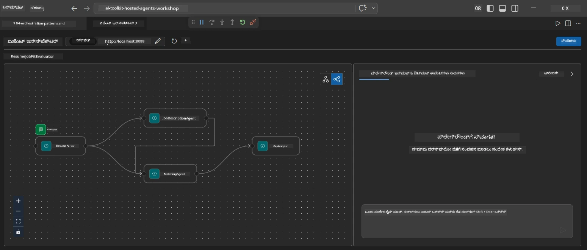
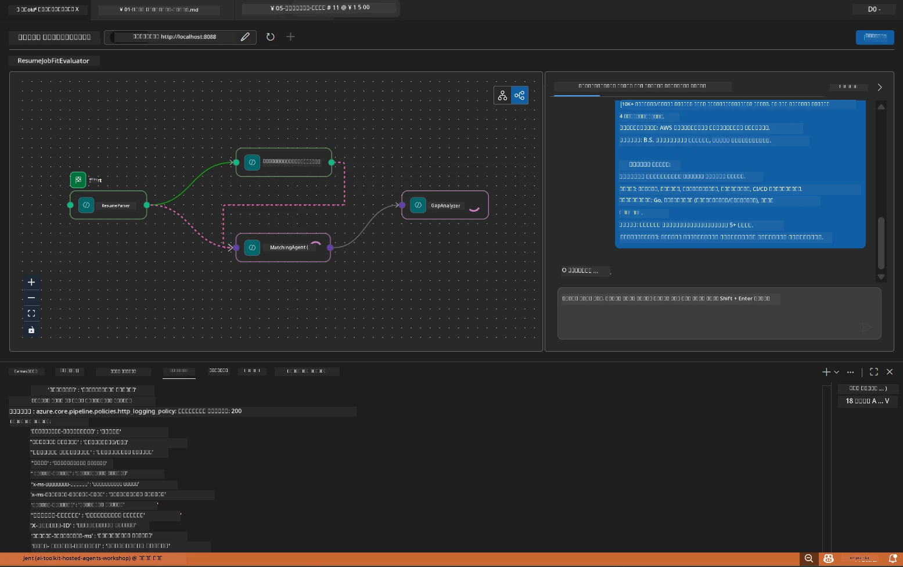
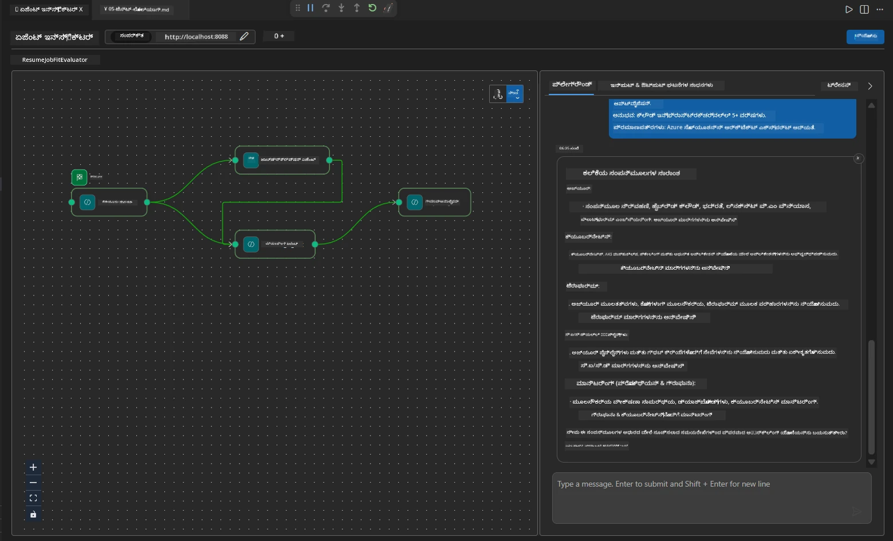

# ಅಧ್ಯಾಯ 5 - ಸ್ಥಳೀಯವಾಗಿ ಪರೀಕ್ಷಿಸು

⏱️ ~15 ನಿಮಿಷಗಳು

ಈ ಅಧ್ಯಾಯದಲ್ಲಿ, ನೀವು ಮಲ್ಟಿ-ಏಜೆಂಟ್ ವರ್ಕ್ಫ್ಲೋವನ್ನು ಸ್ಥಳೀಯವಾಗಿ ರನ್ ಮಾಡುತ್ತೀರಿ, ಅದನ್ನು ಏಜೆಂಟ್ ಇನ್ಸ್‌ಪೆಕ್ಟರ್‌తో ಪರೀಕ್ಷಿಸುತ್ತೀರಿ, ಮತ್ತು ನಾಲ್ಕು ಏಜೆಂಟ್ಗಳು ಮತ್ತು MCP ಸಾಧನ ಸರಿಯಾಗಿ ಕೆಲಸ ಮಾಡುತ್ತವೆ ಎಂದು ದೃಢಪಡಿಸುತ್ತೀರಿ trước ವಿತರಿಸುವ ಮೊದಲು.

---

## ಹೆಜ್ಜೆ 1: ಏಜೆಂಟ್ ಸರ್ವರ್ ಪ್ರಾರಂಭಿಸಿ

### ಆಯ್ಕೆ A: VS ಕೋಡ್ ಟಾಸ್ಕ್ ಉಪಯೋಗಿಸುವುದು (ಶಿಫಾರಸು ಮಾಡಲಾಗಿದೆ)

1. `workshop/lab02-multi-agent/PersonalCareerCopilot/` ಅನ್ನು ನಿಮ್ಮ VS ಕೋಡ್ ಫೋಲ್ಡರ್ ಆಗಿ ತೆರೆಯಿರಿ.
2. `Ctrl+Shift+P` ಒತ್ತಿ → **Tasks: Run Task** type ಮಾಡಿ → **Run Agent HTTP Server** ಆಯ್ಕೆಮಾಡಿ.
3. ಟಾಸ್ಕ್ ಡಿಬಗ್ಪೈ ಜೋಡಿಸಲಾದ ಸರ್ವರ್ ಅನ್ನು `5679` ಪೋರ್ಟ್‌ನಲ್ಲಿ ಮತ್ತು ಏಜೆಂಟ್ ಅನ್ನು `8088` ಪೋರ್ಟ್‌ನಲ್ಲಿ ಪ್ರಾರಂಭಿಸುತ್ತದೆ.
4. ಔಟ್ಪುಟ್‌ನಲ್ಲಿ ಸ್ಟಾರ್ಟ್ ಅಪ್ ಸಂದೇಶ ಮತ್ತು ನಂತರ ಸರ್ವರ್‌ನ ಸ್ವಂತ ಸಿದ್ಧ ಸಂದೇಶ ಕಾಣುವವರೆಗೆ ಕಾಯಿರಿ (ಇತರ ಲಾಗ್ ಲೈನ್ಗಳು ಮಧ್ಯದಲ್ಲಿ ಕಾಣಬಹುದು):

```
INFO:resume-job-fit:Starting Resume -> Job Fit Evaluator HTTP server...
...
INFO:hypercorn.error:Running on http://0.0.0.0:8088 (CTRL + C to quit)
```

### ಆಯ್ಕೆ B: F5 ಉಪಯೋಗಿಸುವುದು (ಡಿಬಗ್ ಮೋಡ್)

1. `F5` ಒತ್ತಿ → **Debug Local Agent HTTP Server** ಆಯ್ಕೆಮಾಡಿ.
2. ಸರ್ವರ್ ಪೂರ್ಣ ಬ್ರೇಕ್‌ಪಾಯಿಂಟ್ ಬೆಂಬಲದೊಂದಿಗೆ ಪ್ರಾರಂಭವಾಗುತ್ತದೆ - MCP ಪ್ರತಿಕ್ರಿಯೆ ಅಥವಾ ಏಜೆಂಟ್ ಔಟ್ಪುಟ್ ಪರಿಶೀಲಿಸಲು ಉಪಯುಕ್ತ.

---

## ಹೆಜ್ಜೆ 2: ಏಜೆಂಟ್ ಇನ್ಸ್‌ಪೆಕ್ಟರ್ ತೆರೆಯಿರಿ

1. `Ctrl+Shift+P` ಒತ್ತಿ → **Foundry Toolkit: Open Agent Inspector** type ಮಾಡಿ.
2. ಏಜೆಂಟ್ ಇನ್ಸ್‌ಪೆಕ್ಟರ್ ಒಂದು VS ಕೋಡ್ ಪ್ಯಾನಲ್ ಆಗಿ `http://localhost:8088` ಗೆ ಸಂಪರ್ಕ ಹೊಂದಿದೆ.
3. ನೀವು ಸಂದೇಶಗಳನ್ನು ಸ್ವೀಕರಿಸಲು ಏಜೆಂಟ್ ಇಂಟರ್‌ಫೇಸ್ ಸಿದ್ಧವಾಗಿರುವುದು ಕಾಣಬೇಕು.



> **ಎೕಜೆಂಟ್ ಇನ್ಸ್‌ಪೆಕ್ಟರ್ ತೆರೆಯದಿದ್ದರೆ:** ಸರ್ವರ್ ಸಂಪೂರ್ಣವಾಗಿ ಪ್ರಾರಂಭವಾಗಿದ್ದನ್ನು ಖಚಿತಪಡಿಸಿಕೊಳ್ಳಿ (ನೀವು `Running on http://0.0.0.0:8088` ಲಾಗ್ ನೋಡುತ್ತೀರಿ). 5679 ಪೋರ್ಟ್ ಬ್ಯುಸಿ ಇದ್ದರೆ, [ಅಧ್ಯಾಯ 8 - ಸಮಸ್ಯೆಗಳು ನಿವಾರಣೆ](08-troubleshooting.md) ನೋಡಿ.

---

## ಹೆಜ್ಜೆ 2b: (ಐಚ್ಛಿಕ) ವರ್ಕ್ಫ್ಲೋ ದೃಶ್ಯಕರನ್ನು ತೆರೆಯಿರಿ

Foundry Toolkit ನಲ್ಲಿ ನೈಜ-ಸಮಯ **Workflow Visualizer** ಇದೆ ಅದು ಏಜೆಂಟ್ಸ್ ಹೇಗೆ ಪರಸ್ಪರ ಕ್ರಿಯಾ ಮಾಡುತ್ತಿವೆ ಎಂಬುದನ್ನು ಗ್ರಾಫ್ ನಿರ್ವಹಣೆಯ ಸಮಯದಲ್ಲಿ ತೋರಿಸುತ್ತದೆ. ಇದು ವಿಶೇಷವಾಗಿ ಮಲ್ಟಿ-ಏಜೆಂಟ್ ಡಿಬಗ್ಗಿಂಗಿಗೆ ಉಪಯುಕ್ತ.

1. `Ctrl+Shift+P` ಒತ್ತಿ → **Foundry Toolkit: Open Visualizer for Hosted Agents** type ಮಾಡಿ.
2. ಹೊಸ VS ಕೋಡ್ ಟ್ಯಾಬ್ ತೆರೆಯುತ್ತದೆ ಮತ್ತು ಲೈವ್ ನಿರ್ವಹಣಾ ಗ್ರಾಫ್ ತೋರಿಸುತ್ತದೆ.
3. ನೀವು ಏಜೆಂಟ್ ಇನ್ಸ್‌ಪೆಕ್ಟರ್ ನಲ್ಲಿ ಸಂದೇಶಗಳನ್ನು ಕಳುಹಿಸುವಾಗ, ದೃಶ್ಯಕರ ಸ್ವಯಂಚಾಲಿತವಾಗಿ ನವೀಕರಿಸುತ್ತದೆ - ಹಸಿರು ನೋಡೆಗಳು ಪೂರ್ಣಗೊಂಡ ಏಜೆಂಟ್‌ಗಳನ್ನು ಸೂಚಿಸುತ್ತವೆ, ಮತ್ತು ಚಲಿಸುವ ಧಾರಿಗಳು ಅವರ ಮಧ್ಯೆ ಡೇಟಾ ಹರಿವು ತೋರುತ್ತವೆ.

> **ಪೋರ್ಟ್ ಸಂಘರ್ಷ:** ದೃಶ್ಯಕರ ಪೋರ್ಟ್ ಈಗಾಗಲೆ ಉಪಯೋಗದಲ್ಲಿದ್ದರೆ, ಅದನ್ನು VS ಕೋಡ್ ಸೆಟ್ಟಿಂಗ್ಗಳಲ್ಲಿ ಬದಲಾಯಿಸಿ → **Extensions** → **Microsoft Foundry Configuration** → **Hosted Agents: Visualizer Port**.

---

## ಹೆಜ್ಜೆ 3: ಸ್ಮೋಕ್ ಟೆಸ್ಟ್ ನಿಮ್ಮಿಸಿ

ಈ ಎರಡು ಪರೀಕ್ಷೆಗಳನ್ನು ಕ್ರಮವಾಗಿ ರನ್ ಮಾಡಿ. ಪ್ರತಿ ಪರೀಕ್ಷೆ ವರ್ಕ್ಫ್ಲೋವನ್ನು ಕ್ರಮೇಣ ಹೆಚ್ಚಿನವೈಶಿಷ್ಟ್ಯಗಳನ್ನು ಪರೀಕ್ಷಿಸುತ್ತದೆ.

### ಪರೀಕ್ಷೆ 1: ಮೂಲ ರೆಸೂಮ್ + ಕೆಲಸ ವರ್ಣನೆ

ಕೆಳಕಂಡನ್ನು ಏಜೆಂಟ್ ಇನ್ಸ್‌ಪೆಕ್ಟರ್‌ಗೆ ಅಂಟಿಸಿ:

```
Resume:
Jane Doe
Senior Software Engineer with 5 years of experience in Python, Django, and AWS.
Built microservices handling 10K+ requests/second. Led a team of 4 developers.
Certifications: AWS Solutions Architect Associate.
Education: B.S. Computer Science, State University.

Job Description:
Senior Cloud Engineer at Contoso Ltd.
Required: Python, Azure, Kubernetes, Terraform, CI/CD pipelines.
Preferred: Go, monitoring (Prometheus/Grafana), cost optimization.
Experience: 5+ years in cloud infrastructure.
Certifications: Azure Solutions Architect Expert preferred.
```

**ಪ್ರತಿಕ್ರಿಯೆಯ ನಿರೀಕ್ಷಿತ ರಚನೆ:**

ಪ್ರತಿಕ್ರಿಯೆಯಲ್ಲಿ ನಾಲ್ಕು ಏಜೆಂಟ್‌ಗಳ ಔಟ್ಪುಟ್ ಸರಣಿಯಿಂದ ಇರಬೇಕು:

1. **ರೆಸೂಮ್ ಪಾರ್ಸರ್ ಔಟ್ಪುಟ್** - ಎರಡು ಲೇಬಲ್‌ ಮಾಡಿದ ವಿಭಾಗಗಳು: `[PARSED RESUME]` (ಅಭ್ಯರ್ಥಿ ಪ್ರೊಫೈಲ್ ಗುಂಪುಗೊಂಡ ಕೌಶಲ್ಯಗಳೊಂದಿಗೆ) ಮತ್ತು `[JOB DESCRIPTION PASS-THROUGH]` (ಸಾಕ್ಷಾತ್ ಶಬ್ದ JD ಪಠ್ಯ JD ಏಜೆಂಟ್‌ಗೆ ಆಹಾರ ನೀಡುವುದು)
2. **JD ಏಜೆಂಟ್ ಔಟ್ಪುಟ್** - ಕೃತಕ ಸೂತ್ರಬದ್ಧ ಅಗತ್ಯಗಳು ಮತ್ತು ಇಚ್ಛಿತ ಕೌಶಲ್ಯಗಳು ಪ್ರತ್ಯೇಕಿತವಾಗಿ
3. **ಹೋಲಿಕೆ ಏಜೆಂಟ್ ಔಟ್ಪುಟ್** - ಫಿಟ್ ಸ್ಕೋರ್ (0-100) ಜೊತೆ ವಿವರಣೆ, ಹೊಂದಾಣಿಕೆಯ ಕೌಶಲ್ಯಗಳು, ಕಾಣದ ಕೌಶಲ್ಯಗಳು, ರಂಧ್ರಗಳು
4. **ಗೂಢ ವಿಶ್ಲೇಷಕ ಔಟ್ಪುಟ್** - ಪ್ರತಿಯೊಬ್ಬ ಕಾಣದ ಕೌಶಲ್ಯಕ್ಕೆ ವ್ಯಕ್ತಿಪರ ರಂಧ್ರ ಕಾರ್ಡ್ಗಳು, ಪ್ರತಿ ಕಾರ್ಡ್‌ನಲ್ಲಿ Microsoft Learn URLs





### ಪರೀಕ್ಷೆ 1 ನಲ್ಲಿ ಪರಿಶೀಲಿಸಬೇಕಾದುದು

| ಪರಿಶೀಲಿಸಿ | ನಿರೀಕ್ಷಿತ | ಪಾಸ್? |
|----------|----------|-------|
| ಪ್ರತಿಕ್ರಿಯೆಯಲ್ಲಿ ಫಿಟ್ ಸ್ಕೋರ್ ಇದೆ | 0-100 ರ ನಡುವೆ ಸಂಖ್ಯೆ ಮತ್ತು ವಿವರಣೆ | |
| ಹೊಂದಾಣಿಕೆಯ ಕೌಶಲ್ಯಗಳು ಪಟ್ಟಿ ಬರೆದಿವೆ | Python, CI/CD (ಭಾಗಶಃ), ಇತ್ಯಾದಿ | |
| ಕಾಣದ ಕೌಶಲ್ಯಗಳು ಪಟ್ಟಿ ಬರೆದಿವೆ | Azure, Kubernetes, Terraform, ಇತ್ಯಾದಿ | |
| ಪ್ರತಿ ಕಾಣದ ಕೌಶಲ್ಯಕ್ಕೆ ರಂಧ್ರ ಕಾರ್ಡ್ಗಳು ಇವೆ | ಪ್ರತಿ ಕೌಶಲ್ಯಕ್ಕೆ ಒಂದು ಕಾರ್ಡ್ | |
| Microsoft Learn URLs ಇವೆ | ನಿಜವಾದ `learn.microsoft.com` ಲಿಂಕ್‌ಗಳು | |
| ಪ್ರತಿಕ್ರಿಯೆಯಲ್ಲಿ ದೋಷ ಸಂದೇಶಗಳು ಇಲ್ಲ | ಶುದ್ಧ ಸುಗಮ ರೂಪದಲ್ಲಿ ಔಟ್ಪುಟ್ | |

### ಪರೀಕ್ಷೆ 2: ಪ್ರান্তಿಕ ಕೇಸ್ - ಹೆಚ್ಚಿನ ಫಿಟ್ ಅರ್ಥಬೋಧಕ

ಗುಚ್ಚಿನ ಕೆಲಸ ವಿವರಣೆಗೆ ಹತ್ತಿರವಾದ ರೆಸೂಮ್ ಅನ್ನು ಅಂಟಿಸಿ ಮತ್ತು ಗೂಡ್ ವಿಶ್ಲೇಷಕ ಮೂರು ಹಂತದ ಸನ್ನಿವೇಶಗಳನ್ನು ಸಮರ್ಥವಾಗಿ ನಿರ್ವಹಿಸಬಹುದೆಂದು ಪರಿಶೀಲಿಸಿ:

```
Resume:
Alex Chen
Senior Cloud Engineer with 7 years of experience.
Skills: Python, Azure (AKS, Functions, DevOps), Kubernetes, Terraform, CI/CD (GitHub Actions, Azure Pipelines), Go, Prometheus, Grafana, cost optimization.
Certifications: Azure Solutions Architect Expert, Azure DevOps Engineer Expert.
Led infrastructure migration to Azure for 3 enterprise clients.
Education: M.S. Computer Science, Tech University.

Job Description:
Senior Cloud Engineer at Contoso Ltd.
Required: Python, Azure, Kubernetes, Terraform, CI/CD pipelines.
Preferred: Go, monitoring (Prometheus/Grafana), cost optimization.
Experience: 5+ years in cloud infrastructure.
Certifications: Azure Solutions Architect Expert preferred.
```

**ನಿರೀಕ್ಷಿತ ವರ್ತನೆ:**
- ಫಿಟ್ ಸ್ಕೋರ್ **80+** ಇರುವುದಾಗಿರಬೇಕು (ಬಹುತೇಕ ಕೌಶಲ್ಯಗಳು ಹೊಂದಿವೆ)
- ರಂಧ್ರ ಕಾರ್ಡ್ಗಳು ಮೌಲಿಕ ಅಧ್ಯಯನದ ಬದಲು ತೀವ್ರ/ಸಾಕ್ಷಾತ್ಕಾರ ಸಿದ್ದತೆ ಮೇಲೆ ಕೇಂದ್ರೀಕರಿಸಬೇಕು
- ಗೂಡ್ ವಿಶ್ಲೇಷಕ ಸೂಚನೆಗಳು: "ಫಿಟ್ >= 80 ಆಗಿದ್ದರೆ, ತೀವ್ರ/ಸಾಕ್ಷಾತ್ಕಾರ ಸಿದ್ದತೆ ಮೇಲೆ ಕೇಂದ್ರೀಕರಿಸಿ"

---

## ಹೆಜ್ಜೆ 4: ನಿಮ್ಮ ಸ್ವಂತ ಡೇಟಾ ಬಳಸಿ ಪರೀಕ್ಷಿಸಿ (ಐಚ್ಛಿಕ)

ನಿಮ್ಮ ಸ್ವಂತ ರೆಸೂಮ್ ಮತ್ತು ನಿಜವಾದ ಕೆಲಸ ವರ್ಣನೆಯನ್ನು ಅಂಟಿಸಿ. ಇದರಿಂದ ಖಚಿತವಾಗುತ್ತದೆ:

- ಏಜೆಂಟ್‌ಗಳು ವಿಭಿನ್ನ ರೆಸೂಮ್ ಪ್ರಕಾರಗಳನ್ನು ಹೊಂದಿಕೊಳ್ಳುತ್ತವೆ (ಕ್ರಮರಹಿತ, ಕಾರ್ಯನಿಷ್ಟ, ಸಂಯುಕ್ತ)
- JD ಏಜೆಂಟ್ ಬಲಬಲದಲ್ಲಿ JD ಶೈಲಿಗಳನ್ನು ತೆಗೆಯುತ್ತದೆ (ಗುರುತುಬಿಂದುಗಳು, ಪ್ಯಾರಾಗ್ರಾಫ್‌ಗಳು, ರಚನೆ)
- MCP ಸಾಧನವು ನಿಜವಾದ ಕೌಶಲ್ಯಗಳಿಗೆ ಸಂಬಂಧಿತ ಸಂಪನ್ಮೂಲಗಳನ್ನು ಕೊಡುತ್ತದೆ
- ರಂಧ್ರ ಕಾರ್ಡ್ಗಳು ನಿಮ್ಮ ವೈಯಕ್ತಿಕ ಹಿನ್ನೆಲೆಗೆ ಹೊಂದಿಕೆಯಾಗಿವೆ

> **ಗೋಪ್ಯತೆ - ಮಾರ್ಗ A (Foundry ಕ್ಲೌಡ್):** ರೆಸೂಮ್ ಮತ್ತು JD ಪಠ್ಯವನ್ನು ನಿಮ್ಮ Azure OpenAI ಅನ್ನು ಬಳಸುವ ನಿಯೋಜನೆಗೆ ಕಳುಹಿಸಲಾಗುತ್ತದೆ. ಕ್ಯಾಪ್ಚರ್ ಅಥವಾ ಸಂಗ್ರಹಣೆಯಾಗಿಲ್ಲ. ನೀವು ಬಯಸಿದರೆ ಸ್ಥಾನಗೊಳ್ಳುವ ಹೆಸರುಗಳನ್ನು ಬಳಸಿ (ಉದಾ., "ಜೆನ್ ಡೋ").
>
> **ಗೋಪ್ಯತೆ - ಮಾರ್ಗ B (Foundry ಲೋಕಲ್):** ಎಲ್ಲಾ ನಾಲ್ಕು ಏಜೆಂಟ್ ಅಧ್ಯಯನಗಳು ಸಂಪೂರ್ಣವಾಗಿ ನಿಮ್ಮ ಸಾಧನದಲ್ಲಿ ನಡೆಯುತ್ತವೆ. ನಿಮ್ಮ ರೆಸೂಮ್ ಮತ್ತು ಕೆಲಸ ವಿವರಣೆ ಪಠ್ಯಗಳು **ಯಾವಾಗಲೂ ನಿಮ್ಮ ಯಂತ್ರವನ್ನು ಬಿಟ್ಟು ಹೋಗುವುದಿಲ್ಲ**. ಏಕಮಾತ್ರ ಔಟ್‌ಬೌಂಡ್ ಕರೆಗೆ MCP ಸಾಧನ ಪುನಃಸಂಪನ್ಮೂಲಗಳನ್ನು `https://learn.microsoft.com/api/mcp` ಲಿಂದ ಹಿಂಪಡೆಯುತ್ತದೆ; ಆ ವಿಚಾರಣೆ ಕೌಶಲ್ಯದ ಹೆಸರನ್ನು ಮಾತ್ರ ಒಳಗೊಂಡಿದೆ, ನಿಮ್ಮ ವೈಯಕ್ತಿಕ ಡೇಟಾವನ್ನು ಅಲ್ಲ.

---

### ತಪಾಸಣಾ ಪಾಯಿಂಟ್

- [ ] ಸರ್ವರ್ ಯಶಸ್ವಿಯಾಗಿ ಪ್ರಾರಂಭವಾಯಿತು `8088` ಪೋರ್ಟ್‌ನಲ್ಲಿ (ಲಾಗ್ ನಲ್ಲಿ `Running on http://0.0.0.0:8088` ತೋರಿಸುತ್ತದೆ)
- [ ] ಏಜೆಂಟ್ ಇನ್ಸ್‌ಪೆಕ್ಟರ್ ತೆರೆಯಲ್ಪಟ್ಟಿದ್ದು ಏಜೆಂಟ್‌ಗೆ ಸಂಪರ್ಕ ಹೊಂದಿದೆ
- [ ] ಪರೀಕ್ಷೆ 1: ಪೂರ್ಣ ಪ್ರತಿಕ್ರಿಯೆ ಫಿಟ್ ಸ್ಕೋರ್, ಹೊಂದಾಣಿಕೆ/ಕಾಣಿಕೆ ಕೌಶಲ್ಯಗಳು, ರಂಧ್ರ ಕಾರ್ಡ್ಗಳು ಮತ್ತು Microsoft Learn URLs ಜೊತೆ
- [ ] ಪರೀಕ್ಷೆ 2: ಹೆಚ್ಚಿನ ಫಿಟ್ ಹೊಂದಿದ ಅಭ್ಯರ್ಥಿ ಫಲಿತಾಂಶ 80+ ಮತ್ತು ತೀವ್ರತೆ-ಆಧಾರಿತ ಶಿಫಾರಸುಗಳನ್ನು ಪಡೆಯುತ್ತಾನೆ
- [ ] ಎಲ್ಲಾ ರಂಧ್ರ ಕಾರ್ಡ್ಗಳು ಇವೆ (ಪ್ರತಿ ಕಾಣದ ಕೌಶಲ್ಯಕ್ಕೆ ಒಂದು, ಯಾವುದೇ ಕಡಿತವಿಲ್ಲ)
- [ ] ಸರ್ವರ್ ಟರ್ಮಿನಲ್ನಲ್ಲಿ ದೋಷಗಳು ಅಥವಾ ಸ್ಟ್ಯಾಕ್ ಟ್ರೇಸ್ಗಳು ಇಲ್ಲ

---

**ಮுந்தைய:** [04 - ಒರ್ಕೆಸ್ಟ್ರೇಶನ್ ಮಾದರಿಗಳು](04-orchestration-patterns.md) · **ಮುಂದೆ:** [06 - Foundry ಗೆ ನಿಯೋಜಿಸು →](06-deploy-to-foundry.md)

---

<!-- CO-OP TRANSLATOR DISCLAIMER START -->
**ಅಸ್ವೀಕಾರ**:
ಈ ದಸ್ತಾವೇಜು AI ಅನುವಾದ ಸೇವೆ [Co-op Translator](https://github.com/Azure/co-op-translator) ಬಳಸಿ ಅನುವಾದಿಸಲಾಗಿದೆ. ನಾವು ನಿಖರತೆಯನ್ನು ಸಾಧಿಸಲು ಪ್ರಯತ್ನಿಸುತ್ತಿದ್ದರೂ, ದಯವಿಟ್ಟು ಗಮನಿಸಿ, ಸ್ವಯಂಚಾಲಿತ ಅನುವಾದಗಳಲ್ಲಿ ದೋಷಗಳು ಅಥವಾ ಅಸಡ್ಡೆಗಳು ಇರಬಹುದು. ಮೂಲ ಭಾಷೆಯಲ್ಲಿರುವ ಮೂಲ ದಸ್ತಾವೇಜು ಪ್ರಾಮಾಣಿಕ ಮೂಲವೆಂದು ಪರಿಗಣಿಸಬೇಕು. ಪ್ರಮುಖ ಮಾಹಿತಿಗಾಗಿ, ವೃತ್ತಿಪರ ಮಾನವ ಅನುವಾದವನ್ನು ಶಿಫಾರಸು ಮಾಡಲಾಗುತ್ತದೆ. ಈ ಅನುವಾದವನ್ನು ಬಳಸುವ ಮೂಲಕ ಉಂಟಾಗುವ ಯಾವುದೇ ತಪ್ಪು ಅರ್ಥಗಳ ಅಥವಾ ತಪ್ಪು ವ್ಯಾಖ್ಯಾನಗಳ ಬಗ್ಗೆ ನಾವು ಹೊಣೆಗಾರರಲ್ಲ.
<!-- CO-OP TRANSLATOR DISCLAIMER END -->