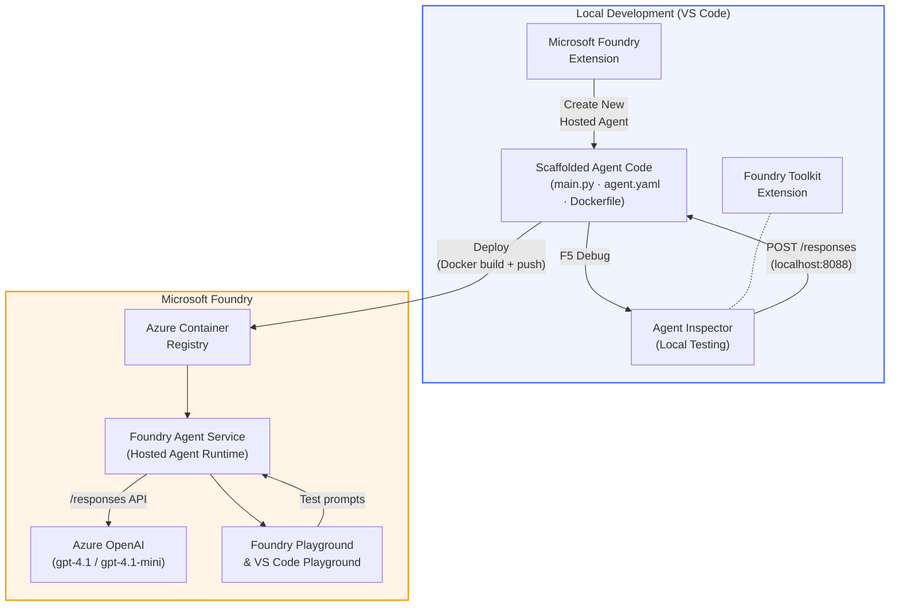

# Foundry Toolkit + Foundry Hosted Agents 워크숍

[](https://www.python.org/)
[](https://github.com/microsoft/agents)
[](https://learn.microsoft.com/azure/foundry/agents/concepts/hosted-agents)
[](https://ai.azure.com/)
[](https://learn.microsoft.com/azure/ai-services/openai/)
[](https://learn.microsoft.com/cli/azure/install-azure-cli)
[](https://learn.microsoft.com/azure/developer/azure-developer-cli/install-azd)
[](https://www.docker.com/)
[](https://marketplace.visualstudio.com/items?itemName=ms-windows-ai-studio.windows-ai-studio)
[](LICENSE)

VS Code 내에서 **Microsoft Foundry 확장** 및 <strong>Foundry Toolkit</strong>을 사용하여 AI 에이전트를 <strong>Microsoft Foundry Agent Service</strong>에 <strong>호스팅 에이전트</strong>로 빌드, 테스트 및 배포합니다.

> **호스팅 에이전트는 현재 미리보기 상태입니다.** 지원되는 지역은 제한적입니다 - [지역 가용성](https://learn.microsoft.com/azure/foundry/agents/concepts/hosted-agents#region-availability)을 참조하세요.

> 각 실습 내의 `agent/` 폴더는 Foundry 확장에 의해 <strong>자동으로 생성</strong>되며, 이후 코드를 맞춤 설정하고 로컬에서 테스트한 후 배포합니다.

### 🌐 다국어 지원

#### GitHub Action을 통한 지원 (자동화 및 항상 최신 상태 유지)

<!-- CO-OP TRANSLATOR LANGUAGES TABLE START -->
[아랍어](../ar/README.md) | [벵골어](../bn/README.md) | [불가리아어](../bg/README.md) | [버마어(미얀마)](../my/README.md) | [중국어(간체)](../zh-CN/README.md) | [중국어(번체, 홍콩)](../zh-HK/README.md) | [중국어(번체, 마카오)](../zh-MO/README.md) | [중국어(번체, 대만)](../zh-TW/README.md) | [크로아티아어](../hr/README.md) | [체코어](../cs/README.md) | [덴마크어](../da/README.md) | [네덜란드어](../nl/README.md) | [에스토니아어](../et/README.md) | [핀란드어](../fi/README.md) | [프랑스어](../fr/README.md) | [독일어](../de/README.md) | [그리스어](../el/README.md) | [히브리어](../he/README.md) | [힌디어](../hi/README.md) | [헝가리어](../hu/README.md) | [인도네시아어](../id/README.md) | [이탈리아어](../it/README.md) | [일본어](../ja/README.md) | [칸나다어](../kn/README.md) | [크메르어](../km/README.md) | [한국어](./README.md) | [리투아니아어](../lt/README.md) | [말레이어](../ms/README.md) | [말라얄람어](../ml/README.md) | [마니푸리어(메이테이 마예크)](../mni/README.md) | [마라티어](../mr/README.md) | [네팔어](../ne/README.md) | [나이지리아 피진어](../pcm/README.md) | [노르웨이어](../no/README.md) | [페르시아어(파르시)](../fa/README.md) | [폴란드어](../pl/README.md) | [포르투갈어(브라질)](../pt-BR/README.md) | [포르투갈어(포르투갈)](../pt-PT/README.md) | [펀자브어(구름키)](../pa/README.md) | [루마니아어](../ro/README.md) | [러시아어](../ru/README.md) | [세르비아어(키릴문자)](../sr/README.md) | [슬로바키아어](../sk/README.md) | [슬로베니아어](../sl/README.md) | [스페인어](../es/README.md) | [스와힐리어](../sw/README.md) | [스웨덴어](../sv/README.md) | [타갈로그어(필리피노)](../tl/README.md) | [타밀어](../ta/README.md) | [텔루구어](../te/README.md) | [태국어](../th/README.md) | [터키어](../tr/README.md) | [우크라이나어](../uk/README.md) | [우르두어](../ur/README.md) | [베트남어](../vi/README.md)

> **로컬 클론을 선호하시나요?**
>
> 이 저장소는 50개 이상의 언어 번역을 포함하여 다운로드 크기가 훨씬 커집니다. 번역 없이 클론하려면 sparse checkout을 사용하세요:
>
> **Bash / macOS / Linux:**
> ```bash
> git clone --filter=blob:none --sparse https://github.com/microsoft-foundry/Foundry_Toolkit_for_VSCode_Lab.git
> cd Foundry_Toolkit_for_VSCode_Lab
> git sparse-checkout set --no-cone '/*' '!translations' '!translated_images'
> ```
>
> **CMD (Windows):**
> ```cmd
> git clone --filter=blob:none --sparse https://github.com/microsoft-foundry/Foundry_Toolkit_for_VSCode_Lab.git
> cd Foundry_Toolkit_for_VSCode_Lab
> git sparse-checkout set --no-cone "/*" "!translations" "!translated_images"
> ```
>
> 이렇게 하면 훨씬 빠른 다운로드로 강의를 완료하는데 필요한 모든 것이 제공됩니다.
<!-- CO-OP TRANSLATOR LANGUAGES TABLE END -->

---

## 아키텍처



**흐름:** Foundry 확장이 에이전트를 생성 → 사용자가 코드 및 명령을 맞춤 설정 → Agent Inspector로 로컬 테스트 → Foundry에 배포(도커 이미지가 ACR에 푸시됨) → Playground에서 검증.

---

## 구축할 내용

| 실습 | 설명 | 상태 |
|-----|-------------|--------|
| **Lab 01 - 단일 에이전트** | <strong>"임원처럼 설명해 주세요" 에이전트</strong>를 만들고 로컬에서 테스트 후 Foundry에 배포 | ✅ 사용 가능 |
| **Lab 02 - 다중 에이전트 워크플로우** | **"이력서 → 직무 적합 평가자"** 빌드 - 4개 에이전트가 협력하여 이력서 적합도를 평가하고 학습 로드맵 생성 | ✅ 사용 가능 |

---

## 임원 에이전트를 만나보세요

이 워크숍에서는 복잡한 기술 용어를 진정한 이사회 준비 요약으로 번역하는 AI 에이전트인 <strong>"임원처럼 설명해 주세요" 에이전트</strong>를 구축합니다. 솔직히 말해, 경영진 누구도 "v3.2에서 도입된 동기식 호출로 인한 스레드 풀 고갈" 등에 대해 듣고 싶어하지 않거든요.

저는 완벽하게 작성한 사후 분석 보고서에 "그래서… 웹사이트가 다운된 건가요 아닌가요?"라는 반응이 너무 자주 나와서 이 에이전트를 만들게 되었습니다.

### 작동 방식

기술적 업데이트를 입력하면, 에이전트는 잡다한 용어, 스택 추적 없이 세 가지 주요 항목으로 임원요약을 출력합니다. 즉, **무슨 일이 있었는지**, **비즈니스 영향**, 그리고 <strong>다음 단계</strong>를 알려줍니다.

### 작동 예시

**당신이 말합니다:**
> "v3.2에서 도입된 동기식 호출로 인한 스레드 풀 고갈 때문에 API 지연 시간이 증가했습니다."

**에이전트가 대답합니다:**

> **임원 요약:**
> - **무슨 일이 있었는지:** 최신 릴리스 후 시스템이 느려졌습니다.
> - **비즈니스 영향:** 일부 사용자가 서비스 사용 중 지연을 겪었습니다.
> - **다음 단계:** 변경 사항이 롤백되었으며 재배포 전에 수정이 준비 중입니다.

### 왜 이 에이전트인가요?

단순 명료한 단일 목적의 에이전트로, 복잡한 도구 체인에 얽매이지 않고 호스팅 에이전트 워크플로우를 처음부터 끝까지 배우기에 완벽합니다. 솔직히 말해, 모든 엔지니어링 팀에 이 같은 에이전트가 필요합니다.

---

## 워크숍 구조

```
📂 Foundry_Toolkit_for_VSCode_Lab/
├── 📄 README.md                      ← You are here
└── 📂 workshop/
    ├── 📂 lab01-single-agent/        ← Full lab: docs + agent code
    │   ├── README.md                 ← Hands-on lab instructions
    │   ├── 📂 docs/                  ← Step-by-step tutorial modules
    │   │   ├── 00-prerequisites.md
    │   │   ├── 01-setup.md
    │   │   ├── 02-create-hosted-agent.md
    │   │   ├── 03-configure-and-code.md
    │   │   ├── 04-test-locally.md
    │   │   ├── 05-deploy-to-foundry.md
    │   │   ├── 06-verify-in-playground.md
    │   │   ├── 07-summary.md
    │   │   └── 08-troubleshooting.md
    │   └── 📂 agent/                 ← Reference solution (auto-scaffolded by Foundry extension)
    │       ├── agent.yaml
    │       ├── Dockerfile
    │       ├── main.py
    │       └── requirements.txt
    └── 📂 lab02-multi-agent/         ← Resume → Job Fit Evaluator
        ├── README.md                 ← Hands-on lab instructions (end-to-end)
        ├── 📂 docs/                  ← Step-by-step tutorial modules
        │   ├── 00-prerequisites.md
        │   ├── 01-understand-multi-agent.md
        │   ├── 02-scaffold-multi-agent.md
        │   ├── 03-configure-agents.md
        │   ├── 04-orchestration-patterns.md
        │   ├── 05-test-locally.md
        │   ├── 06-deploy-to-foundry.md
        │   ├── 07-verify-in-playground.md
        │   └── 08-troubleshooting.md
        └── 📂 PersonalCareerCopilot/ ← Reference solution (multi-agent workflow)
            ├── agent.yaml
            ├── Dockerfile
            ├── main.py
            └── requirements.txt
```

> **참고:** 각 실습의 `agent/` 폴더는 <strong>Microsoft Foundry 확장</strong>이 명령 팔레트에서 `Microsoft Foundry: Create a New Hosted Agent`를 실행할 때 생성하는 파일입니다. 이후 에이전트의 명령, 도구, 구성을 반영하도록 파일을 맞춤 설정합니다. Lab 01에서 처음부터 재구성하는 과정을 안내합니다.

---

## 시작하기

### 1. 저장소 클론하기

```bash
git clone https://github.com/microsoft-foundry/Foundry_Toolkit_for_VSCode_Lab.git
cd Foundry_Toolkit_for_VSCode_Lab
```

### 2. Python 가상 환경 설정하기

```bash
python -m venv venv
```

활성화:

- **Windows (PowerShell):**
  ```powershell
  .\venv\Scripts\Activate.ps1
  ```
- **macOS / Linux:**
  ```bash
  source venv/bin/activate
  ```

### 3. 종속성 설치

```bash
pip install -r workshop/lab01-single-agent/agent/requirements.txt
```

### 4. 환경 변수 구성

에이전트 폴더 내 예제 `.env` 파일을 복사하고 값을 입력하세요:

```bash
cp workshop/lab01-single-agent/agent/.env.example workshop/lab01-single-agent/agent/.env
```

`workshop/lab01-single-agent/agent/.env` 편집:

```env
AZURE_AI_PROJECT_ENDPOINT=https://<your-account>.services.ai.azure.com/api/projects/<your-project>
AZURE_AI_MODEL_DEPLOYMENT_NAME=<your-model-deployment-name>
```

### 5. 워크숍 실습 진행하기

각 실습은 자체 모듈로 구성되어 있습니다. 기본부터 배우려면 <strong>Lab 01</strong>로 시작하고, 다중 에이전트 워크플로우는 <strong>Lab 02</strong>를 진행하세요.

#### Lab 01 - 단일 에이전트 ([전체 지침](workshop/lab01-single-agent/README.md))

| # | 모듈 | 링크 |
|---|--------|------|
| 1 | 사전 준비 사항 읽기 | [00-prerequisites.md](workshop/lab01-single-agent/docs/00-prerequisites.md) |
| 2 | Foundry Toolkit 및 Foundry 확장 설치 | [01-setup.md](workshop/lab01-single-agent/docs/01-setup.md) |
| 3 | Foundry 프로젝트 생성 | [01-setup.md](workshop/lab01-single-agent/docs/01-setup.md) |
| 4 | 호스팅 에이전트 생성 | [02-create-hosted-agent.md](workshop/lab01-single-agent/docs/02-create-hosted-agent.md) |
| 5 | 명령 및 환경 구성 | [03-configure-and-code.md](workshop/lab01-single-agent/docs/03-configure-and-code.md) |
| 6 | 로컬 테스트 | [04-test-locally.md](workshop/lab01-single-agent/docs/04-test-locally.md) |
| 7 | Foundry에 배포 | [05-deploy-to-foundry.md](workshop/lab01-single-agent/docs/05-deploy-to-foundry.md) |
| 8 | Playground에서 검증 | [06-verify-in-playground.md](workshop/lab01-single-agent/docs/06-verify-in-playground.md) |
| 9 | 문제 해결 | [08-troubleshooting.md](workshop/lab01-single-agent/docs/08-troubleshooting.md) |

#### Lab 02 - 다중 에이전트 워크플로우 ([전체 지침](workshop/lab02-multi-agent/README.md))

| # | 모듈 | 링크 |
|---|--------|------|
| 1 | 사전 준비 사항 (Lab 02) | [00-prerequisites.md](workshop/lab02-multi-agent/docs/00-prerequisites.md) |
| 2 | 다중 에이전트 아키텍처 이해하기 | [01-understand-multi-agent.md](workshop/lab02-multi-agent/docs/01-understand-multi-agent.md) |
| 3 | 다중 에이전트 프로젝트 생성 | [02-scaffold-multi-agent.md](workshop/lab02-multi-agent/docs/02-scaffold-multi-agent.md) |
| 4 | 에이전트 및 환경 구성 | [03-configure-agents.md](workshop/lab02-multi-agent/docs/03-configure-agents.md) |
| 5 | 오케스트레이션 패턴 | [04-orchestration-patterns.md](workshop/lab02-multi-agent/docs/04-orchestration-patterns.md) |
| 6 | 로컬 테스트 (다중 에이전트) | [05-test-locally.md](workshop/lab02-multi-agent/docs/05-test-locally.md) |
| 7 | Foundry에 배포 | [06-deploy-to-foundry.md](workshop/lab02-multi-agent/docs/06-deploy-to-foundry.md) |
| 8 | Playground에서 검증 | [07-verify-in-playground.md](workshop/lab02-multi-agent/docs/07-verify-in-playground.md) |
| 9 | 문제 해결 (다중 에이전트) | [08-troubleshooting.md](workshop/lab02-multi-agent/docs/08-troubleshooting.md) |

---

## 유지 관리 담당자

<table>
<tr>
    <td align="center"><a href="https://github.com/ShivamGoyal03">
        <br />
        <sub><b>Shivam Goyal</b></sub>
    </a><br />
    </td>
</tr>
</table>

---

## 필요한 권한 (간략 참고용)

| 시나리오 | 필요한 역할 |
|----------|---------------|
| 새 Foundry 프로젝트 생성 | Foundry 리소스에 대한 **Azure AI 소유자** |
| 기존 프로젝트에 배포 (새 리소스 포함) | 구독에 대한 **Azure AI 소유자** + <strong>기여자</strong> |
| 완전히 구성된 프로젝트에 배포 | 계정에 대한 **읽기 권한자** + 프로젝트에 대한 **Azure AI 사용자** |

> **중요:** Azure `Owner` 및 `Contributor` 역할은 <em>관리</em> 권한만 포함하며 <em>개발</em>(데이터 작업) 권한은 포함하지 않습니다. 에이전트를 구축하고 배포하려면 **Azure AI 사용자** 또는 <strong>Azure AI 소유자</strong>가 필요합니다.

---

## 참조

- [빠른 시작: 첫 번째 호스티드 에이전트 배포하기 (VS Code)](https://learn.microsoft.com/azure/foundry/agents/quickstarts/quickstart-hosted-agent)
- [호스티드 에이전트란?](https://learn.microsoft.com/azure/foundry/agents/concepts/hosted-agents)
- [VS Code에서 호스티드 에이전트 워크플로우 생성하기](https://learn.microsoft.com/azure/foundry/agents/how-to/vs-code-agents-workflow-pro-code)
- [호스티드 에이전트 배포하기](https://learn.microsoft.com/azure/foundry/agents/how-to/deploy-hosted-agent)
- [Microsoft Foundry의 RBAC](https://learn.microsoft.com/azure/foundry/concepts/rbac-foundry)
- [아키텍처 리뷰 에이전트 샘플](https://github.com/Azure-Samples/agent-architecture-review-sample) - MCP 도구, Excalidraw 다이어그램 및 이중 배포가 포함된 실제 호스티드 에이전트

---


## 라이선스

[MIT](../../LICENSE)

---

<!-- CO-OP TRANSLATOR DISCLAIMER START -->
**면책 조항**:
이 문서는 AI 번역 서비스 [Co-op Translator](https://github.com/Azure/co-op-translator)를 사용하여 번역되었습니다. 정확성을 기하기 위해 노력하고 있으나, 자동 번역은 오류나 부정확한 부분이 있을 수 있음을 유의하시기 바랍니다. 원본 문서의 원어본이 권위 있는 자료로 간주되어야 합니다. 중요한 정보의 경우, 전문가의 인간 번역을 권장합니다. 이 번역 사용으로 인해 발생하는 오해나 잘못된 해석에 대해 당사는 책임을 지지 않습니다.
<!-- CO-OP TRANSLATOR DISCLAIMER END -->