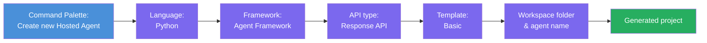
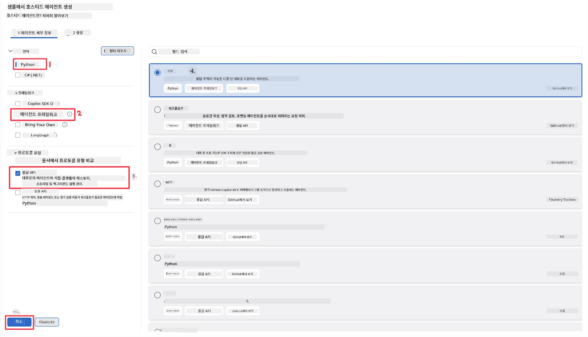
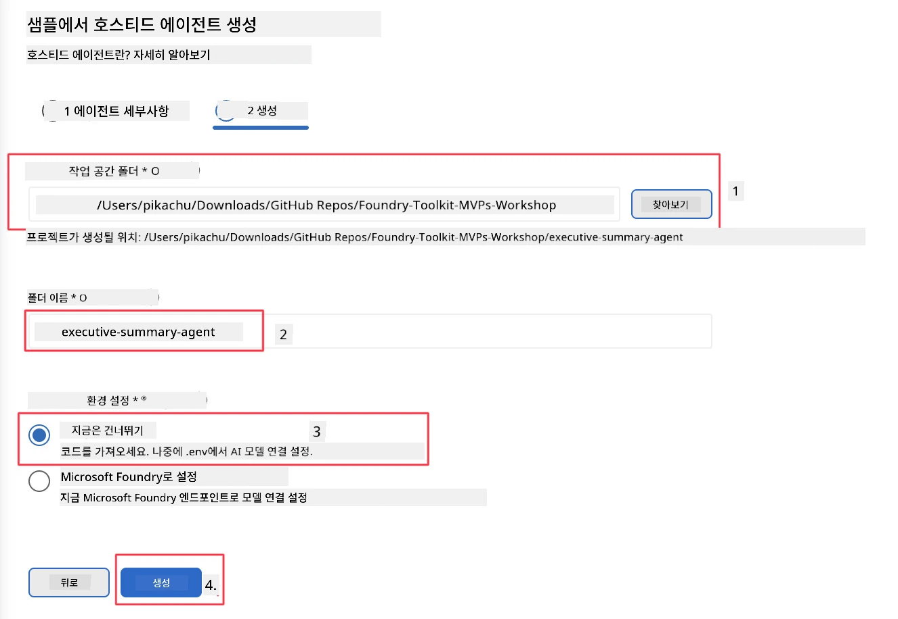

# 모듈 2 - 새로운 호스팅 에이전트 생성

⏱️ 약 5분

이 모듈에서 Foundry Toolkit을 사용하여 **호스팅 에이전트 프로젝트의 골격을 만듭니다**. 스캐폴드는 전체 프로젝트 구조 - `agent.yaml`, `main.py`, `Dockerfile`, `requirements.txt` 및 VS Code 디버그 구성 - 를 생성하므로 에이전트 동작 맞춤화에 집중할 수 있습니다.

> **핵심 개념:** 이 실습의 `agent/` 폴더는 Foundry Toolkit이 생성하는 예시입니다. 이 파일들을 처음부터 직접 작성하지 않습니다.

### 스캐폴드 마법사 흐름



---

## 1단계: 호스팅 에이전트 생성 마법사 열기

1. `Ctrl+Shift+P`를 눌러 <strong>명령 팔레트</strong>를 엽니다.
2. 입력: <strong>Foundry Toolkit: Create new Hosted Agent</strong>를 입력하고 선택합니다.

> **대안: Foundry 포털에서 생성**
> 브라우저를 선호하는 경우 [https://ai.azure.com](https://ai.azure.com) 에서 프로젝트를 생성할 수 있습니다. 프로젝트가 프로비저닝되면 VS Code로 돌아와 **Foundry Toolkit** 사이드바를 사용해 연결하세요.

> **대안:** Foundry Toolkit 사이드바에서 프로젝트 아래의 **Agents** 위에 마우스를 올리고, **+** 아이콘을 클릭한 다음, <strong>템플릿으로 코드에서 생성</strong>을 선택합니다.

## 2단계: 설정 선택



1. 왼쪽 탐색/옵션 섹션에서 다음을 선택합니다:

| 메뉴 | 선택 | 참고 |
|--------|-----------|-------|
| <strong>언어</strong> | Python | C#도 지원됨 |
| <strong>프레임워크</strong> | 에이전트 프레임워크 | 에이전트 프레임워크 SDK를 사용하는 간단한 시작점 |
| **API 유형** | 응답 API | `POST /responses` - 대화식, 플랫폼에서 관리하는 히스토리 포함 |
| <strong>템플릿</strong> | 기본 | 에이전트 프레임워크 SDK를 사용하는 간단한 시작점 |

2. 선택 후 <strong>다음</strong>을 클릭합니다.



3. 다음 창에서 다음을 선택합니다:

| 메뉴 | 선택 | 참고 |
|--------|-----------|-------|
| **작업공간 폴더** | 대상 폴더 선택 | 예: `/workspace/Foundry_Toolkit_for_VSCode_Lab/` 또는 이 저장소 내 하위 폴더 |
| **에이전트 이름** | 이름을 입력하세요 | 예: `executive-summary-agent` |
| **환경 설정** | 지금은 설정 건너뛰기 |  |

<strong>생성</strong>을 클릭하여 에이전트를 만듭니다. 호스팅된 에이전트 이름으로 새 폴더가 생성됩니다.

## 3단계: 생성된 프로젝트 살펴보기

스캐폴딩이 완료되면 탐색기(`Ctrl+Shift+E`)에서 다음 파일들이 있는지 확인하세요:

```
📂 executive-summary-agent/
├── .env                ← Environment variables (placeholders)
├── .vscode/
│   ├── launch.json     ← Debug config (F5 → run + Agent Inspector)
│   └── tasks.json      ← VS Code task definitions
├── agent.yaml          ← Agent definition (kind: hosted)
├── Dockerfile          ← Container config for deployment
├── main.py             ← Agent entry point (your main code)
└── requirements.txt    ← Python dependencies
```

### 주요 파일 설명

| 파일 | 용도 |
|------|---------|
| `agent.yaml` | 에이전트를 `kind: hosted`로 선언하고, 환경 변수를 매핑하며, `/responses` 프로토콜을 정의합니다 |
| `main.py` | `FoundryChatClient`를 생성 → 지침과 함께 `Agent`로 감싸기 → 포트 8088에서 `ResponsesHostServer`를 통해 서비스 제공 |
| `Dockerfile` | `python:3.12-slim`를 사용하고, 종속성을 설치하며, 포트 8088을 공개하고, `main.py`를 실행합니다 |
| `requirements.txt` | `agent-framework-foundry`, `agent-framework-foundry-hosting`, `mcp`, `debugpy` |

> **중요:** 스캐폴딩된 에이전트 폴더를 VS Code에서 직접 열어야 합니다(즉, `agent/` 폴더 자체를) 그래야 F5 디버깅용 `.vscode/launch.json`와 `tasks.json`가 올바르게 작동합니다.

---

### ✅ 체크포인트

- [ ] 예상된 모든 파일로 스캐폴딩된 프로젝트가 생성됨
- [ ] `agent.yaml`에서 `kind: hosted`와 `protocol: responses`를 보여줌
- [ ] `main.py`가 `Agent`, `FoundryChatClient`, `ResponsesHostServer`를 가져옵니다
- [ ] agent 폴더가 VS Code에서 작업 공간 루트로 열려 있습니다

---

**이전:** [01 - 설정](01-setup.md) · **다음:** [03 - 구성 및 코드 →](03-configure-and-code.md)

---

<!-- CO-OP TRANSLATOR DISCLAIMER START -->
**면책 조항**:
이 문서는 AI 번역 서비스 [Co-op Translator](https://github.com/Azure/co-op-translator)를 사용하여 번역되었습니다. 정확성을 기하기 위해 노력하고 있으나, 자동 번역은 오류나 부정확한 부분이 있을 수 있음을 유의하시기 바랍니다. 원본 문서의 원어본이 권위 있는 자료로 간주되어야 합니다. 중요한 정보의 경우, 전문가의 인간 번역을 권장합니다. 이 번역 사용으로 인해 발생하는 오해나 잘못된 해석에 대해 당사는 책임을 지지 않습니다.
<!-- CO-OP TRANSLATOR DISCLAIMER END -->