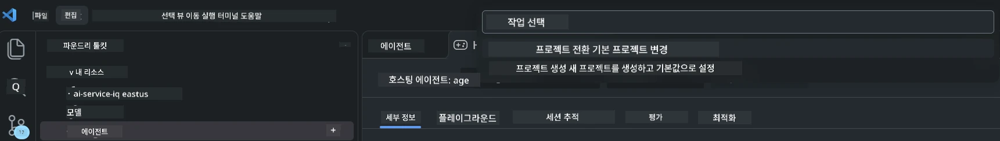

# 모듈 0 - 소개

⏱️ ~10분

> [!WARNING]
> **미리보기 및 제한사항:** [Hosted Agents](https://learn.microsoft.com/azure/foundry/agents/concepts/hosted-agents)는 현재 **공개 미리보기** 상태입니다 - 프로덕션 작업에는 권장하지 않습니다. 이 워크숍에서 보여지는 일부 기능은 서비스가 GA로 전환되면서 변경될 수 있습니다.

## 구축할 내용

이 실습에서는 Lab 01의 단일 에이전트 기술을 확장하여 <strong>멀티 에이전트 워크플로우</strong>를 구축합니다 - 이력서 → 잡 적합도 평가기입니다.

이력서와 직무 설명을 붙여넣으면, 네 개의 전문화된 에이전트가 순차적으로 입력을 처리하고 다음을 반환합니다:
- 적합도 점수 (0~100 및 점수 내역 포함)
- 기술 및 자격증 격차 목록
- 각 격차에 대한 실제 Microsoft Learn 링크가 포함된 맞춤형 학습 로드맵

**워크플로우에 사용되는 것:**
- **Microsoft Agent Framework** - `WorkflowBuilder`를 사용한 순차 파이프라인 오케스트레이션
- **Foundry Toolkit for VS Code** - 스캐폴딩, 로컬 테스트, 배포
- **AI 모델** (예: `gpt-4.1-mini`) - 네 에이전트 모두에서 사용
- **Microsoft Learn MCP 서버** - 각 기술 격차에 대한 실제 학습 자료 링크 제공

---

## 경로 선택

> ⚠️ **Lab 01에서 사용한 경로를 그대로 계속 진행하세요.**

<details open>
<summary><strong>🅰️ 경로 A - Azure 클라우드 (Azure 구독 필요)</strong></summary>

| | 세부 사항 |
|---|---|
| <strong>대상</strong> | Azure 구독을 사용해 Lab 01을 완료한 분 |
| <strong>모델</strong> | Foundry를 통한 Azure OpenAI (예: `gpt-4.1-mini`) |
| **포함 모듈** | 모든 모듈 (00~09) |
| **클라우드 배포 여부** | ✅ 예 - 완전한 엔드 투 엔드 배포 |

</details>

<details open>
<summary><strong>🅱️ 경로 B - Foundry 로컬 (Azure 구독 필요 없음)</strong></summary>

| | 세부 사항 |
|---|---|
| <strong>대상</strong> | Foundry Local을 사용해 Lab 01을 완료한 분 |
| <strong>모델</strong> | Foundry Local (무료, 본인 컴퓨터에서 실행) |
| **포함 모듈** | 00~05 모듈 (06~07은 배포 및 클라우드 검증이므로 생략) |
| **클라우드 배포 여부** | ❌ 아니요 - Agent Inspector로 로컬 테스트만 가능 |

</details>

---

## Lab 01 점검

Lab 02는 Lab 01에 직접적으로 구축됩니다. 여기 시작하기 전에 반드시 Lab 01을 완료하세요.

Lab 01을 아직 완료하지 않았다면, 여기서 시작하세요: [Lab 01 - 소개](../../lab01-single-agent/docs/00-prerequisites.md)

<details open>
<summary><strong>🅰️ 경로 A - Azure 클라우드</strong></summary>

```powershell
az account show --query "{name:name, id:id}" --output table
```

실패 시 `az login` 을 실행하세요. 그런 다음 VS Code에서 확인:

1. `Ctrl+Shift+P` → **Foundry Toolkit** 입력 → 명령어가 나타나는지 확인합니다.
2. **Foundry Toolkit** 아이콘 클릭 → 프로젝트 및 배포된 모델에 **성공(Succeeded)** 상태 표시 확인.



> **RBAC:** Lab 01에서 **Foundry User** 역할을 할당했습니다. 다시 할당이 필요하면 [Lab 01, 모듈 1](../../lab01-single-agent/docs/01-setup.md#deploy-a-model--assign-rbac)을 참조하세요. 이 역할은 이전에 <strong>Azure AI User</strong>라는 이름이었으며 권한은 동일합니다.

</details>

<details open>
<summary><strong>🅱️ 경로 B - Foundry 로컬</strong></summary>

```powershell
Invoke-WebRequest -Uri "http://localhost:5273/v1/health" -UseBasicParsing | Select-Object StatusCode
```

예상 결과: `StatusCode: 200`. 그렇지 않은 경우 Foundry Toolkit 사이드바에서 Foundry Local을 재시작하세요.

> 모든 추론은 본인 컴퓨터에서 수행됩니다. MCP 도구로의 유일한 아웃바운드 호출은 `https://learn.microsoft.com/api/mcp`로 향합니다.

</details>

---

## Lab 02의 새로운 점

| | Lab 01 | Lab 02 |
|--|--------|--------|
| 에이전트 | 1 | 4 (WorkflowBuilder로 연결) |
| 스캐폴드 템플릿 | 기본 - Agent Framework | 워크플로우 - Agent Framework |
| 신규 패키지 | - | `mcp` |
| 오케스트레이션 | 단일 대화형 에이전트 | 순차 파이프라인 (WorkflowBuilder) |
| 신규 도구 | - | `search_microsoft_learn_for_plan` (MCP) |

---

**다음:** [01 - 아키텍처 이해하기 →](01-understand-multi-agent.md)

---

<!-- CO-OP TRANSLATOR DISCLAIMER START -->
**면책 조항**:
이 문서는 AI 번역 서비스 [Co-op Translator](https://github.com/Azure/co-op-translator)를 사용하여 번역되었습니다. 정확성을 기하기 위해 노력하고 있으나, 자동 번역은 오류나 부정확한 부분이 있을 수 있음을 유의하시기 바랍니다. 원본 문서의 원어본이 권위 있는 자료로 간주되어야 합니다. 중요한 정보의 경우, 전문가의 인간 번역을 권장합니다. 이 번역 사용으로 인해 발생하는 오해나 잘못된 해석에 대해 당사는 책임을 지지 않습니다.
<!-- CO-OP TRANSLATOR DISCLAIMER END -->