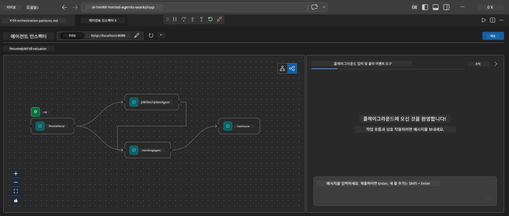
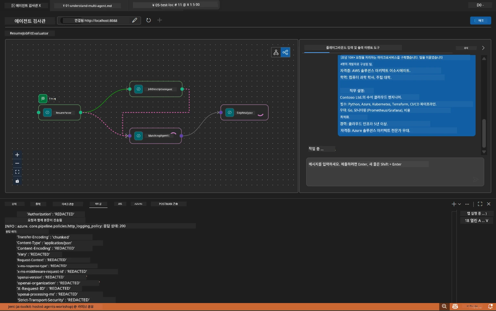
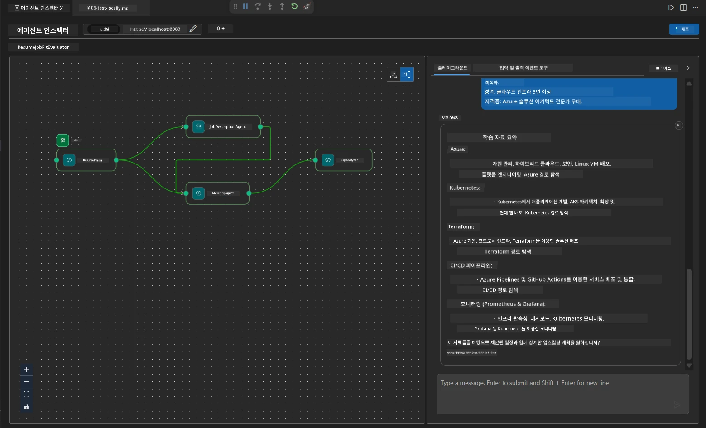

# 모듈 5 - 로컬 테스트

⏱️ ~15 분

이 모듈에서는 멀티 에이전트 워크플로우를 로컬에서 실행하고, Agent Inspector로 테스트하며, 네 개의 에이전트와 MCP 도구가 모두 올바르게 작동하는지 배포 전에 확인합니다.

---

## 1단계: 에이전트 서버 시작

### 옵션 A: VS Code 작업 사용 (권장)

1. `workshop/lab02-multi-agent/PersonalCareerCopilot/`를 VS Code 폴더로 엽니다.
2. `Ctrl+Shift+P`를 누른 후 <strong>Tasks: Run Task</strong>를 입력 → **Run Agent HTTP Server** 선택.
3. 작업은 포트 `5679`에서 debugpy가 연결된 서버를, 포트 `8088`에서 에이전트를 시작합니다.
4. 출력에 시작 메시지가 표시되고 서버 자체의 준비 완료 메시지가 나타날 때까지 기다립니다 (중간에 다른 로그 라인도 나타납니다):

```
INFO:resume-job-fit:Starting Resume -> Job Fit Evaluator HTTP server...
...
INFO:hypercorn.error:Running on http://0.0.0.0:8088 (CTRL + C to quit)
```

### 옵션 B: F5 사용 (디버그 모드)

1. `F5`를 누른 후 **Debug Local Agent HTTP Server** 선택.
2. 서버는 전체 중단점 지원과 함께 시작됩니다 - MCP 응답이나 에이전트 출력을 검사하는 데 유용합니다.

---

## 2단계: Agent Inspector 열기

1. `Ctrl+Shift+P`를 누른 후 **Foundry Toolkit: Open Agent Inspector** 입력.
2. Agent Inspector가 `http://localhost:8088`에 연결된 VS Code 패널로 열립니다.
3. 메시지를 받을 준비가 된 에이전트 인터페이스가 보여야 합니다.



> **Agent Inspector가 열리지 않는 경우:** 서버가 완전히 시작되었는지 확인하세요 (로그에 `Running on http://0.0.0.0:8088`가 보임). 포트 5679가 사용 중이면 [모듈 8 - 문제 해결](08-troubleshooting.md)을 참조하세요.

---

## 2b단계: (선택 사항) 워크플로우 시각화 도구 열기

Foundry Toolkit에는 에이전트들이 그래프 실행 중 어떻게 상호작용하는지 실시간으로 보여주는 <strong>워크플로우 시각화 도구</strong>가 포함되어 있습니다. 멀티 에이전트 디버깅에 특히 유용합니다.

1. `Ctrl+Shift+P`를 누른 후 **Foundry Toolkit: Open Visualizer for Hosted Agents** 입력.
2. 라이브 실행 그래프를 보여주는 새로운 VS Code 탭이 열립니다.
3. Agent Inspector에서 메시지를 보낼 때마다 시각화 도구가 자동으로 업데이트됩니다 - 녹색 노드는 완료된 에이전트를 나타내고, 애니메이션 가장자리는 데이터 흐름을 나타냅니다.

> **포트 충돌:** 시각화 도구 포트가 이미 사용 중이면 VS Code 설정 → **Extensions** → **Microsoft Foundry Configuration** → <strong>Hosted Agents: Visualizer Port</strong>에서 변경하세요.

---

## 3단계: 스모크 테스트 실행

다음 두 가지 테스트를 순서대로 실행하세요. 각 테스트는 워크플로우를 점차 점검합니다.

### 테스트 1: 기본 이력서 + 직무 설명

다음 내용을 Agent Inspector에 붙여넣으세요:

```
Resume:
Jane Doe
Senior Software Engineer with 5 years of experience in Python, Django, and AWS.
Built microservices handling 10K+ requests/second. Led a team of 4 developers.
Certifications: AWS Solutions Architect Associate.
Education: B.S. Computer Science, State University.

Job Description:
Senior Cloud Engineer at Contoso Ltd.
Required: Python, Azure, Kubernetes, Terraform, CI/CD pipelines.
Preferred: Go, monitoring (Prometheus/Grafana), cost optimization.
Experience: 5+ years in cloud infrastructure.
Certifications: Azure Solutions Architect Expert preferred.
```

**예상 출력 구조:**

응답은 네 개의 에이전트 출력을 순서대로 포함해야 합니다:

1. **이력서 파서 출력** - 두 개의 레이블된 섹션: `[PARSED RESUME]` (능력별로 그룹화된 후보자 프로필) 및 `[JOB DESCRIPTION PASS-THROUGH]` (직무 설명 에이전트에 제공되는 원문 JD 텍스트)
2. **직무 설명 에이전트 출력** - 필수 및 우대 기술이 구분된 구조화된 요구사항
3. **매칭 에이전트 출력** - 적합 점수(0-100)와 세부 내역, 매칭된 기술, 누락된 기술, 격차
4. **갭 분석기 출력** - 누락된 각 기술에 대한 개별 갭 카드, 각 카드에 Microsoft Learn URL 포함





### 테스트 1에서 확인할 사항

| 확인 항목 | 예상 결과 | 통과? |
|-------|----------|-------|
| 응답에 적합 점수 포함 | 0-100 사이 숫자와 세부 내역 | |
| 매칭된 기술 나열 | Python, CI/CD (부분), 등 | |
| 누락된 기술 나열 | Azure, Kubernetes, Terraform, 등 | |
| 누락된 기술마다 갭 카드 존재 | 기술별 카드 1개씩 | |
| Microsoft Learn URL 존재 | 실제 `learn.microsoft.com` 링크 | |
| 응답에 오류 메시지 없음 | 깔끔한 구조화 출력 | |

### 테스트 2: 엣지 케이스 - 적합도 높은 후보자

직무 설명에 매우 근접하게 맞는 이력서를 붙여넣어 GapAnalyzer가 적합도 높은 상황을 올바르게 처리하는지 확인하세요:

```
Resume:
Alex Chen
Senior Cloud Engineer with 7 years of experience.
Skills: Python, Azure (AKS, Functions, DevOps), Kubernetes, Terraform, CI/CD (GitHub Actions, Azure Pipelines), Go, Prometheus, Grafana, cost optimization.
Certifications: Azure Solutions Architect Expert, Azure DevOps Engineer Expert.
Led infrastructure migration to Azure for 3 enterprise clients.
Education: M.S. Computer Science, Tech University.

Job Description:
Senior Cloud Engineer at Contoso Ltd.
Required: Python, Azure, Kubernetes, Terraform, CI/CD pipelines.
Preferred: Go, monitoring (Prometheus/Grafana), cost optimization.
Experience: 5+ years in cloud infrastructure.
Certifications: Azure Solutions Architect Expert preferred.
```

**예상 동작:**
- 적합 점수는 <strong>80 이상</strong>이어야 함 (대부분 기술이 일치)
- 갭 카드는 기초 학습보다는 다듬기/인터뷰 준비에 집중함
- GapAnalyzer 지침에는 "적합도가 80 이상이면 다듬기/인터뷰 준비에 집중"이라고 명시됨

---

## 4단계: 자신의 데이터로 테스트 (선택 사항)

자신의 이력서와 실제 직무 설명을 붙여넣어 테스트해 보세요. 이로 인해 다음 사항을 확인할 수 있습니다:

- 에이전트가 다양한 이력서 형식(연대기식, 기능식, 하이브리드)을 처리하는지
- 직무 설명 에이전트가 다양한 JD 스타일(글머리표, 문단, 구조화)를 처리하는지
- MCP 도구가 실제 기술에 대한 관련 리소스를 반환하는지
- 갭 카드가 개인의 특정 배경에 맞게 맞춤화되는지

> **개인정보 보호 - 경로 A (Foundry 클라우드):** 이력서와 JD 텍스트는 추론을 위해 Azure OpenAI 배포에 전송됩니다. 워크숍 인프라에서 기록되거나 저장되지 않습니다. 원한다면 가명(예: "Jane Doe")을 사용하세요.
>
> **개인정보 보호 - 경로 B (Foundry 로컬):** 네 개 에이전트 추론은 모두 장치 내에서 완전히 실행됩니다. 이력서와 직무 설명 텍스트가 **기계를 벗어나지 않습니다**. 외부 호출은 MCP 도구가 `https://learn.microsoft.com/api/mcp`에서 리소스를 가져올 때뿐이며 해당 쿼리는 기술 이름만 포함하고 개인 데이터는 포함하지 않습니다.

---

### 체크포인트

- [ ] 포트 `8088`에서 서버가 성공적으로 시작됨 (로그에 `Running on http://0.0.0.0:8088` 표시)
- [ ] Agent Inspector가 열리고 에이전트에 연결됨
- [ ] 테스트 1: 적합 점수, 매칭/누락된 기술, 갭 카드, Microsoft Learn URL을 포함한 완전한 응답
- [ ] 테스트 2: 적합도 높은 후보자가 80+ 점수와 다듬기 중심 권장 사항을 받음
- [ ] 모든 갭 카드가 존재함 (누락된 기술별로 하나씩, 누락 없음)
- [ ] 서버 터미널에 오류나 스택 트레이스 없음

---

**이전:** [04 - 오케스트레이션 패턴](04-orchestration-patterns.md) · **다음:** [06 - Foundry에 배포 →](06-deploy-to-foundry.md)

---

<!-- CO-OP TRANSLATOR DISCLAIMER START -->
**면책 조항**:
이 문서는 AI 번역 서비스 [Co-op Translator](https://github.com/Azure/co-op-translator)를 사용하여 번역되었습니다. 정확성을 기하기 위해 노력하고 있으나, 자동 번역은 오류나 부정확한 부분이 있을 수 있음을 유의하시기 바랍니다. 원본 문서의 원어본이 권위 있는 자료로 간주되어야 합니다. 중요한 정보의 경우, 전문가의 인간 번역을 권장합니다. 이 번역 사용으로 인해 발생하는 오해나 잘못된 해석에 대해 당사는 책임을 지지 않습니다.
<!-- CO-OP TRANSLATOR DISCLAIMER END -->