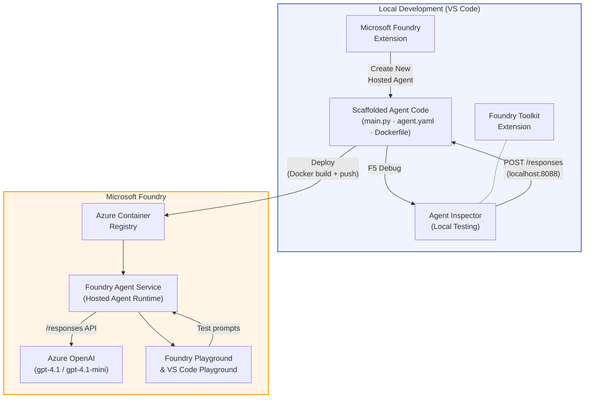

# Foundry Toolkit + Foundry Hosted Agents dirbtuvės

[](https://www.python.org/)
[](https://github.com/microsoft/agents)
[](https://learn.microsoft.com/azure/foundry/agents/concepts/hosted-agents)
[](https://ai.azure.com/)
[](https://learn.microsoft.com/azure/ai-services/openai/)
[](https://learn.microsoft.com/cli/azure/install-azure-cli)
[](https://learn.microsoft.com/azure/developer/azure-developer-cli/install-azd)
[](https://www.docker.com/)
[](https://marketplace.visualstudio.com/items?itemName=ms-windows-ai-studio.windows-ai-studio)
[](../../LICENSE)

Kurkite, testuokite ir diegkite DI agentus į **Microsoft Foundry Agent Service** kaip **Talpinami agentai** - visiškai iš VS Code naudodami **Microsoft Foundry plėtinį** ir **Foundry Toolkit**.

> **Talpinami agentai šiuo metu yra peržiūros režime.** Palaikomos sritys ribotos - žr. [regionų prieinamumas](https://learn.microsoft.com/azure/foundry/agents/concepts/hosted-agents#region-availability).

> `agent/` aplankas kiekvienoje laboratorijoje yra **automatiškai sugeneruojamas** Foundry plėtiniu - tuomet pritaikote kodą, testuojate lokaliai ir diegiate.

### 🌐 Daugiakalbė parama

#### Palaikoma per GitHub Action (automatizuota ir visada atnaujinta)

<!-- CO-OP TRANSLATOR LANGUAGES TABLE START -->
[Arabų](../ar/README.md) | [Bengalų](../bn/README.md) | [Bulgarų](../bg/README.md) | [Birmiečių (Mianmaras)](../my/README.md) | [Kinų (supaprastinta)](../zh-CN/README.md) | [Kinų (tradicinė, Honkongas)](../zh-HK/README.md) | [Kinų (tradicinė, Makao)](../zh-MO/README.md) | [Kinų (tradicinė, Taivanas)](../zh-TW/README.md) | [Kroatų](../hr/README.md) | [Čekų](../cs/README.md) | [Danų](../da/README.md) | [Olandų](../nl/README.md) | [Estų](../et/README.md) | [Suomi](../fi/README.md) | [Prancūzų](../fr/README.md) | [Vokiečių](../de/README.md) | [Graikų](../el/README.md) | [Hebrajų](../he/README.md) | [Hindi](../hi/README.md) | [Vengrų](../hu/README.md) | [Indoneziečių](../id/README.md) | [Italų](../it/README.md) | [Japonų](../ja/README.md) | [Kannados](../kn/README.md) | [Khmerų](../km/README.md) | [Korėjiečių](../ko/README.md) | [Lietuvių](./README.md) | [Malajų](../ms/README.md) | [Malajalamų](../ml/README.md) | [Maratų](../mr/README.md) | [Nepalų](../ne/README.md) | [Nigerijos pidžinų](../pcm/README.md) | [Norvegų](../no/README.md) | [Persų (Farsi)](../fa/README.md) | [Lenkų](../pl/README.md) | [Portugalų (Brazilija)](../pt-BR/README.md) | [Portugalų (Portugalija)](../pt-PT/README.md) | [Pandžabi (Gurmukhi)](../pa/README.md) | [Rumunų](../ro/README.md) | [Rusų](../ru/README.md) | [Serbų (kirilica)](../sr/README.md) | [Slovakų](../sk/README.md) | [Slovėnų](../sl/README.md) | [Ispanų](../es/README.md) | [Svahili](../sw/README.md) | [Švedų](../sv/README.md) | [Tagalog (filipinų)](../tl/README.md) | [Tamilų](../ta/README.md) | [Telugų](../te/README.md) | [Tajų](../th/README.md) | [Turkų](../tr/README.md) | [Ukrainiečių](../uk/README.md) | [Urdu](../ur/README.md) | [Vietnamo](../vi/README.md)

> **Ar norite klonuoti lokaliai?**
>
> Šiame saugykloje yra daugiau nei 50 vertimų kalbomis, dėl ko smarkiai padidėja atsisiuntimo dydis. Norėdami klonuoti be vertimų, naudokite sparse checkout:
>
> **Bash / macOS / Linux:**
> ```bash
> git clone --filter=blob:none --sparse https://github.com/microsoft-foundry/Foundry_Toolkit_for_VSCode_Lab.git
> cd Foundry_Toolkit_for_VSCode_Lab
> git sparse-checkout set --no-cone '/*' '!translations' '!translated_images'
> ```
>
> **CMD (Windows):**
> ```cmd
> git clone --filter=blob:none --sparse https://github.com/microsoft-foundry/Foundry_Toolkit_for_VSCode_Lab.git
> cd Foundry_Toolkit_for_VSCode_Lab
> git sparse-checkout set --no-cone "/*" "!translations" "!translated_images"
> ```
>
> Tai suteikia viską, ko reikia kursui užbaigti, ir leidžia atsisiųsti daug greičiau.
<!-- CO-OP TRANSLATOR LANGUAGES TABLE END -->

---

## Architektūra



**Eiga:** Foundry plėtinys sugeneruoja agentą → jūs pritaikote kodą & instrukcijas → testuojate lokaliai su Agent Inspector → diegiate į Foundry (Docker atvaizdas nusiųstas į ACR) → patikrinate Playground.

---

## Ką kursite

| Laboratorija | Aprašymas | Statusas |
|-----|-------------|--------|
| **Laboratorija 01 - Vienas agentas** | Sukurkite **"Explain Like I'm an Executive" Agent** (Sukurkite **"Paaiškinkite taip, lyg būčiau vadovas"** agentą), testuokite lokaliai ir diegkite į Foundry | ✅ Prieinama |
| **Laboratorija 02 - Daugiagentinis darbo srautas** | Sukurkite **"Resume → Job Fit Evaluator"** - 4 agentai bendradarbiauja, kad įvertintų CV atitiktį ir sugeneruotų mokymosi kelią | ✅ Prieinama |

---

## Susipažinkite su vykdomuoju agentu

Šiose dirbtuvėse sukursite **"Explain Like I'm an Executive" Agent** - DI agentą, kuris sudėtingą techninį žargoną paverčia ramiomis, susirinkimui parengtomis santraukomis. Būkime sąžiningi — niekas C lygio vadovybėje nenori girdėti apie "thread pool exhaustion caused by synchronous calls introduced in v3.2."

Šį agentą sukūriau po kiek per daug incidentų, kai mano puikiai parengtas post-mortemas sulaukdavo atsakymo: *"Tai... ar svetainė neveikia, ar visgi taip?"*

### Kaip tai veikia

Jūs pateikiate techninį pranešimą. Jis grąžina vykdomąją santrauką - tris punktus, be žargono, be stack trace'ų, be egzistencinio nerimo. Tiesiog **kas įvyko**, **verslo poveikis**, ir **kitas žingsnis**.

### Pamatykite veikiantį

**Jūs sakote:**
> "The API latency increased due to thread pool exhaustion caused by synchronous calls introduced in v3.2."

**Agentas atsako:**

> **Vykdomoji santrauka:**
> - **Kas įvyko:** Po naujausio leidimo sistema sulėtėjo.
> - **Verslo poveikis:** Kai kurie vartotojai patyrė delsą naudodamiesi paslauga.
> - **Kitas žingsnis:** Pakeitimas buvo atšauktas ir ruošiama pataisa prieš pakartotinį diegimą.

### Kodėl šis agentas?

Tai labai paprastas, vienos paskirties agentas - puikiai tinka išmokti talpinamo agente darbo eigą nuo pradžios iki pabaigos, neužstrigus prie sudėtingų įrankių grandinių. Ir, tiesą sakant, kiekvienai inžinerinei komandai toks agentas būtų naudingas.

---

## Dirbtuvių struktūra

```
📂 Foundry_Toolkit_for_VSCode_Lab/
├── 📄 README.md                      ← You are here
└── 📂 workshop/
    ├── 📂 lab01-single-agent/        ← Full lab: docs + agent code
    │   ├── README.md                 ← Hands-on lab instructions
    │   ├── 📂 docs/                  ← Step-by-step tutorial modules
    │   │   ├── 00-prerequisites.md
    │   │   ├── 01-setup.md
    │   │   ├── 02-create-hosted-agent.md
    │   │   ├── 03-configure-and-code.md
    │   │   ├── 04-test-locally.md
    │   │   ├── 05-deploy-to-foundry.md
    │   │   ├── 06-verify-in-playground.md
    │   │   ├── 07-summary.md
    │   │   └── 08-troubleshooting.md
    │   └── 📂 agent/                 ← Reference solution (auto-scaffolded by Foundry extension)
    │       ├── agent.yaml
    │       ├── Dockerfile
    │       ├── main.py
    │       └── requirements.txt
    └── 📂 lab02-multi-agent/         ← Resume → Job Fit Evaluator
        ├── README.md                 ← Hands-on lab instructions (end-to-end)
        ├── 📂 docs/                  ← Step-by-step tutorial modules
        │   ├── 00-prerequisites.md
        │   ├── 01-understand-multi-agent.md
        │   ├── 02-scaffold-multi-agent.md
        │   ├── 03-configure-agents.md
        │   ├── 04-orchestration-patterns.md
        │   ├── 05-test-locally.md
        │   ├── 06-deploy-to-foundry.md
        │   ├── 07-verify-in-playground.md
        │   └── 08-troubleshooting.md
        └── 📂 PersonalCareerCopilot/ ← Reference solution (multi-agent workflow)
            ├── agent.yaml
            ├── Dockerfile
            ├── main.py
            └── requirements.txt
```

> **Pastaba:** `agent/` aplankas kiekvienoje laboratorijoje yra tai, ką **Microsoft Foundry plėtinys** sugeneruoja kai vykdote `Microsoft Foundry: Create a New Hosted Agent` iš Command Palette. Failai vėliau pritaikomi su jūsų agente skirtomis instrukcijomis, įrankiais ir konfigūracija. Laboratorija 01 veda jus per šio kūrimo procesą nuo nulio.

---

## Pradžia

### 1. Klonuokite saugyklą

```bash
git clone https://github.com/microsoft-foundry/Foundry_Toolkit_for_VSCode_Lab.git
cd Foundry_Toolkit_for_VSCode_Lab
```

### 2. Sukurkite Python virtualią aplinką

```bash
python -m venv venv
```

Aktyvuokite ją:

- **Windows (PowerShell):**
  ```powershell
  .\venv\Scripts\Activate.ps1
  ```
- **macOS / Linux:**
  ```bash
  source venv/bin/activate
  ```

### 3. Įdiekite priklausomybes

```bash
pip install -r workshop/lab01-single-agent/agent/requirements.txt
```

### 4. Konfigūruokite aplinkos kintamuosius

Kopijuokite pavyzdinį `.env` failą į agento aplanką ir užpildykite savo reikšmes:

```bash
cp workshop/lab01-single-agent/agent/.env.example workshop/lab01-single-agent/agent/.env
```

Redaguokite `workshop/lab01-single-agent/agent/.env`:

```env
AZURE_AI_PROJECT_ENDPOINT=https://<your-account>.services.ai.azure.com/api/projects/<your-project>
AZURE_AI_MODEL_DEPLOYMENT_NAME=<your-model-deployment-name>
```

### 5. Vykdykite dirbtuvėse pateiktas laboratorijas

Kiekviena laboratorija yra savarankiška su savo moduliais. Pradėkite nuo **Laboratorijos 01**, kad išmoktumėte pagrindus, tada pereikite prie **Laboratorijos 02** dėl daugiagentinių darbo eigų.

#### Laboratorija 01 - Vienas agentas ([pilnos instrukcijos](workshop/lab01-single-agent/README.md))

| # | Modulis | Nuoroda |
|---|--------|------|
| 1 | Perskaitykite reikalavimus | [00-prerequisites.md](workshop/lab01-single-agent/docs/00-prerequisites.md) |
| 2 | Įdiekite Foundry Toolkit & Foundry plėtinį | [01-setup.md](workshop/lab01-single-agent/docs/01-setup.md) |
| 3 | Sukurkite Foundry projektą | [01-setup.md](workshop/lab01-single-agent/docs/01-setup.md) |
| 4 | Sukurkite talpinamą agentą | [02-create-hosted-agent.md](workshop/lab01-single-agent/docs/02-create-hosted-agent.md) |
| 5 | Konfigūruokite instrukcijas & aplinką | [03-configure-and-code.md](workshop/lab01-single-agent/docs/03-configure-and-code.md) |
| 6 | Testuokite lokaliai | [04-test-locally.md](workshop/lab01-single-agent/docs/04-test-locally.md) |
| 7 | Diegti į Foundry | [05-deploy-to-foundry.md](workshop/lab01-single-agent/docs/05-deploy-to-foundry.md) |
| 8 | Patikrinkite playground | [06-verify-in-playground.md](workshop/lab01-single-agent/docs/06-verify-in-playground.md) |
| 9 | Trikčių šalinimas | [08-troubleshooting.md](workshop/lab01-single-agent/docs/08-troubleshooting.md) |

#### Laboratorija 02 - Daugiagentinis darbo srautas ([pilnos instrukcijos](workshop/lab02-multi-agent/README.md))

| # | Modulis | Nuoroda |
|---|--------|------|
| 1 | Išankstiniai reikalavimai (Laboratorijai 02) | [00-prerequisites.md](workshop/lab02-multi-agent/docs/00-prerequisites.md) |
| 2 | Suprasti daugiagentinę architektūrą | [01-understand-multi-agent.md](workshop/lab02-multi-agent/docs/01-understand-multi-agent.md) |
| 3 | Sugeneruoti daugiagentinį projektą | [02-scaffold-multi-agent.md](workshop/lab02-multi-agent/docs/02-scaffold-multi-agent.md) |
| 4 | Konfigūruoti agentus & aplinką | [03-configure-agents.md](workshop/lab02-multi-agent/docs/03-configure-agents.md) |
| 5 | Orkestracijos šablonai | [04-orchestration-patterns.md](workshop/lab02-multi-agent/docs/04-orchestration-patterns.md) |
| 6 | Testuokite lokaliai (daugiagentinis) | [05-test-locally.md](workshop/lab02-multi-agent/docs/05-test-locally.md) |
| 7 | Diegti į Foundry | [06-deploy-to-foundry.md](workshop/lab02-multi-agent/docs/06-deploy-to-foundry.md) |
| 8 | Patikrinkite playground | [07-verify-in-playground.md](workshop/lab02-multi-agent/docs/07-verify-in-playground.md) |
| 9 | Trikčių šalinimas (daugiagentinis) | [08-troubleshooting.md](workshop/lab02-multi-agent/docs/08-troubleshooting.md) |

---

## Prižiūrėtojas

<table>
<tr>
    <td align="center"><a href="https://github.com/ShivamGoyal03">
        <br />
        <sub><b>Shivam Goyal</b></sub>
    </a><br />
    </td>
</tr>
</table>

---

## Reikalingos teisės (greita nuoroda)

| Scenarijus | Reikalingos rolės |
|----------|---------------|
| Sukurti naują Foundry projektą | **Azure AI Owner** ant Foundry resurso |
| Diegti į esamą projektą (nauji resursai) | **Azure AI Owner** + **Contributor** ant prenumeratos |
| Diegti į visiškai sukonfigūruotą projektą | **Reader** ant paskyros + **Azure AI User** projekte |

> **Svarbu:** Azure `Owner` ir `Contributor` vaidmenys apima tik *valdymo* teises, o ne *kūrimo* (duomenų veiksmų) teises. Jums reikia **Azure AI User** arba **Azure AI Owner**, kad kurtumėte ir diegtumėte agentus.

---

## Nuorodos

- [Greitas startas: Įdiekite savo pirmąjį talpinamą agentą (VS Code)](https://learn.microsoft.com/azure/foundry/agents/quickstarts/quickstart-hosted-agent)
- [Kas yra talpinami agentai?](https://learn.microsoft.com/azure/foundry/agents/concepts/hosted-agents)
- [Sukurkite talpinamų agentų darbo eigas VS Code](https://learn.microsoft.com/azure/foundry/agents/how-to/vs-code-agents-workflow-pro-code)
- [Įdiegti talpinamą agentą](https://learn.microsoft.com/azure/foundry/agents/how-to/deploy-hosted-agent)
- [RBAC Microsoft Foundry'ui](https://learn.microsoft.com/azure/foundry/concepts/rbac-foundry)
- [Architektūros peržiūros agento pavyzdys](https://github.com/Azure-Samples/agent-architecture-review-sample) - Realiame pasaulyje naudojamas talpinamas agentas su MCP įrankiais, Excalidraw diagramomis ir dviem diegimo būdais

---


## Licencija

[MIT](../../LICENSE)

---

<!-- CO-OP TRANSLATOR DISCLAIMER START -->
**Atsakomybės apribojimas**:
Šis dokumentas buvo išverstas naudojant dirbtinio intelekto vertimo paslaugą [Co-op Translator](https://github.com/Azure/co-op-translator). Nors siekiame tikslumo, prašome atkreipti dėmesį, kad automatiniai vertimai gali turėti klaidų ar netikslumų. Originalus dokumentas jo gimtąja kalba laikomas autoritetingu šaltiniu. Svarbiai informacijai rekomenduojama naudoti profesionalų žmogiškąjį vertimą. Mes neatsakome už jokius nesusipratimus ar neteisingą interpretaciją, kilusią naudojantis šiuo vertimu.
<!-- CO-OP TRANSLATOR DISCLAIMER END -->
