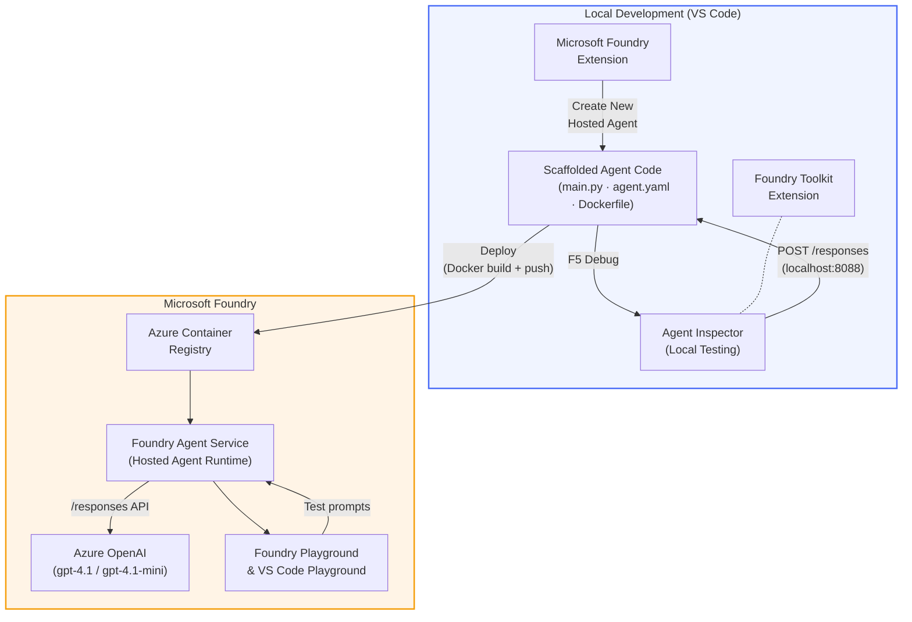

# Foundry įrankių rinkinys + Foundry talpinamų agentų dirbtuvės

[](https://www.python.org/)
[](https://learn.microsoft.com/agent-framework/)
[](https://learn.microsoft.com/azure/foundry/agents/concepts/hosted-agents)
[](https://ai.azure.com/)
[](https://learn.microsoft.com/azure/ai-services/openai/)
[](https://learn.microsoft.com/cli/azure/install-azure-cli)
[](https://learn.microsoft.com/azure/developer/azure-developer-cli/install-azd)
[](https://www.docker.com/)
[](https://marketplace.visualstudio.com/items?itemName=ms-windows-ai-studio.windows-ai-studio)
[](LICENSE)

Kurkite, bandykite ir diegkite DI agentus į **Microsoft Foundry Agent Service** kaip **talpinamus agentus** – visiškai iš VS Code naudojant **Microsoft Foundry plėtinį** ir **Foundry įrankių rinkinį**.

> **Talpinami agentai šiuo metu yra peržiūros stadijoje.** Palaikomos sritys yra ribotos – žr. [regionų prieinamumas](https://learn.microsoft.com/azure/foundry/agents/concepts/hosted-agents#region-availability).

> Kiekvieno užsiėmimo viduje esantis `agent/` katalogas yra **automatiškai sukuriamas** Foundry plėtinio – tada jūs pritaikote kodą, testuojate vietoje ir diegiate.

### 🌐 Daugiakalbė palaikymas

#### Palaikoma per GitHub Action (automatizuota ir visuomet atnaujinta)

<!-- CO-OP TRANSLATOR LANGUAGES TABLE START -->
[arabų](../ar/README.md) | [bendžalių](../bn/README.md) | [bulgarų](../bg/README.md) | [birmanių (Mianmaras)](../my/README.md) | [kinų (supaprastinta)](../zh-CN/README.md) | [kinų (tradicinė, Honkongas)](../zh-HK/README.md) | [kinų (tradicinė, Makao)](../zh-MO/README.md) | [kinų (tradicinė, Taivanas)](../zh-TW/README.md) | [kroatų](../hr/README.md) | [čekų](../cs/README.md) | [danų](../da/README.md) | [olandų](../nl/README.md) | [estų](../et/README.md) | [suomių](../fi/README.md) | [prancūzų](../fr/README.md) | [vokiečių](../de/README.md) | [graikų](../el/README.md) | [hebrajų](../he/README.md) | [hindų](../hi/README.md) | [vengrų](../hu/README.md) | [indoneziečių](../id/README.md) | [italų](../it/README.md) | [japonų](../ja/README.md) | [kanadų](../kn/README.md) | [kmėjų](../km/README.md) | [korėjiečių](../ko/README.md) | [lietuvių](./README.md) | [malajų](../ms/README.md) | [malajalamų](../ml/README.md) | [maratų](../mr/README.md) | [nepaliečių](../ne/README.md) | [nigerijos pidžinų](../pcm/README.md) | [norvegų](../no/README.md) | [persų (farzi)](../fa/README.md) | [lenkų](../pl/README.md) | [portugalų (Brazilija)](../pt-BR/README.md) | [portugalų (Portugalija)](../pt-PT/README.md) | [pandžabių (Gurmukhi)](../pa/README.md) | [rumunų](../ro/README.md) | [rusų](../ru/README.md) | [serbų (kirilica)](../sr/README.md) | [slovakų](../sk/README.md) | [slovėnų](../sl/README.md) | [ispanų](../es/README.md) | [svahilių](../sw/README.md) | [švedų](../sv/README.md) | [tagalogų (filipiniečių)](../tl/README.md) | [tamilų](../ta/README.md) | [telugų](../te/README.md) | [tailandietiškų](../th/README.md) | [turkų](../tr/README.md) | [ukrainiečių](../uk/README.md) | [urdu](../ur/README.md) | [vietnamiečių](../vi/README.md)

> **Norite klonuoti lokaliai?**
>
> Šiame saugykloje yra daugiau nei 50 vertimų, kurie ženkliai padidina atsisiuntimo dydį. Norėdami klonuoti be vertimų, naudokite sparse checkout:
>
> **Bash / macOS / Linux:**
> ```bash
> git clone --filter=blob:none --sparse https://github.com/microsoft-foundry/Foundry_Toolkit_for_VSCode_Lab.git
> cd Foundry_Toolkit_for_VSCode_Lab
> git sparse-checkout set --no-cone '/*' '!translations' '!translated_images'
> ```
>
> **CMD (Windows):**
> ```cmd
> git clone --filter=blob:none --sparse https://github.com/microsoft-foundry/Foundry_Toolkit_for_VSCode_Lab.git
> cd Foundry_Toolkit_for_VSCode_Lab
> git sparse-checkout set --no-cone "/*" "!translations" "!translated_images"
> ```
>
> Tai suteiks jums viską, ko reikia kursui baigti, su daug greitesniu atsisiuntimu.
<!-- CO-OP TRANSLATOR LANGUAGES TABLE END -->

---

## Architektūra



**Srautas:** Foundry plėtinys sukurtas agentas → jūs koreguojate kodą ir instrukcijas → testuojate vietoje naudodami Agent Inspector → diegiate į Foundry (Docker atvaizdas įkeltas į ACR) → tikrinate Playground.

---

## Ką kursite

| Užsiėmimas | Aprašymas | Būsena |
|-----|-------------|--------|
| **Užsiėmimas 01 - Vieno agento** | Sukurkite **"Paaiškink kaip vadovui" agentą**, išbandykite vietoje ir įdiekite į Foundry | ✅ Galima |
| **Užsiėmimas 02 - Daugiaagentų darbo eiga** | Sukurkite **"CV → Darbo tinkamumo vertintojas"** – 4 agentai bendradarbiauja įvertindami CV tinkamumą ir generuodami mokymosi planą | ✅ Galima |

---

## Susipažinkite su Vadovo agentu

Šiame dirbtuvėse jūs kursite **"Paaiškink kaip vadovui" agentą** – DI agentą, kuris sudėtingą techninę informaciją verčia į ramias, valdybai tinkamas santraukas. Nes tiesa ta, kad niekas C-lygyje nenori girdėti apie „sruogų talpyklos tuštėjimą, kurį sukėlė sinchroniniai kvietimai įdėti v3.2“.

Šį agentą sukūriau po daugelio kartų, kai mano tobulai parengtas post mortem sulaukė reakcijos: *„Tai... ar svetainė veikia, ar ne?“*

### Kaip tai veikia

Jūs pateikiate techninį atnaujinimą. Jis grąžina vadovo santrauką – tris punktus, be žargono, be klaidų pėdsakų, be nerimo. Tik **kas įvyko**, **verslo poveikis** ir **kitas žingsnis**.

### Pamatykite veikime

**Jūs sakote:**
> „API delsa padidėjo dėl sruogų talpyklos tuštėjimo, kurį sukėlė sinchroniniai kvietimai įdėti v3.2.“

**Agentas atsako:**

> **Vadovo santrauka:**
> - **Kas įvyko:** Po naujausio leidimo sistema sulėtėjo.
> - **Verslo poveikis:** Kai kurie vartotojai patyrė delsą naudodamiesi paslauga.
> - **Kitas žingsnis:** Pakeitimas buvo atšauktas ir ruošiama pataisa prieš pakartotinį diegimą.

### Kodėl šis agentas?

Tai itin paprastas, vienos paskirties agentas – puikiai tinkantis mokytis talpinamo agento darbo eigą nuo pradžios iki galo nesudėtingais įrankių grandiniais. Ir tiesą sakant? Kiekviena inžinerinė komanda galėtų tokių turėti.

---

## Dirbtuvių struktūra

```
📂 Foundry_Toolkit_for_VSCode_Lab/
├── 📄 README.md                      ← You are here
└── 📂 workshop/
    ├── 📂 lab01-single-agent/        ← Full lab: docs + agent code
    │   ├── README.md                 ← Hands-on lab instructions
    │   ├── 📂 docs/                  ← Step-by-step tutorial modules
    │   │   ├── 00-prerequisites.md
    │   │   ├── 01-setup.md
    │   │   ├── 02-create-hosted-agent.md
    │   │   ├── 03-configure-and-code.md
    │   │   ├── 04-test-locally.md
    │   │   ├── 05-deploy-to-foundry.md
    │   │   ├── 06-verify-in-playground.md
    │   │   ├── 07-summary.md
    │   │   └── 08-troubleshooting.md
    │   └── 📂 agent/                 ← Reference solution (auto-scaffolded by Foundry extension)
    │       ├── agent.yaml
    │       ├── Dockerfile
    │       ├── main.py
    │       └── requirements.txt
    └── 📂 lab02-multi-agent/         ← Resume → Job Fit Evaluator
        ├── README.md                 ← Hands-on lab instructions (end-to-end)
        ├── 📂 docs/                  ← Step-by-step tutorial modules
        │   ├── 00-prerequisites.md
        │   ├── 01-understand-multi-agent.md
        │   ├── 02-scaffold-multi-agent.md
        │   ├── 03-configure-agents.md
        │   ├── 04-orchestration-patterns.md
        │   ├── 05-test-locally.md
        │   ├── 06-deploy-to-foundry.md
        │   ├── 07-verify-in-playground.md
        │   ├── 08-troubleshooting.md
        │   └── 09-summary.md
        └── 📂 PersonalCareerCopilot/ ← Reference solution (multi-agent workflow)
            ├── agent.yaml
            ├── Dockerfile
            ├── main.py
            └── requirements.txt
```

> **Pastaba:** Kiekviename užsiėmime esantis `agent/` katalogas yra tai, ką sugeneruoja **Microsoft Foundry plėtinys**, kai paleidžiate `Microsoft Foundry: Create a New Hosted Agent` iš komandinio sąrašo. Šie failai tada pritaikomi su jūsų agento instrukcijomis, įrankiais ir konfigūracija. Užsiėmimas 01 jus žingsnis po žingsnio veda per tai, kaip sukurti tai nuo nulio.

---

## Pradžia

### 1. Klonuokite saugyklą

```bash
git clone https://github.com/microsoft-foundry/Foundry_Toolkit_for_VSCode_Lab.git
cd Foundry_Toolkit_for_VSCode_Lab
```

### 2. Sukurkite Python virtualią aplinką

```bash
python -m venv venv
```

Aktyvuokite ją:

- **Windows (PowerShell):**
  ```powershell
  .\venv\Scripts\Activate.ps1
  ```
- **macOS / Linux:**
  ```bash
  source venv/bin/activate
  ```

### 3. Įdiekite priklausomybes

```bash
pip install -r workshop/lab01-single-agent/agent/requirements.txt
```

### 4. Sukonfigūruokite aplinkos kintamuosius

Nukopijuokite pavyzdinį `.env` failą agento kataloge ir užpildykite savo duomenis:

```bash
cp workshop/lab01-single-agent/agent/.env.example workshop/lab01-single-agent/agent/.env
```

Redaguokite `workshop/lab01-single-agent/agent/.env`:

```env
FOUNDRY_PROJECT_ENDPOINT=https://<your-account>.services.ai.azure.com/api/projects/<your-project>
AZURE_AI_MODEL_DEPLOYMENT_NAME=<your-model-deployment-name>
```

### 5. Sekite dirbtuvių užsiėmimus

Kiekvienas užsiėmimas yra savarankiškas su savo moduliais. Pradėkite nuo **Užsiėmimo 01**, kad išmoktumėte pagrindus, tada pereikite prie **Užsiėmimo 02** dėl daugiaagentės darbo eigos.

#### Užsiėmimas 01 - Vienas agentas ([pilnos instrukcijos](workshop/lab01-single-agent/README.md))

| Nr. | Modulis | Nuoroda |
|---|--------|------|
| 1 | Skaitykite išankstines sąlygas | [00-prerequisites.md](workshop/lab01-single-agent/docs/00-prerequisites.md) |
| 2 | Įdiekite Foundry įrankių rinkinį ir Foundry plėtinį | [01-setup.md](workshop/lab01-single-agent/docs/01-setup.md) |
| 3 | Sukurkite Foundry projektą | [01-setup.md](workshop/lab01-single-agent/docs/01-setup.md) |
| 4 | Sukurkite talpinamą agentą | [02-create-hosted-agent.md](workshop/lab01-single-agent/docs/02-create-hosted-agent.md) |
| 5 | Konfigūruokite instrukcijas ir aplinką | [03-configure-and-code.md](workshop/lab01-single-agent/docs/03-configure-and-code.md) |
| 6 | Testuokite vietoje | [04-test-locally.md](workshop/lab01-single-agent/docs/04-test-locally.md) |
| 7 | Diegkite į Foundry | [05-deploy-to-foundry.md](workshop/lab01-single-agent/docs/05-deploy-to-foundry.md) |
| 8 | Patikrinkite playground | [06-verify-in-playground.md](workshop/lab01-single-agent/docs/06-verify-in-playground.md) |
| 9 | Santrauka ir tolesni žingsniai | [07-summary.md](workshop/lab01-single-agent/docs/07-summary.md) |
| 10 | Problemų sprendimas | [08-troubleshooting.md](workshop/lab01-single-agent/docs/08-troubleshooting.md) |

#### Užsiėmimas 02 - Daugiaagentų darbo eiga ([pilnos instrukcijos](workshop/lab02-multi-agent/README.md))

| Nr. | Modulis | Nuoroda |
|---|--------|------|
| 1 | Prieš sąlygos (Užsiėmimas 02) | [00-prerequisites.md](workshop/lab02-multi-agent/docs/00-prerequisites.md) |
| 2 | Supraskite daugiaagentę architektūrą | [01-understand-multi-agent.md](workshop/lab02-multi-agent/docs/01-understand-multi-agent.md) |
| 3 | Sukurkite daugiaagentį projektą | [02-scaffold-multi-agent.md](workshop/lab02-multi-agent/docs/02-scaffold-multi-agent.md) |
| 4 | Konfigūruokite agentus ir aplinką | [03-configure-agents.md](workshop/lab02-multi-agent/docs/03-configure-agents.md) |
| 5 | Orkestravimo modeliai | [04-orchestration-patterns.md](workshop/lab02-multi-agent/docs/04-orchestration-patterns.md) |
| 6 | Testuokite vietoje (daugiaagentis) | [05-test-locally.md](workshop/lab02-multi-agent/docs/05-test-locally.md) |
| 7 | Diegkite į Foundry | [06-deploy-to-foundry.md](workshop/lab02-multi-agent/docs/06-deploy-to-foundry.md) |
| 8 | Patikrinkite playground | [07-verify-in-playground.md](workshop/lab02-multi-agent/docs/07-verify-in-playground.md) |
| 9 | Problemų sprendimas (daugiaagentis) | [08-troubleshooting.md](workshop/lab02-multi-agent/docs/08-troubleshooting.md) |
| 10 | Santrauka ir tolesni žingsniai | [09-summary.md](workshop/lab02-multi-agent/docs/09-summary.md) |

---

## Prižiūrėtojas

<table>
<tr>
    <td align="center"><a href="https://github.com/ShivamGoyal03">
        <br />
        <sub><b>Shivam Goyal</b></sub>
    </a><br />
    </td>
</tr>
</table>

---

## Reikalingi leidimai (greitas nuorodas)

| Scenarijus | Reikalingos rolės |
|----------|---------------|
| Kurti naują Foundry projektą | **Azure AI Administratorius** Foundry resurse |
| Diegti į esamą projektą (nauji resursai) | **Azure AI Administratorius** + **Bendradarbis** prenumeratoje |
| Diegti į pilnai sukonfigūruotą projektą | **Skaitytojas** paskyroje + **Azure AI Vartotojas** projekte |

> **Svarbu:** Azure `Owner` ir `Contributor` vaidmenys apima tik *valdymo* leidimus, o ne *plėtros* (duomenų veiksmų) leidimus. Norint kurti ir diegti agentus, reikia **Azure AI User** arba **Azure AI Owner**.

---

## Nuorodos

- [Greitas pradėjimas: Diegti pirmąjį talpinamą agentą (VS Code)](https://learn.microsoft.com/azure/foundry/agents/quickstarts/quickstart-hosted-agent)
- [Kas yra talpinami agentai?](https://learn.microsoft.com/azure/foundry/agents/concepts/hosted-agents)
- [Kurti talpinamų agentų darbo eigas VS Code](https://learn.microsoft.com/azure/foundry/agents/how-to/vs-code-agents-workflow-pro-code)
- [Diegti talpinamą agentą](https://learn.microsoft.com/azure/foundry/agents/how-to/deploy-hosted-agent)
- [RBAC Microsoft Foundry](https://learn.microsoft.com/azure/foundry/concepts/rbac-foundry)
- [Architektūros apžvalgos agento pavyzdys](https://github.com/Azure-Samples/agent-architecture-review-sample) - Tikras talpinamas agentas su MCP įrankiais, Excalidraw diagramomis ir dvigubu diegimu

---


## Licencija

[MIT](../../LICENSE)

---

<!-- CO-OP TRANSLATOR DISCLAIMER START -->
**Atsakomybės apribojimas**:
Šis dokumentas buvo išverstas naudojant dirbtinio intelekto vertimo paslaugą [Co-op Translator](https://github.com/Azure/co-op-translator). Nors siekiame tikslumo, prašome atkreipti dėmesį, kad automatiniai vertimai gali turėti klaidų ar netikslumų. Originalus dokumentas jo gimtąja kalba laikomas autoritetingu šaltiniu. Svarbiai informacijai rekomenduojama naudoti profesionalų žmogiškąjį vertimą. Mes neatsakome už jokius nesusipratimus ar neteisingą interpretaciją, kilusią naudojantis šiuo vertimu.
<!-- CO-OP TRANSLATOR DISCLAIMER END -->