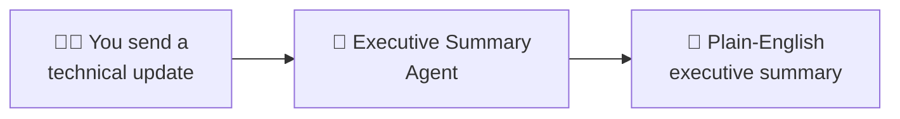

# Modulis 0 - Įvadas

⏱️ ~10 min

> [!WARNING]
> **Peržiūra ir apribojimai:** [Talpinami agentai](https://learn.microsoft.com/azure/foundry/agents/concepts/hosted-agents) šiuo metu yra **viešoje peržiūroje** - nerekomenduojami gamybinėms apkrovoms. Atkreipkite dėmesį į šiuos dalykus:
> - **Palaikomų regionų skaičius ribotas** - prieš kuriant išteklius patikrinkite [regiono prieinamumą](https://learn.microsoft.com/azure/foundry/agents/concepts/hosted-agents#region-availability). Jei pasirenkate nepalaikomą regioną, diegimas nepavyks.
> - Paketas `agent-framework-foundry-hosting` yra ankstyvoje versijoje - API gali keistis tarp versijų.
> - Mastelio ribos: talpinami agentai palaiko 0–5 kopijas (įskaitant mastelio mažinimą iki nulio).
> - Kai kurios šio seminaro parodomos funkcijos gali keistis, kai paslauga pereis prie GA.

## Ką kursite

Šiame seminare kursite **„Paaiškink kaip vadovui“** agentą – talpinamą AI agentą, kuris paima sudėtingus techninius atnaujinimus ir perrašo juos paprastais anglų kalbos vadovo santraukų tekstais.

**Agento naudojama:**
- **Microsoft Agent Framework** - agento logikai ir struktūrai
- **Foundry Toolkit for VS Code** - struktūravimui, lokaliam testavimui ir diegimui
- **AI modelis** (pvz., `gpt-4.1-mini/gpt-5-mini`) - santraukų generavimui

Baigę šią pamoką turėsite veikiantį agentą, kurį galėsite testuoti lokaliai naudodami Agent Inspector ili, jei norėsite, diegti į debesį.

---

## Kas yra talpinami agentai?

**Talpinamas agentas** yra AI agentas, veikiantis kaip valdomas servisas Microsoft Foundry aplinkoje. Vietoj to, kad valdytumėte savo infrastruktūrą, jūs įpakuojate agento kodą konteineryje, o Foundry rūpinasi masteliu, talpinimu ir teikia jį per standartinį HTTP galinį tašką.

| Sąvoka | Ką tai reiškia |
|---------|--------------|
| **Agentas** | Jūsų Python kodas, kuris gauna vartotojo žinutę, kviečia AI modelį ir grąžina struktūrizuotą atsakymą |
| **Talpinamas** | Foundry paleidžia jūsų konteinerį – be VM, Kubernetes ar infrastruktūros valdymo |
| **Atsakymų protokolas** | Standartinis HTTP API (`POST /responses`), kurį bet kuris klientas gali iškvieti bendraujant su agentu |
| **Agent Inspector** | Vietinė testavimo vartotojo sąsaja (įtraukta į Foundry Toolkit), leidžianti bendrauti su agentu prieš diegiant |

Šiame seminare pereisite nuo nulio iki visiškai talpinamo agente – arba sustosite ties vietiniu testavimu, jei pageidausite.

---

## Pasirinkite savo kelią

> ⚠️ **Pasirinkite vieną kelią prieš tęsdami.** Jūsų pasirinkimas nuspręs, kokias įrankių instaliacijas atlikti ir kokie moduliai taikomi. Vėliau galite persijungti iš B kelio į A kelią, jei įsigysite prenumeratą.

<strong>🅰️ A kelias – Azure debesys (reikia Azure prenumeratos)</strong>

| | Detalės |
|---|---|
| **Kam skirtas?** | Turite aktyvią Azure prenumeratą ir galite kurti Foundry išteklius |
| **Modelis** | Azure OpenAI per Foundry (pvz., `gpt-4.1-mini/gpt-5-mini`) |
| **Aprėpti moduliai** | Visi moduliai (00–07) |
| **Diegti į debesį?** | ✅ Taip – visiškas galutinis diegimas |

<strong>🅱️ B kelias – Vietinis / nemokamas lygis (nereikia Azure prenumeratos)</strong>

| | Detalės |
|---|---|
| **Kam skirtas?** | MVP, studentams ar tiems, kurie neturi Azure prieigos |
| **Modelis** | **Foundry Local** (nemokamas, veikia jūsų kompiuteryje) |
| **Aprėpti moduliai** | Moduliai 00–04 (nereikia diegimo ir debesų patikrinimo) |
| **Diegti į debesį?** | ❌ Ne – tik vietinis testavimas per Agent Inspector |

---

## Visiems keliams: reikalingi įrankiai

Įdiekite kiekvieną žemiau nurodytą įrankį. Po įdiegimo įsitikinkite, kad jis veikia, paleisdami patikrinimo komandą.

| # | Įrankis | Versija | Įdiegimas | Patikra (tikėtinas rezultatas) |
|---|---------|---------|---------|------------------------------|
| 1 | **Visual Studio Code** | Naujausia | [code.visualstudio.com](https://code.visualstudio.com/) | Atidaro be klaidų |
| 2 | **Python** | 3.12 ar naujesnė | [python.org/downloads](https://www.python.org/downloads/) | `python --version` $\rightarrow$ `Python 3.12.x` |
| 3 | **Foundry Toolkit for VS Code** | Naujausia | Plėtinio ID: `ms-windows-ai-studio.windows-ai-studio` | Foundry piktograma Veiklos juostoje |
| 4 | **Python plėtinys VS Code** | Naujausia | Plėtinio ID: `ms-python.python` | Įdiegtas Plėtinių skiltyje |

> [!TIP]
> **Įdiegimo patarimai:**
> - **Python PATH (Windows):** Visada pažymėkite **„Add Python to PATH“** pirmame Python diegimo ekrane. Be to, `python` terminale nebus atpažintas.
> - **Daug Python versijų:** Jei turite įdiegtus Python 3.10 ir 3.12, naudokite `python3.12 -m venv .venv`, kad virtualioje aplinkoje būtų naudojama teisinga versija.
> - **Docker WSL 2 (Windows):** Diegdami Docker Desktop, įsitikinkite, kad pažymėtas **WSL 2 backend**. Docker su Hyper-V veikia lėčiau ir gali sukelti problemų su Foundry konteinerio kūrimu.
> - **Docker nesikuria?** Palaukite 30–60 sekundžių po Docker Desktop paleidimo. Paleiskite `docker info` - jei matote „Cannot connect to the Docker daemon,“ Docker dar iniciuojamas.
> - **VS Code plėtiniai nesikrauna?** Po plėtinių diegimo perkraukite langą: `Ctrl+Shift+P` → `Developer: Reload Window`.

> **Windows naudotojams:** Patikrinkite **„Add Python to PATH“** diegiant Python.

**Toliau:** [01 - Paruošimas →](01-setup.md)

---

<!-- CO-OP TRANSLATOR DISCLAIMER START -->
**Atsakomybės apribojimas**:
Šis dokumentas buvo išverstas naudojant dirbtinio intelekto vertimo paslaugą [Co-op Translator](https://github.com/Azure/co-op-translator). Nors siekiame tikslumo, prašome atkreipti dėmesį, kad automatiniai vertimai gali turėti klaidų ar netikslumų. Originalus dokumentas jo gimtąja kalba laikomas autoritetingu šaltiniu. Svarbiai informacijai rekomenduojama naudoti profesionalų žmogiškąjį vertimą. Mes neatsakome už jokius nesusipratimus ar neteisingą interpretaciją, kilusią naudojantis šiuo vertimu.
<!-- CO-OP TRANSLATOR DISCLAIMER END -->