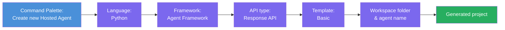
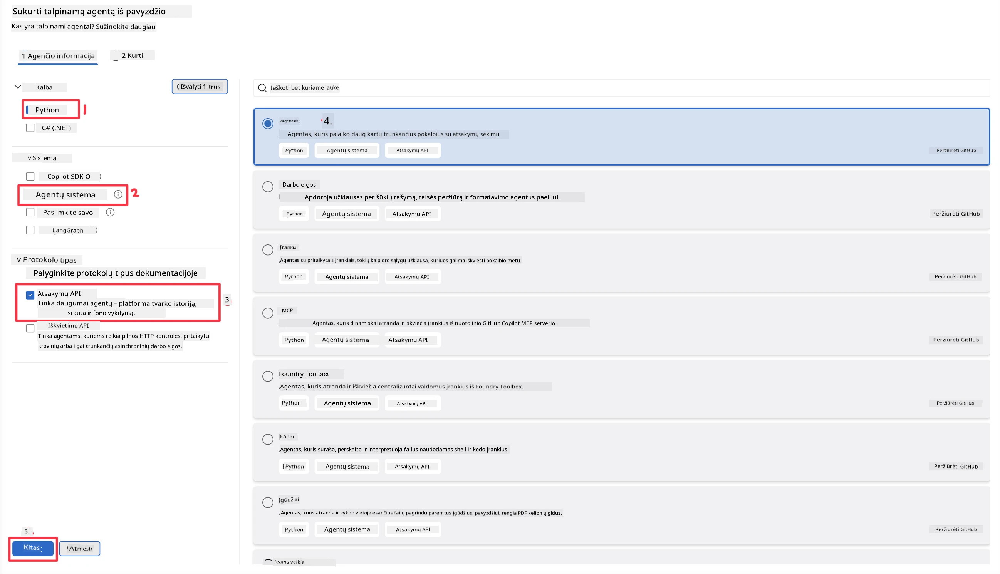
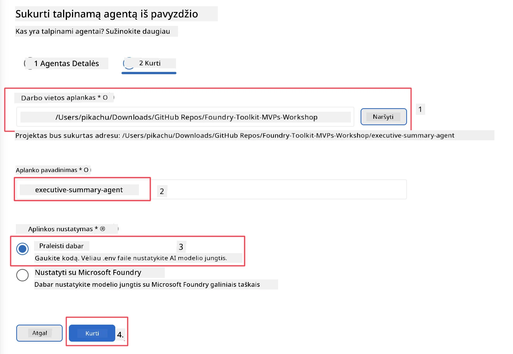

# 2 modulis - Naujo talpinamo agento kūrimas

⏱️ ~5 min

Šiame modulyje naudojate Foundry Toolkit, kad **sukurtumėte talpinamo agento projektą**. Šis karkasas sugeneruoja visą projekto struktūrą - `agent.yaml`, `main.py`, `Dockerfile`, `requirements.txt` ir VS Code derinimo konfigūraciją - kad galėtumėte susitelkti į agento elgesio pritaikymą.

> **Pagrindinė sąvoka:** Šioje laboratorijoje `agent/` aplankas yra pavyzdys, ką sugeneruoja Foundry Toolkit. Jūsų nereikia rašyti šių failų nuo nulio.

### Karkaso vedlio eiga



---

## 1 žingsnis: Atidarykite Create Hosted Agent vedlį

1. Paspauskite `Ctrl+Shift+P`, kad atidarytumėte **Command Palette**.
2. Įveskite: **Foundry Toolkit: Create new Hosted Agent** ir pasirinkite.

> **Alternatyva: Kurti per Foundry Portalą**
> Jei labiau norite naudoti naršyklę, galite sukurti projektą [https://ai.azure.com](https://ai.azure.com). Kai projektas bus paruoštas, grįžkite į VS Code ir naudokite **Foundry Toolkit** šoninę juostą, kad prisijungtumėte prie jo.

> **Alternatyva:** Foundry Toolkit šoninėje juostoje užveskite pelės žymeklį ant **Agents** po savo projektu, spustelėkite **+** ikoną, tada pasirinkite **Create in Code With Template**.

## 2 žingsnis: Pasirinkite nustatymus



1. Kairėje navigacijos/pasirinkimų skiltyje pasirinkite šiuos:

| Meniu | Pasirinkimas | Pastabos |
|--------|-----------|-------|
| **Kalba** | Python | Taip pat palaikomas C# |
| **Framework** | Agent Framework | Paprastas pradžios taškas naudojant Agent Framework SDK |
| **API tipas** | Response API | `POST /responses` - pokalbinis, su platformos valdomu istorijos palaikymu |
| **Šablonas** | Basic | Paprastas pradžios taškas naudojant Agent Framework SDK |

2. Pasirinkę spustelėkite **Next**



3. Kitame lange pasirinkite:

| Meniu | Pasirinkimas | Pastabos |
|--------|-----------|-------|
| **Darbo aplanko vieta** | Pasirinkite tikslinį aplanką | pvz., `/workspace/Foundry_Toolkit_for_VSCode_Lab/` arba poaplankis šiame repozitorijoje |
| **Agento pavadinimas** | Įveskite vardą | pvz., `executive-summary-agent` |
| **Aplinka Setup** | šiuo metu praleiskite nustatymą |  |

Spustelėkite **create**, kad sukurtumėte agentą. Bus sukurtas naujas aplankas su talpinamo agento pavadinimu.

## 3 žingsnis: Patikrinkite sugeneruotą projektą

Baigus karkaso generavimą, patikrinkite, ar matote šiuos failus Explorer lange (`Ctrl+Shift+E`):

```
📂 executive-summary-agent/
├── .env                ← Environment variables (placeholders)
├── .vscode/
│   ├── launch.json     ← Debug config (F5 → run + Agent Inspector)
│   └── tasks.json      ← VS Code task definitions
├── agent.yaml          ← Agent definition (kind: hosted)
├── Dockerfile          ← Container config for deployment
├── main.py             ← Agent entry point (your main code)
└── requirements.txt    ← Python dependencies
```

### Pagrindinių failų paaiškinimas

| Failas | Paskirtis |
|------|---------|
| `agent.yaml` | Deklaruoja agentą kaip `kind: hosted`, susieja aplinkos kintamuosius, apibrėžia `/responses` protokolą |
| `main.py` | Sukuria `FoundryChatClient` → įvynioja jį į `Agent` su instrukcijomis → serveriu aptarnauja per `ResponsesHostServer` prievadą 8088 |
| `Dockerfile` | Naudoja `python:3.12-slim`, įdiegia priklausomybes, atidaro 8088 prievadą, vykdo `main.py` |
| `requirements.txt` | `agent-framework-foundry`, `agent-framework-foundry-hosting`, `mcp`, `debugpy` |

> **Svarbu:** Atidarykite karkasuotą agento aplanką tiesiogiai VS Code (patį `agent/` aplanką), kad `.vscode/launch.json` ir `tasks.json` tinkamai veiktų F5 derinimui.

---

### ✅ Kontrolinis punktas

- [ ] Sukurtas karkasuotas projektas su visais reikalingais failais
- [ ] `agent.yaml` rodo `kind: hosted` ir `protocol: responses`
- [ ] `main.py` importuoja `Agent`, `FoundryChatClient`, `ResponsesHostServer`
- [ ] Agento aplankas atidarytas kaip darbo srities šaknis VS Code

---

**Ankstesnis:** [01 - Setup](01-setup.md) · **Toliau:** [03 - Konfigūruoti ir programuoti →](03-configure-and-code.md)

---

<!-- CO-OP TRANSLATOR DISCLAIMER START -->
**Atsakomybės apribojimas**:
Šis dokumentas buvo išverstas naudojant dirbtinio intelekto vertimo paslaugą [Co-op Translator](https://github.com/Azure/co-op-translator). Nors siekiame tikslumo, prašome atkreipti dėmesį, kad automatiniai vertimai gali turėti klaidų ar netikslumų. Originalus dokumentas jo gimtąja kalba laikomas autoritetingu šaltiniu. Svarbiai informacijai rekomenduojama naudoti profesionalų žmogiškąjį vertimą. Mes neatsakome už jokius nesusipratimus ar neteisingą interpretaciją, kilusią naudojantis šiuo vertimu.
<!-- CO-OP TRANSLATOR DISCLAIMER END -->