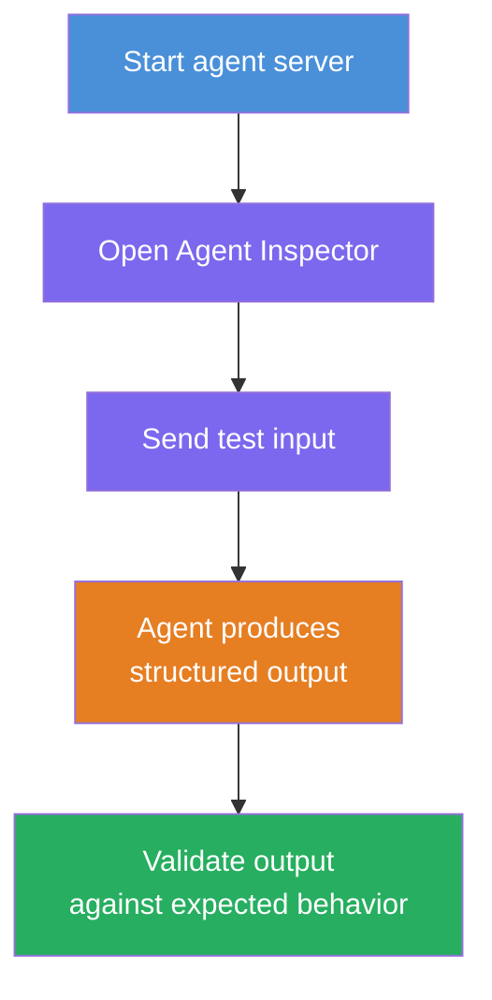
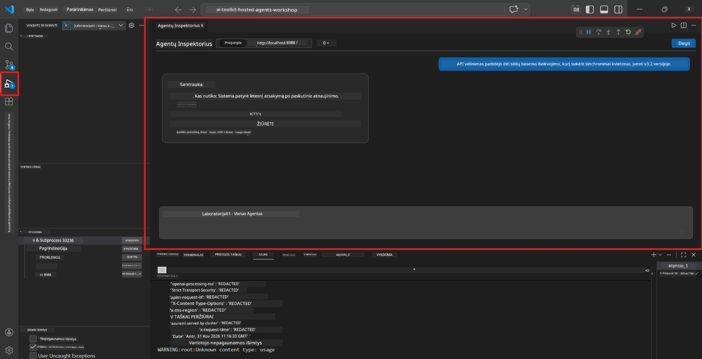
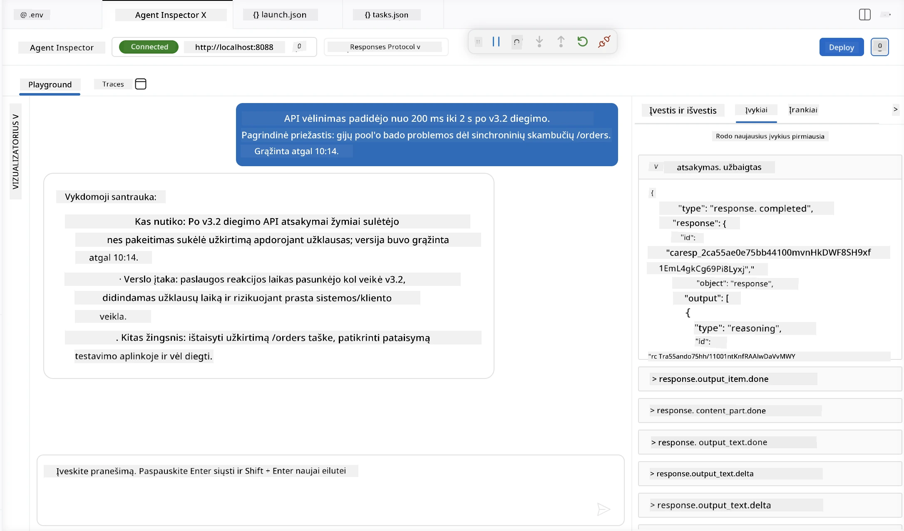

# 4 Modulis - Vietinis testavimas

⏱️ ~10 min

Šiame modulyje jūs vietoje paleisite savo agentą ir patikrinsite, ar jis veikia tinkamai, naudodami **sėkmingo kelio funkcinius testus**. Naudosite Agent Inspector (vizualią sąsają) arba tiesioginius HTTP skambučius, kad patvirtintumėte – agentas pateikia struktūrizuotus, tikslius atsakymus.

### Vietinio testavimo eiga



---

## 1 parinktis: Paspauskite F5 – derinkite naudodami Agent Inspector (rekomenduojama)

### Paleiskite derinimo įrankį

1. Atidarykite **executive-summary-agent/** katalogą tiesiogiai VS Code(`File → Open Folder`).
2. Atidarykite **Run and Debug** skydelį (`Ctrl+Shift+D`).
3. Išskleidžiamajame meniu pasirinkite **Debug Local Agent HTTP Server**.
4. Paspauskite **F5** (arba spustelėkite ▶ Pradėti derinimą).

> ⚠️ **Svarbu: Pasirinkite savo Python interpretatorių**
> Jei gaunate "ModuleNotFoundError" arba derintuvas neatsidaro, turite nurodyti VS Code naudoti savo virtualią aplinką:
  > 1. Paspauskite `Ctrl+Shift+P` $\rightarrow$ įveskite **Python: Select Interpreter**.
  > 2. Pasirinkite interpretatorių, esančią jūsų projekto `.venv` aplanke (pvz., `.\.venv\Scripts\python.exe` Windows sistemoje).
  > 3. Perkraukite derinimo sesiją.
> Jei vis dar gaunate klaidų, rankiniu būdu atnaujinkite savo failą `tasks.json` taip:
  > 1. Eikite į `.vscode/tasks.json` failą
  > 2. Suraskite užduotį pavadinimu: `Run Agent HTTP Server`
  > 3. Atnaujinkite komandos reikšmę taip:
  >    - **Windows:** `"value": "${workspaceFolder}/.venv/Scripts/python.exe",`
  >    - **macOS/Linux:** `"value": "${workspaceFolder}/.venv/bin/python",`

### Kas vyksta

1. HTTP serveris paleidžiamas adresu `http://localhost:8088/responses`.
2. Automatiškai atsidaro **Agent Inspector** skydelis – vizualinė pokalbių sąsaja testavimui.
3. Stabdymo taškai įjungiami `main.py`.

Stebėkite Terminalą:
```
Starting executive summary hosted agent
Executive agent server running on http://localhost:8088
```

> **Jei Agent Inspector neatsidaro:** Paspauskite `Ctrl+Shift+P` → **Foundry Toolkit: Open Agent Inspector**.



> *Ekrano nuotraukoje gali būti parodytas senesnis 'AI TOOLKIT' prekės ženklas iš ankstesnės plėtinio versijos.*

---

## 2 parinktis: Testavimas per terminalą (alternatyva)

Paleiskite agentą viename terminale, o užklausas siųskite iš kito:

```bash
# Terminal 1: Start agent
cd executive-summary-agent/
source .venv/bin/activate
python main.py
```

```bash
# Terminal 2: Send test (curl)
curl -sS -X POST http://localhost:8088/responses \
  -H "Content-Type: application/json" \
  -d '{"input": "The API latency increased due to thread pool exhaustion caused by sync calls in v3.2.", "stream": false}'
```

---

## Scenarijų testai: Sėkmingo kelio funkcijų patikra

Vykdykite **visus tris** žemiau pateiktus scenarijus. Jie patikrina, ar jūsų agentas pateikia teisingą, struktūruotą atsakymą realistiškiems įvestims.



### Scenarijus 1: IT incidentas – API delsos šuolis

**Įvestis:**
```
The API latency increased from 200ms to 2s after deploying v3.2.
Root cause: thread pool starvation from synchronous calls in /orders.
Rolled back at 10:14.
```

**Numatytas elgesys:**
- ✅ Laikosi "Executive Summary" struktūros (Kas nutiko / Verslo poveikis / Kitas žingsnis)
- ✅ Nenaudoja techninės terminijos (nėra "thread pool", "/orders", "v3.2")
- ✅ Aiškiai nurodo verslo poveikį (pvz., vartotojai patyrė delsą)
- ✅ Įtraukia kitą žingsnį (pvz., pataisa įdiegta, stebėjimas vykdomas)

---

### Scenarijus 2: Duomenų kanalas – ETL klaida

**Įvestis:**
```
The nightly ETL job failed because the upstream schema changed. APAC dashboards show missing data.
```

**Numatytas elgesys:**
- ✅ Paprastai apibendrina duomenų atnaujinimo gedimą
- ✅ Paminėtas APAC informacinis skydelis poveikis
- ✅ Įtrauktas pataisymo kitas žingsnis
- ✅ NENAUDOJAMI terminai "ETL", "schema" ar kiti techniniai žodžiai

---

### Scenarijus 3: Saugumas – atskleisti prisijungimo duomenys

**Įvestis:**
```
Static analysis flagged a hardcoded secret in the repository.
The secret may have been exposed in commit history.
```

**Numatytas elgesys:**
- ✅ Aprašo prisijungimo/ saugumo problemą suprantamais žodžiais vadovybei
- ✅ Pabrėžia galimą riziką (neautorizuotas prieigos pavojus)
- ✅ Nurodo pataisymo veiksmą (prisijungimo duomenų keitimas, auditas)
- ✅ NENAUDOJA terminų kaip "statinė analizė", "įsipareigojimų istorija", "įrašyta tiesiogiai"

---

## Patikros kriterijai

Kiekvienam scenarijui patikrinkite:

| # | Kriterijus | Praėjimo sąlyga |
|---|----------|---------------|
| 1 | **Struktūra** | Atsakymas naudoja "Executive Summary" formatą su visais trim taškais |
| 2 | **Paprasta kalba** | Nėra techninės terminijos, kurios vadovas nesuprastų |
| 3 | **Tikslumas** | Santrauka atitinka įvestį – nėra išgalvotų detalių |
| 4 | **Trumpumas** | Atsakymas yra ne ilgesnis nei 100 žodžių |
| 5 | **Kitas žingsnis** | Aiškiai nurodytas veiksmas arba pasekmės mažinimas |

---

## Derinimo patarimai

| Problema | Sprendimas |
|-------|-----|
| Agentas neprasideda | Patikrinkite `.env` reikšmes, įsitikinkite, kad venv aktyvuotas, paleiskite `pip install -r requirements.txt` |
| Tuščias arba bendrinis atsakymas | Peržiūrėkite instrukcijas `main.py` – įsitikinkite, kad nurodytas atsakymo formatas |
| Atsakyme yra žargono | Sustiprinkite "pašalinti techninius terminus" taisykles instrukcijose |
| Agent Inspector neatidaromas | `Ctrl+Shift+P` → **Foundry Toolkit: Open Agent Inspector** |
| Modelio klaidos Terminale | Įsitikinkite, kad `AZURE_AI_MODEL_DEPLOYMENT_NAME` yra tikslus (atitinka raidžių dydį) |

---

### ✅ Kontrolinis taškas

- [ ] Agentas paleidžiamas lokaliai be klaidų
- [ ] Agent Inspector atsidaro ir rodo pokalbių sąsają (jei naudojate F5)
- [ ] **Scenarijus 1** (IT įvykis) – struktūruota Executive Summary, be žargonų
- [ ] **Scenarijus 2** (duomenų kanalas) – aktuali santrauka su verslo poveikiu
- [ ] **Scenarijus 3** (saugumo įspėjimas) – tinkama rizikos komunikacija
- [ ] Visi atsakymai atitinka apibrėžtą išvesties struktūrą

> **Išsaugokite savo atsakymus** (nukopijuokite arba ekrano nuotraukas) – jas palyginsite su debesies rezultatais 6 modulyje.

---

**Ankstesnis:** [03 - Konfigūruoti ir koduoti](03-configure-and-code.md) · **Kitas:** [05 - Diegti į Foundry →](05-deploy-to-foundry.md)

---

<!-- CO-OP TRANSLATOR DISCLAIMER START -->
**Atsakomybės apribojimas**:
Šis dokumentas buvo išverstas naudojant dirbtinio intelekto vertimo paslaugą [Co-op Translator](https://github.com/Azure/co-op-translator). Nors siekiame tikslumo, prašome atkreipti dėmesį, kad automatiniai vertimai gali turėti klaidų ar netikslumų. Originalus dokumentas jo gimtąja kalba laikomas autoritetingu šaltiniu. Svarbiai informacijai rekomenduojama naudoti profesionalų žmogiškąjį vertimą. Mes neatsakome už jokius nesusipratimus ar neteisingą interpretaciją, kilusią naudojantis šiuo vertimu.
<!-- CO-OP TRANSLATOR DISCLAIMER END -->