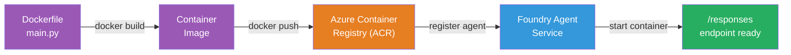
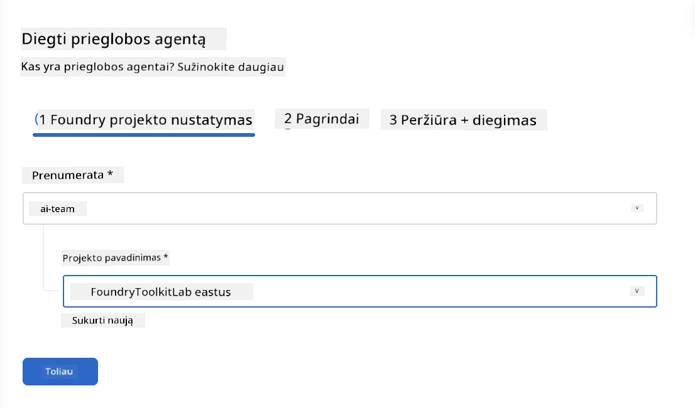
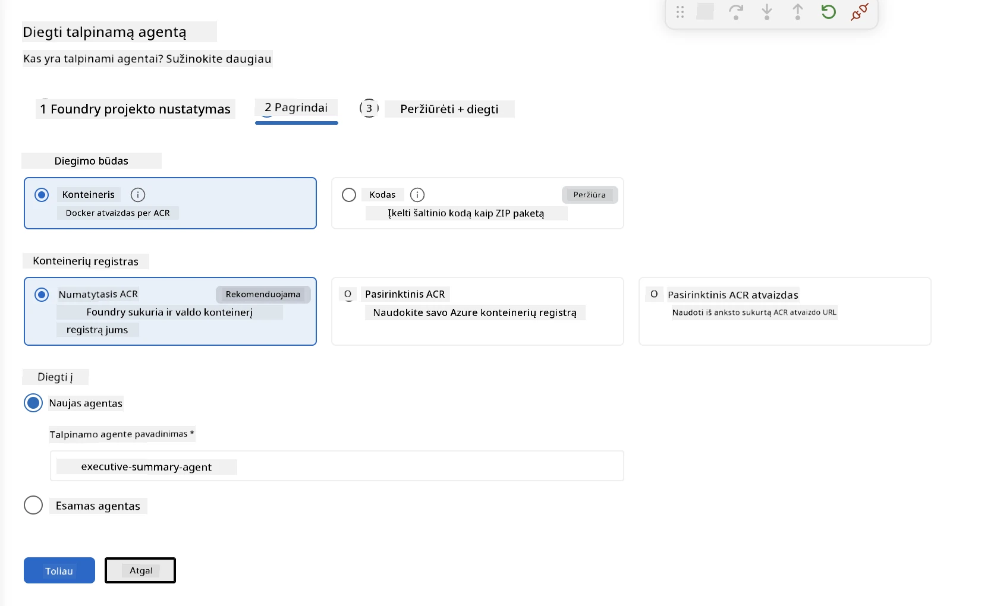
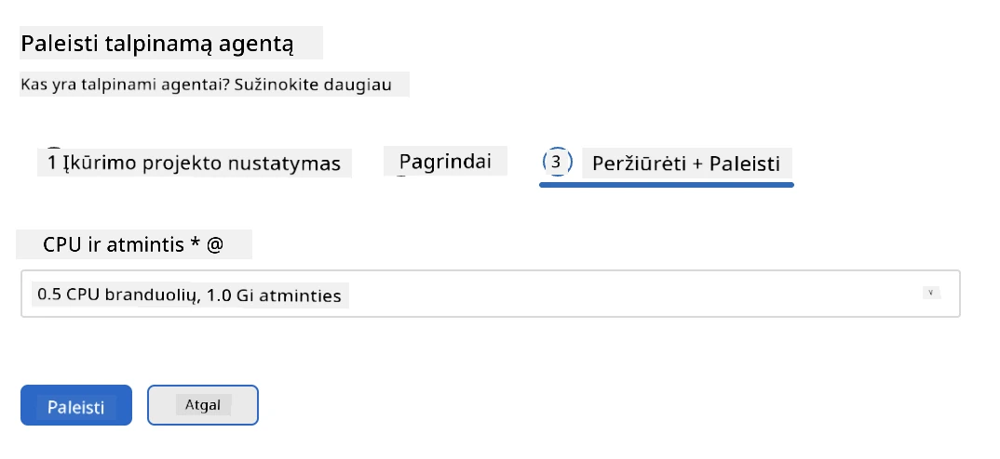
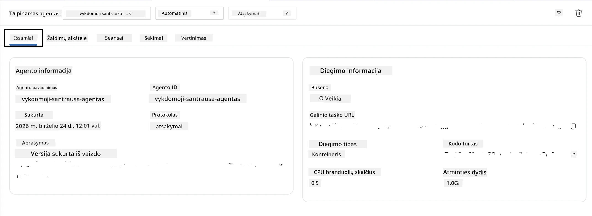

# 5 modulis - Diegimas į Foundry Agent Service

⏱️ ~10 min

> ⚠️ **B maršruto vartotojams:** Šiam moduliui reikalinga Foundry prenumerata. Jei naudojate Foundry Local, pereikite prie [7 modulio - Santrauka](07-summary.md). Jūs sėkmingai atlikote vietinio kūrimo darbo eigą!

Šiame modulyje įdiegiate savo vietoje patikrintą agentą į Microsoft Foundry kaip **Talpinamą Agentą**. Diegimo metu sukuriamas konteinerio vaizdas, įkeliama jį į Azure Container Registry ir agentas paleidžiamas Foundry valdomoje infrastruktūroje.

### Diegimo vamzdelis

---

## Reikalavimų patikra

Prieš diegdami įsitikinkite:

- [ ] Agentas praeina visus 3 vietinius scenarijus iš [4 modulio](04-test-locally.md)
- [ ] Jūs turite **Azure AI User** rolę projekte ([1 modulis, RBAC priskyrimas](01-setup.md#deploy-a-model--assign-rbac))
- [ ] Esate prisijungę prie Azure per VS Code (Paskyrų piktogramoje matomas jūsų vardas)

---

## 1 žingsnis: Pradėkite diegimą

### A variantas: Diegimas iš Agent Inspector (rekomenduojama)

Jei Agent Inspector langas atidarytas (iš testavimo):
1. Spustelėkite **Deploy** mygtuką viršutiniame dešiniajame kampe (debesies piktograma ↑).

### B variantas: Diegimas iš komandų paletės

1. Paspauskite `Ctrl+Shift+P` → **Foundry Toolkit: Deploy Hosted Agent**.

---

## 2 žingsnis: Konfigūruokite diegimą

Vedlys paprašys:

| Laukas | Pasirinkimas |
|--------|-------------|
| **Prenumerata** | Jūsų Azure prenumerata |
| **Tikslinis projektas** | Jūsų Foundry projektas (pvz., `workshop-agents`) |

Spustelėkite **next**, norėdami konfigūruoti agentą.

| Laukas | Pasirinkimas |
|--------|-------------|
| **Diegimo būdas** | Konteineris |
| **Konteinerių registras** | **Numatytasis ACR** (Microsoft Foundry sukuria ir valdo vieną už jus) |
| **Diegti į** | Naują agentą (pavadinimas, `executive-summary-agent`) |

Spustelėkite **next**, norėdami peržiūrėti ir diegti agentą.

| Laukas | Pasirinkimas |
|--------|-------------|
| **CPU ir atmintis** | **0.5 CPU branduoliai, 1.0 Gi atmintis** (numatytasis - pakanka dirbtuvėms) |

---

## 3 žingsnis: Diegimas ir stebėjimas

1. Spustelėkite **Deploy**.
2. Stebėkite **Output** skydelį (išskleidžiamajame sąraše pasirinkite **Microsoft Foundry**).
3. Diegimas vyksta per šiuos etapus:
   - **Docker build** - sukuria konteinerį iš jūsų Dockerfile
   - **Docker push** - įkelia vaizdą į ACR (pirmo diegimo metu trunka 1–3 min)
   - **Agent registracija** - sukuria talpinamą agentą Foundry
   - **Konteinerio paleidimas** - paleidžia su sistemos valdomu identitetu

4. Baigus, pasirodys pranešimas:
   > **executive-summary-agent yra sėkmingai įdiegtas.** `View logs` `Run agent`

5. Spustelėkite **Run agent**, kad atidarytumėte Agent Playground.

### Diegimo būsenos reikšmės

| Būsena | Reikšmė |
|--------|----------|
| **Running** | Konteineris paruoštas, agentas atsako |
| **Pending** | Konteineris paleidžiamas - palaukite 30–60 sekundžių |
| **Failed** | Patikrinkite žurnalus (žr. toliau trikčių šalinimą) |

---

## Dažnos diegimo klaidos

| Klaida | Pagrindinė priežastis | Sprendimas |
|--------|--------------------|----------|
| `agents/write` leidimas atmestas | Trūksta **Azure AI User** rolės projekte | [1 modulis, RBAC priskyrimas](01-setup.md#deploy-a-model--assign-rbac) |
| Docker neveikia | Docker Desktop nepradėtas | Paleiskite Docker Desktop → patikrinkite `docker info` |
| ACR autorizacija | Valdomas identitetas negali parsisiųsti vaizdo | Žr. [8 modulis - Trikčių šalinimas](08-troubleshooting.md) |

---

### ✅ Patikros taškas

- [ ] Diegimas užbaigtas be klaidų
- [ ] Agentas matomas **Hosted Agent** skirtuke, spustelėjus **Agents** jūsų projekte Foundry Toolkit šoninėje juostoje
- [ ] Konteineryje rodoma būsena **Running**
- [ ] Agent Playground skirtukas atidarytas, rodantis agento duomenis ir galinio taško URL

---

**Ankstesnis:** [04 - Testavimas vietoje](04-test-locally.md) · **Kitas:** [06 - Patikrinimas Playground →](06-verify-in-playground.md)

---

<!-- CO-OP TRANSLATOR DISCLAIMER START -->
**Atsakomybės apribojimas**:
Šis dokumentas buvo išverstas naudojant dirbtinio intelekto vertimo paslaugą [Co-op Translator](https://github.com/Azure/co-op-translator). Nors siekiame tikslumo, prašome atkreipti dėmesį, kad automatiniai vertimai gali turėti klaidų ar netikslumų. Originalus dokumentas jo gimtąja kalba laikomas autoritetingu šaltiniu. Svarbiai informacijai rekomenduojama naudoti profesionalų žmogiškąjį vertimą. Mes neatsakome už jokius nesusipratimus ar neteisingą interpretaciją, kilusią naudojantis šiuo vertimu.
<!-- CO-OP TRANSLATOR DISCLAIMER END -->