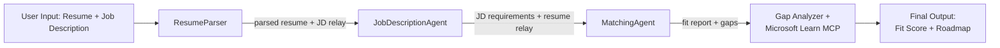

# PersonalCareerCopilot - Gyvenimo aprašymo → Darbo atitikties vertintojas

Darbo srauto pirmumo kelių agentų programa, kuri įvertina, kiek gerai gyvenimo aprašymas atitinka darbo aprašymą, tada generuoja asmeninę mokymosi kelių žemėlapį, kad užpildytų spragas.

---

## Agentai

| Agentas | Vaidmuo | Įrankiai |
|-------|------|-------|
| **ResumeParser** | Ištraukia struktūruotus įgūdžius, patirtį, sertifikatus iš gyvenimo aprašymo teksto | - |
| **JobDescriptionAgent** | Ištraukia reikiamus / pageidaujamus įgūdžius, patirtį, sertifikatus iš darbo aprašymo | - |
| **MatchingAgent** | Lygina profilį su reikalavimais → atitikties balas (0-100) + atitinkančius/trūkstamus įgūdžius | - |
| **GapAnalyzer** | Sudaro asmeninį mokymosi kelių žemėlapį su Microsoft Learn resursais | `search_microsoft_learn_for_plan` (MCP) |

## Darbo eiga



---

## Greitas startas

### 1. Paruoškite aplinką

Šis aplankas yra referencinė darbo eigos pagrindu sukurto Lab 02 karkaso implementacija. Jo `main.py` naudoja esamus užklausų blokus kartu su `WorkflowBuilder`, kad sujungtų keturis agentus.

```powershell
cd workshop\lab02-multi-agent\PersonalCareerCopilot
python -m venv .venv
.\.venv\Scripts\Activate.ps1          # Windows PowerShell
# source .venv/bin/activate            # macOS / Linux
pip install -r requirements.txt
```

### 2. Konfigūruokite kredencialus

Sukurkite `.env` failą šiame aplanke:

```powershell
copy .env .env.bak 2>$null; echo $null > .env
```

Redaguokite `.env`:

```env
FOUNDRY_PROJECT_ENDPOINT=https://<your-account>.services.ai.azure.com/api/projects/<your-project>
AZURE_AI_MODEL_DEPLOYMENT_NAME=gpt-4.1-mini
```

| Vertė | Kur rasti |
|-------|------------------|
| `FOUNDRY_PROJECT_ENDPOINT` | Foundry Toolkit šoninė juosta → dešiniuoju pelės klavišu spustelėkite savo projektą → **Kopijuoti projekto pabaigos tašką** |
| `AZURE_AI_MODEL_DEPLOYMENT_NAME` | Foundry šoninė juosta → išplėskite projektą → **Modeliai + pabaigos taškai** → diegimo pavadinimas |

### 3. Vykdykite vietoje

```powershell
python -m debugpy --listen 127.0.0.1:5679 main.py --port 8088
```

Arba naudokite VS Code užduotį: `Ctrl+Shift+P` → **Tasks: Run Task** → **Run Agent HTTP Server**.

F5 derinimui naudokite **Debug Local Agent HTTP Server**.

### 4. Testuokite su Agent Inspector

Atidarykite Agent Inspector: `Ctrl+Shift+P` → **Foundry Toolkit: Open Agent Inspector**.

Įklijuokite šią testinę užklausą:

```
Resume:
Jane Doe
Senior Software Engineer with 5 years of experience in Python, Django, and AWS.
Built microservices handling 10K+ requests/second. Led a team of 4 developers.
Certifications: AWS Solutions Architect Associate.
Education: B.S. Computer Science, State University.

Job Description:
Senior Cloud Engineer at Contoso Ltd.
Required: Python, Azure, Kubernetes, Terraform, CI/CD pipelines.
Preferred: Go, monitoring (Prometheus/Grafana), cost optimization.
Experience: 5+ years in cloud infrastructure.
Certifications: Azure Solutions Architect Expert preferred.
```

**Laukiama:** atitikties balas (0-100), atitinkančių/trūkstamų įgūdžių sąrašas, ir asmeninė mokymosi kelių žemėlapis su Microsoft Learn URL.

### 5. Diegimas į Foundry

`Ctrl+Shift+P` → **Foundry Toolkit: Deploy Hosted Agent** → pasirinkite savo projektą → patvirtinkite.

---

## Projekto struktūra

```
PersonalCareerCopilot/
├── .env                ← Your credentials (git-ignored)
├── agent.yaml          ← Hosted agent definition (name, resources, env vars)
├── Dockerfile          ← Container image for Foundry deployment
├── main.py             ← 4-agent workflow (instructions, MCP tool, WorkflowBuilder)
└── requirements.txt    ← Python dependencies
```

## Svarbūs failai

### `agent.yaml`

Apibrėžia prižiūrimą agentą Foundry Agent Service:
- `kind: hosted` - veikia kaip valdomas konteineris
- `protocols` - `responses` protokolas su `version: 2.0.0`, atveriantis `/responses` HTTP pabaigos tašką
- `environment_variables` - `AZURE_AI_MODEL_DEPLOYMENT_NAME` deklaruotas čia; `FOUNDRY_PROJECT_ENDPOINT` automatiškai įjungiama diegimo metu

### `main.py`

Turinys:
- **Agentų instrukcijos** - keturi `*_INSTRUCTIONS` konstantos, po vieną kiekvienam agentui
- **MCP įrankis** - `search_microsoft_learn_for_plan()` kviečia `https://learn.microsoft.com/api/mcp` per Streamable HTTP
- **Agentų kūrimas** - keturios `Agent()` + `AgentExecutor()` instancijos, dalijamos vieno `FoundryChatClient`
- **Darbo eigos grafas** - `WorkflowBuilder` sujungia agentus kaip nuoseklią grandinę: ResumeParser → JD Agent → MatchingAgent → GapAnalyzer
- **Serverio paleidimas** - `ResponsesHostServer` veikia 8088 porto numeriu

### `requirements.txt`

| Paketas | Paskirtis |
|---------|----------|
| `agent-framework-foundry` | Pagrindinis vykdymas: `Agent`, `AgentExecutor`, `WorkflowBuilder`, `@tool`, `FoundryChatClient` |
| `agent-framework-foundry-hosting` | `ResponsesHostServer` + Foundry talpinimo integracija |
| `mcp<2,>=1.24.0` | MCP klientas GapAnalyzer (`streamable_http_client`) |
| `debugpy` | Python derinimas (F5 VS Code) |

---

## Trikčių šalinimas

| Problema | Sprendimas |
|-------|-----|
| `KeyError: 'FOUNDRY_PROJECT_ENDPOINT'` arba `KeyError: 'AZURE_AI_MODEL_DEPLOYMENT_NAME'` | Sukurkite `.env` su abiem `FOUNDRY_PROJECT_ENDPOINT` ir `AZURE_AI_MODEL_DEPLOYMENT_NAME` nustatymais |
| `ModuleNotFoundError: No module named 'agent_framework'` | Aktyvuokite venv ir paleiskite `pip install -r requirements.txt` |
| Microsoft Learn URL nerodomi išvestyje | Patikrinkite interneto ryšį su `https://learn.microsoft.com/api/mcp` |
| Tik 1 spragos kortelė (sutrumpinta) | Įsitikinkite, kad `GAP_ANALYZER_INSTRUCTIONS` apima `CRITICAL:` bloką |
| Portas 8088 užimtas | Sustabdykite kitus serverius: `netstat -ano \| findstr :8088` |

Daugiau trikčių šalinimo informacijos rasite [8 modulyje - trikčių šalinimas](../docs/08-troubleshooting.md).

---

**Pilnas vadovas:** [Lab 02 dokumentacija](../docs/README.md) · **Atgal į:** [Lab 02 README](../README.md) · [Dirbtuvių pradžia](../../../README.md)

---

<!-- CO-OP TRANSLATOR DISCLAIMER START -->
**Atsakomybės apribojimas**:
Šis dokumentas buvo išverstas naudojant dirbtinio intelekto vertimo paslaugą [Co-op Translator](https://github.com/Azure/co-op-translator). Nors siekiame tikslumo, prašome atkreipti dėmesį, kad automatiniai vertimai gali turėti klaidų ar netikslumų. Originalus dokumentas jo gimtąja kalba laikomas autoritetingu šaltiniu. Svarbiai informacijai rekomenduojama naudoti profesionalų žmogiškąjį vertimą. Mes neatsakome už jokius nesusipratimus ar neteisingą interpretaciją, kilusią naudojantis šiuo vertimu.
<!-- CO-OP TRANSLATOR DISCLAIMER END -->