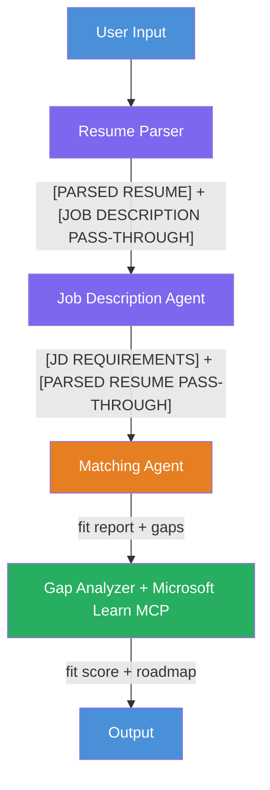

# Laboratorinis darbas 02 - Daugiaprogramis Darbo Srautas: gyvenimo aprašymas → darbo tinkamumo vertintojas

## Apžvalga

Šiame praktiniame laboratoriniame darbe sukursite **darbo srauto pagrindu veikiantį daugiaagentį programėlę** naudodami Foundry Toolkit VS Code aplinkoje ir ją paleisite Microsoft Foundry Agent Service.

**Ką kursite:** gyvenimo aprašymo → darbo tinkamumo vertintojas, kuris analizuoja gyvenimo aprašymą ir darbo aprašymą, įvertina jų atitikimą ir sudaro asmeninę mokymosi planą naudojant Microsoft Learn išteklius.

---

## Architektūra

**Kaip tai veikia:**
1. Vartotojas įklijuoja gyvenimo aprašymą ir darbo aprašymą.
2. **ResumeParser** analizuoja gyvenimo aprašymą ir pažodžiui kopijuoja darbo aprašymą į `[JOB DESCRIPTION PASS-THROUGH]` sekciją.
3. **JD Agent** ištraukia struktūruotus reikalavimus iš pernešimo, tada perduoda `[PARSED RESUME]` kaip `[PARSED RESUME PASS-THROUGH]`.
4. **MatchingAgent** lygina `[PARSED RESUME PASS-THROUGH]` su `[JD REQUIREMENTS]` ir sukuria tinkamumo įvertinimą.
5. **GapAnalyzer** paverčia spragas į praktišką planą ir gauna tikrus Microsoft Learn nuorodas per MCP.

---

## Reikalavimai

Pirmiausia įvykdykite laboratorinį darbą 01:

- [Laboratorinis darbas 01 - Vienas agentas](../lab01-single-agent/README.md)

---

## 1 dalis: skaitykite modulius iš eilės

Visą mokymosi kelią rasite:

- [Laboratorinio darbo 2 dokumentai - Reikalavimai](docs/00-prerequisites.md)
- [Laboratorinio darbo 2 dokumentai - Pilnas mokymosi kelias](docs/README.md)
- [PersonalCareerCopilot vykdymo vadovas](PersonalCareerCopilot/README.md)

---

## 2 dalis: sukurkite ir išbandykite darbo srautą

1. Naudokite Foundry Toolkit vedlį, kad sukurtumėte darbo srauto pagrindu veikiantį projektą.
2. Nukopijuokite užklausų blokus ir darbo srauto schemą iš `PersonalCareerCopilot/main.py` į savo darbo aplinką.
3. Vietoje paleiskite su Agent Inspector ir patikrinkite visus keturis agentus bei MCP įrankį.
4. Jeigu vietinis testavimas sėkmingas, paleiskite agentą Foundry serveryje.

---

## Orkestracijos modeliai

Laboratorinis darbas 02 naudoja **sekinę dujotiekio grandinę**: kiekvieno agentei išvestis tiekiama kitam, o darbo srautas grąžina paskutinio agentei atsakymą. Du modeliai tai užtikrina:

- **Sekinė grandinė** - `WorkflowBuilder` jungia ResumeParser → JD Agent → MatchingAgent → GapAnalyzer su vienu `add_edge()` kvietimu kiekviename žingsnyje
- **Turinio perdavimas** - kadangi kiekvienas agentas mato tik ankstesnio agento išvestį, ResumeParser ir JD Agent kopijuoja duomenis į žymėtas pernešimo sekcijas, kurių reikia tolesniems agentams

Dokumentai taip pat paaiškina, kodėl laboratorinis darbas nenaudoja daugiašakio išskirstymo/sujungimo ir kaip pridėti dar vieną agentą į schemą.

Žr. [docs/04-orchestration-patterns.md](docs/04-orchestration-patterns.md).

---

**Ankstesnis:** [Laboratorinis darbas 01 - Vienas agentas](../lab01-single-agent/README.md) · **Atgal į:** [Dirbtuvių pradžia](../../README.md)

---

<!-- CO-OP TRANSLATOR DISCLAIMER START -->
**Atsakomybės apribojimas**:
Šis dokumentas buvo išverstas naudojant dirbtinio intelekto vertimo paslaugą [Co-op Translator](https://github.com/Azure/co-op-translator). Nors siekiame tikslumo, prašome atkreipti dėmesį, kad automatiniai vertimai gali turėti klaidų ar netikslumų. Originalus dokumentas jo gimtąja kalba laikomas autoritetingu šaltiniu. Svarbiai informacijai rekomenduojama naudoti profesionalų žmogiškąjį vertimą. Mes neatsakome už jokius nesusipratimus ar neteisingą interpretaciją, kilusią naudojantis šiuo vertimu.
<!-- CO-OP TRANSLATOR DISCLAIMER END -->