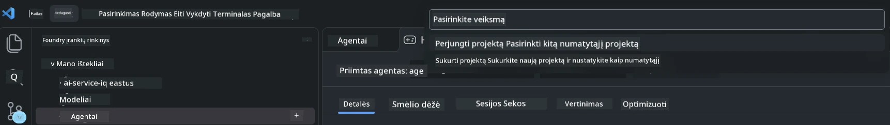

# Modulis 0 - Įvadas

⏱️ ~10 min

> [!WARNING]
> **Peržiūra ir apribojimai:** [Hosted Agents](https://learn.microsoft.com/azure/foundry/agents/concepts/hosted-agents) šiuo metu yra **viešoje peržiūroje** – nerekomenduojama naudoti gamybinėms užduotims. Kai kurios šio mokymo dirbtuvės funkcijos gali pasikeisti, kai paslauga pereis prie GA.

## Ką kursite

Šiame laboratoriniame darbe išplėsite vieno agente įgūdžius iš 01 laboratorijos ir kursite **daugiagentinį darbo eigą** – CV → Darbo tinkamumo vertintuvą.

Jūs įklijuojate **CV** ir **darbo aprašymą**. Keturi specializuoti agentai apdoroja įvestį paeiliui, tuomet pateikia:
- Tinkamumo balą (0–100 su balų išskaidymu)
- Įgūdžių ir sertifikatų trūkumo sąrašą
- Asmeninę mokymosi planą su realiais Microsoft Learn nuorodomis kiekvienam trūkumui

**Darbo eiga naudoja:**
- **Microsoft Agent Framework** - `WorkflowBuilder` sekančiai kanalo orkestracijai
- **Foundry Toolkit for VS Code** - karkaso kūrimui, vietiniam testavimui, diegimui
- **AI modelį** (pvz., `gpt-4.1-mini`) – visų keturių agentų naudotą
- **Microsoft Learn MCP serverį** – teikia realias mokymosi išteklių nuorodas kiekvienam įgūdžių trūkumui

---

## Pasirinkite savo kelią

> ⚠️ **Tęskite naudodami tą patį kelią, kurį naudojote 01 laboratorijoje.**

<details open>
<summary><strong>🅰️ Kelias A - Azure debesyje (reikalaujama Azure prenumeratos)</strong></summary>

| | Detalės |
|---|---|
| **Kam tai skirta?** | Jūs įvykdėte 01 laboratoriją naudodami Azure prenumeratą |
| **Modelis** | Azure OpenAI per Foundry (pvz., `gpt-4.1-mini`) |
| **Aprėpti moduliai** | Visi moduliai (00–09) |
| **Diegimas į debesis?** | ✅ Taip – pilnas end-to-end diegimas |

</details>

<details open>
<summary><strong>🅱️ Kelias B - Foundry Local (nereikia Azure prenumeratos)</strong></summary>

| | Detalės |
|---|---|
| **Kam tai skirta?** | Jūs įvykdėte 01 laboratoriją naudodami Foundry Local |
| **Modelis** | Foundry Local (nemokamas, veikia jūsų mašinoje) |
| **Aprėpti moduliai** | Moduliai 00–05 (praleiskite 06–07 - diegimas ir debesų patikra) |
| **Diegimas į debesis?** | ❌ Ne – tik vietinis testavimas per Agent Inspector |

</details>

---

## 01 laboratorijos patikra

02 laboratorija tiesiogiai remiasi 01 laboratorija. Pradėkite nuo 01 laboratorijos baigimo prieš čia pradėdami.

Dar nedarėte 01 laboratorijos? Pradėkite čia: [Lab 01 - Įvadas](../../lab01-single-agent/docs/00-prerequisites.md)

<details open>
<summary><strong>🅰️ Kelias A - Azure debesyje</strong></summary>

```powershell
az account show --query "{name:name, id:id}" --output table
```

Jei nepavyksta, paleiskite `az login`. Tada patikrinkite VS Code:

1. `Ctrl+Shift+P` → įveskite **Foundry Toolkit** → patvirtinkite, kad komandos matomos.
2. Spustelėkite **Foundry Toolkit** piktogramą → jūsų projektas ir įdiegta modelis rodomi kaip **Atlikta**.



> **RBAC:** Jūs priskyrėte **Foundry User** 01 laboratorijoje. Jei reikia priskirti iš naujo, žiūrėkite [01 laboratorija, Modulis 1](../../lab01-single-agent/docs/01-setup.md#deploy-a-model--assign-rbac). Anksčiau rolė vadinosi **Azure AI User** – tos pačios teisės.

</details>

<details open>
<summary><strong>🅱️ Kelias B - Foundry Local</strong></summary>

```powershell
Invoke-WebRequest -Uri "http://localhost:5273/v1/health" -UseBasicParsing | Select-Object StatusCode
```

Tikėtina: `StatusCode: 200`. Jei ne, paleiskite Foundry Local iš naujo per Foundry Toolkit šoninę juostą.

> Visa inferencija vyksta jūsų mašinoje. Vienintelis išėjimas – MCP įrankis į `https://learn.microsoft.com/api/mcp`.

</details>

---

## Kas naujo 02 laboratorijoje

| | 01 laboratorija | 02 laboratorija |
|--|--------|--------|
| Agentai | 1 | 4 (susieti su WorkflowBuilder) |
| Karkaso šablonas | Pagrindinis - Agent Framework | Darbo eigos - Agent Framework |
| Nauja paketas | - | `mcp` |
| Orkestracija | Vienas pokalbis agentas | Sekanti kanalo eiga (WorkflowBuilder) |
| Naujas įrankis | - | `search_microsoft_learn_for_plan` (MCP) |

---

**Toliau:** [01 - Suprasti architektūrą →](01-understand-multi-agent.md)

---

<!-- CO-OP TRANSLATOR DISCLAIMER START -->
**Atsakomybės apribojimas**:
Šis dokumentas buvo išverstas naudojant dirbtinio intelekto vertimo paslaugą [Co-op Translator](https://github.com/Azure/co-op-translator). Nors siekiame tikslumo, prašome atkreipti dėmesį, kad automatiniai vertimai gali turėti klaidų ar netikslumų. Originalus dokumentas jo gimtąja kalba laikomas autoritetingu šaltiniu. Svarbiai informacijai rekomenduojama naudoti profesionalų žmogiškąjį vertimą. Mes neatsakome už jokius nesusipratimus ar neteisingą interpretaciją, kilusią naudojantis šiuo vertimu.
<!-- CO-OP TRANSLATOR DISCLAIMER END -->