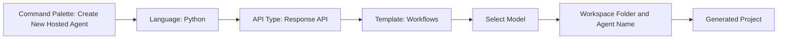

# Modulis 2 - Daugiaagentinio projekto karkaso sukūrimas

⏱️ ~5 min

Šiame modulyje jūs naudojate [Foundry Toolkit for VS Code](https://aka.ms/foundrytk) kad **sukurtumėte daugiaagentinį projektą**. Vedlys sugeneruoja `agent.yaml`, `main.py`, `Dockerfile`, `requirements.txt`, `.env`, ir VS Code derinimo konfigūraciją - kad galėtumėte susitelkti į 4-agentų darbo eigos sujungimą 3 modulyje.

> **Pagrindinė sąvoka:** Karkasas yra veikiantis šablonas su vienu agentu. Jūs pakeisite laikinojo sprendinio logiką su `WorkflowBuilder` grafu Modulyje 3. Jums nereikia rašyti šablono nuo nulio.

> **Atlikimo pavyzdys:** [`PersonalCareerCopilot/`](../../../../../workshop/lab02-multi-agent/PersonalCareerCopilot) yra pilnas veikiantis pavyzdys. Naudokite jį, kad palygintumėte savo darbą.

### Karkaso vedlio eiga



---

## 1 žingsnis: Atidarykite Create Hosted Agent vedlį

1. Paspauskite `Ctrl+Shift+P`, kad atidarytumėte **Command Palette**.
2. Įveskite: **Foundry Toolkit: Create a New Hosted Agent** ir pasirinkite jį.
3. Vedlys atsidarys skirtuke **Agent Details**.

> **Alternatyva:** Spustelėkite **Foundry Toolkit** piktogramą Activity Bar → spustelėkite **+** šalia **Hosted Agents** → **Create New Hosted Agent**.

---

## 2 žingsnis: Pasirinkite nustatymus


1. Kairėje naršymo/parinkčių srityje pasirinkite šiuos parametrus:

| Meniu | Pasirinkimas | Pastabos |
|--------|-----------|-------|
| **Language** | Python | C# (.NET) taip pat palaikomas |
| **Framework** | Agent Framework | Teikia `Agent`, `AgentExecutor`, `WorkflowBuilder` |
| **API type** | Response API | `POST /responses` – platformos valdoma istorija, srautinis palaikymas |
| **Template** | **Workflows** | Apdoroja užklausas per kelis agentus paeiliui |

2. Kai pasirinkta, spustelėkite **Next**


3. Kitame lange pasirinkite šiuos parametrus:

| Meniu | Pasirinkimas | Pastabos |
|--------|-----------|-------|
| **Workspace folder** | Naršykite iki tikslo aplanko | pvz., `workshop/lab02-multi-agent/` šiame repo |
| **Agent name** | `PersonalCareerCopilot` | Tai taps projekto katalogo pavadinimu |
| **Model Deployment** | Pasirinkite savo išdiegtą modelį | pvz., `gpt-4.1-mini` iš Lab 01 |

4. Spustelėkite **Create**, kad sukurtumėte projekto karkasą. VS Code sugeneruos failus ir atidarys aplanką.

> **Patarimas:** [`gpt-4.1-mini`](https://learn.microsoft.com/azure/foundry/foundry-models/concepts/models-sold-directly-by-azure#gpt-41-series) gerai subalansuoja greitį ir kokybę daugiaagentiniam vystymui.

---

## 3 žingsnis: Patikrinkite sugeneruotą projektą

Po karkaso sukūrimo, patikrinkite, ar matote šiuos failus Explorer (`Ctrl+Shift+E`):

```
📂 <your-agent-name>/
├── .azdignore          ← Files excluded from Azure Developer CLI deployments
├── .dockerignore       ← Files excluded from Docker builds
├── .env                ← Environment variables (placeholders - fill in Module 3)
├── .vscode/
│   ├── launch.json     ← Debug config (F5 → run + Agent Inspector)
│   └── tasks.json      ← VS Code task definitions
├── agent.yaml          ← Agent definition (kind: hosted, protocol: responses)
├── Dockerfile          ← Container config for deployment
├── main.py             ← Stub agent entry point (replace with WorkflowBuilder in Module 3)
└── requirements.txt    ← Python dependencies
```

> **Svarbu:** Atidarykite šį sugeneruotą aplanką tiesiogiai VS Code, kad `.vscode/launch.json` ir `tasks.json` teisingai galiojtų F5 derinimui.

### Pagrindinių failų paaiškinimai

| Failas | Paskirtis |
|------|---------|
| `agent.yaml` | Deklaruoja `kind: hosted`, mapuoja aplinkos kintamuosius, apibrėžia `/responses` protokolą |
| `main.py` | Šablonas: vienas `FoundryChatClient` → `Agent` → `ResponsesHostServer`. Tai pakeisite 4 agentais + `WorkflowBuilder` Modulyje 3 |
| `Dockerfile` | `python:3.12-slim`, įdiegia `requirements.txt`, atveria prievadą 8088, paleidžia `python main.py` |
| `requirements.txt` | `agent-framework-foundry`, `agent-framework-foundry-hosting`, `mcp<2,>=1.24.0`, `debugpy` |

> **Nuoroda:** Peržiūrėkite [`PersonalCareerCopilot/agent.yaml`](../../../../../workshop/lab02-multi-agent/PersonalCareerCopilot/agent.yaml) ir [`PersonalCareerCopilot/requirements.txt`](../../../../../workshop/lab02-multi-agent/PersonalCareerCopilot/requirements.txt) dėl pilno sugeneruoto turinio.

---

### ✅ Kontrolinis taškas

- [ ] Karkaso vedlys užbaigtas - naujas projekto aplankas matomas Explorer
- [ ] Visi tikėtini failai yra: `agent.yaml`, `main.py`, `Dockerfile`, `requirements.txt`, `.env`
- [ ] `agent.yaml` rodo `kind: hosted` ir `protocol: responses`
- [ ] `main.py` importuoja `Agent`, `FoundryChatClient`, `ResponsesHostServer`
- [ ] Karkasuotas aplankas atidarytas kaip VS Code darbo srities šaknis
- [ ] Suprantate, kad `main.py` yra šablonas - `WorkflowBuilder` bus pridėtas Modulyje 3

---

**Ankstesnis:** [01 - Suprasti daugiaagentę architektūrą](01-understand-multi-agent.md) · **Kitas:** [03 - Konfigūruoti agentus ir aplinką →](03-configure-agents.md)

---

<!-- CO-OP TRANSLATOR DISCLAIMER START -->
**Atsakomybės apribojimas**:
Šis dokumentas buvo išverstas naudojant dirbtinio intelekto vertimo paslaugą [Co-op Translator](https://github.com/Azure/co-op-translator). Nors siekiame tikslumo, prašome atkreipti dėmesį, kad automatiniai vertimai gali turėti klaidų ar netikslumų. Originalus dokumentas jo gimtąja kalba laikomas autoritetingu šaltiniu. Svarbiai informacijai rekomenduojama naudoti profesionalų žmogiškąjį vertimą. Mes neatsakome už jokius nesusipratimus ar neteisingą interpretaciją, kilusią naudojantis šiuo vertimu.
<!-- CO-OP TRANSLATOR DISCLAIMER END -->