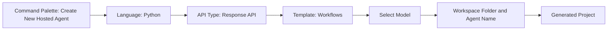
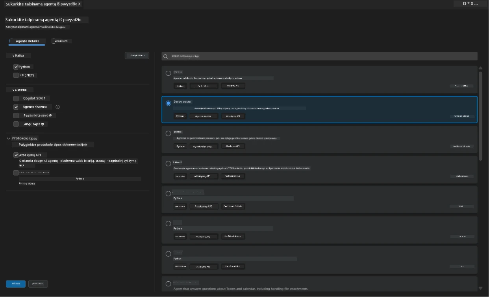
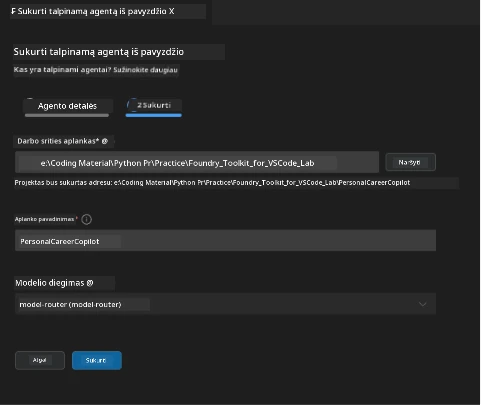

# Modulis 2 - Multi-agenčių projekto karkaso kūrimas

⏱️ ~5 min

Šiame modulyje naudojate [Foundry Toolkit for VS Code](https://aka.ms/foundrytk), kad **sukurtumėte multi-agenčių projekto karkasą**. Vedlys sugeneruoja `agent.yaml`, `main.py`, `Dockerfile`, `requirements.txt`, `.env` ir VS Code derinimo konfigūraciją – taip galite sutelkti dėmesį į 4-agentų darbo sekos jungimą 3 modulyje.

> **Pagrindinė koncepcija:** Karkasas yra veikiantis šablonas su vienu agentu. Jūs pakeičiate laikinojo kodo logiką `WorkflowBuilder` grafu 3 modulyje. Jums nereikia rašyti boilerplate nuo nulio.

> **Referencinė įgyvendinimo pavyzdys:** [`PersonalCareerCopilot/`](../../../../../workshop/lab02-multi-agent/PersonalCareerCopilot) yra pilnas veikiantis pavyzdys. Naudokite jį kaip palyginimą savo darbui.

### Vedlio kūrimo eiga



---

## 1 žingsnis: Atidarykite Create Hosted Agent vedlį

1. Paspauskite `Ctrl+Shift+P`, kad atidarytumėte **Command Palette**.
2. Įrašykite: **Foundry Toolkit: Create new Hosted Agent** ir pasirinkite ją.
3. Vedlys atsidarys skirtuke **Agent Details**.

> **Alternatyva:** Spustelėkite **Foundry Toolkit** piktogramą Activity Bar → spustelėkite **+** piktogramą prie **Hosted Agents** → **Create New Hosted Agent**.

---

## 2 žingsnis: Pasirinkite nustatymus



1. Kairėje navigacijos/ parinkčių srityje pasirinkite:

| Meniu | Pasirinkimas | Pastabos |
|--------|-----------|-------|
| **Kalba** | Python | Taip pat palaikomas C# (.NET) |
| **Sistema** | Agent Framework | Teikia `Agent`, `AgentExecutor`, `WorkflowBuilder` |
| **API tipas** | Response API | `POST /responses` – platformos valdoma istorija, srautinio perdavimo palaikymas |
| **Šablonas** | **Workflows** | Užklausas apdoroja per kelis agentus paeiliui |

2. Pasirinkus spustelėkite **Next**



3. Kitoje lange pasirinkite:

| Meniu | Pasirinkimas | Pastabos |
|--------|-----------|-------|
| **Darbo aplanko vieta** | Naršyti iki tikslinio aplanko | pavyzdžiui, `workshop/lab02-multi-agent/` šiame repozitorijoje |
| **Agentų pavadinimas** | `PersonalCareerCopilot` | Tai taps projekto katalogo pavadinimu |
| **Modelio diegimas** | Pasirinkite savo diegtą modelį | pavyzdžiui, `gpt-4.1-mini` iš 01 laboratorijos |

4. Spustelėkite **Create**, kad sukurtumėte projekto karkasą. VS Code sugeneruoja failus ir atidarys aplanką.

> **Patariama:** [`gpt-4.1-mini`](https://learn.microsoft.com/azure/foundry/foundry-models/concepts/models-sold-directly-by-azure#gpt-41-series) gerai balansuoja greitį ir kokybę multi-agenčių vystymui.

---

## 3 žingsnis: Apžvelkite sugeneruotą projektą

Po karkaso kūrimo pabaigos patikrinkite, ar tyrinėtojo lange (`Ctrl+Shift+E`) matomi šie failai:

```
📂 <your-agent-name>/
├── .azdignore          ← Files excluded from Azure Developer CLI deployments
├── .dockerignore       ← Files excluded from Docker builds
├── .env                ← Environment variables (placeholders - fill in Module 3)
├── .vscode/
│   ├── launch.json     ← Debug config (F5 → run + Agent Inspector)
│   └── tasks.json      ← VS Code task definitions
├── agent.yaml          ← Agent definition (kind: hosted, protocol: responses)
├── Dockerfile          ← Container config for deployment
├── main.py             ← Stub agent entry point (replace with WorkflowBuilder in Module 3)
└── requirements.txt    ← Python dependencies
```

> **Svarbu:** Atidarykite šį karkaso aplanką tiesiogiai VS Code, kad `.vscode/launch.json` ir `tasks.json` tinkamai veiktų F5 derinimui.

### Pagrindiniai failai paaiškinti

| Failas | Paskirtis |
|------|---------|
| `agent.yaml` | Deklaruoja `kind: hosted`, žemėlapiuoja aplinkos kintamuosius, apibrėžia `/responses` protokolą |
| `main.py` | Šablonas: vienas `FoundryChatClient` → `Agent` → `ResponsesHostServer`. Jūs pakeisite jį keturiais agentais + `WorkflowBuilder` 3 modulyje |
| `Dockerfile` | `python:3.12-slim`, įdiegia `requirements.txt`, atveria 8088 prievadą, vykdo `python main.py` |
| `requirements.txt` | `agent-framework-foundry`, `agent-framework-foundry-hosting`, `mcp<2,>=1.24.0`, `debugpy` |

> **Nuoroda:** Žr. [`PersonalCareerCopilot/agent.yaml`](../../../../../workshop/lab02-multi-agent/PersonalCareerCopilot/agent.yaml) ir [`PersonalCareerCopilot/requirements.txt`](../../../../../workshop/lab02-multi-agent/PersonalCareerCopilot/requirements.txt) pilną sugeneruotą turinį.

---

### ✅ Tikrinimo taškas

- [ ] Vedlys baigtas – naujas projekto aplankas matomas Tyrinėtojo lange
- [ ] Visi laukiamieji failai yra: `agent.yaml`, `main.py`, `Dockerfile`, `requirements.txt`, `.env`
- [ ] `agent.yaml` rodo `kind: hosted` ir `protocol: responses`
- [ ] `main.py` importuoja `Agent`, `FoundryChatClient`, `ResponsesHostServer`
- [ ] Karkaso aplankas atidarytas kaip VS Code darbo aplanko šaknis
- [ ] Suprantate, kad `main.py` yra šablonas – `WorkflowBuilder` bus pridėtas 3 modulyje

---

**Ankstesnis:** [01 - Suprasti multi-agenčių architektūrą](01-understand-multi-agent.md) · **Kitas:** [03 - Agentų ir aplinkos konfigūravimas →](03-configure-agents.md)

---

<!-- CO-OP TRANSLATOR DISCLAIMER START -->
**Atsakomybės apribojimas**:
Šis dokumentas buvo išverstas naudojant dirbtinio intelekto vertimo paslaugą [Co-op Translator](https://github.com/Azure/co-op-translator). Nors siekiame tikslumo, prašome atkreipti dėmesį, kad automatiniai vertimai gali turėti klaidų ar netikslumų. Originalus dokumentas jo gimtąja kalba laikomas autoritetingu šaltiniu. Svarbiai informacijai rekomenduojama naudoti profesionalų žmogiškąjį vertimą. Mes neatsakome už jokius nesusipratimus ar neteisingą interpretaciją, kilusią naudojantis šiuo vertimu.
<!-- CO-OP TRANSLATOR DISCLAIMER END -->