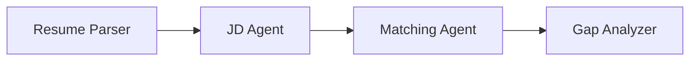
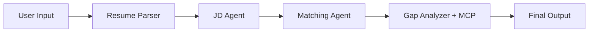

# Modulis 4 - Orkestracijos šablonai

⏱️ ~10 min

Šiame modulyje išmoksite apie orkestracijos šablonus, naudojamus Resume Job Fit Evaluator, taip pat kaip skaityti, keisti ir plėsti darbo srauto grafą. Šių šablonų supratimas yra būtinas, kad būtų galima derinti duomenų srauto problemas ir kurti savo [daugiapakopius darbo srautus](https://learn.microsoft.com/agent-framework/workflows/).

---

## Šablonas 1: Sekanti seka

Pagrindinis darbo srauto šablonas yra **sekanti seka** – kiekvieno agento išvestis tiesiogiai perduodama kitam.



Kode kiekvienas `add_edge()` kvietimas sukuria vieną žingsnį sekoje:

```python
.add_edge(resume_executor, jd_executor)       # ResumeParser output → JD Agent
.add_edge(jd_executor, matching_executor)     # JD Agent output → MatchingAgent
.add_edge(matching_executor, gap_executor)    # MatchingAgent output → GapAnalyzer
```

> **Kodėl sekanti, o ne išsiskleidžianti/sujungianti?** `WorkflowBuilder` naudoja **ARBA-semantiką** įeinančioms juostoms: žemyn srovės vykdytojas suveikia iš karto, kai tik **bet kuris** ankstesnysis yra baigtas. Jei `matching_executor` turėtų du įeinančius kelius (iš `resume_executor` ir `jd_executor`), jis paleistųsi du kartus – kai baigtų ResumeParser ir vėl, kai baigtų JD Agent – tai sukeltų GapAnalyzer veikimą du kartus ir išvestis pasirodytų du kartus. Sekanti eiga to visiškai išvengia.

## Šablonas 2: Turinio perdavimas

Kadangi `context_mode="last_agent"` reiškia, kad kiekvienas vykdytojas mato tik savo **tiesioginio pirmtako išvestį**, agentai sekanti seka turi aiškiai perduoti toliau bet kokius duomenis, kurių žemyn srovės agentai reikalauja.

Šiame darbo sraute:
- **ResumeParser** nukopijuoja JD tiksliai į `[JOB DESCRIPTION PASS-THROUGH]` (kad JD Agent galėtų jį rasti).
- **JD Agent** nukopijuoja `[PARSED RESUME]` tiksliai į `[PARSED RESUME PASS-THROUGH]` (kad MatchingAgent galėtų palyginti abu profilius).

```
ResumeParser output
└─ [PARSED RESUME]               ← extracted by JD Agent
└─ [JOB DESCRIPTION PASS-THROUGH] ← extracted by JD Agent

JD Agent output
└─ [JD REQUIREMENTS]             ← extracted by MatchingAgent
└─ [PARSED RESUME PASS-THROUGH]  ← extracted by MatchingAgent
```

Kiekvieną perdavimo dalį turi būti nukopijuota **tiksliai** – jos santrauka ar parafrazavimas sulaužytų žemyn sraute esančio agento veikimą.

---

## Pilnas grafas

Sujungus sekanti seka ir turinio perdavimo šablonus gaunamas pilnas darbo srautas:



Agentų inspektorius rodo tą pačią grafikos struktūrą, kai agentas veikia lokaliai. Žr. [Modulis 5 - Testavimas lokaliai](05-test-locally.md) ekrano nuotraukas.

---

## Darbo srauto kūrėjo kodo skaitymas

Darbo srauto grafas sukuriamas `main()` funkcijoje [`PersonalCareerCopilot/main.py`](../../../../../workshop/lab02-multi-agent/PersonalCareerCopilot/main.py). trys `add_edge()` kvietimai sukuria sekanti seką:

| # | Kraštas | Poveikis |
|---|---------|---------|
| 1 | `resume_executor → jd_executor` | JD Agent gauna `[PARSED RESUME]` + `[JOB DESCRIPTION PASS-THROUGH]` |
| 2 | `jd_executor → matching_executor` | MatchingAgent gauna `[JD REQUIREMENTS]` + `[PARSED RESUME PASS-THROUGH]` |
| 3 | `matching_executor → gap_executor` | GapAnalyzer gauna atitikties ataskaitą + spragų sąrašą |

---

## Grafo keitimas

### Naujo agente pridėjimas

Norint pridėti penktą agentą (pvz., **InterviewPrepAgent** po GapAnalyzer):

1. Apibrėžkite `INTERVIEW_PREP_INSTRUCTIONS` konstantą.
2. Sukurkite `Agent` + `AgentExecutor` objektus (taip pat, kaip ir keturi esami).
3. Įtraukite `.add_edge(gap_executor, interview_exec)` į `WorkflowBuilder`.
4. Atnaujinkite `output_executors=[interview_exec]`.

> **Svarbu:** `start_executor` yra vienintelis agentas, kuris gauna žalią naudotojo įvestį. Visi kiti agentai gauna išvestį iš savo aukštesnio lygio krašto.

---

## Dažnos grafo klaidos

| Klaida | Simptomas | Sprendimas |
|---------|---------|------------|
| Trūksta krašto iki `output_executors` | Agentas veikia, bet išvestis tuščia | Užtikrinkite, kad būtų kelias nuo `start_executor` iki kiekvieno agento `output_executors` |
| Ciklinė priklausomybė | Begalinis ciklas arba užlaikymas | Patikrinkite, ar agentas negrįžta atgal aukštesnio lygio agentui |
| Agentas `output_executors` be įeinančio krašto | Tuščia išvestis | Pridėkite bent vieną `add_edge(source, that_agent)` |
| Keli `output_executors` be fan-in | Išvestyje yra tik vieno agento atsakas | Naudokite vieną agentą išvestyje, kuris agreguoja, arba priimkite kelias išvestis |
| Trūksta `start_executor` | `ValueError` kūrimo metu | Visada nurodykite `start_executor` `WorkflowBuilder()` |

---

## Grafo derinimas

### Agentų inspektoriaus naudojimas

1. Paleiskite agentą lokaliai su F5.
2. Atidarykite Agentų inspektorių (`Ctrl+Shift+P` → **Foundry Toolkit: Open Agent Inspector**).
3. Siųskite testinę žinutę.
4. Inspektoriaus atsakymų srityje ieškokite **srautinių išvesčių** – jose rodoma kiekvieno agento indėlis sekose.


### Registracijos (logging) naudojimas

Pridėkite registraciją prie `main.py`, kad atsektumėte duomenų srautą:

```python
import logging
logger = logging.getLogger("resume-job-fit")

# In main(), after building the workflow:
logger.info("Workflow graph built with edges: RP→JD, JD→MA, MA→GA")
```

Serverio žurnaluose matomas agento vykdymo tvarkos ir MCP įrankių kvietimai:

```
INFO:agent_framework:Executing agent: ResumeParser
INFO:agent_framework:Executing agent: JobDescriptionAgent
INFO:agent_framework:Executing agent: MatchingAgent
INFO:agent_framework:Executing agent: GapAnalyzer
INFO:agent_framework:Tool call: search_microsoft_learn_for_plan(skill="Kubernetes")
POST https://learn.microsoft.com/api/mcp → 200
INFO:agent_framework:Tool call: search_microsoft_learn_for_plan(skill="Terraform")
POST https://learn.microsoft.com/api/mcp → 200
```

---

### Patikros taškas

- [ ] Jūs galite atpažinti du orkestracijos šablonus darbo sraute: sekanti seka ir turinio perdavimas
- [ ] Suprantate, kodėl `context_mode="last_agent"` reikalauja aiškaus duomenų perdavimo tarp agentų
- [ ] Gebate skaityti `WorkflowBuilder` kodą ir susieti kiekvieną `add_edge()` kvietimą su matomu grafu
- [ ] Žinote, kaip pridėti naują agentą prie galo sekos
- [ ] Galite atpažinti dažnas grafo klaidas ir jų simptomus

---

**Ankstesnis:** [03 - Agentų ir aplinkos konfigūravimas](03-configure-agents.md) · **Kitas:** [05 - Testavimas lokaliai →](05-test-locally.md)

---

<!-- CO-OP TRANSLATOR DISCLAIMER START -->
**Atsakomybės apribojimas**:
Šis dokumentas buvo išverstas naudojant dirbtinio intelekto vertimo paslaugą [Co-op Translator](https://github.com/Azure/co-op-translator). Nors siekiame tikslumo, prašome atkreipti dėmesį, kad automatiniai vertimai gali turėti klaidų ar netikslumų. Originalus dokumentas jo gimtąja kalba laikomas autoritetingu šaltiniu. Svarbiai informacijai rekomenduojama naudoti profesionalų žmogiškąjį vertimą. Mes neatsakome už jokius nesusipratimus ar neteisingą interpretaciją, kilusią naudojantis šiuo vertimu.
<!-- CO-OP TRANSLATOR DISCLAIMER END -->