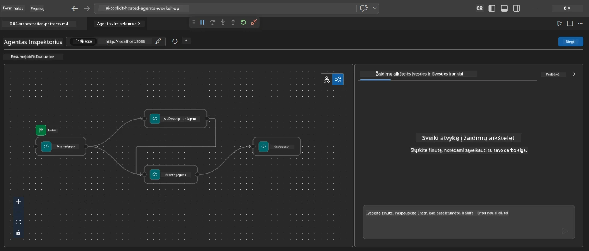
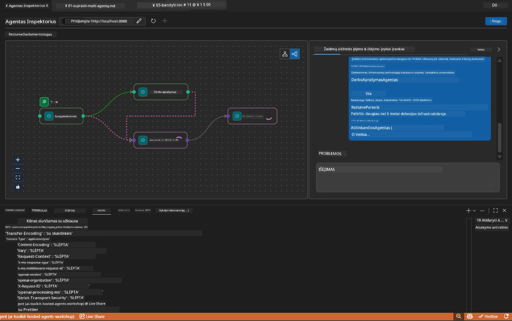
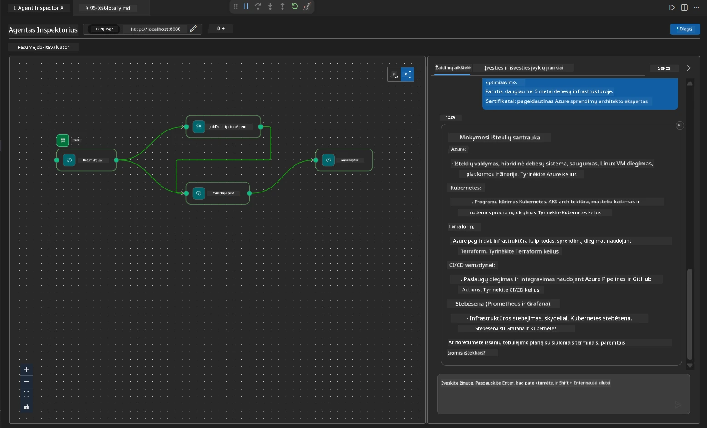

# 5 modulis - Vietinis testavimas

⏱️ ~15 min

Šiame modulyje jūs paleidžiate daugiaprogramių agentų darbo seką vietoje, testuojate ją su Agent Inspector ir patikrinkite, ar visi keturi agentai bei MCP įrankis veikia tinkamai prieš diegiant.

---

## 1 veiksmas: Paleiskite agentų serverį

### A parinktis: Naudojant VS Code užduotį (rekomenduojama)

1. Atidarykite `workshop/lab02-multi-agent/PersonalCareerCopilot/` kaip savo VS Code aplanką.
2. Paspauskite `Ctrl+Shift+P` → įveskite **Tasks: Run Task** → pasirinkite **Run Agent HTTP Server**.
3. Užduotis paleidžia serverį su debugpy pririštu prie prievado `5679` ir agentą prie prievado `8088`.
4. Palaukite, kol išvestyje pasirodys paleidimo pranešimas, po kurio seka serverio paruošiamasis pranešimas (tarp jų gali būti kitų įrašų):

```
INFO:resume-job-fit:Starting Resume -> Job Fit Evaluator HTTP server...
...
INFO:hypercorn.error:Running on http://0.0.0.0:8088 (CTRL + C to quit)
```

### B parinktis: Naudojant F5 (derinimo režimas)

1. Paspauskite `F5` → pasirinkite **Debug Local Agent HTTP Server**.
2. Serveris paleidžiamas su pilna pertraukos taškų palaikymu – naudinga MCP atsakymams ar agentų išvestims tikrinti.

---

## 2 veiksmas: Atidarykite Agent Inspector

1. Paspauskite `Ctrl+Shift+P` → įveskite **Foundry Toolkit: Open Agent Inspector**.
2. Agent Inspector atsidaro kaip VS Code skydelis, prijungtas prie `http://localhost:8088`.
3. Turėtumėte matyti agento sąsają, pasiruošusią priimti pranešimus.



> **Jei Agent Inspector neatsidaro:** Įsitikinkite, kad serveris pilnai paleistas (matote `Running on http://0.0.0.0:8088` įrašą). Jei prievadas 5679 užimtas, žr. [8 modulis - trikčių šalinimas](08-troubleshooting.md).

---

## 2b veiksmas: (Pasirinktinai) Atidarykite darbo sekos vizualizatorių

Foundry Toolkit turi realaus laiko **darbo sekos vizualizatorių**, kuris parodo, kaip agentai sąveikauja vykstant grafui. Tai ypač naudinga daugiaprogramių agentų derinimui.

1. Paspauskite `Ctrl+Shift+P` → įveskite **Foundry Toolkit: Open Visualizer for Hosted Agents**.
2. Atsidaro naujas VS Code skirtukas, rodantis vykdymo grafą gyvai.
3. Kai siunčiate pranešimus Agent Inspector lange, vizualizatorius automatiškai atsinaujina – žali mazgai rodo baigtus agentus, o animuoti kraštai rodo tarp jų tekančius duomenis.

> **Prievado konfliktas:** Jei vizualizatoriaus prievadas jau užimtas, pakeiskite jį VS Code nustatymuose → **Extensions** → **Microsoft Foundry Configuration** → **Hosted Agents: Visualizer Port**.

---

## 3 veiksmas: Paleiskite pradinius testus

Paleiskite šiuos du testus eilės tvarka. Kiekvienas jų tikrina vis sudėtingesnę darbo seką.

### Testas 1: Pagrindinis CV analizavimas + darbo aprašymas

Įklijuokite šį tekstą į Agent Inspector:

```
Resume:
Jane Doe
Senior Software Engineer with 5 years of experience in Python, Django, and AWS.
Built microservices handling 10K+ requests/second. Led a team of 4 developers.
Certifications: AWS Solutions Architect Associate.
Education: B.S. Computer Science, State University.

Job Description:
Senior Cloud Engineer at Contoso Ltd.
Required: Python, Azure, Kubernetes, Terraform, CI/CD pipelines.
Preferred: Go, monitoring (Prometheus/Grafana), cost optimization.
Experience: 5+ years in cloud infrastructure.
Certifications: Azure Solutions Architect Expert preferred.
```

**Laukiama išvesties struktūra:**

Atsakyme turi būti išvestis iš visų keturių agentų paeiliui:

1. **Resume Parser išvestis** – Du pažymėti skyriai: `[PARSED RESUME]` (kandidato profilis su sugrupuotais įgūdžiais) ir `[JOB DESCRIPTION PASS-THROUGH]` (tiesioginė darbo aprašymo tekstavimo eilutė, perduodama JD agentui)
2. **JD agento išvestis** – Struktūruotos reikalavimų eilutės su atskirais privalomais ir pageidaujamais įgūdžiais
3. **Matching Agent išvestis** – Tinkamumo įvertinimas (0-100) su detalėmis, atitikę įgūdžiai, trūkumai, spragos
4. **Gap Analyzer išvestis** – Atskiros spragų kortelės kiekvienam trūkstamam įgūdžiui su Microsoft Learn URL nuorodomis





### Ką patikrinti 1 teste

| Patikra | Lūkesčiai | Atlikta? |
|---------|-----------|-----------|
| Atsakyme yra tinkamumo balas | Skirtas skaičius nuo 0 iki 100 su detalėmis | |
| Išvardyti atitikę įgūdžiai | Python, CI/CD (dalinis), ir pan. | |
| Išvardyti trūkstami įgūdžiai | Azure, Kubernetes, Terraform ir pan. | |
| Kiekvienam trūkstamam įgūdžiui yra spragų kortelės | Viena kortelė vienam įgūdžiui | |
| Yra Microsoft Learn nuorodos | Tikros `learn.microsoft.com` nuorodos | |
| Atsakyme nėra klaidų pranešimų | Švari struktūruota išvestis | |

### Testas 2: Kraštutinis atvejis - itin tinkamas kandidatas

Įklijuokite CV, kuris labai atitinka darbo aprašymą, kad patikrintumėte, kaip GapAnalyzer tvarkosi su aukšto tinkamumo atvejais:

```
Resume:
Alex Chen
Senior Cloud Engineer with 7 years of experience.
Skills: Python, Azure (AKS, Functions, DevOps), Kubernetes, Terraform, CI/CD (GitHub Actions, Azure Pipelines), Go, Prometheus, Grafana, cost optimization.
Certifications: Azure Solutions Architect Expert, Azure DevOps Engineer Expert.
Led infrastructure migration to Azure for 3 enterprise clients.
Education: M.S. Computer Science, Tech University.

Job Description:
Senior Cloud Engineer at Contoso Ltd.
Required: Python, Azure, Kubernetes, Terraform, CI/CD pipelines.
Preferred: Go, monitoring (Prometheus/Grafana), cost optimization.
Experience: 5+ years in cloud infrastructure.
Certifications: Azure Solutions Architect Expert preferred.
```

**Laukiamas elgesys:**
- Tinkamumo balas turėtų būti **80+** (dauguma įgūdžių atitinka)
- Spragų kortelės turėtų būti labiau skiriamos tobulinimui / interviu pasiruošimui nei baziniam mokymuisi
- GapAnalyzer nurodymai sako: „Jei tinkamumas >= 80, sutelkite dėmesį į tobulinimą / pasiruošimą interviu“

---

## 4 veiksmas: Testuokite su savo duomenimis (pasirinktinai)

Išbandykite įklijuoti savo CV ir tikrą darbo aprašymą. Tai padės įsitikinti:

- Agentai tvarko skirtingus CV formatus (chronologinius, funkcinius, mišrius)
- JD agentas tvarko skirtingus darbo aprašymo stilius (sąrašų punktus, pastraipas, struktūrizuotus)
- MCP įrankis pateikia aktualius šaltinius tikriems įgūdžiams
- Spragų kortelės yra suasmenintos pagal jūsų asmeninę patirtį

> **Privatumas – A kelias (Foundry debesyje):** CV ir darbo aprašymo tekstas siunčiamas į jūsų Azure OpenAI paskirstymą apdorojimui. Jis nėra registruojamas ar saugomas dirbtuvių infrastruktūros. Naudokite vietos užpildų vardus (pvz., „Jane Doe“), jei pageidaujate.
>
> **Privatumas – B kelias (Foundry vietoje):** Visi keturi agentų apdorojimo žingsniai vykdomi tik jūsų įrenginyje. Jūsų CV ir darbo aprašymo tekstas **niekada neišeina iš jūsų kompiuterio**. Vienintelis išorinės sąveikos taškas yra MCP įrankis, gaunantis šaltinius iš `https://learn.microsoft.com/api/mcp`; užklausoje yra tik įgūdžio pavadinimas, ne jūsų asmeninė informacija.

---

### Patikros taškas

- [ ] Serveris sėkmingai paleistas prie prievado `8088` (žurnale matomas `Running on http://0.0.0.0:8088`)
- [ ] Agent Inspector atidarytas ir prijungtas prie agento
- [ ] Testas 1: Pilnas atsakymas su tinkamumo balu, atitiktais/trūkusiais įgūdžiais, spragų kortelėmis ir Microsoft Learn nuorodomis
- [ ] Testas 2: Aukšto tinkamumo kandidatas gauna 80+ balą su rekomendacijomis tobulinimui
- [ ] Visos spragų kortelės yra (po vieną kiekvienam trūkstamam įgūdžiui, jokių sutrumpinimų)
- [ ] Jokių klaidų ar gedimų žurnale

---

**Ankstesnis:** [04 - Orkestravimo šablonai](04-orchestration-patterns.md) · **Kitas:** [06 - Diegimas į Foundry →](06-deploy-to-foundry.md)

---

<!-- CO-OP TRANSLATOR DISCLAIMER START -->
**Atsakomybės apribojimas**:
Šis dokumentas buvo išverstas naudojant dirbtinio intelekto vertimo paslaugą [Co-op Translator](https://github.com/Azure/co-op-translator). Nors siekiame tikslumo, prašome atkreipti dėmesį, kad automatiniai vertimai gali turėti klaidų ar netikslumų. Originalus dokumentas jo gimtąja kalba laikomas autoritetingu šaltiniu. Svarbiai informacijai rekomenduojama naudoti profesionalų žmogiškąjį vertimą. Mes neatsakome už jokius nesusipratimus ar neteisingą interpretaciją, kilusią naudojantis šiuo vertimu.
<!-- CO-OP TRANSLATOR DISCLAIMER END -->