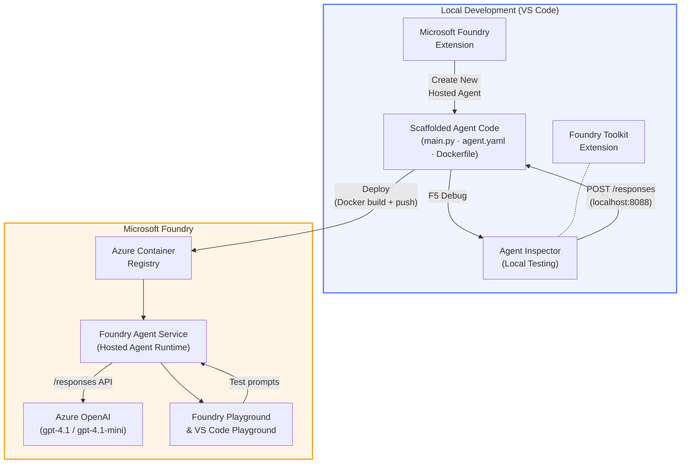

# Foundry Toolkit + Foundry Hosted Agents വർക്ഷോപ്പ്

[](https://www.python.org/)
[](https://github.com/microsoft/agents)
[](https://learn.microsoft.com/azure/foundry/agents/concepts/hosted-agents)
[](https://ai.azure.com/)
[](https://learn.microsoft.com/azure/ai-services/openai/)
[](https://learn.microsoft.com/cli/azure/install-azure-cli)
[](https://learn.microsoft.com/azure/developer/azure-developer-cli/install-azd)
[](https://www.docker.com/)
[](https://marketplace.visualstudio.com/items?itemName=ms-windows-ai-studio.windows-ai-studio)
[](../../LICENSE)

Build, test, and deploy AI agents to **Microsoft Foundry Agent Service** as **Hosted Agents** - entirely from VS Code using the **Microsoft Foundry extension** and **Foundry Toolkit**.

> **Hosted Agents ഇപ്പോൾ പ്രിവ്യൂവിലാണ്.** Supported regions are limited - see [പ്രദേശങ്ങളുടെ ലഭ്യത](https://learn.microsoft.com/azure/foundry/agents/concepts/hosted-agents#region-availability).

> The `agent/` folder inside each lab is **സ്വയം സൃഷ്ടിക്കപ്പെടുന്നു** by the Foundry extension - you then customize the code, test locally, and deploy.

### 🌐 ബഹുഭാഷാ പിന്തുണ

#### GitHub Action വഴി ലഭ്യമാണ് (ഓട്ടോമേറ്റഡ് & എല്ലായ്പ്പോഴും പുതുക്കപ്പെട്ട)

<!-- CO-OP TRANSLATOR LANGUAGES TABLE START -->
[അറബി](../ar/README.md) | [ബംഗ്ലാ](../bn/README.md) | [ബൾഗേറിയൻ](../bg/README.md) | [ബർമീസ് (മിയാൻമർ)](../my/README.md) | [ചൈനീസ് (സിംപ്ലിഫൈഡ്)](../zh-CN/README.md) | [ചൈനീസ് (പരമ്പരാഗതം, ഹോങ്കോംഗ്)](../zh-HK/README.md) | [ചൈനീസ് (പരമ്പരാഗതം, മക്കാവ്)](../zh-MO/README.md) | [ചൈനീസ് (പരമ്പരാഗതം, തായ്‌വാൻ)](../zh-TW/README.md) | [ക്രൊയേഷ്യൻ](../hr/README.md) | [ചെക്ക്](../cs/README.md) | [ഡാനിഷ്](../da/README.md) | [ഡച്ച്](../nl/README.md) | [എസ്റ്റോണിയൻ](../et/README.md) | [ഫിന്നിഷ്](../fi/README.md) | [ഫ്രഞ്ച്](../fr/README.md) | [ജർമ്മൻ](../de/README.md) | [ഗ്രീക്ക്](../el/README.md) | [ഹീബ്രു](../he/README.md) | [ഹിന്ദി](../hi/README.md) | [ഹംഗേറിയൻ](../hu/README.md) | [ഇന്ദോണേഷ്യൻ](../id/README.md) | [ഇറ്റാലിയൻ](../it/README.md) | [ജാപ്പനീസ്](../ja/README.md) | [കന്നഡ](../kn/README.md) | [ഖ്മേർ](../km/README.md) | [കൊറിയൻ](../ko/README.md) | [ലിത്വേനിയൻ](../lt/README.md) | [മലയ്](../ms/README.md) | [മലയാളം](./README.md) | [മറാത്തി](../mr/README.md) | [നെപ്പാലി](../ne/README.md) | [നൈജീരിയൻ പിഡ്ജിൻ](../pcm/README.md) | [നോർവീജിയൻ](../no/README.md) | [പെർഷ്യൻ (ഫാർസി)](../fa/README.md) | [പോളിഷ്](../pl/README.md) | [പോർച്ചുഗീസ് (ബ്രസീൽ)](../pt-BR/README.md) | [പോർച്ചുഗീസ് (പോർച്ചുഗൽ)](../pt-PT/README.md) | [പഞ്ചാബി (ഗുരുമുഖി)](../pa/README.md) | [റൊമാനിയൻ](../ro/README.md) | [റഷ്യൻ](../ru/README.md) | [സെർബിയൻ (സൈറിലിക്)](../sr/README.md) | [സ്ലോവാക്](../sk/README.md) | [സ്ലോവേനിയൻ](../sl/README.md) | [സ്പാനിഷ്](../es/README.md) | [സ്വാഹിലി](../sw/README.md) | [സ്വീഡിഷ്](../sv/README.md) | [താഗലോഗ് (ഫിലിപ്പീൻ)](../tl/README.md) | [തമിഴ്](../ta/README.md) | [తెలుగు](../te/README.md) | [തായ്](../th/README.md) | [ടർക്കിഷ്](../tr/README.md) | [ഉക്രൈനീയൻ](../uk/README.md) | [ഉറുദു](../ur/README.md) | [വിയറ്റ്നാമീസ്](../vi/README.md)

> **പ്രാദേശികമായി ക്ലോൺ ചെയ്യാൻ ഇഷ്ടമുണ്ടോ?**
>
> ഈ റിപ്പോസിറ്ററി 50-ലധികം ഭാഷാ പരിഭാഷകൾ ഉൾക്കൊള്ളുന്നുവെങ്കിൽ ഡൗൺലോഡ് വലുപ്പം ഗണ്യമായി വർദ്ധിക്കുന്നു. പരിഭാഷകൾ ഒഴിവാക്കി ക്ലോൺ ചെയ്യാൻ sparse checkout ഉപയോഗിക്കുക:
>
> **Bash / macOS / Linux:**
> ```bash
> git clone --filter=blob:none --sparse https://github.com/microsoft-foundry/Foundry_Toolkit_for_VSCode_Lab.git
> cd Foundry_Toolkit_for_VSCode_Lab
> git sparse-checkout set --no-cone '/*' '!translations' '!translated_images'
> ```
>
> **CMD (Windows):**
> ```cmd
> git clone --filter=blob:none --sparse https://github.com/microsoft-foundry/Foundry_Toolkit_for_VSCode_Lab.git
> cd Foundry_Toolkit_for_VSCode_Lab
> git sparse-checkout set --no-cone "/*" "!translations" "!translated_images"
> ```
>
> ഇത് കോഴ്‌സ് പൂർത്തിയാക്കാൻ നിങ്ങൾക്ക് ആവശ്യമായ എല്ലാ ഘടകങ്ങളും നൽകും, കൂടാതെ ഡൗൺലോഡ് വളരെ വേഗത്തിലാണ്.
<!-- CO-OP TRANSLATOR LANGUAGES TABLE END -->

---

## ആർക്കിടെക്ചർ



**പ്രവാഹം:** Foundry എക്സ്റ്റൻഷൻ ഏജന്റ് സ്കാഫോൾഡ് ചെയ്യുന്നു → നിങ്ങൾ കോഡ് & നിർദ്ദേശങ്ങൾ കസ്റ്റമൈസ് ചെയ്യുക → Agent Inspector ഉപയോഗിച്ച് ലോക്കലായി ടെസ്റ്റ് ചെയ്യുക → Foundry-ലേക്ക് ഡിപ്ലോയ് ചെയ്യുക (Docker ഇമേജ് ACR-യിലേക്ക് പുഷ് ചെയ്യുന്നു) → Playground-ൽ സ്ഥിരീകരിക്കുക.

---

## നിങ്ങൾ നിർമ്മിക്കുന്നതെന്താണ്

| Lab | വിവരണം | നില |
|-----|-------------|--------|
| **Lab 01 - Single Agent** | **"Explain Like I'm an Executive" ഏജന്റ്** നിർമ്മിക്കുക, ലോക്കലായി ടെസ്റ്റ് ചെയ്ത് Foundry-ലേക്ക് ഡിപ്ലോയ് ചെയ്യുക | ✅ ലഭ്യമാണ് |
| **Lab 02 - Multi-Agent Workflow** | **"Resume → Job Fit Evaluator"** നിർമ്മിക്കുക - റിസ്യൂം ഫിറ്റ് സ്കോർ ചെയ്യാനും പഠന റോഡ്‌മാപ്പ് സൃഷ്ടിക്കാനും 4 ഏജന്റുകൾ സഹകരിക്കുന്നു | ✅ ലഭ്യമാണ് |

---

## എക്സിക്യൂട്ടീവ് ഏജന്റുമായി പരിചയം

ഈ വർക്ഷോപ്പിൽ നിങ്ങൾ നിർമ്മിക്കുന്നത് ആണ് **"Explain Like I'm an Executive" ഏജന്റ്** - സങ്കീർണ സാങ്കേതിക ജാർഗൺ എടുത്ത് അതിനെ ശാന്തവും ബോർഡറൂം-സൗഹൃദവും ആയ സാരാംശങ്ങളായി തർജ്ജമ ചെയ്യാൻ കഴിയുന്ന ഒരു AI ഏജന്റ്. യാഥാർത്ഥ്യമായി പറഞ്ഞാൽ, C-സ്യൂട്ട്里的 ആര്‍ക്കും "v3.2-ൽ ചേർത്ത synchronous calls മൂലം thread pool exhaustion" എന്നത് കേൾക്കാൻ ഇഷ്ടമില്ല.

ഞാൻ ഈ ഏജന്റ് നിർമ്മിച്ചത് പലസന്ദർഭങ്ങളിലും എന്റെ സൂക്ഷ്മമായി തയ്യാറാക്കിയ പോസ്റ്റ്-മോർട്ടത്തിനു ലഭിച്ച മറുപടി *"അപ്പോൾ... വെബ്സൈറ്റ് താഴെയാണോ അല്ലയോ?"* എന്നതുപോലുള്ള നിസ്സാരമായ പ്രതികരണങ്ങൾ മൂലമാണ്.

### ഇത് എങ്ങനെ പ്രവർത്തിക്കുന്നു

നിങ്ങൾ അതിന് ഒരു സാങ്കേതിക അപ്ഡേറ്റ് നൽകും. അത് ഒരു എക്സിക്യൂട്ടീവ് സംഗ്രഹം തിരികെ നൽകുന്നു - മൂന്ന് ബുള്ളറ്റ് പോയിന്റുകൾ, ജാർഗൺ ഇല്ല, സ്ടാക്ക് ട്രേസുകൾ ഇല്ല, അത്യന്തം ഭയം ഇല്ല. വെറും **എന്താണ് സംഭവിച്ചത്**, **ബിസിനസ് സ്വാധീനം**, এবং **അടുത്ത ചുവട്**.

### പ്രവർത്തനത്തിൽ കാണുക

**നിങ്ങൾ പറയുന്നത്:**
> "API ലാറ്റൻസി വർദ്ധിച്ചു കാരണം thread pool exhaustionതാണ്, ഇത് v3.2-ൽ ചേർത്ത synchronous calls മൂലമാണ്."

**ഏജന്റ് മറുപടി നൽകുന്നു:**

> **എക്സിക്യൂട്ടീവ് സംഗ്രഹം:**
> - **എന്താണ് സംഭവിച്ചത്:** ഏറ്റവും പുതിയ റിലീസിനുശേഷം സിസ്റ്റം മന്ദഗതിയില്‍ ആയിരുന്നു.
> - **ബിസിനസ് സ്വാധീനം:** ചില ഉപയോക്താക്കൾ സർവീസ് ഉപയോഗിക്കുമ്പോൾ വൈകല്യം അനുഭവിച്ചു.
> - **അടുത്ത ചുവട്:** മാറ്റം റോള്ബാക്ക് ചെയ്തു; വീണ്ടും ഡിപ്ലോയ്മെന്റ് നടത്തുന്നതിന് മുൻപ് ഒരു ഫിക്സ് തയ്യാറാവുകയാണ്.

### ഈ ഏജന്റ് എന്തിന്?

ഇത് വളരെ ലളിതവും ഏകലക്ഷ്യവുമായ ഏജന്റാണ് — ഹോസ്റ്റഡ് ഏജന്റ് വർക്‌ഫ്ലോ തുടക്കം മുതൽ അവസാനത്തോടെ വരെ പഠിക്കാൻ, സങ്കീർണ ടൂൾചെയിനുകളിൽ ചോർന്നുയരാതെയും, അതിനായി അനുയോജ്യമാണ്. സത്യമായി പറയുമ്പോൾ, ഓരോ എൻജിനീയറിംഗ് ടീമ്മിനും ഇതുപോലൊരു ഏജൻറ് വേണോ എന്ന് തോന്നാം.

---

## വർക്ഷോപ്പ് ഘടന

```
📂 Foundry_Toolkit_for_VSCode_Lab/
├── 📄 README.md                      ← You are here
└── 📂 workshop/
    ├── 📂 lab01-single-agent/        ← Full lab: docs + agent code
    │   ├── README.md                 ← Hands-on lab instructions
    │   ├── 📂 docs/                  ← Step-by-step tutorial modules
    │   │   ├── 00-prerequisites.md
    │   │   ├── 01-setup.md
    │   │   ├── 02-create-hosted-agent.md
    │   │   ├── 03-configure-and-code.md
    │   │   ├── 04-test-locally.md
    │   │   ├── 05-deploy-to-foundry.md
    │   │   ├── 06-verify-in-playground.md
    │   │   ├── 07-summary.md
    │   │   └── 08-troubleshooting.md
    │   └── 📂 agent/                 ← Reference solution (auto-scaffolded by Foundry extension)
    │       ├── agent.yaml
    │       ├── Dockerfile
    │       ├── main.py
    │       └── requirements.txt
    └── 📂 lab02-multi-agent/         ← Resume → Job Fit Evaluator
        ├── README.md                 ← Hands-on lab instructions (end-to-end)
        ├── 📂 docs/                  ← Step-by-step tutorial modules
        │   ├── 00-prerequisites.md
        │   ├── 01-understand-multi-agent.md
        │   ├── 02-scaffold-multi-agent.md
        │   ├── 03-configure-agents.md
        │   ├── 04-orchestration-patterns.md
        │   ├── 05-test-locally.md
        │   ├── 06-deploy-to-foundry.md
        │   ├── 07-verify-in-playground.md
        │   └── 08-troubleshooting.md
        └── 📂 PersonalCareerCopilot/ ← Reference solution (multi-agent workflow)
            ├── agent.yaml
            ├── Dockerfile
            ├── main.py
            └── requirements.txt
```

> **കുറിപ്പ്:** ഓരോ ലാബിലെയും `agent/` ഫോൾഡർ ആണ് **Microsoft Foundry extension** Command Palette-ൽ നിന്നു `Microsoft Foundry: Create a New Hosted Agent` ഓടിക്കുമ്പോൾ ജനറേറ്റ് ചെയ്യപ്പെടുന്നത്. ഫയലുകൾ പിന്നീട് നിങ്ങളുടെ ഏജന്റിന്റെ നിർദ്ദേശങ്ങൾ, ഉപകരണങ്ങൾ, കോൺഫിഗറേഷൻ എന്നിവ അനുസരിച്ച് കസ്റ്റമൈസ് ചെയ്യപ്പെടുന്നു. Lab 01 നിങ്ങളെ ഇത് സ്ക്രാച്ചിൽ നിന്ന് വീണ്ടും സൃഷ്ടിക്കാൻ നയിക്കുന്നു.

---

## ആരംഭിക്കുക

### 1. റെപ്പോസിറ്ററി ക്ലോൺ ചെയ്യുക

```bash
git clone https://github.com/microsoft-foundry/Foundry_Toolkit_for_VSCode_Lab.git
cd Foundry_Toolkit_for_VSCode_Lab
```

### 2. ഒരു Python വെർച്വൽ എൻവയോൺമെന്റ് ക്രമീകരിക്കുക

```bash
python -m venv venv
```

അതെ സജീവമാക്കുക:

- **Windows (PowerShell):**
  ```powershell
  .\venv\Scripts\Activate.ps1
  ```
- **macOS / Linux:**
  ```bash
  source venv/bin/activate
  ```

### 3. ആവശ്യമായ ഡിപ്പെൻഡൻസികൾ ഇൻസ്റ്റാൾ ചെയ്യുക

```bash
pip install -r workshop/lab01-single-agent/agent/requirements.txt
```

### 4. എൻവയോൺമെന്റ് വേരിയബിളുകൾ കോൺഫിഗർ ചെയ്യുക

ഏജന്റ് ഫോൾഡറിനുള്ളിലെ ഉദാഹരണ `.env` ഫയൽ പകർത്തി നിങ്ങളുടെ മൂല്യങ്ങൾ പൂർത്തിയാക്കുക:

```bash
cp workshop/lab01-single-agent/agent/.env.example workshop/lab01-single-agent/agent/.env
```

`workshop/lab01-single-agent/agent/.env` തിരുത്തുക:

```env
AZURE_AI_PROJECT_ENDPOINT=https://<your-account>.services.ai.azure.com/api/projects/<your-project>
AZURE_AI_MODEL_DEPLOYMENT_NAME=<your-model-deployment-name>
```

### 5. വർക്ഷോപ്പ് ലാബുകൾ പിന്തുടരുക

ഓരോ ലാബും സ്വതന്ത്രമായി അതിന്റെ സ്വന്തം മോഡ്യൂളുകൾ ഉൾക്കൊള്ളുന്നു. അടിസ്ഥാനങ്ങൾ പഠിക്കാൻ **Lab 01**-ൽ തുടങ്ങി, പിന്നീട് മൾട്ടി-ഏജന്റ് വർക്‌ഫ്ലോകൾക്കായി **Lab 02**-ലേക്ക് Movers ചെയ്യുക.

#### Lab 01 - Single Agent ([പൂർണ്ണ നിർദ്ദേശങ്ങൾ](workshop/lab01-single-agent/README.md))

| # | മോഡ്യൂൾ | ലിങ്ക് |
|---|--------|------|
| 1 | ആവശ്യകതകൾ വായിക്കുക | [00-prerequisites.md](workshop/lab01-single-agent/docs/00-prerequisites.md) |
| 2 | Foundry Toolkit & Foundry എക്സ്റ്റൻഷൻ ഇൻസ്റ്റാൾ ചെയ്യുക | [01-setup.md](workshop/lab01-single-agent/docs/01-setup.md) |
| 3 | Foundry പ്രോജക്ട் സൃഷ്ടിക്കുക | [01-setup.md](workshop/lab01-single-agent/docs/01-setup.md) |
| 4 | ഒരു ഹോസ്റ്റഡ് ഏജന്റ് സൃഷ്ടിക്കുക | [02-create-hosted-agent.md](workshop/lab01-single-agent/docs/02-create-hosted-agent.md) |
| 5 | നിർദ്ദേശങ്ങളും എൻവയോൺമെന്റും കോൺഫിഗർ ചെയ്യുക | [03-configure-and-code.md](workshop/lab01-single-agent/docs/03-configure-and-code.md) |
| 6 | ലോക്കലായി ടെസ്റ്റ് ചെയ്യുക | [04-test-locally.md](workshop/lab01-single-agent/docs/04-test-locally.md) |
| 7 | Foundry-ലേക്ക് ഡിപ്ലോയ് ചെയ്യുക | [05-deploy-to-foundry.md](workshop/lab01-single-agent/docs/05-deploy-to-foundry.md) |
| 8 | Playground-ൽ സ്ഥിരീകരിക്കുക | [06-verify-in-playground.md](workshop/lab01-single-agent/docs/06-verify-in-playground.md) |
| 9 | പ്രശ്നപരിഹാരം | [08-troubleshooting.md](workshop/lab01-single-agent/docs/08-troubleshooting.md) |

#### Lab 02 - Multi-Agent Workflow ([പൂർണ്ണ നിർദ്ദേശങ്ങൾ](workshop/lab02-multi-agent/README.md))

| # | മോഡ്യൂൾ | ലിങ്ക് |
|---|--------|------|
| 1 | ആവശ്യകതകൾ (Lab 02) | [00-prerequisites.md](workshop/lab02-multi-agent/docs/00-prerequisites.md) |
| 2 | മൾട്ടി-ഏജന്റ് ആർക്കിടെക്ചർ മനസ്സിലാക്കുക | [01-understand-multi-agent.md](workshop/lab02-multi-agent/docs/01-understand-multi-agent.md) |
| 3 | മൾട്ടി-ഏജന്റ് പ്രോജക്ട് സ്കാഫോൾഡ് ചെയ്യുക | [02-scaffold-multi-agent.md](workshop/lab02-multi-agent/docs/02-scaffold-multi-agent.md) |
| 4 | ഏജന്റുകളും എൻവയോൺമെന്റും കോൺഫിഗർ ചെയ്യുക | [03-configure-agents.md](workshop/lab02-multi-agent/docs/03-configure-agents.md) |
| 5 | ഓർക്കസ്ട്രേഷൻ പാറ്റേണുകൾ | [04-orchestration-patterns.md](workshop/lab02-multi-agent/docs/04-orchestration-patterns.md) |
| 6 | ലോക്കലായി ടെസ്റ്റ് ചെയ്യുക (മൾട്ടി-ഏജന്റ്) | [05-test-locally.md](workshop/lab02-multi-agent/docs/05-test-locally.md) |
| 7 | Foundry-ലേക്ക് ഡിപ്ലോയ് ചെയ്യുക | [06-deploy-to-foundry.md](workshop/lab02-multi-agent/docs/06-deploy-to-foundry.md) |
| 8 | Playground-ൽ സ്ഥിരീകരിക്കുക | [07-verify-in-playground.md](workshop/lab02-multi-agent/docs/07-verify-in-playground.md) |
| 9 | പ്രശ്നപരിഹാരം (മൾട്ടി-ഏജന്റ്) | [08-troubleshooting.md](workshop/lab02-multi-agent/docs/08-troubleshooting.md) |

---

## പരിപാലകൻ

<table>
<tr>
    <td align="center"><a href="https://github.com/ShivamGoyal03">
        <br />
        <sub><b>Shivam Goyal</b></sub>
    </a><br />
    </td>
</tr>
</table>

---

## ആവശ്യമായ അനുമതികൾ (എളുപ്പത്തിലുള്ള റഫറൻസ്)

| സീനാരിയോ | ആവശ്യമായ റോളുകൾ |
|----------|---------------|
| പുതിയ Foundry പ്രോജക്ട് സൃഷ്ടിക്കുക | **Azure AI Owner** Foundry റിസോഴ്സിൽ |
| നിലവിലുള്ള പ്രോജക്ടിലേക്ക് ഡിപ്ലോയ് ചെയ്യുക (പുതിയ റിസോഴ്സുകൾ) | **Azure AI Owner** + **Contributor** സബ്സ്ക്രിപ്ഷനിൽ |
| പൂർണ്ണമായി കോൺഫിഗർ ചെയ്ത പ്രോജക്ടിലേക്ക് ഡിപ്ലോയ് ചെയ്യുക | അക്കൗണ്ടിൽ **Reader** + പ്രോജക്ടിൽ **Azure AI User** |

> **പ്രധാനമായത്:** Azure `Owner` and `Contributor` റോളുകൾ에는 *മാനേജ്മെന്റ്* അനുമതികൾ മാത്രമേ ഉൾക്കൊള്ളാറുള്ളൂ, *ഡവലപ്പ്മെന്റ്* (ഡാറ്റാ ആക്ഷൻ) അനുമതികൾ അല്ല. ഏജന്റുകൾ നിർമിക്കാനും ഡിപ്ലോയ് ചെയ്യാനും നിങ്ങൾക്കു **Azure AI User** അല്ലെങ്കിൽ **Azure AI Owner** ആവശ്യമുണ്ട്.

---

## റഫറൻസുകൾ

- [ഉടൻ തുടങ്ങൽ: നിങ്ങളുടെ ആദ്യ ഹോസ്റ്റഡ് ഏജന്റ് (VS Code)](https://learn.microsoft.com/azure/foundry/agents/quickstarts/quickstart-hosted-agent)
- [ഹോസ്റ്റഡ് ഏജന്റുകൾ എന്താണ്?](https://learn.microsoft.com/azure/foundry/agents/concepts/hosted-agents)
- [VS Code-ൽ ഹോസ്റ്റഡ് ഏജന്റ് വർക്‌ഫ്ലോകൾ സൃഷ്ടിക്കുക](https://learn.microsoft.com/azure/foundry/agents/how-to/vs-code-agents-workflow-pro-code)
- [ഹോസ്റ്റഡ് ഏജന്റ് വിന്യസിക്കുക](https://learn.microsoft.com/azure/foundry/agents/how-to/deploy-hosted-agent)
- [Microsoft Foundry-യ്ക്കുള്ള RBAC](https://learn.microsoft.com/azure/foundry/concepts/rbac-foundry)
- [ആർക്കിടെക്ചർ റിവ്യൂ ഏജന്റ് സാമ്പിൾ](https://github.com/Azure-Samples/agent-architecture-review-sample) - MCP ടൂളുകൾ, Excalidraw രേഖാചിത്രങ്ങൾ, ഇരട്ട വിന്യാസമുള്ള യാഥാർത്ഥ്യ ഹോസ്റ്റഡ് ഏജന്റ്

---


## ലൈസൻസ്

[MIT](../../LICENSE)

---

<!-- CO-OP TRANSLATOR DISCLAIMER START -->
**അറിയിപ്പ്**:
ഈ രേഖ AI പരിഭാഷാ സേവനം [Co-op Translator](https://github.com/Azure/co-op-translator) ഉപയോഗിച്ച് പരിഭാഷപ്പെടുത്തിയതാണ്. ഞങ്ങൾ കൃത്യതയ്ക്കായി ശ്രമിക്കുന്നുവെങ്കിലും, ഓട്ടോമേറ്റഡ് പരിഭാഷകളിൽ പിഴവുകൾ അല്ലെങ്കിൽ തെറ്റായ വിവരങ്ങൾ ഉണ്ടാകാൻ സാധ്യതയുണ്ട്. അതിന്റെ സ്വാഭാവിക ഭാഷയിലുള്ള അസൽ രേഖയാണ് പ്രാമാണികമായ ഉറവിടമായി പരിഗണിക്കേണ്ടത്. നിർണായകമായ വിവരങ്ങൾക്ക്, പ്രൊഫഷണൽ മനുഷ്യ പരിഭാഷ ശുപാർശ ചെയ്യുന്നു. ഈ പരിഭാഷ ഉപയോഗിച്ച് ഉണ്ടാകുന്ന തെറ്റിദ്ധാരണകൾ അല്ലെങ്കിൽ തെറ്റായ വ്യാഖ്യാനങ്ങൾക്കായി ഞങ്ങൾ ഉത്തരവാദികളല്ല.
<!-- CO-OP TRANSLATOR DISCLAIMER END -->
