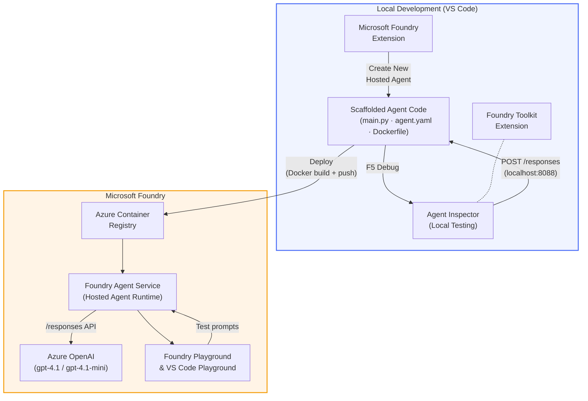

# ഫൗണ്ട്രി ടൂള്കിറ്റ് + ഫൗണ്ട്രി ഹോസ്റ്റഡ് ഏജന്റുകൾ വര്‍ക്ക്‌ഷോപ്പ്

[](https://www.python.org/)
[](https://learn.microsoft.com/agent-framework/)
[](https://learn.microsoft.com/azure/foundry/agents/concepts/hosted-agents)
[](https://ai.azure.com/)
[](https://learn.microsoft.com/azure/ai-services/openai/)
[](https://learn.microsoft.com/cli/azure/install-azure-cli)
[](https://learn.microsoft.com/azure/developer/azure-developer-cli/install-azd)
[](https://www.docker.com/)
[](https://marketplace.visualstudio.com/items?itemName=ms-windows-ai-studio.windows-ai-studio)
[](LICENSE)

**Microsoft Foundry ഒമ്പത് എജന്റ് സർവീസിലേക്ക്** AI ഏജന്റുകളെ തയാറാക്കുക, పరీక్షിക്കുക, വിന്യസിക്കുക - പൂർണമായും VS കോഡ് ഉപയോഗിച്ച് **Microsoft Foundry എക്സ്റ്റെൻഷൻ** ക്കും **Foundry Toolkit** ക്കും വഴി **Hosted Agents** എന്ന നിലയിൽ.

> **Hosted Agents ഇപ്പോൾ പ്രിവ്യൂയിൽ ആണ്.** പിന്തുണയ്‌ക്കുന്ന മേഖലയുകൾ പരിമിതമാണ് - [മേഖല ലഭ്യത](https://learn.microsoft.com/azure/foundry/agents/concepts/hosted-agents#region-availability) കാണുക.

> ഓരോ ലാബിനുള്ളിൽ ഉള്ള `agent/` ഫോൾഡർ **Foundry എക്സ്റ്റെൻഷൻ** സ്വയം സ്രഷ്ടിക്കുന്നു - പിന്നീട് നിങ്ങൾ കോഡ് ഇഷ്‌ടാനുസൃതമാക്കാം, പ്രാദേശികമായി പരീക്ഷിക്കാം, വിന്യസിക്കാം.

### 🌐 ബഹു-ഭാഷാ പിന്തുണ

#### GitHub പ്രവർത്തനത്തിലൂടെ പിന്തുണ (ഓട്ടോമാറ്റികും എല്ലായ്പ്പോഴും പുതുക്കപ്പെട്ടതും)

<!-- CO-OP TRANSLATOR LANGUAGES TABLE START -->
[അറബിക്](../ar/README.md) | [ബംഗാളി](../bn/README.md) | [ബൾഗേറിയൻ](../bg/README.md) | [ബർമീസ് (മ്യാന്മാർ)](../my/README.md) | [ചൈനീസ് (ലളിതം)](../zh-CN/README.md) | [ചൈനീസ് (പരമ്പരാഗതം, ഹോങ്ങ് കോങ്)](../zh-HK/README.md) | [ചൈനീസ് (പരമ്പരാഗതം, മകാവ്)](../zh-MO/README.md) | [ചൈനീസ് (പരമ്പരാഗതം, തായ്‌വാൻ)](../zh-TW/README.md) | [ക്രൊയേഷ്യൻ](../hr/README.md) | [ചെക്ക്](../cs/README.md) | [ഡാനിഷ്](../da/README.md) | [ഡച്ച്ഡ്](../nl/README.md) | [എസ്റ്റോണിയൻ](../et/README.md) | [ഫിന്നിഷ്](../fi/README.md) | [ഫ്രഞ്ച്](../fr/README.md) | [ജർമ്മൻ](../de/README.md) | [ഗ്രേക്ക്](../el/README.md) | [ഹീബ്രു](../he/README.md) | [ഹിന്ദി](../hi/README.md) | [ഹംഗേറിയൻ](../hu/README.md) | [ഇന്തോനേഷ്യൻ](../id/README.md) | [ഇറ്റാലിയൻ](../it/README.md) | [ജാപ്പനീസ്](../ja/README.md) | [കന്നഡ](../kn/README.md) | [ഖ്മേർ](../km/README.md) | [കൊറിയൻ](../ko/README.md) | [ലിത്വേനിയൻ](../lt/README.md) | [മലായ്](../ms/README.md) | [മലയാളം](./README.md) | [മറാത്തി](../mr/README.md) | [നേപ്പാളി](../ne/README.md) | [നൈജീരിയൻ പിഡ്ജിൻ](../pcm/README.md) | [നോർവീജിയൻ](../no/README.md) | [ഫേർഷ്യൻ (ഫാർസി)](../fa/README.md) | [പോളിഷ്](../pl/README.md) | [പോർച്ചുഗീസ് (ബ്രസീൽ)](../pt-BR/README.md) | [പോർച്ചുഗീസ് (പോർച്ചുഗൽ)](../pt-PT/README.md) | [പഞ്ചാബി (ഗുർമുഖി)](../pa/README.md) | [റോമേനിയൻ](../ro/README.md) | [റഷ്യൻ](../ru/README.md) | [സെർബിയൻ (സിറിലിക്)](../sr/README.md) | [സ്ലോവാക്](../sk/README.md) | [സ്ലോവീനിയൻ](../sl/README.md) | [സ്പാനിഷ്](../es/README.md) | [സ്വാഹിലി](../sw/README.md) | [സ്വീഡിഷ്](../sv/README.md) | [ടാഗലോഗ് (ഫിലിപ്പിനോ)](../tl/README.md) | [തമിഴ്](../ta/README.md) | [തെലുങ്കു](../te/README.md) | [തായ്](../th/README.md) | [തുര്‍ക്കിഷ്](../tr/README.md) | [യുക്രെയ്നിയൻ](../uk/README.md) | [ഉർදු](../ur/README.md) | [വിയറ്റ്നാമീസ്](../vi/README.md)

> **സ്ഥാനാന്തരിക്കാൻ ഇഷ്ടമാണോ?**
>
> ഈ റിപ്പോസിറ്ററിയിൽ 50 ലധികം ഭാഷാ പരിഭാഷകൾ ഉൾപ്പെട്ടിരിക്കുന്നു, ഇത് ഡൗൺലോഡ് വലിപ്പം കൂടുന്നു. പരിഭവങ്ങളില്ലാതെ ക്ലോൺ ചെയ്യാനായി sparse checkout ഉപയോഗിക്കുക:
>
> **ബാഷ് / മാക്ക്ഓ.എസ് / ലിനക്സ്:**
> ```bash
> git clone --filter=blob:none --sparse https://github.com/microsoft-foundry/Foundry_Toolkit_for_VSCode_Lab.git
> cd Foundry_Toolkit_for_VSCode_Lab
> git sparse-checkout set --no-cone '/*' '!translations' '!translated_images'
> ```
>
> **CMD (വിൻഡോസ്):**
> ```cmd
> git clone --filter=blob:none --sparse https://github.com/microsoft-foundry/Foundry_Toolkit_for_VSCode_Lab.git
> cd Foundry_Toolkit_for_VSCode_Lab
> git sparse-checkout set --no-cone "/*" "!translations" "!translated_images"
> ```
>
> ഇതു നിങ്ങളുടെ കോഴ്സ് പൂർത്തിയാക്കാൻ ആവശ്യമായ എല്ലാം നൽകുന്നു പതിയെ ഡൗൺലോഡ് ചെയ്യുന്നതിനു പകരം.
<!-- CO-OP TRANSLATOR LANGUAGES TABLE END -->

---

## രൂപരേഖ



**ഫ്ലോ:** ഫൗണ്ട്രി എക്സ്റ്റെൻഷൻ ഏജന്റ് സ്കാഫോൾഡ് ചെയ്യുന്നു → നിങ്ങൾ കോഡ് & നിർദ്ദേശങ്ങൾ ഇഷ്‌ടാനുസൃതമാക്കുന്നു → ഏജന്റ് ഇൻസ്‌പെക്ടറുമായി പ്രാദേശികമായി പരീക്ഷിക്കുന്നു → ഫൗണ്ട്രിയിലേക്ക് വിന്യസിക്കുന്നു (ഡോക്കർ ഇമേജ് ACR-ലേക്ക് പുഷ് ചെയ്യുന്നു) → പ്ലേഗ്രസ്‌ളിയിൽ പരിശോധന നടത്തുന്നു.

---

## നിങ്ങൾ തയാറാക്കുക

| ലാബ് | വിവരണം | നില |
|-----|-------------|--------|
| **ലാബ് 01 - സിംഗിൾ ഏജന്റ്** | **"ഞാൻ എക്സിക്യൂട്ടീവ് ആണെന്ന് വിശദീകരിക്കുക" ഏജന്റ്** നിർമ്മിച്ച്, പ്രാദേശികമായി പരീക്ഷിച്ച്, ഫൗണ്ട്രിയിലേക്ക് വിന്യസിക്കുക | ✅ ലഭ്യമാണ് |
| **ലാബ് 02 - ബഹു-ഏജന്റ് വർക്ക്‌ഫ്ലോവ്** | **"റിസ്യൂമേ → ജോലി യോഗ്യതാ വിലയിരുത്തൽ"** - 4 ഏജന്റുകൾ കൂട്ടായ്മയിൽ റിസ്യൂമേ യോഗ്യത വിലയിരുത്തൽ സ്കോർ ചെയ്യുന്നു, പഠന രൂപരേഖ സൃഷ്ടിക്കുന്നു | ✅ ലഭ്യമാണ് |

---

## എക്സിക്യൂട്ടീവ് ഏജന്റിനെ കണ്ടു നോക്കൂ

ഈ വര്‍ക്ക്‌ഷോപ്പിൽ നിങ്ങൾ **"ഞാൻ എക്സിക്യൂട്ടീവ് ആണെന്ന് വിശദീകരിക്കുക" ഏജന്റ്** നിർമ്മിക്കും - സങ്കീർണ്ണ സాంకേതിക പദങ്ങൾ എടുത്ത്, സമാധാനപരമായ, ബോർഡ് റൂം-സജ്ജമായ സംക്ഷിപ്തരൂപത്തിൽ ആസ്വദിക്കാവുന്ന രൂപത്തിൽ പരിഭാഷപ്പെടുത്തുന്ന AI ഏജന്റ്. കാരണം, സിഐസിൻറെ അംഗങ്ങൾ "v3.2-ൽ പ്രবর্তിപ്പിച്ച സമകാലിക കറങ്കൾ കൊണ്ട് ത്രെഡ് പൂൾ എക്സോസ്റ്റഷൻ" എന്ന തലത്തിലുള്ള സാങ്കേതിക ചർച്ച കേൾക്കാൻ ആഗ്രഹിക്കുന്നില്ല.

ഈ ഏജന്റ് ഞാൻ നിർമ്മിച്ചത്, നിരവധി തവണയ്ക്ക് എന്റെ പൂർണ്ണമായ പോസ്റ്റ് മോർട്ടം പ്രസ്താവനയ്ക്ക് പ്രതികരണം ഉണ്ടായി: *"അപ്പോൾ... വെബ്സൈറ്റ് ഡൗൺ ആയോ അല്ലയോ?"*

### ഇത് എങ്ങനെ പ്രവർത്തിക്കുന്നു

നിങ്ങൾ ഒരു സാങ്കേതിക അപ്‌ഡേറ്റ് നൽകുന്നു. അതിന് തിരിച്ചടി നൽകുന്നത് ഒരു എക്സിക്യൂട്ടീവ് സംക്ഷേപം - മൂന്ന് ബുള്ളറ്റ് പോയിന്റുകൾ, jargon ഇല്ല, സ്റ്റാക്ക് ട്രേസുകൾ ഇല്ല, ഒരു ഉളവും ഇല്ല. വെറും **എന്ത് സംഭവിച്ചു**, **ബിസിനസ് പ്രഭാവം**, **അടുത്ത ചുവടു**.

### പ്രവർത്തനത്തിൽ കണ്ടു നോക്കൂ

**നിങ്ങൾ പറയുന്നു:**
> "API ലേറ്റൻസി വർധിച്ചത് v3.2-ൽ പരിചയപ്പെടുത്തിയ സമകാലിക കറങ്കൾ കൊണ്ട് ത്രെഡ് പൂൾ എക്സോസ്റ്റഷൻ മൂലമാണ്."

**ഏജന്റ് പ്രതികരിക്കുന്നു:**

> **എക്സിക്യൂട്ടീവ് സംക്ഷേപം:**
> - **എന്ത് സംഭവിച്ചു:** ഏറ്റവും പുതിയ റിലീസിന് ശേഷം സിസ്റ്റം മന്ദഗതിയിലായി.
> - **ബിസിനസ് പ്രഭാവം:** ചില ഉപയോക്താക്കൾ സേവനം ഉപയോഗിക്കുമ്പോൾ താമസം അനുഭവപ്പെടുത്തി.
> - **അടുത്ത ചുവടു:** മാറ്റം പിൻവലിച്ചു, പുതിയ വിന്യസനത്തിന് മുമ്പ് പരിഹാരം ഒരുക്കുകയാണ്.

### ഈ ഏജന്റ് എന്തിന്?

അത് ഒരു പ്രാണപരിപൂർണവും, ഒറ്റലക്ഷ്യം ലഭിക്കുന്ന ഏജന്റാണ് - ബഹു-ഏജന്റ് വർക്ക്‌ഫ്ലോവിന്റെ തുടക്കം മുതൽ അവസാനം വരെ പഠിക്കാൻ മികച്ചത്, സങ്കീർണ്ണ ഉപകരണ ശൃംഖലകളിൽ കുടുങ്ങാതെ. സത്യത്തിൽ? എല്ലാ എൻജിനീയറിംഗ് ടീമിനും ഇതുപോലൊരു ഏജന്റ് വേണ്ടി വരും.

---

## വര്‍ക്ക്‌ഷോപ്പ് ഘടന

```
📂 Foundry_Toolkit_for_VSCode_Lab/
├── 📄 README.md                      ← You are here
└── 📂 workshop/
    ├── 📂 lab01-single-agent/        ← Full lab: docs + agent code
    │   ├── README.md                 ← Hands-on lab instructions
    │   ├── 📂 docs/                  ← Step-by-step tutorial modules
    │   │   ├── 00-prerequisites.md
    │   │   ├── 01-setup.md
    │   │   ├── 02-create-hosted-agent.md
    │   │   ├── 03-configure-and-code.md
    │   │   ├── 04-test-locally.md
    │   │   ├── 05-deploy-to-foundry.md
    │   │   ├── 06-verify-in-playground.md
    │   │   ├── 07-summary.md
    │   │   └── 08-troubleshooting.md
    │   └── 📂 agent/                 ← Reference solution (auto-scaffolded by Foundry extension)
    │       ├── agent.yaml
    │       ├── Dockerfile
    │       ├── main.py
    │       └── requirements.txt
    └── 📂 lab02-multi-agent/         ← Resume → Job Fit Evaluator
        ├── README.md                 ← Hands-on lab instructions (end-to-end)
        ├── 📂 docs/                  ← Step-by-step tutorial modules
        │   ├── 00-prerequisites.md
        │   ├── 01-understand-multi-agent.md
        │   ├── 02-scaffold-multi-agent.md
        │   ├── 03-configure-agents.md
        │   ├── 04-orchestration-patterns.md
        │   ├── 05-test-locally.md
        │   ├── 06-deploy-to-foundry.md
        │   ├── 07-verify-in-playground.md
        │   ├── 08-troubleshooting.md
        │   └── 09-summary.md
        └── 📂 PersonalCareerCopilot/ ← Reference solution (multi-agent workflow)
            ├── agent.yaml
            ├── Dockerfile
            ├── main.py
            └── requirements.txt
```

> **കുറിപ്പ്:** ഓരോ ലാബിനുള്ളിലെ `agent/` ഫോൾഡർ **Microsoft Foundry എക്സ്റ്റെൻഷൻ** കമാൻഡ് പാലറ്റിൽ നിന്ന് `Microsoft Foundry: Create a New Hosted Agent` പ്രവർത്തിപ്പിക്കുമ്പോൾ സൃഷ്ടിക്കുന്നു. ഫയലുകൾ പിന്നീട് നിങ്ങളുടെ ഏജന്റിന്റെ നിർദ്ദേശങ്ങൾ, ടൂളുകൾ, കോൺഫിഗറേഷനുസൃതമാക്കി ഇഷ്‌ടാനുസൃതമാക്കുന്നു. ലാബ് 01 നിങ്ങൾക്ക് ഇത് പൂർത്തിയാക്കുന്ന വഴി കാണിക്കുന്നു.

---

## ആരംഭിക്കുന്നത് എങ്ങനെ

### 1. റിപ്പോസിറ്ററി ക്ലോൺ ചെയ്യുക

```bash
git clone https://github.com/microsoft-foundry/Foundry_Toolkit_for_VSCode_Lab.git
cd Foundry_Toolkit_for_VSCode_Lab
```

### 2. Python വേർച്വൽ എൻവയർമെന്റ് സജ്ജമാക്കുക

```bash
python -m venv venv
```

അത് പ്രവർത്തിപ്പിക്കുക:

- **Windows (PowerShell):**
  ```powershell
  .\venv\Scripts\Activate.ps1
  ```
- **macOS / Linux:**
  ```bash
  source venv/bin/activate
  ```

### 3. ആശ്രിതങ്ങൾ ഇൻസ്റ്റാൾ ചെയ്യുക

```bash
pip install -r workshop/lab01-single-agent/agent/requirements.txt
```

### 4. എൻവയർമെന്റ് വേരിയബിളുകൾ കോൺഫിഗർ ചെയ്യുക

ഏജന്റ് ഫോൾഡറിനുള്ളിൽ ഉദാഹരണ `.env` ഫയൽ പകർത്ത് നിങ്ങളുടെ മൂല്യങ്ങൾ നിറക്കുക:

```bash
cp workshop/lab01-single-agent/agent/.env.example workshop/lab01-single-agent/agent/.env
```

`workshop/lab01-single-agent/agent/.env` ഫയൽ എഡിറ്റ് ചെയ്യുക:

```env
FOUNDRY_PROJECT_ENDPOINT=https://<your-account>.services.ai.azure.com/api/projects/<your-project>
AZURE_AI_MODEL_DEPLOYMENT_NAME=<your-model-deployment-name>
```

### 5. വര്‍ക്ക്‌ഷോപ്പ് ലാബുകൾ പിന്തുടരുക

ഓരോ ലാബും സ്വന്തം മോദ്യൂളുകളോട് സ്വയംപര്യാപ്തമാണ്. **ലാബ് 01** മുതൽ ആരംഭിച്ച് അടിസ്ഥാനങ്ങൾ പഠിക്കുക, പിന്നീട് ബഹു-ഏജന്റ് വർക്ക്‌ഫ്ലോക്കായി **ലാബ് 02** യിലേക്ക് മുന്നോട്ട് പോവുക.

#### ലാബ് 01 - സിംഗിൾ ഏജന്റ് ([സമ്പൂർണ്ണ നിർദ്ദേശങ്ങൾ](workshop/lab01-single-agent/README.md))

| # | മോദ്യൂൾ | ലിങ്ക് |
|---|--------|------|
| 1 | മുൻപരിചയം വായിക്കുക | [00-prerequisites.md](workshop/lab01-single-agent/docs/00-prerequisites.md) |
| 2 | Foundry Toolkit & Foundry എക്സ്റ്റെൻഷൻ ഇൻസ്റ്റാൾ ചെയ്യുക | [01-setup.md](workshop/lab01-single-agent/docs/01-setup.md) |
| 3 | Foundry പ്രൊജക്ട് സൃഷ്ടിക്കുക | [01-setup.md](workshop/lab01-single-agent/docs/01-setup.md) |
| 4 | ഹോസ്റ്റഡ് ഏജന്റ് സൃഷ്ടിക്കുക | [02-create-hosted-agent.md](workshop/lab01-single-agent/docs/02-create-hosted-agent.md) |
| 5 | നിർദ്ദേശങ്ങളും എൻവയർമെന്റും കോൺഫിഗർ ചെയ്യുക | [03-configure-and-code.md](workshop/lab01-single-agent/docs/03-configure-and-code.md) |
| 6 | പ്രാദേശികമായി പരീക്ഷിക്കുക | [04-test-locally.md](workshop/lab01-single-agent/docs/04-test-locally.md) |
| 7 | ഫൗണ്ട്രിയിലേക്ക് വിന്യസിക്കുക | [05-deploy-to-foundry.md](workshop/lab01-single-agent/docs/05-deploy-to-foundry.md) |
| 8 | പ്ലേഗ്രൗണ്ടിൽ സ്ഥിരീകരിക്കുക | [06-verify-in-playground.md](workshop/lab01-single-agent/docs/06-verify-in-playground.md) |
| 9 | സംക്ഷേപവും അടുത്ത ചുവടുകളും | [07-summary.md](workshop/lab01-single-agent/docs/07-summary.md) |
| 10 | പ്രശ്നപരിഹാരം | [08-troubleshooting.md](workshop/lab01-single-agent/docs/08-troubleshooting.md) |

#### ലാബ് 02 - ബഹു-ഏജന്റ് വർക്ക്‌ഫ്ലോ ([സമ്പൂർണ്ണ നിർദ്ദേശങ്ങൾ](workshop/lab02-multi-agent/README.md))

| # | മോദ്യൂൾ | ലിങ്ക് |
|---|--------|------|
| 1 | മുൻപരിചയം (ലാബ് 02) | [00-prerequisites.md](workshop/lab02-multi-agent/docs/00-prerequisites.md) |
| 2 | ബഹുഏജന്റ് ആർക്കിടെക്ചർ മനസിലാക്കുക | [01-understand-multi-agent.md](workshop/lab02-multi-agent/docs/01-understand-multi-agent.md) |
| 3 | ബഹുഏജന്റ് പ്രൊജക്ട് സ്കാഫോൾഡ് ചെയ്യുക | [02-scaffold-multi-agent.md](workshop/lab02-multi-agent/docs/02-scaffold-multi-agent.md) |
| 4 | ഏജന്റുകളും എൻവയർമെന്റും കോൺഫിഗർ ചെയ്യുക | [03-configure-agents.md](workshop/lab02-multi-agent/docs/03-configure-agents.md) |
| 5 | ഓർക്കസ്ട്രേഷൻ പാറ്റേണുകൾ | [04-orchestration-patterns.md](workshop/lab02-multi-agent/docs/04-orchestration-patterns.md) |
| 6 | പ്രാദേശികമായി പരീക്ഷിക്കുക (ബഹുഏജന്റ്) | [05-test-locally.md](workshop/lab02-multi-agent/docs/05-test-locally.md) |
| 7 | ഫൗണ്ട്രിയിലേക്ക് വിന്യസിക്കുക | [06-deploy-to-foundry.md](workshop/lab02-multi-agent/docs/06-deploy-to-foundry.md) |
| 8 | പ്ലേഗ്രൗണ്ടിൽ പരിശോധിക്കുക | [07-verify-in-playground.md](workshop/lab02-multi-agent/docs/07-verify-in-playground.md) |
| 9 | പ്രശ്നപരിഹാരം (ബഹുഏജന്റ്) | [08-troubleshooting.md](workshop/lab02-multi-agent/docs/08-troubleshooting.md) |
| 10 | സംക്ഷേപവും അടുത്ത ചുവടുകളും | [09-summary.md](workshop/lab02-multi-agent/docs/09-summary.md) |

---

## പരിപാലകൻ

<table>
<tr>
    <td align="center"><a href="https://github.com/ShivamGoyal03">
        <br />
        <sub><b>ശിവം ഗോയൽ</b></sub>
    </a><br />
    </td>
</tr>
</table>

---

## ആവശ്യമായ അർഹതകൾ (ത്വരിത പരിഗണന)

| സാഹചര്യം | ആവശ്യമായ റോളുകൾ |
|----------|---------------|
| പുതിയ Foundry പ്രൊജക്ട് സൃഷ്ടിക്കുക | **Azure AI ഉടമ** ഫൗണ്ട്രി റിസോഴ്സിൽ |
| നിലവിലുള്ള പ്രൊജക്ടിൽ വിന്യസിക്കുക (പുതിയ റിസോഴ്സ്) | **Azure AI ഉടമ** + **കൊണ്ട്രിബ്യൂട്ടർ** സബ്സ്ക്രിപ്ഷനിൽ |
| പൂർണ്ണമായും കോൺഫിഗർ ചെയ്ത പ്രൊജക്ടിലേക്ക് വിന്യസിക്കുക | അക്കൗണ്ടിൽ **റീഡർ** + പ്രൊജക്ടിൽ **Azure AI ഉപയോക്താവ്** |

> **പ്രധാനമാണ്:** Azure `Owner` ಮತ್ತು `Contributor` ಪಾತ್ರങ്ങൾ *മാൻേജ്‌മെന്റ്* അനുമതികളേ അടങ്ങിയിട്ടുണ്ട്, *ഡെവലപ്‌മെന്റ്* (ഡേറ്റാ ആക്ഷൻ) അനുമതികൾ അല്ല. ഏജൻറുകൾ നിർമ്മിക്കുകയും വെയ്ക്കുകയും ചെയ്യാൻ നിങ്ങൾക്ക് **Azure AI User** അല്ലെങ്കിൽ **Azure AI Owner** വേണം.

---

## റഫറൻസുകൾ

- [ക്വിക്ക്സ്റ്റാർട്ട്: നിങ്ങളുടെ ആദ്യ ഹോസ്റ്റുഡ് ഏജന്റുമായി (VS കോഡ്)](https://learn.microsoft.com/azure/foundry/agents/quickstarts/quickstart-hosted-agent)
- [ഹോസ്റ്റുഡ് ഏജന്റുകൾ എന്താണ്?](https://learn.microsoft.com/azure/foundry/agents/concepts/hosted-agents)
- [VS കോഡിൽ ഹോസ്റ്റുഡ് ഏജന്റ് വർക്‌ഫ്ലേകൾ സൃഷ്ടിക്കുക](https://learn.microsoft.com/azure/foundry/agents/how-to/vs-code-agents-workflow-pro-code)
- [ഒരു ഹോസ്റ്റുഡ് ഏജന്റ് വിന്യസിക്കുക](https://learn.microsoft.com/azure/foundry/agents/how-to/deploy-hosted-agent)
- [Microsoft Foundry-നുള്ള RBAC](https://learn.microsoft.com/azure/foundry/concepts/rbac-foundry)
- [ആർക്കിടെക്ചർ റിവ്യൂ ഏജന്റ് സാമ്പിൾ](https://github.com/Azure-Samples/agent-architecture-review-sample) - MCP ടൂളുകൾ, എക്സ്കാലിഡ്രോ ഡയർഗ്രാമുകൾ, കൂടാതെ ഇരട്ട വിന്യസണമുള്ള യഥാർത്ഥ ഹോസ്റ്റുഡ് ഏജന്റ്

---


## ലൈസൻസ്

[MIT](../../LICENSE)

---

<!-- CO-OP TRANSLATOR DISCLAIMER START -->
**അറിയിപ്പ്**:
ഈ രേഖ AI പരിഭാഷാ സേവനം [Co-op Translator](https://github.com/Azure/co-op-translator) ഉപയോഗിച്ച് പരിഭാഷപ്പെടുത്തിയതാണ്. ഞങ്ങൾ കൃത്യതയ്ക്കായി ശ്രമിക്കുന്നുവെങ്കിലും, ഓട്ടോമേറ്റഡ് പരിഭാഷകളിൽ പിഴവുകൾ അല്ലെങ്കിൽ തെറ്റായ വിവരങ്ങൾ ഉണ്ടാകാൻ സാധ്യതയുണ്ട്. അതിന്റെ സ്വാഭാവിക ഭാഷയിലുള്ള അസൽ രേഖയാണ് പ്രാമാണികമായ ഉറവിടമായി പരിഗണിക്കേണ്ടത്. നിർണായകമായ വിവരങ്ങൾക്ക്, പ്രൊഫഷണൽ മനുഷ്യ പരിഭാഷ ശുപാർശ ചെയ്യുന്നു. ഈ പരിഭാഷ ഉപയോഗിച്ച് ഉണ്ടാകുന്ന തെറ്റിദ്ധാരണകൾ അല്ലെങ്കിൽ തെറ്റായ വ്യാഖ്യാനങ്ങൾക്കായി ഞങ്ങൾ ഉത്തരവാദികളല്ല.
<!-- CO-OP TRANSLATOR DISCLAIMER END -->