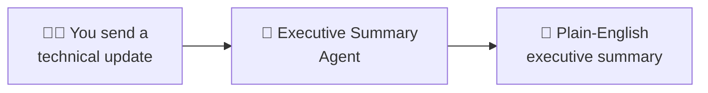

# Module 0 - പരിചയപ്പെടുത്തി

⏱️ ~10 മിനിറ്റ്

> [!WARNING]
> **മുന്‍ദര്‍ശനം & പരിമിതികള്‍:** [Hosted Agents](https://learn.microsoft.com/azure/foundry/agents/concepts/hosted-agents) ഇപ്പോള്‍ **പബ്ലിക്ക് പ്രിവ്യൂ**ത്തിലാണ് - പ്രൊഡക്ഷന്‍ വര്‍ക്ക്ലോർഡുകൾക്കായി ശുപാർശ ചെയ്യപ്പെടുന്നില്ല. താഴെ കൊടുത്ത കാര്യങ്ങൾ മനസിലാക്കുക:
> - **പിന്തുണയുള്ള മേഖലകൾ കണിഷ്ടമാണ്** - റിസോഴ്‌സുകൾ സൃഷ്ടിക്കുന്നതിന് മുമ്പ് [മേഖല ലഭ്യത](https://learn.microsoft.com/azure/foundry/agents/concepts/hosted-agents#region-availability) പരിശോധിക്കുക. പിന്തുണയില്ലാത്ത മേഖലം തിരഞ്ഞെടുക്കുകയാണെങ്കിൽ, ഡിപ്ലോയ്‌മെന്റ് പരാജയപ്പെടും.
> - `agent-framework-foundry-hosting` പാക്കേജ് പ്രീ-റിലീസ് ആണ് - പതിപ്പുകള്‍ക്കിടയിലെ API-കൾ മാറാനും സാധ്യതയുണ്ട്.
> - സ്കെയിൽ പരിധികൾ: ഹോസ്റ്റഡ് ഏജന്റുകൾ 0–5 പ്രതിനിധികൾ (സ്കെയിൽ-ടു-സീറോ ഉൾപ്പെടെ) പിന്തുണയ്ക്കുന്നു.
> - ഈ വർക്ഷോപ്പിൽ കാണിക്കുന്ന ചില സവിശേഷതകൾ സേവനം GA-യിലേക്ക് മാറുമ്പോൾ മാറാം.

## നിങ്ങൾ നിർമ്മിക്കുന്നതു

ഈ വർക്ഷോപ്പിൽ, നിങ്ങൾ **"Explain Like I'm an Executive"** പദറ്റന്ന ഒരു ഹോസ്റ്റഡ് AI ഏജന്റ് നിർമ്മിക്കും - പ്രയോഗ സങ്കീർണ്ണമായ സാങ്കേതിക പുതുക്കലുകൾ എളുപ്പത്തിലുള്ള ഇംഗ്ലീഷ് എക്സിക്യൂട്ടീവ് സംഗ്രഹങ്ങളായി പുനരാഖ്യാനം ചെയ്യുന്നു.

**ഏജന്റ് ഉപയോഗിക്കുന്നു:**
- **Microsoft Agent Framework** - ഏജന്റ് ലൊജിക്‌ക്കും ഘടനക്കും
- **Foundry Toolkit for VS Code** - സ്കാഫോൾഡ് ചെയ്യുക, ലോക്കലായി പരീക്ഷിക്കുക, ഡിപ്ലോയ് ചെയ്യുക
- **ഒരു AI മോഡൽ** (ഉദാഹരണം: `gpt-4.1-mini/gpt-5-mini`) - സംഗ്രഹങ്ങൾ സൃഷ്ടിക്കാൻ

ലാബിന്‍റെ അവസാനം, നിങ്ങൾക്ക് ഏജന്റ് ഇന്‍സ്പെക്ടർ വഴി ലോക്കലായി പരീക്ഷിക്കാൻ കഴിയുന്ന പ്രവർത്തനക്ഷമമായ ഒരു ഏജന്റ് ഉണ്ടാകും, ഇഷ്ടാനുസൃതമായി ക്ലൗഡിലേക്ക് ഡിപ്ലോയ് ചെയ്യാനും കഴിയും.

---

## ഹോസ്റ്റഡ് ഏജന്റുകൾ എന്ന് 무엇인가?

ഒരു **ഹോസ്റ്റഡ് ഏജന്റ്** Microsoft Foundry-ൽ സേവനമായി നടത്തപ്പെടുന്ന AI ഏജന്റ് ആണ്. നിങ്ങളുടെ സ്വന്തം ഇൻഫ്രാസ്ട്രക്ചർ നിയന്ത്രിക്കുന്നതിന് പകരം, ഏജന്റ് കോഡ് ഒരു കണ്ടെയ്‌നറിലേക്ക് പാക്കേജ് ചെയ്ത് Foundry അത് സ്കെയിലിംഗ്, ഹോസ്റ്റിംഗ്, സ്റ്റാൻഡേർഡ് HTTP എന്റ്പോയിന്റ് വഴി എക്സ്പോസ് ചെയ്യുന്നതിന് നോക്കുന്നു.

| ആശയം | അർത്ഥം |
|---------|--------------|
| **ഏജന്റ്** | ഉപയോക്തൃ സന്ദേശം സ്വീകരിച്ച്, AI മോഡൽ വിളിച്ച്, ഘടനയുള്ള പ്രതികരണം നൽകുന്ന നിങ്ങളുടെ Python കോഡ് |
| **ഹോസ്റ്റഡ്** | Foundry നിങ്ങളുടെ കണ്ടെയ്‌നർ തുടരും - VMs, Kubernetes, അല്ലെങ്കിൽ ഇൻഫ്രാസ്ട്രക്ചർ നിയന്ത്രണം ഇല്ലാതെ |
| **പ്രതികരണ പ്രോട്ടോകോൾ** | ഏതും ക്ലൈന്റും ഉപയോഗിക്കാവുന്ന സ്റ്റാൻഡേർഡ് HTTP API (`POST /responses`) ഏജന്റുമായി ഇടപഴകാൻ |
| **ഏജന്റ് ഇന്‍സ്പെക്ടർ** | Foundry Toolkit-ലുണ്ടായ ഒരു ലോക്കൽ ടെസ്റ്റിംഗ് UI, ഏജന്റിനൊപ്പം ചാറ്റ് ചെയ്യാനും ഡിപ്ലോയ്‌മെന്റ് മുമ്പ് പരിശോധിക്കാനുമുള്ളത് |

ഈ വർക്ഷോപ്പിൽ, നിങ്ങൾ പൂർത്തിയായി ഹോസ്റ്റഡ് ഏജന്റ് ഉണ്ടാക്കും - അല്ലെങ്കിൽ നിങ്ങൾക്ക് ഇഷ്ടമെങ്കിൽ ലോക്കൽ ടെസ്റ്റിങ്ങിൽ നിർത്താം.

---

## നിങ്ങളുടെ വഴി തിരഞ്ഞെടുക്കുക

> ⚠️ **തുടരുന്നതിന് മുമ്പ് ഒരു വഴി തിരഞ്ഞെടുക്കുക.** നിങ്ങളുടെ തീരുമാനം ഏത് ടൂളുകൾ ഇൻസ്റ്റാൾ ചെയ്യേണ്ടതാണെന്നും ഏത് മൊഡ്യൂളുകൾ ബാധകമാണെന്നും നിശ്ചയിക്കുന്നു. സബ്‌സ്‌ക്രിപ്ഷൻ ലഭിച്ചാൽ പാത B → പാത A-യിലേക്ക് മാറാം.

<strong>🅰️ പാത A - Azure ക്ലൗഡ് (Azure സബ്‌സ്‌ക്രിപ്ഷൻ ആവശ്യമാണ്)</strong>

| | വിശദാംശങ്ങൾ |
|---|---|
| **ഇതിന് ആരാണ്?** | നിങ്ങൾക്ക് സജീവമായ Azure സബ്‌സ്‌ക്രിപ്ഷൻ ഉണ്ട്, Foundry റിസോഴ്‌സുകൾ സൃഷ്ടിക്കാൻ സാധിക്കും |
| **മോഡൽ** | Foundry വഴി Azure OpenAI (ഉദാഹരണം: `gpt-4.1-mini/gpt-5-mini`) |
| **കവർ ചെയ്യുന്ന മൊഡ്യൂളുകൾ** | എല്ലാ മൊഡ്യൂളുകളും (00–07) |
| **ക്ലൗഡിലേക്ക് ഡിപ്ലോയ് ചെയ്യാമോ?** | ✅ അതെ - മുഴുവൻ അവസാന മുതൽ അവസാനം ഡിപ്ലോയ്മെന്റ് |

<strong>🅱️ പാത B - ലോക്കൽ / ഫ്രീ-ടിയർ (Azure സബ്‌സ്‌ക്രിപ്ഷൻ വേണ്ട)</strong>

| | വിശദാംശങ്ങൾ |
|---|---|
| **ഇത് ആര്ക്ക് വേണ്ടി?** | MVPകൾ, വിദ്യാർഥികൾ, അല്ലെങ്കിൽ Azure ആക്സസ് ഇല്ലാത്ത ആരും |
| **മോഡൽ** | **Foundry Local** (സ്വതന്ത്രം, നിങ്ങളുടെ യന്ത്രത്തിൽ പ്രവർത്തിക്കും) |
| **ശ്രദ്ധിച്ചിരിക്കുന്ന മൊഡ്യൂളുകൾ** | മൊഡ്യൂളുകൾ 00–04 (deploy & cloud verify ഒഴിവാക്കുക) |
| **ക്ലൗഡിലേക്ക് deploy ചെയ്യണോ?** | ❌ ഇല്ല - Agent Inspector വഴി ലൊക്കൽ ടെസ്റ്റിംഗ് മാത്രം |

---

## എല്ലാ പാതകളും: ആവശ്യമായ ഉപകരണങ്ങൾ

താഴെ നൽകുന്ന ഓരോ ഉപകരണവും ഇൻസ്റ്റാള്‍ ചെയ്യുക. ഇൻസ്റ്റാൾ ചെയ്ത ശേഷം, ചേക് കമാൻഡ് chạy‌ച്ച് ചെയ്യാനായി പ്രവർത്തിക്കുന്നുവെന്ന് ഉറപ്പാക്കുക.

| # | ഉപകരണം | പതിപ്പ് | ഇൻസ്റ്റാൾ | പരിശോധിക്കുക (പ്രതീക്ഷിച്ച ഫലം) |
|---|------|---------|---------|---------------------------|
| 1 | **Visual Studio Code** | ഏറ്റവും പുതിയത് | [code.visualstudio.com](https://code.visualstudio.com/) | പിശകുകൾ ഇല്ലാതെ തുറക്കും |
| 2 | **Python** | 3.12 അല്ലെങ്കിൽ അതിന് മുകളിൽ | [python.org/downloads](https://www.python.org/downloads/) | `python --version` $\rightarrow$ `Python 3.12.x` |
| 3 | **Foundry Toolkit for VS Code** | ഏറ്റവും പുതിയത് | എക്സ്റ്റൻഷൻ ഐഡി: `ms-windows-ai-studio.windows-ai-studio` | Activity Bar-ൽ Foundry ഐക്കൺ |
| 4 | **Python extension for VS Code** | ഏറ്റവും പുതിയത് | എക്സ്റ്റൻഷൻ ഐഡി: `ms-python.python` | എക്സ്റ്റൻഷൻസ് പാനലിൽ ഇൻസ്റ്റാൾ ചെയ്തിട്ടുണ്ട് |

> [!TIP]
> **ഇൻസ്റ്റാളേഷനു വേണ്ടിയുള്ള പ്രൊ-ടിപ്പുകൾ:**
> - **Python PATH (Windows):** Python ഇൻസ്റ്റാളറിന്റെ ആദ്യ സ്ക്രീനിൽ എപ്പോഴും **"Add Python to PATH"** പരിശോധിക്കുക. ഇതില്ലാതെ, `python` നിങ്ങളുടെ ടെർമിനലിൽ തിരിച്ചറിഞ്ഞില്ല.
> - **ബഹുഭൂരിപക്ഷ Python പതിപ്പുകൾ:** Python 3.10 ഉം 3.12 യും ഇൻസ്റ്റാൾ ചെയ്തിട്ടുണ്ടെങ്കിൽ, നിങ്ങളുടെ വിർച്വൽ എൻവയോൺമെന്റിനായി ശരിയായ പതിപ്പ് ഉപയോഗിക്കുന്നുവെന്ന് ഉറപ്പാക്കാൻ `python3.12 -m venv .venv` ഉപയോഗിക്കുക.
> - **Docker WSL 2 (Windows):** Docker Desktop ഇൻസ്റ്റാളേഷനിൽ **WSL 2 ബാക്ക്എൻഡ്** തിരഞ്ഞെടുക്കണം. Hyper-V ഉപയോഗിച്ചുള്ള Docker സ്വന്തമായി Foundry കണ്ടെയ്‌നർ ബിൽഡുകളിൽ പ്രശ്നങ്ങൾ ഉണ്ടാക്കുകയും വൈകിപ്പിക്കാനും സാധ്യതയുണ്ട്.
> - **Docker ആരംഭിക്കുന്നില്ലേ?** Docker Desktop തുടങ്ങാൻ ശേഷമുള്ള 30–60 സെക്കൻഡ് കാത്തിരിക്കുക. `docker info` chạy‌ച്ച് ചെയ്യുക - "Cannot connect to the Docker daemon" എന്ന് കാണുന്നെങ്കിൽ, Docker ഇപ്പോഴും ആരംഭിക്കുകയാണ്.
> - **VS Code എക്സ്റ്റൻഷൻസ് ലോഡ് ചെയ്യുകയില്ലേ?** എക്സ്റ്റൻഷൻസ് ഇൻസ്റ്റാൾ ചെയ്തതിന് ശേഷം വിൻഡോ റീലോഡ് ചെയ്യുക: `Ctrl+Shift+P` → `Developer: Reload Window`.

> **Windows ഉപയോക്താക്കൾ:** Python ഇൻസ്റ്റാളേഷനിൽ **"Add Python to PATH"** ഓപ്ഷൻ പരിശോധിക്കുക.

**അടുത്തത്:** [01 - ക്രമീകരിക്കൽ →](01-setup.md)

---

<!-- CO-OP TRANSLATOR DISCLAIMER START -->
**അറിയിപ്പ്**:
ഈ രേഖ AI പരിഭാഷാ സേവനം [Co-op Translator](https://github.com/Azure/co-op-translator) ഉപയോഗിച്ച് പരിഭാഷപ്പെടുത്തിയതാണ്. ഞങ്ങൾ കൃത്യതയ്ക്കായി ശ്രമിക്കുന്നുവെങ്കിലും, ഓട്ടോമേറ്റഡ് പരിഭാഷകളിൽ പിഴവുകൾ അല്ലെങ്കിൽ തെറ്റായ വിവരങ്ങൾ ഉണ്ടാകാൻ സാധ്യതയുണ്ട്. അതിന്റെ സ്വാഭാവിക ഭാഷയിലുള്ള അസൽ രേഖയാണ് പ്രാമാണികമായ ഉറവിടമായി പരിഗണിക്കേണ്ടത്. നിർണായകമായ വിവരങ്ങൾക്ക്, പ്രൊഫഷണൽ മനുഷ്യ പരിഭാഷ ശുപാർശ ചെയ്യുന്നു. ഈ പരിഭാഷ ഉപയോഗിച്ച് ഉണ്ടാകുന്ന തെറ്റിദ്ധാരണകൾ അല്ലെങ്കിൽ തെറ്റായ വ്യാഖ്യാനങ്ങൾക്കായി ഞങ്ങൾ ഉത്തരവാദികളല്ല.
<!-- CO-OP TRANSLATOR DISCLAIMER END -->