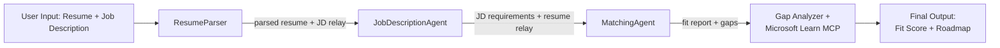

# PersonalCareerCopilot - രിസ്യൂം → ജോബ് ഫിറ്റ് മൂല്യനിർണ്ണയകർ

ഒരു വർക്‌ഫ്ലോ-ഫസ്റ്റ് മൾട്ടി-ഏജന്റ് ആപ്പ്, രിസ്യൂം ജോബ് വിവരണത്തോട് എത്രത്തോളം യോജിക്കുന്നുവെന്ന് വിലയിരുത്തുകയും, പിന്നെ വ്യക്തിഗത പഠന റോഡ്‌മാപ്പ് സൃഷ്ടിച്ച് വിടവുകൾ പൂർത്തിയാക്കാൻ സഹായിക്കുകയും ചെയ്യുന്നു.

---

## ഏജന്റുകൾ

| ഏജന്റ് | റോൾ | ടൂൾസ് |
|-------|------|-------|
| **ResumeParser** | രിസ്യൂം ടെക്‌സ്‌റ്റിൽ നിന്നുള്ള ഘടനാപരമായ കഴിവുകൾ, പരിചയം, സർട്ടിഫിക്കേഷനുകൾ ഏറ്റെടുക്കുന്നു | - |
| **JobDescriptionAgent** | ജോബ് വിവരണത്തിൽ ആവശ്യമായ/പ്രിഫർഡ് കഴിവുകൾ, പരിചയം, സർട്ടിഫിക്കേഷനുകൾ കൈമാറുന്നു | - |
| **MatchingAgent** | പ്രൊഫൈൽ vs ആവശ്യകതകൾ താരതമ്യം ചെയ്യുന്നു → ഫിറ്റ് സ്കോർ (0-100) + യോജിക്കുന്ന/കുറഞ്ഞ കഴിവുകൾ | - |
| **GapAnalyzer** | Microsoft Learn റിസോഴ്‌സുകൾ ഉപയോഗിച്ച് ഒരു വ്യക്തിഗത പഠന റോഡ് മാപ്പ് നിർമ്മിക്കുന്നു | `search_microsoft_learn_for_plan` (MCP) |

## വർക്‌ഫ്ലോ



---

## വേഗത്തിൽ തുടങ്ങേണ്ടത്

### 1. പരിസ്ഥിതി സജ്ജീകരിക്കുക

ഈ ഫോൾഡർ വർക്‌ഫ്ലോ ആധാരമാക്കിയ ലാബ് 02 സ്‌കാഫോൾഡിനായി റഫറൻസ് ഇംപ്ലിമെന്റേഷനാണ്. ഇതിലെ `main.py` നിലവിലുള്ള പ്രോമ്പ്റ്റ് ബ്ലോക്കുകളും `WorkflowBuilder` ഉപയോഗിച്ച് നാല് ഏജന്റുകളും ബന്ധിപ്പിക്കുന്നു.

```powershell
cd workshop\lab02-multi-agent\PersonalCareerCopilot
python -m venv .venv
.\.venv\Scripts\Activate.ps1          # Windows PowerShell
# source .venv/bin/activate            # macOS / Linux
pip install -r requirements.txt
```

### 2. ക്രെഡൻഷ്യലുകൾ കോൺഫിഗർ ചെയ്യുക

ഈ ഫോൾഡറിൽ ഒരു `.env` ഫയൽ സൃഷ്ടിക്കൂ:

```powershell
copy .env .env.bak 2>$null; echo $null > .env
```

`.env` എഡിറ്റ് ചെയ്യുക:

```env
FOUNDRY_PROJECT_ENDPOINT=https://<your-account>.services.ai.azure.com/api/projects/<your-project>
AZURE_AI_MODEL_DEPLOYMENT_NAME=gpt-4.1-mini
```

| മൂല്യം | എവിടെ കണ്ടെത്താം |
|-------|------------------|
| `FOUNDRY_PROJECT_ENDPOINT` | Foundry Toolkit സൈഡ്ബാർ → പ്രോജക്ടിൽ റൈറ്റ്-ക്ലിക്ക് ചെയ്ത് → **Copy Project Endpoint** |
| `AZURE_AI_MODEL_DEPLOYMENT_NAME` | Foundry സൈഡ്ബാർ → പ്രോജക്ട് വികസിപ്പിക്കുക → **Models + endpoints** → ഡിപ്പ്ലോയ്മെന്റ് നാമം |

### 3. ലോക്കലിൽ ഓടിക്കുക

```powershell
python -m debugpy --listen 127.0.0.1:5679 main.py --port 8088
```

അല്ലാത്തെങ്കിൽ VS Code ടാസ്ക് ഉപയോഗിക്കുക: `Ctrl+Shift+P` → **Tasks: Run Task** → **Run Agent HTTP Server**.

F5 ഡിബഗിംഗിന് **Debug Local Agent HTTP Server** ഉപയോഗിക്കുക.

### 4. ഏജന്റ് ഇൻസ്പെക്ടറുമായി പരീക്ഷിക്കുക

ഏജന്റ് ഇൻസ്പെക്ടർ തുറക്കുക: `Ctrl+Shift+P` → **Foundry Toolkit: Open Agent Inspector**.

ഈ ടെസ്റ്റ് പ്രോമ്പ്റ്റ് പിടിക്കാം:

```
Resume:
Jane Doe
Senior Software Engineer with 5 years of experience in Python, Django, and AWS.
Built microservices handling 10K+ requests/second. Led a team of 4 developers.
Certifications: AWS Solutions Architect Associate.
Education: B.S. Computer Science, State University.

Job Description:
Senior Cloud Engineer at Contoso Ltd.
Required: Python, Azure, Kubernetes, Terraform, CI/CD pipelines.
Preferred: Go, monitoring (Prometheus/Grafana), cost optimization.
Experience: 5+ years in cloud infrastructure.
Certifications: Azure Solutions Architect Expert preferred.
```

**പ്രതീക്ഷിച്ചത്:** ഫിറ്റ് സ്കോർ (0-100), യോജിക്കുന്ന/കുറഞ്ഞ കഴിവുകൾ, Microsoft Learn URLs സഹിതം വ്യക്തിഗത പഠന റോഡ് മാപ്പ്.

### 5. Foundry-യിൽ സംയോജിപ്പിക്കുക

`Ctrl+Shift+P` → **Foundry Toolkit: Deploy Hosted Agent** → നിങ്ങളുടെ പ്രോജക്ട് തിരഞ്ഞെടുക്കുക → സ്ഥിരീകരിക്കുക.

---

## പ്രോജക്ട് ഘടന

```
PersonalCareerCopilot/
├── .env                ← Your credentials (git-ignored)
├── agent.yaml          ← Hosted agent definition (name, resources, env vars)
├── Dockerfile          ← Container image for Foundry deployment
├── main.py             ← 4-agent workflow (instructions, MCP tool, WorkflowBuilder)
└── requirements.txt    ← Python dependencies
```

## പ്രധാനം ഫയലുകൾ

### `agent.yaml`

Foundry ഏജന്റ് സർവീസിനായി ഹോസ്റ്റുചെയ്യേണ്ട ഏജന്റ് നിർവചിക്കുന്നു:
- `kind: hosted` - മാനേജുചെയ്‌ത കണ്ടെയ്നറായി പ്രവർത്തിക്കുന്നു
- `protocols` - `responses` പ്രോട്ടോക്കോൾ `version: 2.0.0` ഉപയോഗിച്ച്, `/responses` HTTP എൻപോയിന്റ് പുറത്തുകൊള്ളുന്നു
- `environment_variables` - `AZURE_AI_MODEL_DEPLOYMENT_NAME` ഇവിടെ പ്രഖ്യാപിച്ചിരിക്കുന്നു; `FOUNDRY_PROJECT_ENDPOINT` ഡിപ്പ്ലോയ്മെന്റ് സമയത്ത് സ്വയമേവ ഉൾപ്പെടുത്തപ്പെട്ടിരിക്കുന്നു

### `main.py`

അടങ്ങിയിരിക്കുന്നു:
- **ഏജന്റ് നിർദ്ദേശങ്ങൾ** - നാല് `*_INSTRUCTIONS` കോൺസ്റ്റന്റുകൾ, ഓരോ ഏജന്റിനുമൊന്ന്
- **MCP ടൂൾ** - `search_microsoft_learn_for_plan()` Streamable HTTP വഴി `https://learn.microsoft.com/api/mcp` വിളിക്കുന്നു
- **ഏജന്റ് സൃഷ്ടി** - നാല് `Agent()` + `AgentExecutor()` ഇൻസ്റ്റാൻസുകൾ ഒരൊറ്റ `FoundryChatClient` പങ്കിടുന്നു
- **വർക്ക്‌ഫ്‌ലോ ഗ്രാഫ്** - `WorkflowBuilder` നിരക്ക് ആയി ഏജന്റുമാരെ ബന്ധിപ്പിക്കുന്നു: ResumeParser → JD Agent → MatchingAgent → GapAnalyzer
- **സെർവർ സ്റ്റാർട്ടപ്പ്** - `ResponsesHostServer` പോർട്ട് 8088-ൽ പ്രവർത്തിക്കുന്നു

### `requirements.txt`

| പാക്കേജ് | ഉദ്ദേശ്യം |
|---------|----------|
| `agent-framework-foundry` | കോർ റൺടൈം: `Agent`, `AgentExecutor`, `WorkflowBuilder`, `@tool`, `FoundryChatClient` |
| `agent-framework-foundry-hosting` | `ResponsesHostServer` + ഫൗണ്ട്രി ഹോസ്റ്റിംഗ് ഇന്റഗ്രേഷൻ |
| `mcp<2,>=1.24.0` | GapAnalyzer-ന് MCP ക്ലയന്റ് (`streamable_http_client`) |
| `debugpy` | പൈത്തൺ ഡീബഗിംഗ് (VS കോഡിൽ F5) |

---

## പ്രശ്ന പരിഹാരം

| പ്രശ്നം | പരിഹാരം |
|-------|-----|
| `KeyError: 'FOUNDRY_PROJECT_ENDPOINT'` അല്ലെങ്കിൽ `KeyError: 'AZURE_AI_MODEL_DEPLOYMENT_NAME'` | `.env` സൃഷ്ടിക്കുക, അതിൽ `FOUNDRY_PROJECT_ENDPOINT` ഉം `AZURE_AI_MODEL_DEPLOYMENT_NAME` ഉം സജ്ജീകരിച്ചിരിക്കുന്നതു വ്യക്തമാക്കുക |
| `ModuleNotFoundError: No module named 'agent_framework'` | വെന്ന് സജീവമാക്കി `pip install -r requirements.txt` റൺ ചെയ്യുക |
| ഔട്ട്പുടിൽ മൈക്രോസോഫ്‌റ്റ് ലേൺ URLs ഇല്ലാതെ | `https://learn.microsoft.com/api/mcp`-ലേക്കുള്ള ഇന്റർനെറ്റ് കണറ്റ് കണക്ഷൻ പരിശോധിക്കുക |
| ഒരായി മാത്രമുള്ള ഗാപ്പ് കാർഡ് (ചുരുക്കം) | `GAP_ANALYZER_INSTRUCTIONS` `CRITICAL:` ബ്ലോക്ക് ഉൾപ്പെടുന്നുവെന്ന് ഉറപ്പാക്കുക |
| പോർട്ട് 8088 ഉപയോഗത്തിലാണ് | മറ്റ് സർവറുകൾ നിർത്തുക: `netstat -ano \| findstr :8088` |

വിശദമായ പ്രശ്ന പരിഹാരത്തിനായി, [Module 8 - Troubleshooting](../docs/08-troubleshooting.md) കാണുക.

---

**സമ്പൂർണ്ണ വാക്ക്‌ത്രൂ:** [Lab 02 Docs](../docs/README.md) · **പിന്നീട്:** [Lab 02 README](../README.md) · [Workshop Home](../../../README.md)

---

<!-- CO-OP TRANSLATOR DISCLAIMER START -->
**അറിയിപ്പ്**:
ഈ രേഖ AI പരിഭാഷാ സേവനം [Co-op Translator](https://github.com/Azure/co-op-translator) ഉപയോഗിച്ച് പരിഭാഷപ്പെടുത്തിയതാണ്. ഞങ്ങൾ കൃത്യതയ്ക്കായി ശ്രമിക്കുന്നുവെങ്കിലും, ഓട്ടോമേറ്റഡ് പരിഭാഷകളിൽ പിഴവുകൾ അല്ലെങ്കിൽ തെറ്റായ വിവരങ്ങൾ ഉണ്ടാകാൻ സാധ്യതയുണ്ട്. അതിന്റെ സ്വാഭാവിക ഭാഷയിലുള്ള അസൽ രേഖയാണ് പ്രാമാണികമായ ഉറവിടമായി പരിഗണിക്കേണ്ടത്. നിർണായകമായ വിവരങ്ങൾക്ക്, പ്രൊഫഷണൽ മനുഷ്യ പരിഭാഷ ശുപാർശ ചെയ്യുന്നു. ഈ പരിഭാഷ ഉപയോഗിച്ച് ഉണ്ടാകുന്ന തെറ്റിദ്ധാരണകൾ അല്ലെങ്കിൽ തെറ്റായ വ്യാഖ്യാനങ്ങൾക്കായി ഞങ്ങൾ ഉത്തരവാദികളല്ല.
<!-- CO-OP TRANSLATOR DISCLAIMER END -->