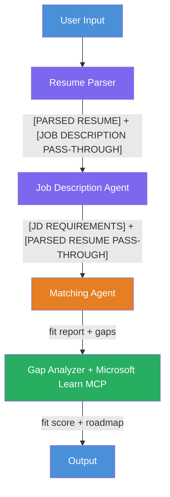

# ലാബ് 02 - മൾട്ടി-എജന്റ് വർക്ക്‌ഫ്ലോ: റിസ്യൂം → ജോബ് ഫിറ്റ് ഇവാലുവേറ്റർ

## അവലോകനം

ഈ ഹാൻഡ്സ്-ഓൺ ലാബിൽ, നിങ്ങൾ VS കോഡിലുള്ള Foundry Toolkit ഉപയോഗിച്ച് **വർക്ക്‌ഫ്ലോ-ഫസ്റ്റ് മൾട്ടി-എജന്റ് ആപ്പ്** നിര്‍മ്മിച്ച് അത് Microsoft Foundry Agent Service-ലേക്ക് വിനിയോഗിക്കും.

**നിങ്ങൾ നിർമ്മിക്കാനുള്ളത്:** റിസ്യൂം → ജോബ് ഫിറ്റ് ഇവാലുവേറ്റർ, जो एक रिज़्यूमे और नौकरी विवरण को पार्स करता है, मेल खाता स्कोर करता है, और Microsoft Learn വിഭവങ്ങൾ ഉപയോഗിച്ച് വ്യക്തിഗത പഠന റോഡ്‌മാപ്പ് ഉളവാക്കുന്നു.

---

## ആർക്കിടെക്ചർ

**ഇത് പ്രവർത്തിക്കുമ്പോൾ:**
1. ഉപയോക്താവ് ഒരു റിസ്യൂവും ജോലി വിവരണവും പസ്റ്റുചെയ്യുന്നു.
2. **ResumeParser** റിസ്യൂം പാഴ്സ് ചെയ്ത് ജോലി വിവരണം വെർbatim ആയി `[JOB DESCRIPTION PASS-THROUGH]` വിഭാഗത്തിലേക്ക് പകർത്തുന്നു.
3. **JD Agent** പാസ്-ത്രൂയിൽ നിന്നു ഘടനയുള്ള ആവശ്യകതകൾ എടുത്ത്, `[PARSED RESUME]` ഫോർവേർഡ് ആയിരിക്കും `[PARSED RESUME PASS-THROUGH]` ആയി.
4. **MatchingAgent** `[PARSED RESUME PASS-THROUGH]`-നും `[JD REQUIREMENTS]`-നുമിടയിൽ താരതമ്യം செய்து ഒരു ഫിറ്റ് സ്കോർ നൽകുന്നു.
5. **GapAnalyzer** അന്തരങ്ങൾ പ്രായോഗിക റോഡ്‌മാപ്പായി മാറുകയും MCP മുഖാന്തിരം യഥാർത്ഥ Microsoft Learn ലിങ്കുകൾ നേടുകയും ചെയ്യുന്നു.

---

## മുൻനിബന്ധനകൾ

ആദ്യം ലാബ് 01 പൂർത്തിയാക്കുക:

- [Lab 01 - Single Agent](../lab01-single-agent/README.md)

---

## ഭാഗം 1: മോഡ്യുലുകൾ ക്രമത്തിലായി വായിക്കുക

പൂർണ്ണ പഠനപാത കാണുക:

- [Lab 2 Docs - Prerequisites](docs/00-prerequisites.md)
- [Lab 2 Docs - Full Learning Path](docs/README.md)
- [PersonalCareerCopilot run guide](PersonalCareerCopilot/README.md)

---

## ഭാഗം 2: വർക്ക്‌ഫ്ലോ നിർമ്മിക്കുകയും പരീക്ഷിക്കുകയും ചെയ്യുക

1. Foundry Toolkit വിഹിതം ഉപയോഗിച്ച് വർക്ക്‌ഫ്ലോ അധിഷ്ഠിത പ്രോജക്ട് സ്കാഫോൾഡ് ചെയ്യുക.
2. പ്രോമ്പ്റ്റ് ബ്ലോക്കുകളും വർക്ക്‌ഫ്ലോ ഗ്രാഫും `PersonalCareerCopilot/main.py` നിൽ നിന്നും നിങ്ങളുടെ വർക്ക്‌സ്പേസിലേയ്ക്ക് പകർത്തുക.
3. Agent Inspector ഉപയോഗിച്ച് പ്രാദേശികമായി ഓടി നാല് ഏജന്റുകളും MCP ഉപകരണം ശരിയായി പ്രവർത്തിക്കുന്നുവെന്ന് പരിശോധിക്കുക.
4. പ്രാദേശിക പരീക്ഷണം വിജയകരമായാൽ ഹോസ്റ്റഡ് ഏജന്റ് Foundry-ലേക്ക് വിനിയോഗിക്കുക.

---

## ഓർക്കസ്ട്രേഷൻ പാറ്റേണുകൾ

ലാബ് 02 ഒരു **ക്രമപരമായ പൈപ്പ്‌ലൈൻ** ഉപയോഗിക്കുന്നു: ഓരോ ഏജന്റിന്റെയും ഔട്ട്പുട്ട് അടുത്തയിലേക്കാണ് പോവുക, വർക്ക്‌ഫ്ലോ അന്തിമ ഏജന്റിന്റെ പ്രതികരണം തിരികെ നൽകുന്നു. രണ്ട് പാറ്റേണുകൾ ഇത് പ്രവർത്തിപ്പിക്കുന്നു:

- **ക്രമപരമായ ചൈൻ** - `WorkflowBuilder` ResumeParser → JD Agent → MatchingAgent → GapAnalyzer എന്നിങ്ങനെ ഒരു `add_edge()` കോൾ ഓരോ ഘട്ടത്തിലും ആണ് ഉപയോഗിക്കുന്നത്
- **കൺറന്റ് റിലേ** - ഓരോ ഏജന്റും തന്റെ നേരിട്ട പ്രീഡിസ്സസർ ഔട്ട്പുട്ട് മാത്രം കാണുന്നതിനാൽ, ResumeParser, JD Agent എന്നിവ താഴെയുള്ള ഏജന്റുകൾക്ക് ആവശ്യമായ ഡാറ്റ ലേബൽ ചെയ്ത പാസ്-ത്രൂ ഭാഗങ്ങളിൽ പകർത്തുന്നു

ഡോക്സുകൾ ഫാൻ-ഔട്ട്/ഫാൻ-ഇൻ ഉപയോഗിക്കാത്തതിന്നും മറ്റൊരു ഏജന്റ് ഉപയോഗിച്ച് ഗ്രാഫ് എങ്ങനെ ദീർഘീകരിക്കാമെന്നതും വിശദീകരിക്കുന്നു.

കാണുക [docs/04-orchestration-patterns.md](docs/04-orchestration-patterns.md).

---

**മുൻപ്:** [Lab 01 - Single Agent](../lab01-single-agent/README.md) · **തിരികെ:** [Workshop Home](../../README.md)

---

<!-- CO-OP TRANSLATOR DISCLAIMER START -->
**അറിയിപ്പ്**:
ഈ രേഖ AI പരിഭാഷാ സേവനം [Co-op Translator](https://github.com/Azure/co-op-translator) ഉപയോഗിച്ച് പരിഭാഷപ്പെടുത്തിയതാണ്. ഞങ്ങൾ കൃത്യതയ്ക്കായി ശ്രമിക്കുന്നുവെങ്കിലും, ഓട്ടോമേറ്റഡ് പരിഭാഷകളിൽ പിഴവുകൾ അല്ലെങ്കിൽ തെറ്റായ വിവരങ്ങൾ ഉണ്ടാകാൻ സാധ്യതയുണ്ട്. അതിന്റെ സ്വാഭാവിക ഭാഷയിലുള്ള അസൽ രേഖയാണ് പ്രാമാണികമായ ഉറവിടമായി പരിഗണിക്കേണ്ടത്. നിർണായകമായ വിവരങ്ങൾക്ക്, പ്രൊഫഷണൽ മനുഷ്യ പരിഭാഷ ശുപാർശ ചെയ്യുന്നു. ഈ പരിഭാഷ ഉപയോഗിച്ച് ഉണ്ടാകുന്ന തെറ്റിദ്ധാരണകൾ അല്ലെങ്കിൽ തെറ്റായ വ്യാഖ്യാനങ്ങൾക്കായി ഞങ്ങൾ ഉത്തരവാദികളല്ല.
<!-- CO-OP TRANSLATOR DISCLAIMER END -->