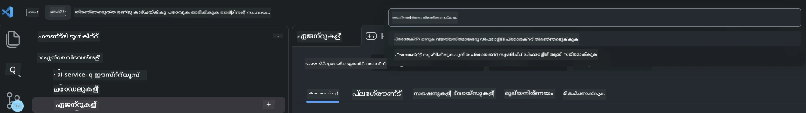

# Module 0 - പരിചയം

⏱️ ~10 മിനിറ്റ്

> [!WARNING]
> **പ്രീവ്യൂ & പരിധികൾ:** [Hosted Agents](https://learn.microsoft.com/azure/foundry/agents/concepts/hosted-agents) ഇപ്പോൾ **പബ്ലിക്ക് പ്രിവ്യൂ** സ്റഥിതിയിലാണ് - പ്രൊഡക്ഷൻ വർക്ക്‌ലോഡുകൾക്ക് ശുപാർശയില്ല. ഈ വർക്ക്‌ഷോപ്പിൽ കാണിച്ച ചില ഫീച്ചറുകൾ serവീസ് GAക്കായി നീങ്ങുന്നതിനൊപ്പം മാറാൻ സാധ്യതയുണ്ട്.

## നിങ്ങൾ നിർമ്മിക്കുന്നത്

ഈ ലാബിൽ, നിങ്ങൾ Lab 01ൽ നിന്നുള്ള സിംഗിൾ-ഏജൻറ് കഴിവുകൾ വിപുലീകരിച്ച് **മൾട്ടി-ഏജൻറ് വർക്ക്‌ഫ്ലോ** നിർമ്മിക്കും - റിസ്യൂം → ജോബ് ഫിറ്റ് വാല്യുവേറ്റർ.

നിങ്ങൾ ഒരു **റിസ്യൂം**യും ഒരു **ജോബ് വിവരണം**യും പകർത്തിപ്പെസ്റ്റ് ചെയ്യുന്നു. നാല് പ്രത്യേകപ്പെടുത്തി സജ്ജമാക്കിയ ഏജൻറുകൾ ഇൻപുട്ട് അനുക്രമത്തിൽ പ്രോസസ്സ് ചെയ്ത്, പിന്നെ തിരികെ നൽകുന്നു:
- ഫിറ്റ് സ്കോർ (0–100 സ്ക്കോറിംഗ് ബ്രേക്ക്‌ഡൗൺ സഹിതം)
- ഒരു സ്കിൽ ആൻഡ് സർട്ടിഫിക്കേഷൻ ഗ്യാപ് ലിസ്റ്റ്
- ഓരോ ഗ്യാപിനും യഥാർത്ഥ Microsoft Learn ലിങ്കുകളോടടങ്ങിയ വ്യക്തിഗത പഠന റോഡ്‌മാപ്പ്

**വർക്ക്‌ഫ്ലോയിൽ ഉപയോഗിക്കുന്നത്:**
- **Microsoft Agent Framework** - അനുക്രമ പൈപ്പ്‌ലൈൻ ഓർക്കസ്ട്രേഷൻക്കായി `WorkflowBuilder`
- **Foundry Toolkit for VS Code** - സ്‌കാഫോൾഡ്, പ്രാദേശികമായി ടെസ്റ്റ് ചെയ്യുക, ഡിപ്പ്ലോയ് ചെയ്യുക
- **ഒരു AI മോഡൽ** (ഉദാഹരണത്തിന്, `gpt-4.1-mini`) - നാല് ഏജൻറുകളും ഉപയോഗിക്കുന്നത്
- **Microsoft Learn MCP സർവർ** - ഓരോ സ്കിൽ ഗ്യാപിനും യഥാർത്ഥ പഠന സ്രോതസ്സ് ലിങ്കുകൾ നൽകുന്നു

---

## നിങ്ങളുടെ വഴി തിരഞ്ഞെടുക്കുക

> ⚠️ **Lab 01ൽ നിങ്ങൾ ഉപയോഗിച്ച വഴിയേ തുടരണം.**

<details open>
<summary><strong>🅰️ വഴി A - Azure ക്ലൗഡ് (Azure സബ്സ്ക്രിപ്ഷൻ ആവശ്യമാണ്)</strong></summary>

| | വിശദാംശങ്ങൾ |
|---|---|
| **ഇതിന് ഏവർക്കാണ്?** | നിങ്ങൾ Azure സബ്സ്ക്രിപ്ഷൻ ഉപയോഗിച്ച് Lab 01 പൂർത്തിയാക്കി |
| **മോഡൽ** | ഔദ്യോഗിക Foundry വഴി Azure OpenAI (ഉദാഹരണം, `gpt-4.1-mini`) |
| **കവറായിട്ടുള്ള മോഡ്യൂളുകൾ** | എല്ലാ മോഡ്യൂളുകളും (00–09) |
| **ക്ലൗഡിലേക്ക് ഡിപ്പ്ലോയ് ചെയ്യുമോ?** | ✅അതെ - പൂർണ end-to-end ഡിപ്പ്ലോയ്മെന്റ് |

</details>

<details open>
<summary><strong>🅱️ വഴി B - Foundry Local (Azure സബ്സ്ക്രിപ്ഷൻ ആവശ്യമില്ല)</strong></summary>

| | വിശദാംശങ്ങൾ |
|---|---|
| **ഇതിന് ഏവർക്കാണ്?** | നിങ്ങൾ Lab 01 Foundry Local ഉപയോഗിച്ച് പൂർത്തിയാക്കി |
| **മോഡൽ** | Foundry Local (സ്വതന്ത്രം, നിങ്ങളുടെ മെഷീനിൽ പ്രവർത്തിക്കുന്നു) |
| **കവറായിട്ടുള്ള മോഡ്യൂളുകൾ** | 00–05 മോട്യൂളുകൾ (06–07 ഒഴിവാക്കുക - ഡിപ്പ്ലോയ് & ക്ലൗഡ് വെരിഫൈ) |
| **ക്ലൗഡിലേക്ക് ഡിപ്പ്ലോയ് ചെയ്യുമോ?** | ❌ഇല്ല - ഏജന്റ് ഇൻസ്‌പെക്ടർ മുഖേന പ്രാദേശിക പരിശോധന മാത്രം |

</details>

---

## Lab 01 പരിശോധന

Lab 02 നേരിട്ട് Lab 01 ൽ നിന്ന് നിർമ്മിക്കുന്നു. ഇവിടെ തുടങ്ങുന്നതിന് മുമ്പ് Lab 01 പൂർത്തിയാക്കുക.

Lab 01 ഇപ്പോഴും ചെയ്തിട്ടില്ലേ? ഇവിടെ തുടങ്ങുക: [Lab 01 - പരിചയം](../../lab01-single-agent/docs/00-prerequisites.md)

<details open>
<summary><strong>🅰️ വഴി A - Azure ക്ലൗഡ്</strong></summary>

```powershell
az account show --query "{name:name, id:id}" --output table
```

ഇതു പരാജയപ്പെട്ടാൽ, `az login` പ്രവർത്തിപ്പിക്കുക. തുടർന്ന് VS Codeൽ പരിശോധിക്കുക:

1. `Ctrl+Shift+P` → ടൈപ്പ് ചെയ്യുക **Foundry Toolkit** → കമാൻഡുകൾ കാണിക്കുന്നതായി സ്ഥിരീകരിക്കുക.
2. **Foundry Toolkit** ഐക്കൺ ക്ലിക്ക് ചെയ്യുക → നിങ്ങളുടെ പ്രോജക്റ്റും ഡിപ്പ്ലോയുചെയ്ത മോഡലും **സക്സീഡ്** ആയി കാണിക്കും.



> **RBAC:** നിങ്ങൾ Lab 01ൽ **Foundry User** നിയമിച്ചു. വീണ്ടും നിയമിക്കേണ്ടത് ഉണ്ടെങ്കിൽ, [Lab 01, Module 1](../../lab01-single-agent/docs/01-setup.md#deploy-a-model--assign-rbac) കാണുക. ഈ റോളിന് മുമ്പ് **Azure AI User** എന്ന പേരിൽ അറിയപ്പെടുന്നുവായിരുന്നു - അനുമതികൾ അത് പോലെ തന്നെ.

</details>

<details open>
<summary><strong>🅱️ വഴി B - Foundry Local</strong></summary>

```powershell
Invoke-WebRequest -Uri "http://localhost:5273/v1/health" -UseBasicParsing | Select-Object StatusCode
```

പ്രതീക്ഷിക്കുന്നത്: `StatusCode: 200`. അല്ലെങ്കിൽ, Foundry Toolkit സൈഡ്ബാർനിന്ന് Foundry Local വീണ്ടും സ്റ്റാർട്ട് ചെയ്യുക.

> സകല ഇൻഫറൻസും നിങ്ങളുടെ മെഷീനിൽ നടക്കുന്നു. മാത്രം বাহ്യ കോൾ MCP ടൂളിനു വേണ്ടി `https://learn.microsoft.com/api/mcp`-ൽ ആണ്.

</details>

---

## Lab 02-ൽ有什么新内容

| | Lab 01 | Lab 02 |
|--|--------|--------|
| ഏജന്റുകൾ | 1 | 4 (WorkflowBuilder ഉപയോഗിച്ച് ശൃംഖല) |
| സ്കാഫോൾഡ് ടെംപ്ലേറ്റ് | ബേസിക്ക് - Agent Framework | വർക്‌ഫ്ലോസ് - Agent Framework |
| പുതിയ പാക്കേജ് | - | `mcp` |
| ഓർക്കസ്ട്രേഷൻ | സിംഗിൾ കൺവേഴ്സേഷനൽ ഏജന്റ് | അനുക്രമ പൈപ്പ്‌ലൈൻ (WorkflowBuilder) |
| പുതിയ ടൂൾ | - | `search_microsoft_learn_for_plan` (MCP) |

---

**അടുത്തത്:** [01 - ആർക്കിടെക്ചർ മനസിലാക്കുക →](01-understand-multi-agent.md)

---

<!-- CO-OP TRANSLATOR DISCLAIMER START -->
**അറിയിപ്പ്**:
ഈ രേഖ AI പരിഭാഷാ സേവനം [Co-op Translator](https://github.com/Azure/co-op-translator) ഉപയോഗിച്ച് പരിഭാഷപ്പെടുത്തിയതാണ്. ഞങ്ങൾ കൃത്യതയ്ക്കായി ശ്രമിക്കുന്നുവെങ്കിലും, ഓട്ടോമേറ്റഡ് പരിഭാഷകളിൽ പിഴവുകൾ അല്ലെങ്കിൽ തെറ്റായ വിവരങ്ങൾ ഉണ്ടാകാൻ സാധ്യതയുണ്ട്. അതിന്റെ സ്വാഭാവിക ഭാഷയിലുള്ള അസൽ രേഖയാണ് പ്രാമാണികമായ ഉറവിടമായി പരിഗണിക്കേണ്ടത്. നിർണായകമായ വിവരങ്ങൾക്ക്, പ്രൊഫഷണൽ മനുഷ്യ പരിഭാഷ ശുപാർശ ചെയ്യുന്നു. ഈ പരിഭാഷ ഉപയോഗിച്ച് ഉണ്ടാകുന്ന തെറ്റിദ്ധാരണകൾ അല്ലെങ്കിൽ തെറ്റായ വ്യാഖ്യാനങ്ങൾക്കായി ഞങ്ങൾ ഉത്തരവാദികളല്ല.
<!-- CO-OP TRANSLATOR DISCLAIMER END -->