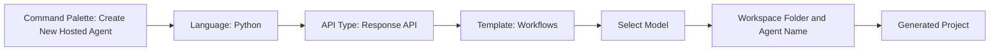

# Module 2 - ബഹുആജന്റ് പ്രോജക്ട് സ്‌കാഫോൾഡ് ചെയ്യുക

⏱️ ~5 മിനിറ്റ്

ഈ മോഡ്യൂളിൽ, [Foundry Toolkit for VS Code](https://aka.ms/foundrytk) ഉപയോഗിച്ച് **ബഹുആജന്റ് പ്രോജക്ട് സ്‌കാഫോൾഡ് ചെയ്യുന്നു**. വിസാർഡ് `agent.yaml`, `main.py`, `Dockerfile`, `requirements.txt`, `.env`,യും VS Code ഡീബഗ് കോൺഫിഗറേഷൻuum സൃഷ്ടിക്കും - അതുകൊണ്ട് നിങ്ങൾക്ക് Module 3-ൽ 4-ഏജന്റ് വർക്ക്‌ഫ്ലോ വയർ ചെയ്യുന്നതിൽ ശ്രദ്ധ കേന്ദ്രീകരിക്കാം.

> **Key concept:** സ്‌കാഫോൾഡ് ഒരു പ്രവർത്തനക്ഷമമായ സ്റ്റബ് ആണ് ഒപ്പം ഒരു ഏജന്റുണ്ട്. നിങ്ങൾ പ്ലേസ്‌ഹോൾഡർ ലൊജിക്ക് Module 3-ൽ `WorkflowBuilder` ഗ്രാഫ് ഉപയോഗിച്ച് മാറ്റും. നിങ്ങൾ ബോയിലർപ്ലേറ്റ് പിന്നീട് മുതൽ എഴുതേണ്ടതില്ല.

> **Reference implementation:** [`PersonalCareerCopilot/`](../../../../../workshop/lab02-multi-agent/PersonalCareerCopilot) ഒരു സമ്പൂർണ്ണ പ്രവർത്തനക്ഷമ ഉദാഹരണമാണ്. നിങ്ങളുടെ പ്രവർത്തനത്തോടൊപ്പം താരതമ്യം ചെയ്യാൻ ഇത് ഉപയോഗിക്കുക.

### സ്‌കാഫോൾഡ് വിസാർഡ് പ്രവാഹം



---

## Step 1: Create Hosted Agent വിസാർഡ് തുറക്കുക

1. `Ctrl+Shift+P` അമർത്തി **Command Palette** തുറക്കുക.
2. ടൈപ്പ് ചെയ്യുക: **Foundry Toolkit: Create a New Hosted Agent** ഒന്ന് തിരഞ്ഞെടുക്കുക.
3. വിസാർഡ് **Agent Details** ടാബിൽ തുറക്കും.

> **Alternative:** Activity Bar-യിൽ ഉള്ള **Foundry Toolkit** ഐക്കൺ ക്ലിക്കുചെയ്തു → **Hosted Agents**-ന്റെ അടുത്ത് ഉള്ള **+** ഐക്കൺ ക്ലിക്ക് ചെയ്ത് → **Create New Hosted Agent**.

---

## Step 2: ക്രമീകരണങ്ങൾ തിരഞ്ഞെടുക്കുക


1. ഇടത്തുവശത്തെ നാവിഗേഷൻ/ഓപ്ഷൻ വിഭാഗത്തിൽ താഴെവരുന്നതുകൾ തിരഞ്ഞെടുക്കുക:

| മെനു | തിരഞ്ഞെടുപ്പ് | കുറിപ്പുകൾ |
|--------|-----------|-------|
| **Language** | Python | C# (.NET) കൂടി പിന്തുണയ്ക്കപ്പെടുന്നു |
| **Framework** | Agent Framework | `Agent`, `AgentExecutor`, `WorkflowBuilder` നൽകുന്നു |
| **API type** | Response API | `POST /responses` - പ്ലാറ്റ്ഫോം-നിർവഹിക്കുന്ന ചരിത്രം, സ്റ്റ്രീമിംഗ് പിന്തുണ |
| **Template** | **Workflows** | അഭ്യർത്ഥനകൾ ഒരു ക്രമത്തിൽ നിരവധി ഏജന്റുകളിലൂടെ പ്രോസസ് ചെയ്യുന്നു |

2. തിരഞ്ഞെടുക്കുക കഴിഞ്ഞാൽ **Next** ക്ലിക്ക് ചെയ്യുക


3. അടുത്ത വിൻഡോയിൽ, താഴെവരുന്നവ തിരഞ്ഞെടുക്കുക:

| മെനു | തിരഞ്ഞെടുപ്പ് | കുറിപ്പുകൾ |
|--------|-----------|-------|
| **Workspace folder** | ലക്ഷ്യ ഫോൾഡർ ബ്രൗസ് ചെയ്യുക | ഉദാ., `workshop/lab02-multi-agent/` ഈ റിപോസിറ്ററിയിൽ |
| **Agent name** | `PersonalCareerCopilot` | ഇത് പ്രോജക്ട് ഡയറക്ടറി നാമമാകും |
| **Model Deployment** | നിങ്ങളുടെ ഡിപ്ലോയ്ഡ് മോഡൽ തിരഞ്ഞെടുക്കുക | ഉദാ., `gpt-4.1-mini` Lab 01-ൽ നിന്ന് |

4. പ്രോജക്ട് സ്‌കാഫോൾഡ് ചെയ്യുവാൻ **Create** ക്ലിക്ക് ചെയ്യുക. VS Code ഫയലുകൾ ജനറേറ്റ് ചെയ്ത് ഫോൾഡർ തുറക്കും.

> **Tip:** [`gpt-4.1-mini`](https://learn.microsoft.com/azure/foundry/foundry-models/concepts/models-sold-directly-by-azure#gpt-41-series) ബഹുആജന്റ് വികസനത്തിന് വേഗതയും ഗുണനിലവാരവും നന്നായി ബാലൻസ് ചെയ്യുന്നു.

---

## Step 3: സൃഷ്ടിച്ച പ്രോജക്റ്റ് പരിശോധിക്കുക

സ്‌കാഫോൾഡിംഗ് പൂർത്തിയാകുമ്പോൾ, Explorer-ൽ (`Ctrl+Shift+E`) നിങ്ങൾക്ക് താഴെ പറയുന്ന ഫയലുകൾ കാണുന്നതായി സ്ഥിരീകരിക്കുക:

```
📂 <your-agent-name>/
├── .azdignore          ← Files excluded from Azure Developer CLI deployments
├── .dockerignore       ← Files excluded from Docker builds
├── .env                ← Environment variables (placeholders - fill in Module 3)
├── .vscode/
│   ├── launch.json     ← Debug config (F5 → run + Agent Inspector)
│   └── tasks.json      ← VS Code task definitions
├── agent.yaml          ← Agent definition (kind: hosted, protocol: responses)
├── Dockerfile          ← Container config for deployment
├── main.py             ← Stub agent entry point (replace with WorkflowBuilder in Module 3)
└── requirements.txt    ← Python dependencies
```

> **Important:** ഈ സ്‌കാഫോൾഡ് ഫോൾഡർ നേരിട്ട് VS Code-യിൽ തിരിച്ചു തുറക്കുക, അതിലൂടെ `.vscode/launch.json`നും `tasks.json`ക്കും F5 ഡീബഗിംഗിനായുള്ള ശരിയായ പ്രയോഗം ലഭിക്കും.

### പ്രധാന ഫയലുകളുടെ വിശദീകരണം

| ഫയൽ | ഉപയോഗം |
|------|---------|
| `agent.yaml` | `kind: hosted` പ്രഖ്യാപിക്കുന്നു, പരിസ്ഥിതി വേരിയബിളുകൾ മാപ്പ് ചെയ്യുന്നു, `/responses` പ്രോട്ടോക്കോൾ നിർവചിക്കുന്നു |
| `main.py` | സ്റ്റബ്: ഒന്ന് `FoundryChatClient` → `Agent` → `ResponsesHostServer`. നിങ്ങൾ ഇത് Module 3-ൽ 4 ഏജന്റുകൾക്കും `WorkflowBuilder`-ക്കും മാറും |
| `Dockerfile` | `python:3.12-slim`, `requirements.txt` ഇൻസ്റ്റാൾ ചെയ്യുന്നു, പോർട്ട് 8088 തുറക്കുന്നു, `python main.py` ഓടിക്കുന്നു |
| `requirements.txt` | `agent-framework-foundry`, `agent-framework-foundry-hosting`, `mcp<2,>=1.24.0`, `debugpy` |

> **Reference:** പൂര്‍ണമായ ജനറേറ്റുചെയ്ത ഉള്ളടക്കത്തിന് [`PersonalCareerCopilot/agent.yaml`](../../../../../workshop/lab02-multi-agent/PersonalCareerCopilot/agent.yaml)യും [`PersonalCareerCopilot/requirements.txt`](../../../../../workshop/lab02-multi-agent/PersonalCareerCopilot/requirements.txt)യും കാണുക.

---

### ✅ ചെക്ക്പോയിന്റ്

- [ ] സ്‌കാഫോൾഡ് വിസാർഡ് പൂർത്തിയായി - പുതിയ പ്രോജക്ട് ഫോൾഡർ Explorer-ൽ കാണപ്പെടുന്നു
- [ ] പ്രതീക്ഷിച്ച എല്ലാ ഫയലുകളും موجود: `agent.yaml`, `main.py`, `Dockerfile`, `requirements.txt`, `.env`
- [ ] `agent.yaml` `kind: hosted`യും `protocol: responses`യും കാണിക്കുന്നു
- [ ] `main.py` `Agent`, `FoundryChatClient`, `ResponsesHostServer` ഇംപോർട്ട് ചെയ്യുന്നു
- [ ] സ്‌കാഫോൾഡ് ചെയ്ത ഫോൾഡർ VS Code വർക്ക്സ്പെയ്‌സ് റൂട്ട് ആയി തുറന്നിട്ടുണ്ട്
- [ ] നിങ്ങൾക്ക് മനസ്സിലായിരിക്കണം `main.py` ഒരു സ്റ്റബ് ആണ് - `WorkflowBuilder` Module 3-ൽ ചേർക്കപ്പെടും

---

**Previous:** [01 - ബഹുആജന്റ് ആർക്കിടെക്ചർ മനസ്സിലാക്കുക](01-understand-multi-agent.md) · **Next:** [03 - ഏജന്റുകളും പരിസ്ഥിതി ക്രമീകരിക്കുക →](03-configure-agents.md)

---

<!-- CO-OP TRANSLATOR DISCLAIMER START -->
**അറിയിപ്പ്**:
ഈ രേഖ AI പരിഭാഷാ സേവനം [Co-op Translator](https://github.com/Azure/co-op-translator) ഉപയോഗിച്ച് പരിഭാഷപ്പെടുത്തിയതാണ്. ഞങ്ങൾ കൃത്യതയ്ക്കായി ശ്രമിക്കുന്നുവെങ്കിലും, ഓട്ടോമേറ്റഡ് പരിഭാഷകളിൽ പിഴവുകൾ അല്ലെങ്കിൽ തെറ്റായ വിവരങ്ങൾ ഉണ്ടാകാൻ സാധ്യതയുണ്ട്. അതിന്റെ സ്വാഭാവിക ഭാഷയിലുള്ള അസൽ രേഖയാണ് പ്രാമാണികമായ ഉറവിടമായി പരിഗണിക്കേണ്ടത്. നിർണായകമായ വിവരങ്ങൾക്ക്, പ്രൊഫഷണൽ മനുഷ്യ പരിഭാഷ ശുപാർശ ചെയ്യുന്നു. ഈ പരിഭാഷ ഉപയോഗിച്ച് ഉണ്ടാകുന്ന തെറ്റിദ്ധാരണകൾ അല്ലെങ്കിൽ തെറ്റായ വ്യാഖ്യാനങ്ങൾക്കായി ഞങ്ങൾ ഉത്തരവാദികളല്ല.
<!-- CO-OP TRANSLATOR DISCLAIMER END -->