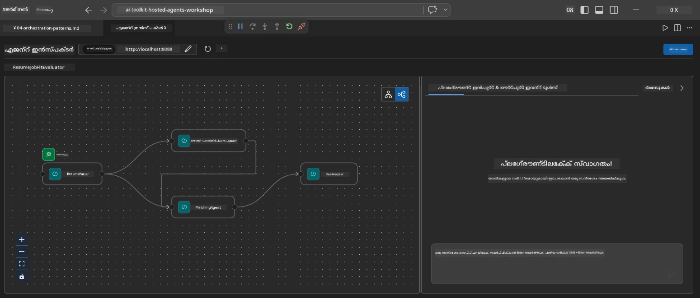
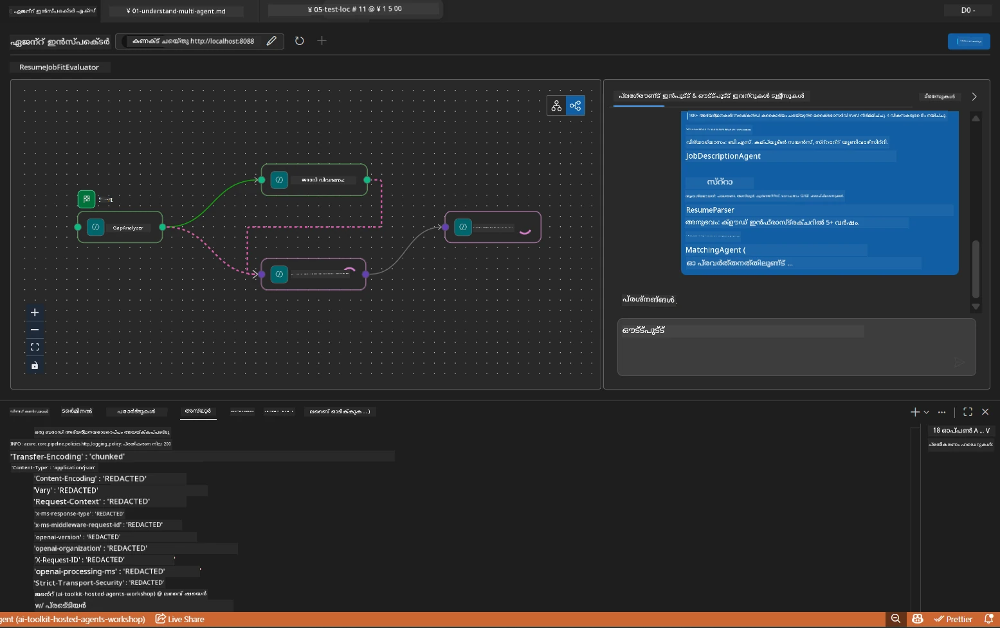
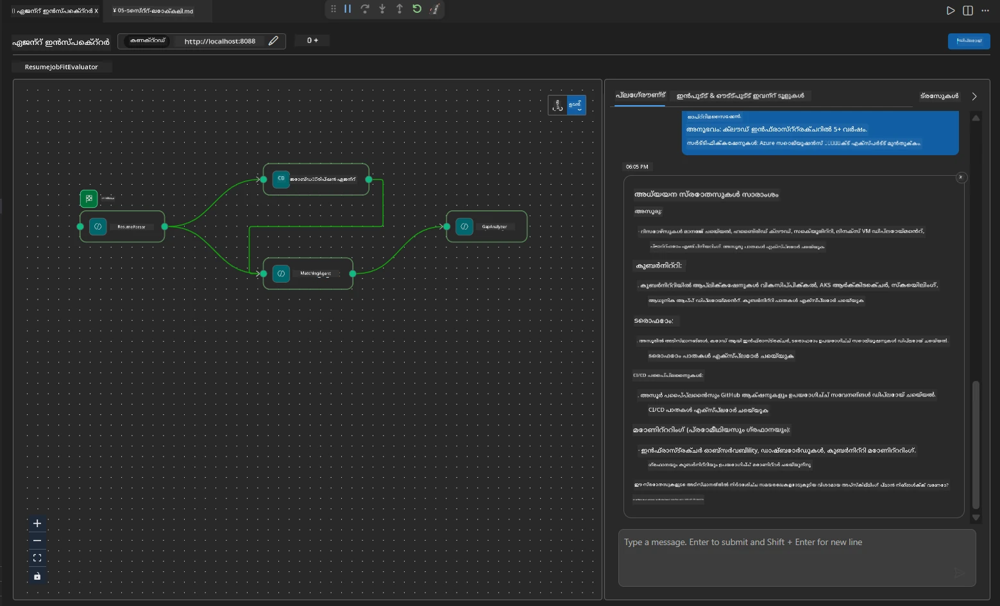

# മാസ്യം 5 - ലോഗലായി പരിശോധന നടത്തുക

⏱️ ~15 മിനിറ്റ്

ഈ മാസ്യത്തില്‍, നിങ്ങൾ മൾട്ടി-ഏജന്റ് വർക്ക്ഫ്ലോ ലൈവിൽ പ്രവർത്തിപ്പിക്കുക, Agent Inspector ഉപയോഗിച്ച് പരിശോധന നടത്തുക, നാലു ഏജന്റുകളും MCP ടൂൾ ശരിയായി പ്രവർത്തിക്കുന്നുണ്ടെന്ന് ഉറപ്പ് വരുത്തുക, തുടർന്ന് മാത്രമേ വിനിയോഗിക്കൂ.

---

## ഘട്ടം 1: ഏജന്റ് സേർവർ ആരംഭിക്കുക

### ഓപ്‌ഷൻ A: VS കോഡ് ടാസ്‌ക്ക് ഉപയോഗിച്ച് (ശുപാർശ ചെയ്യുന്നു)

1. `workshop/lab02-multi-agent/PersonalCareerCopilot/` നിങ്ങളുടെ VS കോഡ് ഫോൾഡറായി തുറക്കുക.
2. `Ctrl+Shift+P` അമർത്തുക → **Tasks: Run Task** ടൈപ്പ് ചെയ്യുക → **Run Agent HTTP Server** തിരഞ്ഞെടുക്കുക.
3. ടാസ്‌ക്ക് debugpy അറ്റാച്ച് ചെയ്ത് പോർട്ട് `5679` യിൽ സെർവർ ആരംഭിക്കുന്നു, ഏജന്റ് പോർട്ട് `8088` യിൽ പ്രവർത്തിക്കുന്നു.
4. ഔട്ട്പുട്ടിൽ സ്റ്റാർട്ടപ്പ് സന്ദേശം കാണാൻ കാത്തിരിക്കുക, തുടർന്ന് സെർവറിന്റെ മറുപടി (മറ്റ് ലോഗ് ലൈൻകൾ ഇടയിൽ വരാം):

```
INFO:resume-job-fit:Starting Resume -> Job Fit Evaluator HTTP server...
...
INFO:hypercorn.error:Running on http://0.0.0.0:8088 (CTRL + C to quit)
```

### ഓപ്‌ഷൻ B: F5 (ഡീബഗ് മോഡ്) ഉപയോഗിച്ച്

1. `F5` അമർത്തുക → **Debug Local Agent HTTP Server** തിരഞ്ഞെടുക്കുക.
2. സെർവർ പൂർണ ബ്രേക്ക്പോയിന്റ് പിന്തുണയോടെ ആരംഭിക്കും - MCP പ്രതികരണങ്ങൾ അല്ലെങ്കിൽ ഏജന്റ് ഔട്ട്പുട്ടുകൾ പരിശോധിക്കാൻ ഉത്തമം.

---

## ഘട്ടം 2: ഏജന്റ് ഇൻസ്‌പെക്ടർ തുറക്കുക

1. `Ctrl+Shift+P` അമർത്തുക → **Foundry Toolkit: Open Agent Inspector** ടൈപ്പ് ചെയ്യുക.
2. Agent Inspector VS Code പാനലായി തുറകും, ഇത് `http://localhost:8088` യുമായി കണക്റ്റ് ചെയ്യുന്നതാണ്.
3. ഏജന്റ് ഇന്റർഫേസ് സന്ദേശങ്ങൾ സ്വീകരിക്കാൻ സജ്ജമാണെന്ന് കാണണം.



> **Agent Inspector തുറക്കേണ്ടെങ്കിൽ:** സെർവർ പൂർണ്ണമായി ആരംഭിച്ചതാണെന്ന് ഉറപ്പാക്കുക (ഏകദേശം `Running on http://0.0.0.0:8088` ലോഗ് കാണുക). പോർട്ട് 5679 ഉപയോഗത്തിലാണ് എങ്കിൽ, [Module 8 - Troubleshooting](08-troubleshooting.md) നോക്കുക.

---

## ഘട്ടം 2b: (ഐച്ഛികം) വർക്ക്ഫ്ലോ വിഷ്വലൈസർ തുറക്കുക

Foundry Toolkit ല്‍ ലൈവ് **Workflow Visualizer** ഉൾപ്പെടുത്തിയിട്ടുണ്ട്, ഏജന്റുകൾ എങ്ങനെ പരസ്പരം ഇടപഴകുന്നു എന്ന് റിയൽ-ടൈം ഗ്രാഫിലൂടെ കാണിക്കുന്നു. മൾട്ടി-ഏജന്റ് ഡീബഗിംഗിന് ഇതു വളരെ സഹായകരമാണ്.

1. `Ctrl+Shift+P` അമർത്തുക → **Foundry Toolkit: Open Visualizer for Hosted Agents** ടൈപ്പ് ചെയ്യുക.
2. ഒരു പുതിയ VS Code ടാബ് തുറന്ന് ലൈവ് എക്സിക്യൂഷൻ ഗ്രാഫ് കാണിക്കും.
3. Agent Inspector ൽ സന്ദേശങ്ങൾ അയയ്ക്കുമ്പോൾ, വിഷ്വലൈസർ സ്വയം അപ്‌ഡേറ്റ് ചെയ്യും - പച്ച കോൺ കണ്ടെത്തിയ ഏജന്റുകൾ, ആനിമേറ്റഡ് എഡ്ജുകൾ ഡാറ്റ ഒഴുകുന്നതായി കാണിക്കും.

> **Port conflict:** വിഷ്വലൈസർ പോർട്ട് മറ്റെവിടെ ഉപയോഗത്തിലാണ് എങ്കിൽ, VS Code സെറ്റിങ്ങുകളിൽ → **Extensions** → **Microsoft Foundry Configuration** → **Hosted Agents: Visualizer Port** മാറ്റുക.

---

## ഘട്ടം 3: സ്മോക്ക് ടെസ്റ്റുകൾ പ്രവർത്തിപ്പിക്കുക

ഈ രണ്ട് ടെസ്റ്റുകളും ഒരു ക്രമത്തിൽ പ്രവർത്തിപ്പിക്കുക. ഓരോ ടെസ്റ്റ് വർക്ക്ഫ്ലോയുടെ കൂടുതൽ ഭാഗങ്ങൾ പരിശോധിക്കും.

### ടെസ്റ്റ് 1: അടിസ്ഥാന റിസ്യൂം + ജോബ് വിവരണം

താഴെ കൊടുത്തതൊക്കെ Agent Inspector ല്‍ പേസ്റ്റ് ചെയ്യുക:

```
Resume:
Jane Doe
Senior Software Engineer with 5 years of experience in Python, Django, and AWS.
Built microservices handling 10K+ requests/second. Led a team of 4 developers.
Certifications: AWS Solutions Architect Associate.
Education: B.S. Computer Science, State University.

Job Description:
Senior Cloud Engineer at Contoso Ltd.
Required: Python, Azure, Kubernetes, Terraform, CI/CD pipelines.
Preferred: Go, monitoring (Prometheus/Grafana), cost optimization.
Experience: 5+ years in cloud infrastructure.
Certifications: Azure Solutions Architect Expert preferred.
```

**പ്രതീക്ഷിക്കപ്പെട്ട ഔട്ട്പുട്ട് ഘടന:**

മറുപടി എല്ലാ നാല് ഏജന്റുകളും അനുയായി ഔട്ട്പുട്ടുകൾ ഉൾക്കൊള്ളണം:

1. **റിസ്യൂം പാർസർ ഔട്ട്പുട്ട്** - രണ്ട് ലേബൽ ചെയ്ത വിഭാഗങ്ങൾ: `[PARSED RESUME]` (ക്യാൻഡിഡറ്റ് പ്രൊഫൈൽ ഗ്രൂപ്പ് ചെയ്ത സ്‌കിൽസോടെ)  മറ്റു `[JOB DESCRIPTION PASS-THROUGH]` (സരാശരി JD ടെക്സ്റ്റ്, JD ഏജന്റിന് നൽകിയിരിക്കുന്നു)
2. **JD ഏജന്റ് ഔട്ട്പുട്ട്** - ആവശ്യമായ Skills ലഭിക്കരും ഇച്ഛാനുസൃത Skills വിഭജിച്ചും ഘടിപ്പിച്ചിട്ടുള്ളത്
3. **മെച്ചപ്പെടുത്തൽ ഏജന്റ് ഔട്ട്പുട്ട്** - ഫ്രിറ്റ് സ്കോർ (0-100) വിശദീകരണം ഉൾപ്പെടെ, പൊരുത്തപ്പെട്ട സ്‌കിൽസുകൾ, കാണാത്ത സ്‌കിൽസ്, ഗ്യാപുകൾ
4. **ഗ്യാപ് അനലൈസർ ഔട്ട്പുട്ട്** - ഓരോ കാണാത്ത സ്‌കിലിനും വ്യക്തിഗത ഗ്യാപ് കാർഡുകൾ, ഓരോതിലും Microsoft Learn URLs ഉൾപ്പെടുന്നു





### ടെസ്റ്റ് 1 ൽ പരിശോധിക്കേണ്ടത്

| പരിശോധിക്കുക | പ്രതീക്ഷിച്ച് | പാസ്സായി? |
|-------------|-------------|----------|
| മറുപടിയിൽ ഫ്രിറ്റ് സ്കോർ ഉണ്ടായിട്ടുണ്ടോ | 0-100 നുള്ള സംഖ്യ വിശദീകരണത്തോടുകൂടി | |
| പൊരുത്തപ്പെട്ട സ്‌കിൽസുകൾ ലിസ്റ്റ് ചെയ്തിട്ടുണ്ടോ | Python, CI/CD (ഭാഗികം), മുതലായവ | |
| കാണാത്ത സ്‌കിൽസ് ലിസ്റ്റ് ചെയ്തിട്ടുണ്ടോ | Azure, Kubernetes, Terraform, മുതലായവ | |
| കാണാത്ത ഓരോ സ്‌കിലിനും ഗ്യാപ് കാർഡുകൾ ഉണ്ടോ | ഓരോ സ്‌കിലിനും ഒരു കാർഡ് | |
| Microsoft Learn URLs ഉണ്ട് | യഥാർത്ഥ `learn.microsoft.com` ലിങ്കുകൾ | |
| മറുപടിയിൽ പിശക് സന്ദേശങ്ങളില്ല | ശുദ്ധമായ ഘടിപ്പിച്ച ഔട്ട്പുട്ട് | |

### ടെസ്റ്റ് 2: എജ് കേസ് - ഉയർന്ന ഫ്രിറ്റ് ക്യാൻഡിഡേറ്റ്

രിസ്യൂമു JD നു വളരെ അടുത്തുള്ളത് പേസ്റ്റ് ചെയ്ത് GapAnalyzer ഉയർന്ന ഫ്രിറ്റ് ഘടന കൈകാര്യം ചെയ്യുന്നു എന്ന് ഉറപ്പാക്കുക:

```
Resume:
Alex Chen
Senior Cloud Engineer with 7 years of experience.
Skills: Python, Azure (AKS, Functions, DevOps), Kubernetes, Terraform, CI/CD (GitHub Actions, Azure Pipelines), Go, Prometheus, Grafana, cost optimization.
Certifications: Azure Solutions Architect Expert, Azure DevOps Engineer Expert.
Led infrastructure migration to Azure for 3 enterprise clients.
Education: M.S. Computer Science, Tech University.

Job Description:
Senior Cloud Engineer at Contoso Ltd.
Required: Python, Azure, Kubernetes, Terraform, CI/CD pipelines.
Preferred: Go, monitoring (Prometheus/Grafana), cost optimization.
Experience: 5+ years in cloud infrastructure.
Certifications: Azure Solutions Architect Expert preferred.
```

**പ്രതീക്ഷിക്കപ്പെട്ട പെരുമാറ്റം:**
- Fit സ്കോർ **80+** ആയിരിക്കണം (മിക്ക സ്ക്കിൽസും പൊരുത്തപ്പെടുന്നു)
- Gap കാർഡുകൾ അടിസ്ഥാന പഠനത്തിനേക്കാൾ പൊളിഷ്/ഇന്റർവ്യൂ റെഡിയ്നസ് പ്രാധാന്യം നൽകണം
- GapAnalyzer നിർദ്ദേശങ്ങൾ പറയുന്നത്: "Fit >= 80 ആണെങ്കിൽ, പൊളിഷ്/ഇന്റർവ്യൂ റെഡിയ്നസ് പ്രാധാന്യമാവും"

---

## ഘട്ടം 4: നിങ്ങളുടെ സ്വന്തമായ ഡാറ്റ ഉപയോഗിച്ച് പരിശോധന നടത്തുക (ഐച്ഛികം)

നിങ്ങളുടെ സ്വന്തം റിസ്യൂംയും യഥാർത്ഥ ജോബ് വിവരണവും പേസ്റ്റ് ചെയ്ത് പരീക്ഷിച്ചു നോക്കുക. ഇതു സ്ഥിരീകരിക്കാൻ സഹായിക്കുന്നു:

- ഏജന്റുകൾ വ്യത്യസ്ത റിസ്യൂം ഫോർമാറ്റുകൾ (ക്രോണോളജിക്കൽ, ഫംഗ്ഷണൽ, ഹൈബ്രിഡ്) കൈകാര്യം ചെയ്യുന്നു
- JD ഏജന്റ് വ്യത്യസ്ത JD സ്റ്റൈലുകൾ (ബുള്ളറ്റ് പോയിന്റുകൾ, പാരഗ്രാഫുകൾ, ഘടിപ്പിച്ച) കൈകാര്യം ചെയ്യുന്നു
- MCP ടൂൾ യഥാർത്ഥ സ്‌കിൽസിനുള്ള പ്രസക്തമായ വിഭവങ്ങൾ തിരിച്ചറിയുന്നു
- ഗ്യാപ് കാർഡുകൾ നിങ്ങളുടെ വ്യക്തിഗത പശ്ചാത്തലത്തിനനുസരിച്ച് വ്യക്തിഗതമാക്കിയതാണ്

> **തനിമയുള്ളത് - പാത്ത് A (Foundry ക്ലൗഡ്):** റിസ്യൂംയും JD ടെക്സ്റ്റും നിങ്ങള്‍ ഉപയോഗിക്കുന്ന Azure OpenAI ഡിസ്പ്ലോയ്മെന്റിലും അന്വയിക്കപ്പെടുന്നു. വർക്ക്‌ഷോപ്പ് സംവിധാനത്തിൽ ഇത് ലോഗ് ചെയ്യാനോ സൂക്ഷിക്കാനോ ഇല്ല. നിങ്ങൾക്ക് ഇഷ്ടമെങ്കിൽ പ്രാദേശിക പേരുകൾ (ഉദാ. "ജെയിൻ ഡോ") ഉപയോഗിക്കാം.
>
> **തനിമയുള്ളത് - പാത്ത് B (Foundry ലോക്കൽ):** നാല് ഏജന്റുകളുടെയും അന്വയം പൂർണമായും നിങ്ങളുടെ ഉപകരണത്തിൽ നടക്കുന്നു. നിങ്ങളുടെ റിസ്യൂംയും ജോബ് വിവരണവും **എല്ലായ്പ്പോഴും നിങ്ങളുടെ മെഷീനിൽ നിന്നു വിട്ടുപോകുന്നില്ല**. MCP ടൂൾത്തിന്റെ മാത്രം ഔട്ട്ബൗണ്ട് കോൾ `https://learn.microsoft.com/api/mcp` നിന്ന് വിഭവങ്ങൾ കൊണ്ടുവരാനുള്ളതാണ്; ആ ക്വറി സ്‌കിൽ നാമം മാത്രമാണ് ഉൾക്കൊള്ളുന്നത്, നിങ്ങളുടെ വ്യക്തിഗത ഡാറ്റ അല്ല.

---

### ചെക്പോയിന്റ്

- [ ] പോർട്ട് `8088` യിൽ സെർവർ വിജയകരമായി ആരംഭിച്ചു (ലോഗ് `Running on http://0.0.0.0:8088` കാണിക്കുന്നു)
- [ ] Agent Inspector തുറന്നു, ഏജന്റുമായി കണിക്ട് ചെയ്തു
- [ ] ടെസ്റ്റ് 1: ഫ്രിറ്റ് സ്കോർ, പൊരുത്തപ്പെട്ട/കാണാത്ത കൌശലങ്ങൾ, ഗ്യാപ് കാർഡുകൾ, Microsoft Learn URLs എന്നിവയോടെ പൂർണമായ മറുപടി
- [ ] ടെസ്റ്റ് 2: ഉയർന്ന ഫ്രിറ്റ് ക്യാൻഡിഡേറ്റ്സ് 80+ സ്കോർ നേടി, പൊളിഷ് ചിന്തിച്ച ശുപാർശകൾ
- [ ] എല്ലാ ഗ്യാപ് കാർഡുകളും ഉണ്ടാകണം (ഓരോ കാണാത്ത സ്‌കിലിനും ഒരു കാര്‍ഡ്, മുടങ്ങാത്തതും)
- [ ] സെർവർ ടെർമിനലിൽ പിശകുകളോ സ്റ്റാക്ക് ട്രേസുകളോ ഇല്ല

---

**മുൻപ്:** [04 - Orchestration Patterns](04-orchestration-patterns.md) · **അടുത്തത്:** [06 - Deploy to Foundry →](06-deploy-to-foundry.md)

---

<!-- CO-OP TRANSLATOR DISCLAIMER START -->
**അറിയിപ്പ്**:
ഈ രേഖ AI പരിഭാഷാ സേവനം [Co-op Translator](https://github.com/Azure/co-op-translator) ഉപയോഗിച്ച് പരിഭാഷപ്പെടുത്തിയതാണ്. ഞങ്ങൾ കൃത്യതയ്ക്കായി ശ്രമിക്കുന്നുവെങ്കിലും, ഓട്ടോമേറ്റഡ് പരിഭാഷകളിൽ പിഴവുകൾ അല്ലെങ്കിൽ തെറ്റായ വിവരങ്ങൾ ഉണ്ടാകാൻ സാധ്യതയുണ്ട്. അതിന്റെ സ്വാഭാവിക ഭാഷയിലുള്ള അസൽ രേഖയാണ് പ്രാമാണികമായ ഉറവിടമായി പരിഗണിക്കേണ്ടത്. നിർണായകമായ വിവരങ്ങൾക്ക്, പ്രൊഫഷണൽ മനുഷ്യ പരിഭാഷ ശുപാർശ ചെയ്യുന്നു. ഈ പരിഭാഷ ഉപയോഗിച്ച് ഉണ്ടാകുന്ന തെറ്റിദ്ധാരണകൾ അല്ലെങ്കിൽ തെറ്റായ വ്യാഖ്യാനങ്ങൾക്കായി ഞങ്ങൾ ഉത്തരവാദികളല്ല.
<!-- CO-OP TRANSLATOR DISCLAIMER END -->