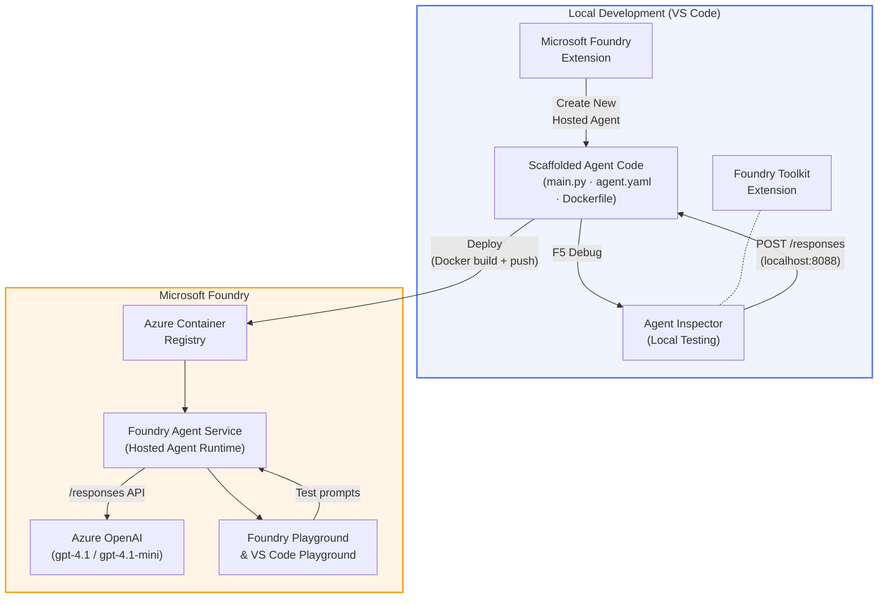

# Foundry Toolkit + Foundry Hosted Agents कार्यशाळा

[](https://www.python.org/)
[](https://github.com/microsoft/agents)
[](https://learn.microsoft.com/azure/foundry/agents/concepts/hosted-agents)
[](https://ai.azure.com/)
[](https://learn.microsoft.com/azure/ai-services/openai/)
[](https://learn.microsoft.com/cli/azure/install-azure-cli)
[](https://learn.microsoft.com/azure/developer/azure-developer-cli/install-azd)
[](https://www.docker.com/)
[](https://marketplace.visualstudio.com/items?itemName=ms-windows-ai-studio.windows-ai-studio)
[](LICENSE)

AI एजंट्स बनवा, चाचणी करा आणि **Microsoft Foundry Agent Service** वर **Hosted Agents** म्हणून तैनात करा - संपूर्णपणे VS कोड वापरून **Microsoft Foundry extension** आणि **Foundry Toolkit** सह.

> **Hosted Agents सध्या प्रीव्ह्यूमध्ये आहेत.** समर्थित प्रदेश मर्यादित आहेत - पहा [region availability](https://learn.microsoft.com/azure/foundry/agents/concepts/hosted-agents#region-availability).

> प्रत्येक लॅबमधील `agent/` फोल्डर **Foundry extension** द्वारे स्वयंचलितपणे तयार केला जातो - त्यानंतर आपण कोड सानुकूलित करता, स्थानिकपणे चाचणी करता आणि तैनात करता.

### 🌐 बहुभाषिक समर्थन

#### GitHub Action द्वारे समर्थित (स्वयंचलित आणि सदैव अद्ययावत)

<!-- CO-OP TRANSLATOR LANGUAGES TABLE START -->
[Arabic](../ar/README.md) | [Bengali](../bn/README.md) | [Bulgarian](../bg/README.md) | [Burmese (Myanmar)](../my/README.md) | [Chinese (Simplified)](../zh-CN/README.md) | [Chinese (Traditional, Hong Kong)](../zh-HK/README.md) | [Chinese (Traditional, Macau)](../zh-MO/README.md) | [Chinese (Traditional, Taiwan)](../zh-TW/README.md) | [Croatian](../hr/README.md) | [Czech](../cs/README.md) | [Danish](../da/README.md) | [Dutch](../nl/README.md) | [Estonian](../et/README.md) | [Finnish](../fi/README.md) | [French](../fr/README.md) | [German](../de/README.md) | [Greek](../el/README.md) | [Hebrew](../he/README.md) | [Hindi](../hi/README.md) | [Hungarian](../hu/README.md) | [Indonesian](../id/README.md) | [Italian](../it/README.md) | [Japanese](../ja/README.md) | [Kannada](../kn/README.md) | [Khmer](../km/README.md) | [Korean](../ko/README.md) | [Lithuanian](../lt/README.md) | [Malay](../ms/README.md) | [Malayalam](../ml/README.md) | [Marathi](./README.md) | [Nepali](../ne/README.md) | [Nigerian Pidgin](../pcm/README.md) | [Norwegian](../no/README.md) | [Persian (Farsi)](../fa/README.md) | [Polish](../pl/README.md) | [Portuguese (Brazil)](../pt-BR/README.md) | [Portuguese (Portugal)](../pt-PT/README.md) | [Punjabi (Gurmukhi)](../pa/README.md) | [Romanian](../ro/README.md) | [Russian](../ru/README.md) | [Serbian (Cyrillic)](../sr/README.md) | [Slovak](../sk/README.md) | [Slovenian](../sl/README.md) | [Spanish](../es/README.md) | [Swahili](../sw/README.md) | [Swedish](../sv/README.md) | [Tagalog (Filipino)](../tl/README.md) | [Tamil](../ta/README.md) | [Telugu](../te/README.md) | [Thai](../th/README.md) | [Turkish](../tr/README.md) | [Ukrainian](../uk/README.md) | [Urdu](../ur/README.md) | [Vietnamese](../vi/README.md)

> **स्थानिक क्लोन प्राधान्य आहे?**
>
> हा रेपॉजिटरी 50+ भाषा अनुवादांसह येतो ज्यामुळे डाउनलोड आकार मोठा होतो. भाषांतरांशिवाय क्लोन करण्यासाठी sparse checkout वापरा:
>
> **Bash / macOS / Linux:**
> ```bash
> git clone --filter=blob:none --sparse https://github.com/microsoft-foundry/Foundry_Toolkit_for_VSCode_Lab.git
> cd Foundry_Toolkit_for_VSCode_Lab
> git sparse-checkout set --no-cone '/*' '!translations' '!translated_images'
> ```
>
> **CMD (Windows):**
> ```cmd
> git clone --filter=blob:none --sparse https://github.com/microsoft-foundry/Foundry_Toolkit_for_VSCode_Lab.git
> cd Foundry_Toolkit_for_VSCode_Lab
> git sparse-checkout set --no-cone "/*" "!translations" "!translated_images"
> ```
>
> हे आपल्याला कोर्स पूर्ण करण्यासाठी सर्वकाही देते आणि डाउनलोड जलद होते.
<!-- CO-OP TRANSLATOR LANGUAGES TABLE END -->

---

## आर्किटेक्चर



**प्रवाह:** Foundry extension एजंट तयार करते → आपण कोड आणि सूचना सानुकूलित करता → Agent Inspector सह स्थानिकपणे चाचणी करता → Foundry वर तैनात करता (Docker इमेज ACR मध्ये ढकलली जाते) → Playground मध्ये तपासणी करता.

---

## आपण काय तयार करणार आहात

| लॅब | वर्णन | स्थिती |
|-----|---------|---------|
| **लॅब 01 - सिंगल एजंट** | **"Explain Like I'm an Executive" एजंट** तयार करा, स्थानिकपणे चाचणी करा, आणि Foundry मध्ये तैनात करा | ✅ उपलब्ध |
| **लॅब 02 - मल्टि-एजंट वर्कफ्लो** | **"Resume → Job Fit Evaluator"** तयार करा - 4 एजंट्स सहकार्य करून रिज्युमेचे मूल्यांकन करतात आणि शिक्षण रोडमॅप तयार करतात | ✅ उपलब्ध |

---

## कार्यकारी एजंटची ओळख

या कार्यशाळेत आपण **"Explain Like I'm an Executive" एजंट** तयार करणार आहात - एक AI एजंट जो कठीण तांत्रिक शब्दसमूह घेवून शांतीपूर्ण, बोर्डरूमसाठी तयार केलेल्या सारांशात भाषांतर करतो. कारण खरं सांगायचं तर, C-स्तरातील कोणालाच "v3.2 मध्ये सादर झालेल्या समकालीन कॉलमुळे थ्रेड पूल एक्सहॉशन" बद्दल ऐकायची इच्छा नाही.

मी हा एजंट तयार केला कारण अनेक वेळा माझ्या व्यवस्थित तयार केलेल्या पोस्ट-मॉर्टेमला असा प्रतिसाद मिळाला: *"तर... वेबसाइट बंद आहे की नाही?"*

### हे कसे कार्य करते

आपण त्याला एक तांत्रिक अद्यतन देता. तो प्रत्युत्तरात एक कार्यकारी सारांश देतो - तीन मुद्दे, कोणतीही तांत्रिक भाषा नाही, कोणतेही स्टॅक ट्रेस नाहीत, कोणतीही मानसिक भीती नाही. फक्त **घडले काय**, **व्यवसायावर परिणाम**, आणि **पुढचा टप्पा**.

### हे प्रत्यक्षात पाहा

**आपण म्हणता:**
> "API विलंब वाढला कारण v3.2 मध्ये समकालीन कॉलांनी थ्रेड पूल एक्सहॉशन घडवून आणला."

**एजंट उत्तर देतो:**

> **कार्यकारी सारांश:**
> - **घडले काय:** नवीनतम रिलीज नंतर सिस्टम मंदावले.
> - **व्यवसायावर परिणाम:** काही वापरकर्त्यांना सेवा वापरताना विलंबाचा अनुभव आला.
> - **पुढचा टप्पा:** बदल मागे घेतला गेला आहे आणि पुनःतैनातीपूर्वी दुरुस्तीची तयारी सुरू आहे.

### का हा एजंट?

हा एक सोपा, एकल उद्देशाचा एजंट आहे - होस्टेड एजंट वर्कफ्लोचा संपूर्ण परिचय शिकण्यासाठी परिपूर्ण, कोणत्याही गुंतागुंतीच्या साधनसाखळीमध्ये अडथळा न आणता. आणि प्रामाणिकपणे? प्रत्येक अभियांत्रिकी टीमला असा एजंट हवा असतो.

---

## कार्यशाळेचा रचना

```
📂 Foundry_Toolkit_for_VSCode_Lab/
├── 📄 README.md                      ← You are here
└── 📂 workshop/
    ├── 📂 lab01-single-agent/        ← Full lab: docs + agent code
    │   ├── README.md                 ← Hands-on lab instructions
    │   ├── 📂 docs/                  ← Step-by-step tutorial modules
    │   │   ├── 00-prerequisites.md
    │   │   ├── 01-setup.md
    │   │   ├── 02-create-hosted-agent.md
    │   │   ├── 03-configure-and-code.md
    │   │   ├── 04-test-locally.md
    │   │   ├── 05-deploy-to-foundry.md
    │   │   ├── 06-verify-in-playground.md
    │   │   ├── 07-summary.md
    │   │   └── 08-troubleshooting.md
    │   └── 📂 agent/                 ← Reference solution (auto-scaffolded by Foundry extension)
    │       ├── agent.yaml
    │       ├── Dockerfile
    │       ├── main.py
    │       └── requirements.txt
    └── 📂 lab02-multi-agent/         ← Resume → Job Fit Evaluator
        ├── README.md                 ← Hands-on lab instructions (end-to-end)
        ├── 📂 docs/                  ← Step-by-step tutorial modules
        │   ├── 00-prerequisites.md
        │   ├── 01-understand-multi-agent.md
        │   ├── 02-scaffold-multi-agent.md
        │   ├── 03-configure-agents.md
        │   ├── 04-orchestration-patterns.md
        │   ├── 05-test-locally.md
        │   ├── 06-deploy-to-foundry.md
        │   ├── 07-verify-in-playground.md
        │   └── 08-troubleshooting.md
        └── 📂 PersonalCareerCopilot/ ← Reference solution (multi-agent workflow)
            ├── agent.yaml
            ├── Dockerfile
            ├── main.py
            └── requirements.txt
```

> **टीप:** प्रत्येक लॅबमधील `agent/` फोल्डर हा **Microsoft Foundry extension** आपल्याला आदेश पॅलेटमधून `Microsoft Foundry: Create a New Hosted Agent` चालविल्यानंतर तयार होते. नंतर त्या फाइल्समध्ये आपल्या एजंटच्या सूचना, साधने, आणि कॉन्फिगरेशन सानुकूलित केल्या जातात. लॅब 01 मध्ये हे संपूर्ण क्रमानुसार कसे करायचे ते दर्शवले आहे.

---

## सुरूवात कशी कराल

### 1. रेपॉजिटरी क्लोन करा

```bash
git clone https://github.com/microsoft-foundry/Foundry_Toolkit_for_VSCode_Lab.git
cd Foundry_Toolkit_for_VSCode_Lab
```

### 2. Python वर्चुअल एन्व्हायर्नमेंट सेट करा

```bash
python -m venv venv
```

ते सक्रिय करा:

- **Windows (PowerShell):**
  ```powershell
  .\venv\Scripts\Activate.ps1
  ```
- **macOS / Linux:**
  ```bash
  source venv/bin/activate
  ```

### 3. अवलंबित्व स्थापित करा

```bash
pip install -r workshop/lab01-single-agent/agent/requirements.txt
```

### 4. एन्व्हायर्नमेंट व्हेरिएबल्स कॉन्फिगर करा

एजंट फोल्डरच्या आत उदाहरण `.env` फाइल कॉपी करा आणि आपली मूल्ये भरा:

```bash
cp workshop/lab01-single-agent/agent/.env.example workshop/lab01-single-agent/agent/.env
```

`workshop/lab01-single-agent/agent/.env` संपादित करा:

```env
AZURE_AI_PROJECT_ENDPOINT=https://<your-account>.services.ai.azure.com/api/projects/<your-project>
AZURE_AI_MODEL_DEPLOYMENT_NAME=<your-model-deployment-name>
```

### 5. कार्यशाळेतील लॅब्सचे अनुसरण करा

प्रत्येक लॅबमध्ये स्वतंत्र मॉड्यूल्स असतात. प्राथमिक गोष्टी शिकण्यासाठी **लॅब 01** पासून सुरू करा, त्यानंतर मल्टि-एजंट वर्कफ्लो साठी **लॅब 02** करा.

#### लॅब 01 - सिंगल एजंट ([पूर्ण सूचना](workshop/lab01-single-agent/README.md))

| # | मॉड्यूल | लिंक |
|---|-----------|--------|
| 1 | पूर्वप्राप्यता वाचा | [00-prerequisites.md](workshop/lab01-single-agent/docs/00-prerequisites.md) |
| 2 | Foundry Toolkit & Foundry extension इंस्टॉल करा | [01-setup.md](workshop/lab01-single-agent/docs/01-setup.md) |
| 3 | Foundry प्रोजेक्ट तयार करा | [01-setup.md](workshop/lab01-single-agent/docs/01-setup.md) |
| 4 | होस्टेड एजंट तयार करा | [02-create-hosted-agent.md](workshop/lab01-single-agent/docs/02-create-hosted-agent.md) |
| 5 | सूचना & पर्यावरण कॉन्फिगर करा | [03-configure-and-code.md](workshop/lab01-single-agent/docs/03-configure-and-code.md) |
| 6 | स्थानिकपणे चाचणी करा | [04-test-locally.md](workshop/lab01-single-agent/docs/04-test-locally.md) |
| 7 | Foundry मध्ये तैनात करा | [05-deploy-to-foundry.md](workshop/lab01-single-agent/docs/05-deploy-to-foundry.md) |
| 8 | प्लेग्राउंडमध्ये तपासणी करा | [06-verify-in-playground.md](workshop/lab01-single-agent/docs/06-verify-in-playground.md) |
| 9 | समस्या निराकरण | [08-troubleshooting.md](workshop/lab01-single-agent/docs/08-troubleshooting.md) |

#### लॅब 02 - मल्टि-एजंट वर्कफ्लो ([पूर्ण सूचना](workshop/lab02-multi-agent/README.md))

| # | मॉड्यूल | लिंक |
|---|-----------|--------|
| 1 | पूर्वप्राप्यता (लॅब 02) | [00-prerequisites.md](workshop/lab02-multi-agent/docs/00-prerequisites.md) |
| 2 | मल्टि-एजंट आर्किटेक्चर समजून घ्या | [01-understand-multi-agent.md](workshop/lab02-multi-agent/docs/01-understand-multi-agent.md) |
| 3 | मल्टि-एजंट प्रोजेक्ट तयार करा | [02-scaffold-multi-agent.md](workshop/lab02-multi-agent/docs/02-scaffold-multi-agent.md) |
| 4 | एजंट्स & पर्यावरण कॉन्फिगर करा | [03-configure-agents.md](workshop/lab02-multi-agent/docs/03-configure-agents.md) |
| 5 | ऑर्केस्ट्रेशन पॅटर्न्स | [04-orchestration-patterns.md](workshop/lab02-multi-agent/docs/04-orchestration-patterns.md) |
| 6 | स्थानिक चाचणी (मल्टि-एजंट) | [05-test-locally.md](workshop/lab02-multi-agent/docs/05-test-locally.md) |
| 7 | Foundry मध्ये तैनात करा | [06-deploy-to-foundry.md](workshop/lab02-multi-agent/docs/06-deploy-to-foundry.md) |
| 8 | प्लेग्राउंडमध्ये तपासणी करा | [07-verify-in-playground.md](workshop/lab02-multi-agent/docs/07-verify-in-playground.md) |
| 9 | समस्या निराकरण (मल्टि-एजंट) | [08-troubleshooting.md](workshop/lab02-multi-agent/docs/08-troubleshooting.md) |

---

## देखभाल करणारा

<table>
<tr>
    <td align="center"><a href="https://github.com/ShivamGoyal03">
        <br />
        <sub><b>शिवम गोयल</b></sub>
    </a><br />
    </td>
</tr>
</table>

---

## आवश्यक परवानग्या (त्वरित संदर्भ)

| स्थिती | आवश्यक भूमिका |
|----------|---------------|
| नवीन Foundry प्रोजेक्ट तयार करा | Foundry संसाधनावर **Azure AI Owner** |
| विद्यमान प्रोजेक्टवर तैनात करा (नवीन संसाधने) | सदस्यत्वावर **Azure AI Owner** + **Contributor** |
| पूर्णरित्या कॉन्फिगर केलेल्या प्रोजेक्टवर तैनात करा | खाते वर **Reader** + प्रोजेक्टवर **Azure AI User** |

> **महत्त्वाचे:** Azure `Owner` आणि `Contributor` भूमिका फक्त *व्यवस्थापन* परवानग्या देतात, *विकास* (डेटा क्रिया) परवानग्या नाहीत. एजंट तयार करण्यासाठी आणि तैनात करण्यासाठी आपल्याला **Azure AI User** किंवा **Azure AI Owner** हवी.

---

## संदर्भ

- [क्विकस्टार्ट: तुमचा पहिला होस्टेड एजंट तैनात करा (VS Code)](https://learn.microsoft.com/azure/foundry/agents/quickstarts/quickstart-hosted-agent)
- [होस्टेड एजंट म्हणजे काय?](https://learn.microsoft.com/azure/foundry/agents/concepts/hosted-agents)
- [VS Code मध्ये होस्टेड एजंट वर्कफ्लोज तयार करा](https://learn.microsoft.com/azure/foundry/agents/how-to/vs-code-agents-workflow-pro-code)
- [होस्टेड एजंट तैनात करा](https://learn.microsoft.com/azure/foundry/agents/how-to/deploy-hosted-agent)
- [Microsoft Foundry साठी RBAC](https://learn.microsoft.com/azure/foundry/concepts/rbac-foundry)
- [आर्किटेक्चर रिव्ह्यू एजंट नमुना](https://github.com/Azure-Samples/agent-architecture-review-sample) - MCP साधने, Excalidraw आकृत्या, आणि ड्युअल तैनातीसह वास्तविक जगातील होस्टेड एजंट

---


## परवाना

[MIT](../../LICENSE)

---

<!-- CO-OP TRANSLATOR DISCLAIMER START -->
**अस्वीकरण**:
हा दस्तऐवज AI भाषांतर सेवा [Co-op Translator](https://github.com/Azure/co-op-translator) चा वापर करून अनुवादित केला आहे. जरी आम्ही अचूकतेसाठी प्रयत्न करतो, तरी कृपया लक्षात घ्या की स्वयंचलित भाषांतरांमध्ये त्रुटी किंवा अचूकतेची कमतरता असू शकते. मूळ दस्तऐवज त्याच्या मूळ भाषेत अधिकृत स्रोत मानला पाहिजे. महत्त्वाची माहिती असल्यास, व्यावसायिक मानवी भाषांतराची शिफारस केली जाते. या भाषांतराच्या वापरामुळे उद्भवणाऱ्या कोणत्याही गैरसमज किंवा चुकीच्या अर्थलावणीसाठी आम्ही जबाबदार नाही.
<!-- CO-OP TRANSLATOR DISCLAIMER END -->
