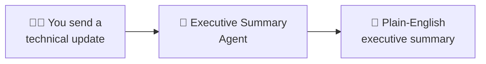

# मॉड्यूल 0 - परिचय

⏱️ ~10 मिनिटे

> [!WARNING]
> **पूर्वावलोकन आणि मर्यादा:** [होस्टेड एजंट्स](https://learn.microsoft.com/azure/foundry/agents/concepts/hosted-agents) सध्या **सार्वजनिक पूर्वावलोकन** मध्ये आहेत - उत्पादन कामांसाठी शिफारस केले जात नाही. खालील गोष्टींचा विचार करा:
> - **समर्थित प्रदेश मर्यादित आहेत** - संसाधने तयार करण्यापूर्वी [प्रदेश उपलब्धता](https://learn.microsoft.com/azure/foundry/agents/concepts/hosted-agents#region-availability) तपासा. जर तुम्ही असमर्थित प्रदेश निवडला तर तैनाती अयशस्वी होईल.
> - `agent-framework-foundry-hosting` पॅकेज प्री-रिलीज आहे - आवृत्त्यांदरम्यान API मध्ये बदल होऊ शकतात.
> - स्केल मर्यादा: होस्टेड एजंट 0–5 प्रतिकृतींना (स्केल-टू-झीरोसहित) समर्थन देतात.
> - या कार्यशाळेमध्ये दर्शविलेली काही वैशिष्ट्ये GA कडे जाताना बदलू शकतात.

## तुम्ही काय तयार कराल

या कार्यशाळेत, तुम्ही एक **"Explain Like I'm an Executive"** एजंट तयार कराल - एक होस्टेड AI एजंट जो क्लिष्ट तांत्रिक अद्यतने घेऊन ती सोप्या इंग्रजीतील कार्यकारी सारांशांमध्ये पुन्हा लिहितो.

**एजंट वापरतो:**
- **Microsoft Agent Framework** - एजंट लॉजिक आणि रचनेसाठी
- **Foundry Toolkit for VS Code** - स्कॅफोल्डिंग, स्थानिक चाचणी आणि तैनातीसाठी
- **एक AI मॉडेल** (उदा., `gpt-4.1-mini/gpt-5-mini`) - सारांश तयार करण्यासाठी

या लॅबच्या शेवटी, तुमच्याकडे एक कार्यरत एजंट असेल ज्याला तुम्ही एजंट इन्स्पेक्टर मार्फत स्थानिकपणे चाचणी देऊ शकता, आणि ऐच्छिकपणे क्लाउडवर तैनात करू शकता.

---

## होस्टेड एजंट म्हणजे काय?

एक **होस्टेड एजंट** हा Microsoft Foundry मध्ये व्यवस्थापित सेवेसारखा चालणारा AI एजंट आहे. तुमचा स्वतःचा इन्फ्रास्ट्रक्चर व्यवस्थापित करण्याऐवजी, तुम्ही तुमचा एजंट कोड कंटेनरमध्ये पॅकेज करता आणि Foundry त्याचा स्केलिंग, होस्टिंग, आणि तो एक मानक HTTP एंडपॉइंटद्वारे उपलब्ध करून देतो.

| संकल्पना | त्याचा अर्थ |
|---------|--------------|
| **एजंट** | तुमचा Python कोड जो वापरकर्त्याचा संदेश प्राप्त करतो, AI मॉडेल कॉल करतो, आणि संरचित प्रतिसाद परत करतो |
| **होस्टेड** | Foundry तुमचा कंटेनर तुमच्यासाठी चालवते - कोणतेही VM, कोणतेही Kubernetes, कोणतेही इन्फ्रास्ट्रक्चर व्यवस्थापन नाही |
| **प्रतिसाद प्रोटोकॉल** | एक मानक HTTP API (`POST /responses`) जे कोणताही क्लायंट तुमच्या एजंटशी संवाद साधण्यासाठी कॉल करू शकतो |
| **एजंट इन्स्पेक्टर** | Foundry Toolkit मध्ये तयार केलेले स्थानिक चाचणी UI जे तुम्हाला तैनात करण्यापूर्वी तुमच्या एजंटशी गप्पा मारण्यास अनुमती देते |

या कार्यशाळेत, तुम्ही शून्यापासून पूर्ण होस्टेड एजंटपर्यंत जाल - किंवा स्थानिक चाचणीपर्यंत थांबू शकता जर तुम्हाला ते आवडेल.

---

## तुमचा मार्ग निवडा

> ⚠️ **आगामी सुरू करण्यापूर्वी एक मार्ग निवडा.** तुमच्या निवडीवर आधारलेले वापरायची साधने आणि लागू होणारे मॉड्युल ठरतील. तुम्ही नंतर Path B → Path A मध्ये बदल करू शकता जर तुम्हाला सबस्क्रिप्शन मिळाले.

<strong>🅰️ मार्ग A - Azure क्लाउड (Azure सबस्क्रिप्शन आवश्यक)</strong>

| | तपशील |
|---|---|
| **कोणासाठी आहे?** | तुमच्याकडे सक्रिय Azure सबस्क्रिप्शन आहे आणि तुम्ही Foundry संसाधने तयार करू शकता |
| **मॉडेल** | Foundry द्वारे Azure OpenAI (उदा., `gpt-4.1-mini/gpt-5-mini`) |
| **आवृत्त्या समाविष्ट** | सर्व मॉड्युल (00–07) |
| **क्लाउडवर तैनात करायचे?** | ✅ हो - पूर्ण एंड-टू-एंड तैनाती |

<strong>🅱️ मार्ग B - स्थानिक / फ्री-टियर (Azure सदस्यत्व आवश्यक नाही)</strong>

| | तपशील |
|---|---|
| **कोणासाठी आहे?** | MVP, विद्यार्थी, किंवा ज्यांच्याकडे Azure प्रवेश नाही |
| **मॉडेल** | **Foundry Local** (मोफत, तुमच्या संगणकावर चालणारे) |
| **आवृत्त्या समाविष्ट** | मॉड्युल 00–04 (तैनात व क्लाउड पडताळणी वगळा) |
| **क्लाउडवर तैनात करायचे?** | ❌ नाही - फक्त एजंट इन्स्पेक्टरद्वारे स्थानिक चाचणी |

---

## सर्व मार्ग: आवश्यक साधने

खालील प्रत्येक साधन स्थापित करा. स्थापना नंतर, तपासणी कमांड चालवून ते काम करत आहे का याची पुष्टी करा.

| # | साधन | आवृत्ती | स्थापना | तपासणी (अपेक्षित आउटपुट) |
|---|------|---------|---------|---------------------------|
| 1 | **Visual Studio Code** | नवीनतम | [code.visualstudio.com](https://code.visualstudio.com/) | त्रुटीशिवाय उघडते |
| 2 | **Python** | 3.12 किंवा त्याहून वर | [python.org/downloads](https://www.python.org/downloads/) | `python --version` $\rightarrow$ `Python 3.12.x` |
| 3 | **Foundry Toolkit for VS Code** | नवीनतम | Extension ID: `ms-windows-ai-studio.windows-ai-studio` | Activity Bar मध्ये Foundry चिन्ह |
| 4 | **Python विस्तार VS Code साठी** | नवीनतम | Extension ID: `ms-python.python` | Extensions पॅनेलमध्ये स्थापित केलेले |

> [!TIP]
> **स्थापनासाठी प्रो-टिप्स:**
> - **Python PATH (विंडोज):** Python इंस्टॉलरच्या पहिल्या स्क्रीनवर नेहमी **"Add Python to PATH"** चॅक करा. याशिवाय, `python` तुमच्या टर्मिनलमध्ये ओळखले जाणार नाही.
> - **एकाधिक Python आवृत्त्या:** जर तुमच्याकडे Python 3.10 आणि 3.12 दोन्ही स्थापित असतील, तर तुमच्या वर्च्युअल पर्यावरणासाठी योग्य आवृत्ती वापरण्यासाठी `python3.12 -m venv .venv` वापरा.
> - **Docker WSL 2 (विंडोज):** Docker Desktop इंस्टॉलेशन दरम्यान, **WSL 2 backend** निवडले असल्याची खात्री करा. Docker with Hyper-V मंदगती असते आणि Foundry कंटेनर बिल्डमध्ये समस्या निर्माण करू शकते.
> - **Docker सुरू होत नाही का?** Docker Desktop सुरू केल्यानंतर 30–60 सेकंद थांबा. `docker info` चालवा - जर तुम्हाला "Cannot connect to the Docker daemon" दिसले तर Docker अजून सुरू होत आहे.
> - **VS Code विस्तार लोड होत नाही का?** विस्तार स्थापित केल्यानंतर, विंडो रीलोड करा: `Ctrl+Shift+P` → `Developer: Reload Window`.

> **विंडोज वापरकर्ते:** Python इंस्टॉलेशन दरम्यान **"Add Python to PATH"** तपासा.

**पुढे:** [01 - सेटअप →](01-setup.md)

---

<!-- CO-OP TRANSLATOR DISCLAIMER START -->
**अस्वीकरण**:
हा दस्तऐवज AI भाषांतर सेवा [Co-op Translator](https://github.com/Azure/co-op-translator) चा वापर करून अनुवादित केला आहे. जरी आम्ही अचूकतेसाठी प्रयत्न करतो, तरी कृपया लक्षात घ्या की स्वयंचलित भाषांतरांमध्ये त्रुटी किंवा अचूकतेची कमतरता असू शकते. मूळ दस्तऐवज त्याच्या मूळ भाषेत अधिकृत स्रोत मानला पाहिजे. महत्त्वाची माहिती असल्यास, व्यावसायिक मानवी भाषांतराची शिफारस केली जाते. या भाषांतराच्या वापरामुळे उद्भवणाऱ्या कोणत्याही गैरसमज किंवा चुकीच्या अर्थलावणीसाठी आम्ही जबाबदार नाही.
<!-- CO-OP TRANSLATOR DISCLAIMER END -->