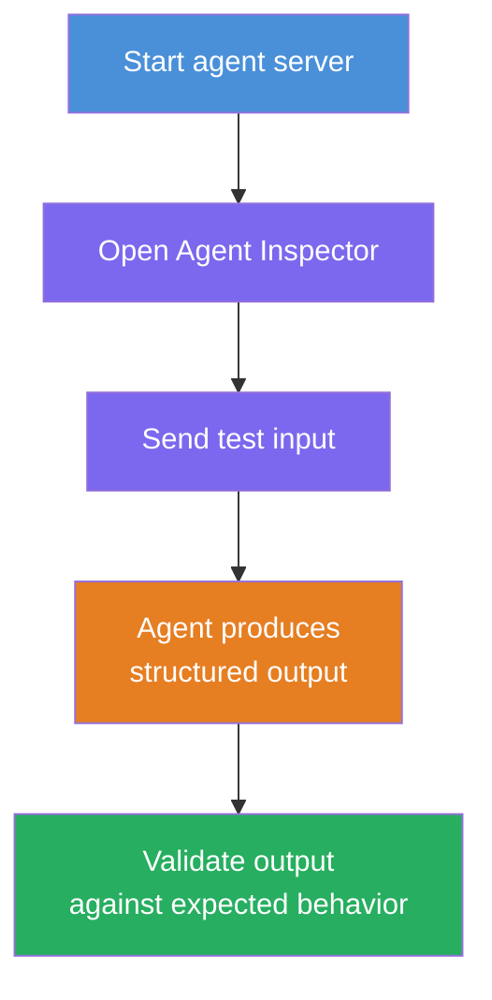
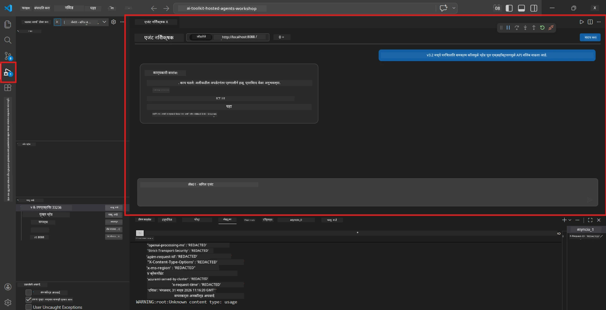
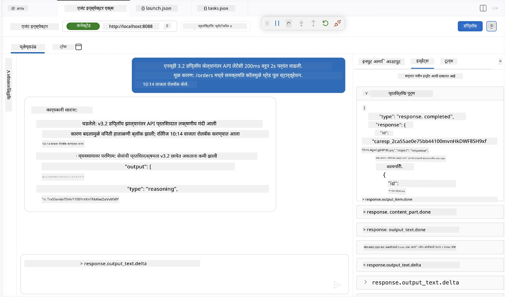

# मॉड्यूल 4 - स्थानिक चाचणी

⏱️ ~10 मिनिटे

या मॉड्यूलमध्ये, आपण आपला एजंट स्थानिकरित्या चालवता आणि तो योग्य प्रकारे कार्य करतो याची पुष्टी **हॅपी-पाथ फंक्शनल चाचण्यांद्वारे** करता. आपण एजंट इन्स्पेक्टर (व्हिज्युअल UI) किंवा थेट HTTP कॉल्स वापरून खात्री करू शकता की एजंट संरचित, अचूक प्रतिसाद तयार करतो.

### स्थानिक चाचणी प्रक्रिया



---

## पर्याय 1: F5 दाबा - एजंट इन्स्पेक्टरसह डिबग करा (शिफारस केलेले)

### डिबगिंग सुरू करा

1. VS Code मध्ये थेट **executive-summary-agent/** फोल्डर उघडा (`File → Open Folder`).
2. **Run and Debug** पॅनेल उघडा (`Ctrl+Shift+D`).
3. ड्रॉपडाउनमधून **Debug Local Agent HTTP Server** निवडा.
4. **F5** दाबा (किंवा ▶ Start Debugging वर क्लिक करा).

> ⚠️ **महत्त्वाचे: आपला Python Interpreter निवडा**
> जर आपल्याला "ModuleNotFoundError" मिळत असेल किंवा डिबगर सुरू होत नसेल, तर आपल्याला VS Code ला आपल्या व्हर्च्युअल एन्व्हायर्नमेंट वापरण्याचा सांगावे लागेल:
  > 1. प्रेस करा `Ctrl+Shift+P` $\rightarrow$ टाइप करा **Python: Select Interpreter**.
  > 2. तुमच्या प्रकल्पाच्या `.venv` फोल्डरमधील इंटरप्रेटर निवडा (उदा., Windows वर `.\.venv\Scripts\python.exe`).
  > 3. डीबग सत्र पुन्हा सुरू करा.
> तुम्हाला अजूनही त्रुटी आल्यास, तुमचा फाइल `tasks.json` खालीलप्रमाणे मॅन्युअली अपडेट करा:
  > 1. `.vscode/tasks.json` फाईलवर जा
  > 2. खालील लेबल असलेल्या टास्कवर जा: `Run Agent HTTP Server`
  > 3. कमांड व्हॅल्यू पुढीलप्रमाणे अपडेट करा:
  >    - **Windows:** `"value": "${workspaceFolder}/.venv/Scripts/python.exe",`
  >    - **macOS/Linux:** `"value": "${workspaceFolder}/.venv/bin/python",`

### काय होते

1. HTTP सर्व्हर सुरू होतो `http://localhost:8088/responses` वर.
2. **Agent Inspector** पॅनेल आपोआप उघडते - तपासणीसाठी एक दृश्य संवाद इंटरफेस.
3. ब्रेकपॉइंट्स सक्रिय होतात `main.py` मध्ये.

टर्मिनल पाहा:
```
Starting executive summary hosted agent
Executive agent server running on http://localhost:8088
```

> **Agent Inspector उघडत नसेल तर:** प्रेस करा `Ctrl+Shift+P` → **Foundry Toolkit: Open Agent Inspector**.



> *स्क्रीनशॉटमध्ये जुना 'AI TOOLKIT' ब्रांडिंग दिसू शकतो, जो आधीच्या विस्ताराच्या आवृत्तीचा आहे.*

---

## पर्याय 2: टर्मिनल वापरून तपासणी (पर्यायी मार्ग)

एका टर्मिनलमध्ये एजंट सुरू करा, दुसऱ्या टर्मिनलमधून विनंत्या पाठवा:

```bash
# Terminal 1: Start agent
cd executive-summary-agent/
source .venv/bin/activate
python main.py
```

```bash
# Terminal 2: Send test (curl)
curl -sS -X POST http://localhost:8088/responses \
  -H "Content-Type: application/json" \
  -d '{"input": "The API latency increased due to thread pool exhaustion caused by sync calls in v3.2.", "stream": false}'
```

---

## परिस्थिती तपासणी: सुखद-मार्ग कार्यक्षम तपासणी

खाली दिलेले **सर्व तीन** परिस्थिती तपासा. हे खात्री करतात की तुमचा एजंट वास्तववादी इनपुटसाठी योग्य, संरचित आउटपुट तयार करतो.



### परिस्थिती 1: IT इन्शिडेंट - API लॅटन्सी वाढ

**इनपुट:**
```
The API latency increased from 200ms to 2s after deploying v3.2.
Root cause: thread pool starvation from synchronous calls in /orders.
Rolled back at 10:14.
```

**अपेक्षित वर्तन:**
- ✅ "Executive Summary" रचना अनुसरित (काय झाले / व्यवसायावर परिणाम / पुढील पायरी)
- ✅ तांत्रिक शब्दसंग्रह नाही (न "thread pool", न "/orders", न "v3.2")
- ✅ स्पष्टपणे व्यवसायावर परिणाम नमूद (उदा., वापरकर्त्यांना विलंब अनुभवला)
- ✅ पुढील पायरी समाविष्ट (उदा., दुरुस्ती तैनात, देखरेख सुरु)

---

### परिस्थिती 2: डेटा पाइपलाइन - ETL अपयश

**इनपुट:**
```
The nightly ETL job failed because the upstream schema changed. APAC dashboards show missing data.
```

**अपेक्षित वर्तन:**
- ✅ साध्या भाषेत डेटा रिफ्रेश अपयश सारांशित करतो
- ✅ APAC डॅशबोर्डवर परिणाम नमूद करतो
- ✅ पुनर्विचारासाठी पुढील पायरी समाविष्ट
- ✅ "ETL", "schema", किंवा इतर तांत्रिक शब्दांचा उल्लेख नाही

---

### परिस्थिती 3: सुरक्षा - उघड क्रेडेन्शियल

**इनपुट:**
```
Static analysis flagged a hardcoded secret in the repository.
The secret may have been exposed in commit history.
```

**अपेक्षित वर्तन:**
- ✅ कार्यकारी समजण्याजोग्या भाषेत क्रेडेन्शियल/सुरक्षा समस्या वर्णन करते
- ✅ संभाव्य धोका (अनधिकृत प्रवेश) नमूद करते
- ✅ दुरुस्तीची क्रिया (क्रेडेन्शियल रोटेशन, ऑडिट) सांगितली
- ✅ "static analysis", "commit history", किंवा "hardcoded" सारखे शब्द नाहीत

---

## प्रमाणीकरण निकष

प्रत्येक परिस्थितीसाठी तपासा:

| # | निकष | उत्तीर्ण स्थिती |
|---|----------|---------------|
| 1 | **रचना** | प्रतिसाद "Executive Summary" स्वरूप वापरतो ज्यात सर्व तीन बुलेट्स असतात |
| 2 | **साधी भाषा** | तांत्रिक शब्द नसणे जे एक कार्यकारी समजू शकत नाही |
| 3 | **अचूकता** | सारांश मध्ये इनपुट प्रतिबिंबित होतो - कोणतेही बनावट तपशील नाहीत |
| 4 | **संक्षिप्तता** | प्रतिसाद 100 शब्दांमध्ये असेल |
| 5 | **पुढील पायरी** | स्पष्ट क्रिया किंवा तोडगा नमूद केलेला आहे |

---

## डीबगिंग टिपा

| समस्या | उपाय |
|-------|-----|
| एजंट सुरू होत नाही | तपासा `.env` मूल्ये, venv सक्रिय आहे का ते तपासा, `pip install -r requirements.txt` चालवा |
| रिकामा किंवा सामान्य प्रतिसाद | `main.py` मध्ये सूचनांचा आढावा घ्या - आउटपुट स्वरूप स्पष्ट करा |
| प्रतिसादात शब्दसंग्रह आहे | "तांत्रिक शब्द काढा" नियम सूचनांमध्ये अधिक बळकट करा |
| Agent Inspector उघडत नाही | `Ctrl+Shift+P` → **Foundry Toolkit: Open Agent Inspector** |
| टर्मिनलमध्ये मॉडेल त्रुटी | तपासा `AZURE_AI_MODEL_DEPLOYMENT_NAME` अचूक जुळते का (केस-संवेदनशील) |

---

### ✅ तपासणी बिंदू

- [ ] एजंट स्थानिकपणे त्रुटीशिवाय सुरू होतो
- [ ] Agent Inspector उघडतो आणि संवाद इंटरफेस दाखवतो (जर F5 वापरत असाल तर)
- [ ] **परिस्थिती 1** (IT इन्शिडेंट) - संरचित Executive Summary, शब्दसंग्रह नाही
- [ ] **परिस्थिती 2** (डेटा पाइपलाइन) - संबंधित सारांश, व्यवसायावर परिणाम
- [ ] **परिस्थिती 3** (सुरक्षा सूचना) - योग्य जोखमीची माहिती
- [ ] सर्व प्रतिसाद निर्दिष्ट आउटपुट रचना अनुसरित करतात

> **तुमचे प्रतिसाद जतन करा** (कॉपी किंवा स्क्रीनशॉट घ्या) - तुम्ही त्यांची तुलना मॉड्यूल 06 मधील क्लाउड निकालांशी कराल.

---

**मागील:** [03 - Configure & Code](03-configure-and-code.md) · **पुढील:** [05 - Deploy to Foundry →](05-deploy-to-foundry.md)

---

<!-- CO-OP TRANSLATOR DISCLAIMER START -->
**अस्वीकरण**:
हा दस्तऐवज AI भाषांतर सेवा [Co-op Translator](https://github.com/Azure/co-op-translator) चा वापर करून अनुवादित केला आहे. जरी आम्ही अचूकतेसाठी प्रयत्न करतो, तरी कृपया लक्षात घ्या की स्वयंचलित भाषांतरांमध्ये त्रुटी किंवा अचूकतेची कमतरता असू शकते. मूळ दस्तऐवज त्याच्या मूळ भाषेत अधिकृत स्रोत मानला पाहिजे. महत्त्वाची माहिती असल्यास, व्यावसायिक मानवी भाषांतराची शिफारस केली जाते. या भाषांतराच्या वापरामुळे उद्भवणाऱ्या कोणत्याही गैरसमज किंवा चुकीच्या अर्थलावणीसाठी आम्ही जबाबदार नाही.
<!-- CO-OP TRANSLATOR DISCLAIMER END -->