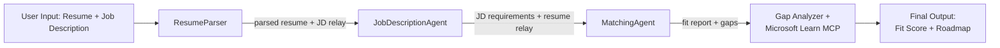

# PersonalCareerCopilot - रिझ्युमे → नोकरी अनुकूलता मूल्यमापनकर्ता

एक वर्कफ्लो-प्रथम मल्टी-एजंट अ‍ॅप जे रिझ्युमे नोकरीच्या वर्णनाशी किती चांगले जुळतो हे मूल्यांकन करते, आणि नंतर अंतर भरण्यासाठी वैयक्तिकृत शिक्षण मार्गनकाशा तयार करते.

---

## एजंट्स

| एजंट | भूमिका | साधने |
|-------|--------|--------|
| **ResumeParser** | रिझ्युमे मजकूरातून संरचित कौशल्ये, अनुभव, प्रमाणपत्रे काढते | - |
| **JobDescriptionAgent** | JD मधून आवश्यक/आग्रह केलेली कौशल्ये, अनुभव, प्रमाणपत्रे काढते | - |
| **MatchingAgent** | प्रोफाइल विरूद्ध आवश्यकतांची तुलना करते → फिट स्कोअर (0-100) + जुळणारी/गहाळ कौशल्ये | - |
| **GapAnalyzer** | Microsoft Learn संसाधनांसह वैयक्तिकृत शिक्षण मार्गनकाशा तयार करते | `search_microsoft_learn_for_plan` (MCP) |

## वर्कफ्लो



---

## जलद प्रारंभ

### 1. पर्यावरण सेट करा

हा फोल्डर वर्कफ्लो-आधारित Lab 02 scaffolding साठी संदर्भ अंमलबजावणूक आहे. त्याच्या `main.py` मध्ये विद्यमान प्रॉम्प्ट ब्लॉक्ससह चार एजंट्सना जोडण्यासाठी `WorkflowBuilder` वापरले आहे.

```powershell
cd workshop\lab02-multi-agent\PersonalCareerCopilot
python -m venv .venv
.\.venv\Scripts\Activate.ps1          # Windows PowerShell
# source .venv/bin/activate            # macOS / Linux
pip install -r requirements.txt
```

### 2. प्रमाणपत्रे कॉन्फिगर करा

या फोल्डरमध्ये एक `.env` फाइल तयार करा:

```powershell
copy .env .env.bak 2>$null; echo $null > .env
```

`.env` संपादित करा:

```env
FOUNDRY_PROJECT_ENDPOINT=https://<your-account>.services.ai.azure.com/api/projects/<your-project>
AZURE_AI_MODEL_DEPLOYMENT_NAME=gpt-4.1-mini
```

| मूल्य | कुठे सापडेल |
|-------|-------------|
| `FOUNDRY_PROJECT_ENDPOINT` | Foundry Toolkit साइडबार → प्रकल्पावर उजवे-क्लिक करा → **प्रोजेक्ट एंडपॉइंट कॉपी करा** |
| `AZURE_AI_MODEL_DEPLOYMENT_NAME` | Foundry साइडबार → प्रकल्प विस्तृत करा → **मॉडेल्स + एंडपॉइंट्स** → डिप्लॉयमेंट नाव |

### 3. स्थानिकरित्या चालवा

```powershell
python -m debugpy --listen 127.0.0.1:5679 main.py --port 8088
```

किंवा VS Code टास्क वापरा: `Ctrl+Shift+P` → **टास्क: टास्क चालवा** → **एजंट HTTP सर्व्हर चालवा**.

F5 डिबगिंगसाठी, **Debug Local Agent HTTP Server** वापरा.

### 4. एजंट निरीक्षकासह चाचणी करा

एजंट निरीक्षक उघडा: `Ctrl+Shift+P` → **Foundry Toolkit: एजंट निरीक्षक उघडा**.

हा चाचणी प्रॉम्प्ट पेस्ट करा:

```
Resume:
Jane Doe
Senior Software Engineer with 5 years of experience in Python, Django, and AWS.
Built microservices handling 10K+ requests/second. Led a team of 4 developers.
Certifications: AWS Solutions Architect Associate.
Education: B.S. Computer Science, State University.

Job Description:
Senior Cloud Engineer at Contoso Ltd.
Required: Python, Azure, Kubernetes, Terraform, CI/CD pipelines.
Preferred: Go, monitoring (Prometheus/Grafana), cost optimization.
Experience: 5+ years in cloud infrastructure.
Certifications: Azure Solutions Architect Expert preferred.
```

**अपेक्षित:** फिट स्कोअर (0-100), जुळणारी/गहाळ कौशल्ये, आणि Microsoft Learn URL सह वैयक्तिकृत शिक्षण मार्गनकाशा.

### 5. Foundry मध्ये डिप्लॉय करा

`Ctrl+Shift+P` → **Foundry Toolkit: होस्टेड एजंट डिप्लॉय करा** → आपला प्रकल्प निवडा → पुष्टी करा.

---

## प्रकल्प संरचना

```
PersonalCareerCopilot/
├── .env                ← Your credentials (git-ignored)
├── agent.yaml          ← Hosted agent definition (name, resources, env vars)
├── Dockerfile          ← Container image for Foundry deployment
├── main.py             ← 4-agent workflow (instructions, MCP tool, WorkflowBuilder)
└── requirements.txt    ← Python dependencies
```

## महत्त्वाच्या फाइल्स

### `agent.yaml`

Foundry एजंट सेवा साठी होस्टेड एजंट परिभाषित करते:
- `kind: hosted` - व्यवस्थापित कंटेनर म्हणून चालते
- `protocols` - `responses` प्रोटोकॉलसह `version: 2.0.0`, `/responses` HTTP एंडपॉइंट उघडते
- `environment_variables` - येथे `AZURE_AI_MODEL_DEPLOYMENT_NAME` घोषित आहे; `FOUNDRY_PROJECT_ENDPOINT` डिप्लॉय वेळेस स्वयंचलितपणे इंजेक्ट होते

### `main.py`

यामध्ये आहे:
- **एजंट सूचना** - चार `*_INSTRUCTIONS` स्थिरांक, प्रत्येकी एक एजंटसाठी
- **MCP साधन** - `search_microsoft_learn_for_plan()` डंबिबध HTTP द्वारे `https://learn.microsoft.com/api/mcp` कॉल करते
- **एजंट निर्मिती** - चार `Agent()` + `AgentExecutor()` उदाहरणे एकच `FoundryChatClient` शेअर करतात
- **वर्कफ्लो ग्राफ** - `WorkflowBuilder` एजंट्सना क्रमवार पाइपलाइन म्हणून जोडते: ResumeParser → JD Agent → MatchingAgent → GapAnalyzer
- **सर्व्हर सुरूवात** - `ResponsesHostServer` पोर्ट 8088 वर चालते

### `requirements.txt`

| पॅकेज | उद्देश |
|---------|---------|
| `agent-framework-foundry` | कोर रनटाइम: `Agent`, `AgentExecutor`, `WorkflowBuilder`, `@tool`, `FoundryChatClient` |
| `agent-framework-foundry-hosting` | `ResponsesHostServer` + Foundry होस्टिंग इंटिग्रेशन |
| `mcp<2,>=1.24.0` | GapAnalyzer साठी MCP क्लायंट (`streamable_http_client`) |
| `debugpy` | पायथन डिबगिंग (VS Code मधील F5) |

---

## त्रुटी निवारण

| समस्या | दुरुस्ती |
|-------|-------|
| `KeyError: 'FOUNDRY_PROJECT_ENDPOINT'` किंवा `KeyError: 'AZURE_AI_MODEL_DEPLOYMENT_NAME'` | `.env` तयार करा ज्यात `FOUNDRY_PROJECT_ENDPOINT` आणि `AZURE_AI_MODEL_DEPLOYMENT_NAME` प्लगइन एकत्र सेट असतील |
| `ModuleNotFoundError: No module named 'agent_framework'` | venv सक्रिय करा आणि `pip install -r requirements.txt` चालवा |
| आउटपुट मध्ये Microsoft Learn URL नाहीत | `https://learn.microsoft.com/api/mcp` इंटरनेट कनेक्टिव्हिटी तपासा |
| फक्त 1 गॅप कार्ड (छाटलेले) | तपासा की `GAP_ANALYZER_INSTRUCTIONS` मध्ये `CRITICAL:` ब्लॉक आहे |
| पोर्ट 8088 वापरात आहे | इतर सर्व्हर्स थांबवा: `netstat -ano \| findstr :8088` |

सविस्तर त्रुटी निवारणासाठी, पहा [Module 8 - Troubleshooting](../docs/08-troubleshooting.md).

---

**पूर्ण मार्गदर्शन:** [Lab 02 Docs](../docs/README.md) · **मागे जा:** [Lab 02 README](../README.md) · [वर्कशॉप होम](../../../README.md)

---

<!-- CO-OP TRANSLATOR DISCLAIMER START -->
**अस्वीकरण**:
हा दस्तऐवज AI भाषांतर सेवा [Co-op Translator](https://github.com/Azure/co-op-translator) चा वापर करून अनुवादित केला आहे. जरी आम्ही अचूकतेसाठी प्रयत्न करतो, तरी कृपया लक्षात घ्या की स्वयंचलित भाषांतरांमध्ये त्रुटी किंवा अचूकतेची कमतरता असू शकते. मूळ दस्तऐवज त्याच्या मूळ भाषेत अधिकृत स्रोत मानला पाहिजे. महत्त्वाची माहिती असल्यास, व्यावसायिक मानवी भाषांतराची शिफारस केली जाते. या भाषांतराच्या वापरामुळे उद्भवणाऱ्या कोणत्याही गैरसमज किंवा चुकीच्या अर्थलावणीसाठी आम्ही जबाबदार नाही.
<!-- CO-OP TRANSLATOR DISCLAIMER END -->