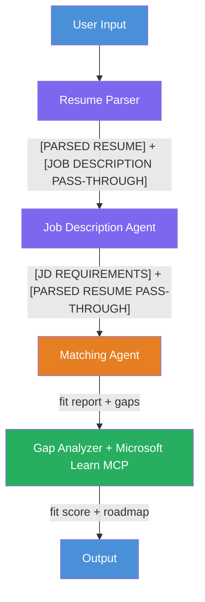

# प्रयोगशाळा 02 - मल्टि-एजंट कार्यप्रवाह: रिज्युमे → नोकरी योग्यतेचे मूल्यांकनकरता

## आढावा

या व्यवहारिक प्रयोगशाळेत, तुम्ही VS कोडमधील Foundry Toolkit वापरून एक **वर्कफ्लो-प्रथम मल्टि-एजंट अ‍ॅप** तयार कराल आणि त्याला Microsoft Foundry Agent Service वर तैनात कराल.

**तुम्ही जे तयार कराल:** एक रिज्युमे → नोकरी योग्यतेचे मूल्यांकनकरता जे रिज्युमे आणि नोकरीचे वर्णन पार्स करेल, जुळणारे स्कोअर देईल, आणि Microsoft Learn संसाधने वापरून वैयक्तिकृत शिकण्याचा रोडमॅप तयार करेल.

---

## वास्तुकला

**हे कसे कार्य करते:**
1. वापरकर्ता एक रिज्युमे आणि नोकरीचे वर्णन पेस्ट करतो.
2. **ResumeParser** रिज्युमे पार्स करतो आणि JD अक्षरशः एका `[JOB DESCRIPTION PASS-THROUGH]` विभागात कॉपी करतो.
3. **JD Agent** पास-थ्रू मधून संरचित गरजा काढतो, नंतर `[PARSED RESUME]` पुढे `[PARSED RESUME PASS-THROUGH]` म्हणून पाठवतो.
4. **MatchingAgent** `[PARSED RESUME PASS-THROUGH]` विरुद्ध `[JD REQUIREMENTS]` ची तुलना करून फिट स्कोअर तयार करतो.
5. **GapAnalyzer** गॅप्सना व्यावहारिक रोडमॅपमध्ये रूपांतरित करतो आणि MCP द्वारे वास्तविक Microsoft Learn लिंक शोधतो.

---

## पूर्वअट

प्रथम Lab 01 पूर्ण करा:

- [Lab 01 - Single Agent](../lab01-single-agent/README.md)

---

## भाग 1: क्रमाने मॉड्यूल वाचा

पूर्ण शिकण्याची मार्गदर्शिका येथे पहा:

- [Lab 2 Docs - Prerequisites](docs/00-prerequisites.md)
- [Lab 2 Docs - Full Learning Path](docs/README.md)
- [PersonalCareerCopilot run guide](PersonalCareerCopilot/README.md)

---

## भाग 2: वर्कफ्लो तयार करा आणि तपासा

1. Foundry Toolkit विजार्ड वापरून वर्कफ्लो-आधारित प्रकल्प तयार करा.
2. आपल्या वर्कस्पेसमध्ये `PersonalCareerCopilot/main.py` मधून प्रॉम्प्ट ब्लॉक्स आणि वर्कफ्लो ग्राफ कॉपी करा.
3. Agent Inspector सह स्थानिकपणे चालवा आणि सर्व चार एजंट्स तसेच MCP टूल यांची पडताळणी करा.
4. स्थानिक तपासणी उत्तीर्ण झाल्यावर होस्टेड एजंट Foundry वर तैनात करा.

---

## ऑर्केस्ट्रेशन पॅटर्न

Lab 02 मध्ये एक **अनुक्रमिक पाइपलाइन** वापरली आहे: प्रत्येक एजंटची आउटपुट पुढील एजंटला देते, आणि वर्कफ्लो शेवटच्या एजंटचा प्रतिसाद परत करते. दोन पॅटर्न हे शक्य करतात:

- **अनुक्रमिक साखळी** - `WorkflowBuilder` वापरून ResumeParser → JD Agent → MatchingAgent → GapAnalyzer यांना प्रत्येक टप्प्यावर एक `add_edge()` कॉलने जोडले आहे
- **सामग्री प्रसारण** - कारण प्रत्येक एजंट फक्त थेट मागील एजंटचे आउटपुट पाहतो, ResumeParser आणि JD Agent आवश्यक डेटा लेबल केलेल्या पास-थ्रू विभागांमध्ये खालील एजंट्ससाठी कॉपी करतात

डॉक्युमेंट्समध्ये हे देखील स्पष्ट केले आहे की प्रयोगशाळा फॅन-आउट/फॅन-इन वापरत नाही, आणि कसे आणखी एका एजंटसह ग्राफ वाढवायचा.

पहा [docs/04-orchestration-patterns.md](docs/04-orchestration-patterns.md).

---

**मागील:** [Lab 01 - Single Agent](../lab01-single-agent/README.md) · **परत जाण्यासाठी:** [Workshop Home](../../README.md)

---

<!-- CO-OP TRANSLATOR DISCLAIMER START -->
**अस्वीकरण**:
हा दस्तऐवज AI भाषांतर सेवा [Co-op Translator](https://github.com/Azure/co-op-translator) चा वापर करून अनुवादित केला आहे. जरी आम्ही अचूकतेसाठी प्रयत्न करतो, तरी कृपया लक्षात घ्या की स्वयंचलित भाषांतरांमध्ये त्रुटी किंवा अचूकतेची कमतरता असू शकते. मूळ दस्तऐवज त्याच्या मूळ भाषेत अधिकृत स्रोत मानला पाहिजे. महत्त्वाची माहिती असल्यास, व्यावसायिक मानवी भाषांतराची शिफारस केली जाते. या भाषांतराच्या वापरामुळे उद्भवणाऱ्या कोणत्याही गैरसमज किंवा चुकीच्या अर्थलावणीसाठी आम्ही जबाबदार नाही.
<!-- CO-OP TRANSLATOR DISCLAIMER END -->