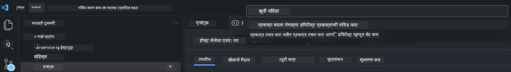

# मॉड्यूल 0 - परिचय

⏱️ ~10 मिनिटे

> [!WARNING]
> **पूर्वावलोकन आणि मर्यादा:** [Hosted Agents](https://learn.microsoft.com/azure/foundry/agents/concepts/hosted-agents) सध्या **सार्वजनिक पूर्वावलोकन** मध्ये आहेत - उत्पादनांच्या कामांसाठी शिफारस नाही. या कार्यशाळेत दाखवलेल्या काही वैशिष्ट्यांमध्ये सेवा GA कडे सरकताना बदल होऊ शकतात.

## तुम्ही काय तयार करणार आहात

या लॅबमध्ये, तुम्ही Lab 01 मधील एकत्रित एजंट कौशल्ये वाढवून एक **मल्टी-एजंट वर्कफ्लो** तयार कराल - Resume → नौकरी सादृश्यता मूल्यमापनकर्ता.

तुम्ही एक **रिज्युमे** आणि एक **नोकरी वर्णन** पेस्ट करता. चार विशेष एजंट्स क्रमाने इनपुट प्रक्रिया करतात, नंतर परत करतात:
- एक सादृश्यतेचा स्कोअर (0–100 व त्याचा स्कोअर तपशील)
- कौशल्य व प्रमाणपत्रातील अंतरांची यादी
- प्रत्येक अंतरासाठी वास्तविक Microsoft Learn दुव्यांसहित वैयक्तिकृत शिक्षण रोडमॅप

**वर्कफ्लो वापरतो:**
- **Microsoft Agent Framework** - `WorkflowBuilder` साठी सतत पाईपलाइन समन्वय
- **Foundry Toolkit for VS Code** - स्कॅफोल्ड, स्थानिक चाचणी, तैनात करणे
- **एक AI मॉडेल** (उदा. `gpt-4.1-mini`) - सर्व चार एजंटद्वारे वापरले जाते
- **Microsoft Learn MCP server** - प्रत्येक कौशल्य अंतरासाठी वास्तविक शिक्षण संसाधन दुवे पुरवते

---

## आपला मार्ग निवडा

> ⚠️ **Lab 01 मध्ये वापरलेला तसा मार्ग वापरून पुढे जा.**

<details open>
<summary><strong>🅰️ मार्ग A - Azure क्लाउड (Azure सदस्यता आवश्यक)</strong></summary>

| | तपशील |
|---|---|
| **हे कोणासाठी आहे?** | तुम्ही Azure सदस्यता वापरून Lab 01 पूर्ण केला आहे |
| **मॉडेल** | Foundry द्वारे Azure OpenAI (उदा. `gpt-4.1-mini`) |
| **आच्छादित मॉड्यूल्स** | सर्व मॉड्यूल (00–09) |
| **क्लाउडवर तैनात करायचे?** | ✅ होय - पूर्ण एंड-टू-एंड तैनाती |

</details>

<details open>
<summary><strong>🅱️ मार्ग B - Foundry Local (Azure सदस्यता आवश्यक नाही)</strong></summary>

| | तपशील |
|---|---|
| **हे कोणासाठी आहे?** | तुम्ही Foundry Local वापरून Lab 01 पूर्ण केला आहे |
| **मॉडेल** | Foundry Local (फ्री, तुमच्या मशीनवर चालते) |
| **आच्छादित मॉड्यूल्स** | मॉड्यूल 00–05 (06–07 स्किप करा - तैनात व क्लाउड तपासणी) |
| **क्लाउडवर तैनात करायचे?** | ❌ नाही - फक्त स्थानिक चाचणी Agent Inspector द्वारे |

</details>

---

## Lab 01 तपासणी

Lab 02 थेट Lab 01 वर आधारित आहे. येथे सुरू करण्यापूर्वी Lab 01 पूर्ण करा.

Lab 01 अजून केलेले नाही का? येथे प्रारंभ करा: [Lab 01 - परिचय](../../lab01-single-agent/docs/00-prerequisites.md)

<details open>
<summary><strong>🅰️ मार्ग A - Azure क्लाउड</strong></summary>

```powershell
az account show --query "{name:name, id:id}" --output table
```

जर हे अयशस्वी झाले, तर `az login` चालवा. नंतर VS Code मध्ये पडताळणी करा:

1. `Ctrl+Shift+P` → टाइप करा **Foundry Toolkit** → कमांड दिसल्याची पुष्टी करा.
2. **Foundry Toolkit** आयकॉनवर क्लिक करा → तुमचा प्रोजेक्ट आणि तैनात मॉडेल **Succeeded** दाखवतात.



> **RBAC:** तुम्ही Lab 01 मध्ये **Foundry User** नियुक्त केले होते. पुन्हा नियुक्त करण्याची गरज असल्यास, पहा [Lab 01, Module 1](../../lab01-single-agent/docs/01-setup.md#deploy-a-model--assign-rbac). भूमिका पूर्वी **Azure AI User** नावाने होती - परवानग्या समान आहेत.

</details>

<details open>
<summary><strong>🅱️ मार्ग B - Foundry Local</strong></summary>

```powershell
Invoke-WebRequest -Uri "http://localhost:5273/v1/health" -UseBasicParsing | Select-Object StatusCode
```

अपेक्षित: `StatusCode: 200`. नसेल तर, Foundry Toolkit साइडबारमधून Foundry Local रीस्टार्ट करा.

> सर्व अनुमान तुमच्या मशीनवर चालतात. एकमेव बाह्य कॉल MCP टूल कडे आहे जे `https://learn.microsoft.com/api/mcp` ला होतो.

</details>

---

## Lab 02 मध्ये काय नवीन आहे

| | Lab 01 | Lab 02 |
|--|--------|--------|
| एजंट्स | 1 | 4 (WorkflowBuilder सह साखळीबद्ध) |
| स्कॅफोल्ड टेंप्लेट | बेसिक - Agent Framework | वर्कफ्लोज - Agent Framework |
| नवीन पॅकेज | - | `mcp` |
| समन्वय | सिंगल संभाषण एजंट | साखळी पाईपलाइन (WorkflowBuilder) |
| नवीन साधन | - | `search_microsoft_learn_for_plan` (MCP) |

---

**पुढे:** [01 - आर्किटेक्चर समजून घ्या →](01-understand-multi-agent.md)

---

<!-- CO-OP TRANSLATOR DISCLAIMER START -->
**अस्वीकरण**:
हा दस्तऐवज AI भाषांतर सेवा [Co-op Translator](https://github.com/Azure/co-op-translator) चा वापर करून अनुवादित केला आहे. जरी आम्ही अचूकतेसाठी प्रयत्न करतो, तरी कृपया लक्षात घ्या की स्वयंचलित भाषांतरांमध्ये त्रुटी किंवा अचूकतेची कमतरता असू शकते. मूळ दस्तऐवज त्याच्या मूळ भाषेत अधिकृत स्रोत मानला पाहिजे. महत्त्वाची माहिती असल्यास, व्यावसायिक मानवी भाषांतराची शिफारस केली जाते. या भाषांतराच्या वापरामुळे उद्भवणाऱ्या कोणत्याही गैरसमज किंवा चुकीच्या अर्थलावणीसाठी आम्ही जबाबदार नाही.
<!-- CO-OP TRANSLATOR DISCLAIMER END -->